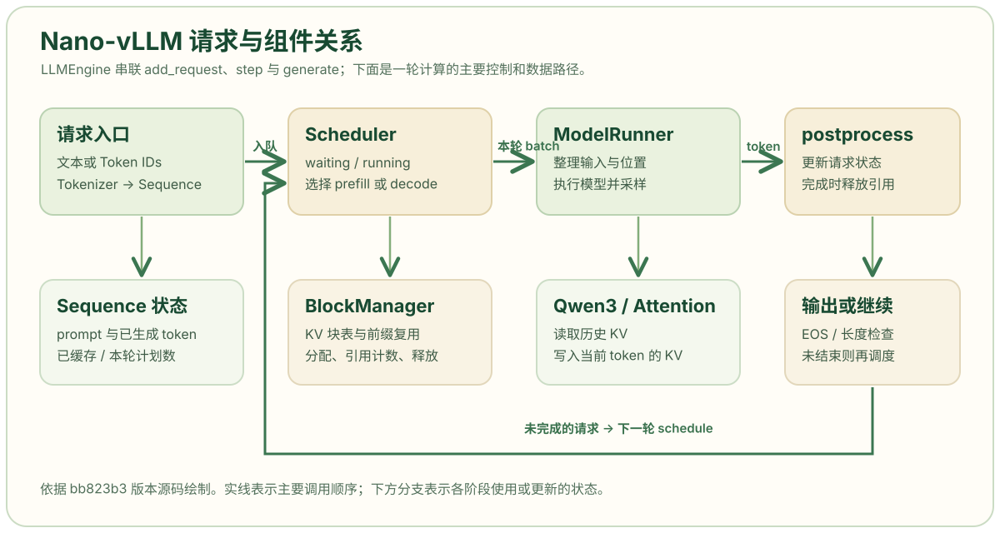

# Nano-vLLM 项目概览与源码阅读路径

Nano-vLLM 是一个体量较小的语言模型推理引擎实现。本系列以 [Nano-vLLM 提交 `bb823b3`](https://github.com/GeeeekExplorer/nano-vllm/tree/bb823b3e06983d71485a8e1f23715ebd87d98ef8) 为阅读基准，沿着一次请求的运行路径理解请求状态、调度、KV Cache 和模型执行。第一章建立组件关系；第二章与第三章分别阅读 `llm_engine.py` 和 `sequence.py` 的完整注释代码。

## 项目定位与阅读范围

语言模型给定 token 序列，计算下一个 token 的得分；**推理引擎**还要管理多个请求：何时把请求送进模型、哪些请求共用一次计算、已计算的注意力状态保存在哪里，以及请求结束后怎样释放资源。Nano-vLLM 在一个较小的代码库里展示这些职责，并使用 Qwen3 模型、前缀缓存、张量并行和 CUDA Graph 等实现。[项目 README](https://github.com/GeeeekExplorer/nano-vllm/blob/bb823b3e06983d71485a8e1f23715ebd87d98ef8/README.md)

当前对外的 `LLM.generate()` 是**离线批量接口**：它先将本次调用传入的所有 prompt 加入等待队列，再循环执行，最后一次性返回结果。它适合学习批处理和吞吐；若要研究错峰到达请求的首 token 延迟，还需要另写到达时间回放和逐请求事件记录。[`LLMEngine.generate()` 源码](https://github.com/GeeeekExplorer/nano-vllm/blob/bb823b3e06983d71485a8e1f23715ebd87d98ef8/nanovllm/engine/llm_engine.py)

## 组件思维导图

图是依据本系列所读版本绘制的结构示意。横向箭头表示一次计算的主要数据流；下方分支标出调度器使用的 KV 块管理，以及模型执行器使用的 Qwen3、Attention 和 GPU KV 张量。生成一个 token 后，请求若尚未结束，会回到下一轮调度，而不是重新创建模型。

这条路径可按一次请求展开：

1. `LLMEngine.add_request()` 将文本分词，创建 `Sequence`，放进调度器的 `waiting` 队列。调用者若已经提供 token ID 列表，就跳过分词。[入口源码](https://github.com/GeeeekExplorer/nano-vllm/blob/bb823b3e06983d71485a8e1f23715ebd87d98ef8/nanovllm/engine/llm_engine.py)
2. `Scheduler.schedule()` 选择本轮要运行的请求，决定是处理 prompt 的 **prefill**，还是让运行中请求继续生成的 **decode**。它通过 `BlockManager` 查询、分配和释放 KV 块。[调度器源码](https://github.com/GeeeekExplorer/nano-vllm/blob/bb823b3e06983d71485a8e1f23715ebd87d98ef8/nanovllm/engine/scheduler.py)
3. `ModelRunner.run()` 按本轮阶段准备 token、位置和 KV 映射，调用 Qwen3 前向计算并采样一个 token。**KV Cache** 保存注意力层已经算出的 Key 和 Value，后续 decode 能读取历史状态。[执行器源码](https://github.com/GeeeekExplorer/nano-vllm/blob/bb823b3e06983d71485a8e1f23715ebd87d98ef8/nanovllm/engine/model_runner.py)
4. `Scheduler.postprocess()` 把采样结果追加到请求，检查结束条件；完成的请求解除对 KV 块的引用，未完成的请求继续参加后续轮次。[后处理源码](https://github.com/GeeeekExplorer/nano-vllm/blob/bb823b3e06983d71485a8e1f23715ebd87d98ef8/nanovllm/engine/scheduler.py)

## 关键状态与模块边界

| 对象 | 保存或处理的内容 | 阅读时关注的接口 |
| --- | --- | --- |
| `LLMEngine` | 分词器、执行器和调度器；驱动生成循环 | `add_request()`、`step()`、`generate()` |
| `Sequence` | 一个请求的 prompt、生成 token、状态和块表 | `num_tokens`、`num_cached_tokens`、`append_token()` |
| `Scheduler` | 等待与运行队列；决定本轮 batch | `schedule()`、`postprocess()` |
| `BlockManager` | 物理 KV 块编号、前缀哈希和引用计数 | `can_allocate()`、`allocate()`、`deallocate()` |
| `ModelRunner` | 模型权重、GPU KV 张量、本轮输入整理与采样 | `prepare_prefill()`、`prepare_decode()`、`run()` |

`Sequence` 的三个计数需要分开：`num_tokens` 是当前序列中的 token 总数；`num_cached_tokens` 是已经完成模型计算、其 KV 可供后续使用的 token 数；`num_scheduled_tokens` 是本轮计划计算的 token 数。举例说，prompt `[A,B,C]` 完成 prefill 并采样出 `D` 后，序列已有 4 个 token，但只有前 3 个完成了 KV 计算；下一轮 decode 才把 `D` 当作模型输入。[`Sequence` 源码](https://github.com/GeeeekExplorer/nano-vllm/blob/bb823b3e06983d71485a8e1f23715ebd87d98ef8/nanovllm/engine/sequence.py)

## 源码阅读顺序

阅读顺序按对象依赖安排，而非按目录字母顺序。每一步都能回答一个具体问题，再进入下一步。

1. [`example.py`](https://github.com/GeeeekExplorer/nano-vllm/blob/bb823b3e06983d71485a8e1f23715ebd87d98ef8/example.py) 和 [`llm_engine.py`](https://github.com/GeeeekExplorer/nano-vllm/blob/bb823b3e06983d71485a8e1f23715ebd87d98ef8/nanovllm/engine/llm_engine.py)：找到对外入口、请求何时入队，以及一次 `step()` 的调用顺序。下一章详细解释这一段。
2. [`sequence.py`](https://github.com/GeeeekExplorer/nano-vllm/blob/bb823b3e06983d71485a8e1f23715ebd87d98ef8/nanovllm/engine/sequence.py)：确认请求状态怎样随 prefill、decode 和完成而变化；本站[第 3 章](03-sequence.html)给出完整注释代码。
3. [`scheduler.py`](https://github.com/GeeeekExplorer/nano-vllm/blob/bb823b3e06983d71485a8e1f23715ebd87d98ef8/nanovllm/engine/scheduler.py) 与 [`block_manager.py`](https://github.com/GeeeekExplorer/nano-vllm/blob/bb823b3e06983d71485a8e1f23715ebd87d98ef8/nanovllm/engine/block_manager.py)：解释本轮选择和 KV 资源约束。以调度优化为目标时，这是最先需要读透的两份文件。
4. [`model_runner.py`](https://github.com/GeeeekExplorer/nano-vllm/blob/bb823b3e06983d71485a8e1f23715ebd87d98ef8/nanovllm/engine/model_runner.py)：追踪选中的请求怎样变成 GPU 输入，以及块编号怎样变成 Attention 可读的映射。
5. [`context.py`](https://github.com/GeeeekExplorer/nano-vllm/blob/bb823b3e06983d71485a8e1f23715ebd87d98ef8/nanovllm/utils/context.py)、[`attention.py`](https://github.com/GeeeekExplorer/nano-vllm/blob/bb823b3e06983d71485a8e1f23715ebd87d98ef8/nanovllm/layers/attention.py) 和 [`qwen3.py`](https://github.com/GeeeekExplorer/nano-vllm/blob/bb823b3e06983d71485a8e1f23715ebd87d98ef8/nanovllm/models/qwen3.py)：理解本轮元数据、KV 写入和模型前向。初读时先看输入输出，随后再追具体算子。
6. [`bench.py`](https://github.com/GeeeekExplorer/nano-vllm/blob/bb823b3e06983d71485a8e1f23715ebd87d98ef8/bench.py)：核对现有基准的请求分布和计时范围，再设计自己需要的在线负载。

## 本系列的验证边界

本文解释的是指定提交中的代码路径。图中的模块关系和上面的 `[A,B,C] → D` 算例用于理解实现，并非性能实测结果。完成前两篇代码解析后，可以用两个短请求手工记录每轮的 `waiting`、`running`、`num_cached_tokens` 和 `is_prefill`；这些状态比只看最终生成文本更能检验自己是否理解了引擎。
