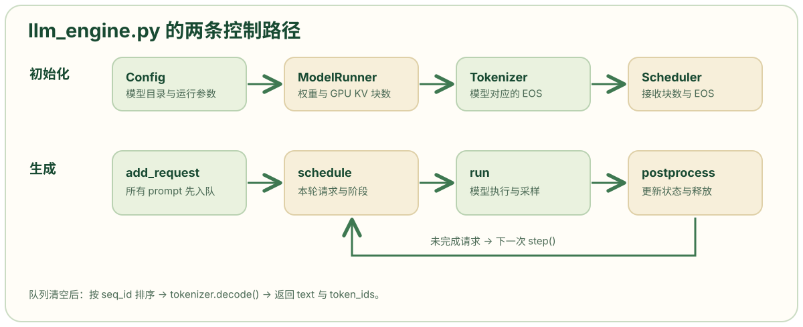

# llm_engine.py: 初始化推理组件并驱动请求生成

```python
# 引入进程退出回调，用于程序正常结束时清理执行器资源。
import atexit
# fields(Config) 返回 Config 声明的字段，供 __init__ 筛选 kwargs。
from dataclasses import fields
# 使用适合测量短时间间隔的单调计时器，为进度条显示每轮速度。
from time import perf_counter
# 引入终端或笔记本环境可用的进度条。
from tqdm.auto import tqdm
# 复用模型目录中的分词器。
from transformers import AutoTokenizer
# 使用 PyTorch 的多进程接口。单卡路径不会启动额外的模型 worker，但仍会创建进程上下文。
import torch.multiprocessing as mp

# 导入引擎级配置。
from nanovllm.config import Config
# 导入每个请求的生成参数类型。
from nanovllm.sampling_params import SamplingParams
# 导入请求状态类。
from nanovllm.engine.sequence import Sequence
# 导入决定本轮运行哪些请求的调度器。
from nanovllm.engine.scheduler import Scheduler
# 导入持有模型和 GPU KV 张量的执行器。
from nanovllm.engine.model_runner import ModelRunner


# 定义所有引擎逻辑；对外的 LLM 子类直接继承它。
class LLMEngine:

    # model 是模型目录，其他命名参数通过 kwargs 传入，例如 enforce_eager=True。
    def __init__(self, model, **kwargs):
        # 用集合收集 Config 的字段名；只允许这些名字成为配置参数。
        config_fields = {field.name for field in fields(Config)}
        # 从 kwargs 中挑出 Config 认识的参数；其他键会被忽略，不会触发报错。
        config_kwargs = {k: v for k, v in kwargs.items() if k in config_fields}
        # 构造配置对象，触发 Config.__post_init__() 检查本地模型路径与读取模型配置。
        config = Config(model, **config_kwargs)
        # 把引擎 KV 块大小写入请求类的共享属性，让 Sequence.num_blocks 使用相同大小。
        Sequence.block_size = config.kvcache_block_size
        # 准备保存多卡 worker 进程与进程间同步事件；单卡时两者保持空列表。
        self.ps = []
        self.events = []
        # spawn 表示子进程从新的 Python 解释器启动，并自行初始化 CUDA；不会直接继承父进程已经初始化的 CUDA 状态。
        # get_context() 只取得这种启动方式对应的 Process/Event 工厂，此行尚未启动任何子进程。
        # 下面的 process.start() 才真正启动；单卡时 range(1, 1) 为空，不创建额外 worker。
        ctx = mp.get_context("spawn")
        # 只为 rank 1 到最后一个 rank 创建子进程；rank 0 在当前进程执行。单卡 tensor_parallel_size=1 时循环不进入。
        for i in range(1, config.tensor_parallel_size):
            # 每个额外 rank 有一个事件对象和一个 ModelRunner 进程，启动后保存起来，供之后发出运行指令和清理。
            event = ctx.Event()
            process = ctx.Process(target=ModelRunner, args=(config, i, event))
            process.start()
            self.ps.append(process)
            self.events.append(event)
        # 在当前进程创建 rank 0 执行器。它会加载权重、预热模型、计算并分配 KV 块；config.num_kvcache_blocks 在这个阶段被填入。
        self.model_runner = ModelRunner(config, 0, self.events)
        # 从同一模型目录加载分词器，use_fast=True 请求快速分词器实现。
        self.tokenizer = AutoTokenizer.from_pretrained(config.model, use_fast=True)
        # 把分词器给出的结束 token ID 写入引擎配置。
        config.eos = self.tokenizer.eos_token_id
        # 创建调度器。它此时能读到真实的 num_kvcache_blocks 和 eos；因此构造顺序不能随意倒过来。
        self.scheduler = Scheduler(config)
        # 注册资源清理回调，程序正常退出时调用 exit()。
        atexit.register(self.exit)

    # 定义退出时需要运行的资源清理过程。
    def exit(self):
        # 通知 rank 0 执行器退出；多卡时 call() 还会把退出消息发给其他 rank。
        self.model_runner.call("exit")
        # 删除当前引擎持有的执行器引用。
        del self.model_runner
        # 等待各子进程结束；单卡时列表为空。
        for p in self.ps:
            p.join()

    # 定义提交单个请求的方法，接受字符串或 token ID 列表。
    def add_request(self, prompt: str | list[int], sampling_params: SamplingParams):
        # 若是字符串，则由当前模型分词器编码成 token ID；已经传入 ID 列表时跳过分词。
        if isinstance(prompt, str):
            prompt = self.tokenizer.encode(prompt)
        # 为该请求创建状态对象和内部 seq_id。
        seq = Sequence(prompt, sampling_params)
        # 将请求放进调度器的等待队列。当前方法没有返回 seq 或 seq_id。
        self.scheduler.add(seq)

    # 定义一次调度和模型计算。一个 step() 可能处理多个请求，但只选择 prefill 或 decode 其中一种路径。
    def step(self):
        # 调度器返回本轮请求列表和路径标记，同时可能已经改变队列和分配 KV 块。
        seqs, is_prefill = self.scheduler.schedule()
        # Prefill 时求各请求本轮计划计算 token 数之和，返回正数；decode 时返回请求数的负值。这个带符号值供进度条区分两类速度，不等于本轮“已生成 token 数”。
        num_tokens = sum(seq.num_scheduled_tokens for seq in seqs) if is_prefill else -len(seqs)
        # 让执行器准备输入、执行模型并采样；返回列表中每个请求本轮的 token ID。多卡时 call() 还负责把方法名和参数发给其他 rank。
        token_ids = self.model_runner.call("run", seqs, is_prefill)
        # 根据计算和采样结果更新每个请求的缓存进度、token 列表、结束状态和 KV 块引用。
        self.scheduler.postprocess(seqs, token_ids, is_prefill)
        # 只收集本轮已经 FINISHED 的请求，元素是 (seq_id, completion_token_ids)。运行中的请求即使刚产生首 token，也不会出现在这里。
        outputs = [(seq.seq_id, seq.completion_token_ids) for seq in seqs if seq.is_finished]
        # 返回本轮已完成的请求，以及用正负号标识 prefill/decode 的工作量。
        return outputs, num_tokens

    # 直接询问调度器是否两个队列都空；这个名字表示本次已提交批次全部结束。
    def is_finished(self):
        return self.scheduler.is_finished()

    # prompts 是本次请求列表；sampling_params 是共享或逐请求参数；use_tqdm 控制进度条。
    def generate(
        self,
        prompts: list[str] | list[list[int]],
        sampling_params: SamplingParams | list[SamplingParams],
        use_tqdm: bool = True,
    ) -> list[str]:
        # 用请求个数作为进度条目标；每完成一个请求更新一次。
        pbar = tqdm(total=len(prompts), desc="Generating", dynamic_ncols=True, disable=not use_tqdm)
        # 若 sampling_params 是单个对象，就让每个 prompt 使用这组温度、长度和 EOS 参数。
        if not isinstance(sampling_params, list):
            sampling_params = [sampling_params] * len(prompts)
        # zip(prompts, sampling_params) 按位置配对：第 1 个 prompt 配第 1 组参数，第 2 个配第 2 组，依次产生 (prompt, sp)。
        # add_request(prompt, sp) 将字符串 prompt 分词（若已是 token ID 列表则直接使用），创建 Sequence，再放入 scheduler.waiting。
        # 循环依次把每对 prompt、参数加入等待队列；循环结束后 while 才开始模型计算。
        for prompt, sp in zip(prompts, sampling_params):
            self.add_request(prompt, sp)
        # 用内部 seq_id 作键收集完成结果，避免完成顺序与输入顺序不同造成错位。
        outputs = {}
        # 分别记录最近一轮 prefill 与 decode 的 token/s，供进度条显示。
        prefill_throughput = decode_throughput = 0.
        # 只要等待队列或运行队列仍有请求，就继续运行一轮。
        while not self.is_finished():
            # 在本轮 step() 前记下 CPU 计时点。
            t = perf_counter()
            # 执行一次调度、模型推理与后处理。当前调用会阻塞到 step() 返回。
            output, num_tokens = self.step()
            # 正数视为 prefill，负数视为 decode；用该轮工作量除以计时间隔，更新对应吞吐显示。这里不是逐请求 TTFT/TPOT。
            if num_tokens > 0:
                prefill_throughput = num_tokens / (perf_counter() - t)
            else:
                decode_throughput = -num_tokens / (perf_counter() - t)
            # 把最近的两种吞吐数字放到进度条后面。
            pbar.set_postfix({
                "Prefill": f"{int(prefill_throughput)}tok/s",
                "Decode": f"{int(decode_throughput)}tok/s",
            })
            # 对本轮完成的每个请求，以 seq_id 保存 token 列表，并使进度条完成数加 1。
            for seq_id, token_ids in output:
                outputs[seq_id] = token_ids
                pbar.update(1)
        # 全部请求完成后关闭进度条。
        pbar.close()
        # 按请求 ID 顺序恢复输出。即使 warmup 让 ID 不从 0 开始，相对顺序仍对应提交顺序。
        outputs = [outputs[seq_id] for seq_id in sorted(outputs.keys())]
        # 把每个请求的生成 token 列表解码为文本，同时保留原 token ID；最终每项是含 text、token_ids 两个键的字典。
        outputs = [{"text": self.tokenizer.decode(token_ids), "token_ids": token_ids} for token_ids in outputs]
        # 将按提交顺序排列的最终结果一次性返回。
        return outputs
```

## 文件职责与调用边界

```python
def step(self):
    seqs, is_prefill = self.scheduler.schedule()
    num_tokens = sum(seq.num_scheduled_tokens for seq in seqs) if is_prefill else -len(seqs)
    token_ids = self.model_runner.call("run", seqs, is_prefill)
    self.scheduler.postprocess(seqs, token_ids, is_prefill)
    outputs = [(seq.seq_id, seq.completion_token_ids) for seq in seqs if seq.is_finished]
    return outputs, num_tokens
```

`LLMEngine` 接收请求、调用调度器选择本轮请求，再让模型执行器计算并交回结果。`add_request()` 把一个请求放进队列；`step()` 执行一轮。这两个方法只负责连接组件：具体的请求选择在 `Scheduler`，模型前向计算在 `ModelRunner`。对外的 [`LLM` 类](https://github.com/GeeeekExplorer/nano-vllm/blob/bb823b3e06983d71485a8e1f23715ebd87d98ef8/nanovllm/llm.py) 直接继承 `LLMEngine`。



图沿着文件中的两个主要方法展开：上方是 `__init__()` 的一次性初始化，下方是 `generate()` 驱动的多轮计算。箭头表示调用先后；模型内部前向与 KV 块操作由其他模块负责。

调用者把模型目录和配置参数传给 `LLM(...)`，再把 prompt 与 `SamplingParams` 传给 `generate()`。这一版 `generate()` 先接收整批请求，最后一次性返回每个请求的生成结果；`step()` 是它反复调用的单轮接口。

## 初始化顺序与配置回填

```python
def __init__(self, model, **kwargs):
    config_fields = {field.name for field in fields(Config)}
    config_kwargs = {k: v for k, v in kwargs.items() if k in config_fields}
    config = Config(model, **config_kwargs)
    Sequence.block_size = config.kvcache_block_size
    self.ps = []
    self.events = []
    ctx = mp.get_context("spawn")
    for i in range(1, config.tensor_parallel_size):
        event = ctx.Event()
        process = ctx.Process(target=ModelRunner, args=(config, i, event))
        process.start()
        self.ps.append(process)
        self.events.append(event)
    self.model_runner = ModelRunner(config, 0, self.events)
    self.tokenizer = AutoTokenizer.from_pretrained(config.model, use_fast=True)
    config.eos = self.tokenizer.eos_token_id
    self.scheduler = Scheduler(config)
    atexit.register(self.exit)
```

`__init__(model, **kwargs)` 中，`model` 是本地模型目录；`kwargs` 中只有字段名属于 [`Config`](https://github.com/GeeeekExplorer/nano-vllm/blob/bb823b3e06983d71485a8e1f23715ebd87d98ef8/nanovllm/config.py) 的项会进入 `config_kwargs`。Python 的 `**config_kwargs` 把字典里的键值展开成命名参数；拼错的配置名会被此处过滤，当前实现不会为它报错。

接下来先创建 `ModelRunner(config, 0, self.events)`。它加载 Qwen3 权重、预热模型并根据显存计算 `config.num_kvcache_blocks`。然后 `AutoTokenizer.from_pretrained(config.model, use_fast=True)` 从同一个模型目录读取分词器，把 `eos_token_id` 写回 `config.eos`。最后才创建 `Scheduler(config)`，此时调度器才能取得真实的 KV 块数和结束 token ID。这里的“同一个目录”是调用 `LLM` 时传入的模型目录，里面的权重与 tokenizer 必须配套。[`ModelRunner` 初始化源码](https://github.com/GeeeekExplorer/nano-vllm/blob/bb823b3e06983d71485a8e1f23715ebd87d98ef8/nanovllm/engine/model_runner.py)

`Sequence.block_size = config.kvcache_block_size` 修改的是 `Sequence` 的类属性，使后续请求计算逻辑块数时使用引擎选择的块大小。`atexit.register(self.exit)` 则在进程正常退出时调用 `exit()`；`exit()` 先通知 worker 退出，再对保存于 `self.ps` 的子进程逐个 `join()`，等它们真正结束。

## 张量并行中的主进程和子进程

```python
ctx = mp.get_context("spawn")
for i in range(1, config.tensor_parallel_size):
    event = ctx.Event()
    process = ctx.Process(target=ModelRunner, args=(config, i, event))
    process.start()
    self.ps.append(process)
    self.events.append(event)
self.model_runner = ModelRunner(config, 0, self.events)
```

`rank` 是本次张量并行计算中各进程的编号。当前进程直接构造 rank 0 的 `ModelRunner`；循环 `range(1, config.tensor_parallel_size)` 只为 rank 1 及之后创建子进程。`mp.get_context("spawn")` 返回使用 spawn 启动方式的上下文；`ctx.Process(...)` 只是创建进程对象，`process.start()` 才启动它。`Event` 是父进程通知对应 worker 处理命令的信号，不是模型输出。[`ModelRunner.call()` 与消息路径](https://github.com/GeeeekExplorer/nano-vllm/blob/bb823b3e06983d71485a8e1f23715ebd87d98ef8/nanovllm/engine/model_runner.py)

单卡 `tensor_parallel_size=1` 时，`range(1,1)` 为空，因此没有额外子进程，`self.events` 也为空。多卡时，每个 worker 在对应 GPU 上计算模型的一部分；rank 0 还在本进程中负责调用入口与采样结果的汇集。这说明循环从 1 开始的原因：rank 0 并没有缺席，它是在循环后单独创建的。

## 请求入队与一次 step

```python
def add_request(self, prompt: str | list[int], sampling_params: SamplingParams):
    if isinstance(prompt, str):
        prompt = self.tokenizer.encode(prompt)
    seq = Sequence(prompt, sampling_params)
    self.scheduler.add(seq)

def step(self):
    seqs, is_prefill = self.scheduler.schedule()
    num_tokens = sum(seq.num_scheduled_tokens for seq in seqs) if is_prefill else -len(seqs)
    token_ids = self.model_runner.call("run", seqs, is_prefill)
    self.scheduler.postprocess(seqs, token_ids, is_prefill)
    outputs = [(seq.seq_id, seq.completion_token_ids) for seq in seqs if seq.is_finished]
    return outputs, num_tokens
```

`add_request(prompt, sampling_params)` 的输入是一个字符串或 token ID 列表，以及该请求的采样设置。字符串先用当前模型的 tokenizer 编码；列表已经是 token ID，直接使用。函数随后创建一个 [`Sequence`](https://github.com/GeeeekExplorer/nano-vllm/blob/bb823b3e06983d71485a8e1f23715ebd87d98ef8/nanovllm/engine/sequence.py)，通过 `scheduler.add(seq)` 放进 `waiting` 队列。**入队不等于模型已经计算**：实际计算要等 `step()` 调度到它。

`step()` 的五个动作按依赖顺序排列：

1. `schedule()` 返回本轮选中的 `seqs` 和 `is_prefill`。`seqs` 是请求对象列表，`is_prefill=True` 表示本轮处理 prompt；`False` 表示本轮让这些请求各执行一步 decode。[`Scheduler.schedule()`](https://github.com/GeeeekExplorer/nano-vllm/blob/bb823b3e06983d71485a8e1f23715ebd87d98ef8/nanovllm/engine/scheduler.py)
2. `num_tokens` 记录本轮显示速度所需的工作量。prefill 使用选中请求的 `num_scheduled_tokens` 之和；decode 用 `-len(seqs)`，因为每个请求本轮处理一个 token。负号只是让后面的进度条识别 decode，模型没有计算“负 token”。
3. `ModelRunner.call("run", seqs, is_prefill)` 将本轮请求交给执行器，返回各请求采样出的 token ID。单卡直接调用本进程中的方法；多卡还会通知其他 rank 一起计算。
4. `scheduler.postprocess(...)` 根据返回的 token 更新计算进度、追加生成 token，并在结束时释放相应 KV 块。[`postprocess()`](https://github.com/GeeeekExplorer/nano-vllm/blob/bb823b3e06983d71485a8e1f23715ebd87d98ef8/nanovllm/engine/scheduler.py)
5. `outputs` 只收集本轮已经完成的请求。刚采样到首 token 但尚未完成的请求仍留在引擎里；`step()` 不把它们作为最终结果返回。

## generate 循环与结果顺序

```python
pbar = tqdm(total=len(prompts), desc="Generating", dynamic_ncols=True, disable=not use_tqdm)
if not isinstance(sampling_params, list):
    sampling_params = [sampling_params] * len(prompts)
for prompt, sp in zip(prompts, sampling_params):
    self.add_request(prompt, sp)
outputs = {}
prefill_throughput = decode_throughput = 0.
while not self.is_finished():
    t = perf_counter()
    output, num_tokens = self.step()
    if num_tokens > 0:
        prefill_throughput = num_tokens / (perf_counter() - t)
    else:
        decode_throughput = -num_tokens / (perf_counter() - t)
    pbar.set_postfix({
        "Prefill": f"{int(prefill_throughput)}tok/s",
        "Decode": f"{int(decode_throughput)}tok/s",
    })
    for seq_id, token_ids in output:
        outputs[seq_id] = token_ids
        pbar.update(1)
pbar.close()
outputs = [outputs[seq_id] for seq_id in sorted(outputs.keys())]
outputs = [{"text": self.tokenizer.decode(token_ids), "token_ids": token_ids} for token_ids in outputs]
return outputs
```

`generate(prompts, sampling_params)` 接受一组 prompt。如果 `sampling_params` 只有一个对象，就用 `[sampling_params] * len(prompts)` 为每个 prompt 配上同一组参数。之后 `zip(prompts, sampling_params)` 按位置给出一对 `(prompt, sp)`，循环中调用 `add_request(prompt, sp)`。例如两个 prompt 与两组参数会形成两对；若传入的两个列表本来长度不同，`zip` 到较短的一方结束，当前代码没有另外检查剩余项。

**所有请求在 `while not self.is_finished()` 开始前已经入队。** 循环每次调用一次 `step()`，用 `perf_counter()` 测这轮耗时，再利用 `num_tokens` 的符号分别显示 prefill 和 decode 的最近一轮速度。这些数字不是每个请求的首 token 延迟。完成请求先进入以 `seq_id` 为键的字典，最后按 `seq_id` 排序并由 tokenizer 解码，因此返回列表恢复了提交顺序。

源码的方法签名把返回类型标成 `list[str]`，实际返回项是包含 `text` 和 `token_ids` 的字典。阅读调用方时要按最后的返回语句判断真实数据结构。此处还有一个性能实验边界：现有 `generate()` 不会在请求到达的瞬间逐个流式返回 token；测在线请求的 TTFT，需要额外记录请求到达和首 token 事件。

## 与源码位置对应的两请求算例

```python
for prompt, sp in zip(prompts, sampling_params):
    self.add_request(prompt, sp)
outputs = {}
prefill_throughput = decode_throughput = 0.
while not self.is_finished():
    t = perf_counter()
    output, num_tokens = self.step()
```

以下例子用于核对 `generate()` 和 `step()` 的状态变化，并非性能实测。设两个短 prompt 都在 `generate()` 开头入队，`max_tokens=2`、`ignore_eos=True`，且一次 prefill 的 token 预算与 KV 块足够容纳两者。

| 对应位置 | 请求状态 | 本轮作用 |
| --- | --- | --- |
| `generate()` 的 `for prompt, sp in zip(...)` | A、B 先后进入 `waiting` | `add_request()` 创建两个 `Sequence`，尚未运行模型 |
| 第一次 `step()` 的 `schedule()` 与 `run()` | A、B 的 prompt 被安排处理 | 完整 prefill 后各采样首 token，`postprocess()` 把它们留在运行流程中 |
| 第二次 `step()` | A、B 各处理上轮采样的 token | 各产生第二个输出 token，达到 `max_tokens`，释放请求的块并进入本轮 `outputs` |
| `generate()` 末尾排序与解码 | 两个队列都为空 | 按 `seq_id` 恢复 A、B 的提交顺序，返回文本和 token ID |

这个算例依赖“完整 prompt 一轮处理完”和“未提前结束”两个条件。若 prompt 被切成多个 prefill chunk，或 KV 块不足导致等待和抢占，应该回到 `Scheduler.schedule()` 检查每轮实际选中了谁，而不能沿用表中固定的两轮结论。
