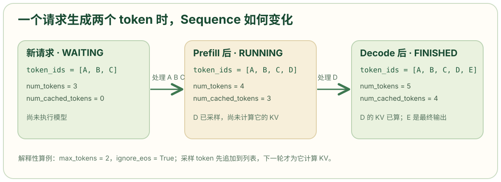

# sequence.py: 保存单个请求的生成状态与 KV 块视图

```python
# 引入浅拷贝函数。构造请求时复制输入 token 列表，使后续 append_token() 不改变调用者原来的列表。元素是整数，浅拷贝已经足够隔离列表本身。
from copy import copy
# Enum 用于定义有限的状态集合，auto() 给各状态自动分配内部值。状态名比具体数字重要。
from enum import Enum, auto
# count() 产生递增整数，用作进程内请求 ID。
from itertools import count

# SamplingParams 提供当前请求的温度、生成上限和是否忽略 EOS。
from nanovllm.sampling_params import SamplingParams


# SequenceStatus 限定一个请求只能处于等待、运行或完成状态。
class SequenceStatus(Enum):
    # 请求尚在等待可用计算或资源；包括尚未完成 prefill 的请求。
    WAITING = auto()
    # 完整 prompt 已被安排处理，接下来可进入 decode。调度器在完成 prefill 的调度阶段就会把状态改为 RUNNING，早于该轮 GPU 计算真正结束。
    RUNNING = auto()
    # 到达 EOS 或生成长度上限后不再参与调度。
    FINISHED = auto()


# 一个 Sequence 保存一个请求的 token、调度状态和 KV 块编号。
class Sequence:
    # 类级默认 KV 块大小；LLMEngine.__init__() 会把它改成当前引擎配置的 kvcache_block_size。因此所有 Sequence 实例在同一进程内共享这个类属性。
    block_size = 256
    # 类级 ID 生成器。每次构造 Sequence 都前进一步；模型 warmup 也构造临时 Sequence，因此第一个正式请求的 ID 不一定是 0。
    counter = count()

    # token_ids 是非空的 prompt ID 列表；sampling_params 是该请求的采样设置。默认参数对象创建一次，本类只读取它。
    def __init__(self, token_ids: list[int], sampling_params = SamplingParams()):
        # 为这个请求取一个新的整数 ID。这个 ID 之后用于将完成结果恢复到输入顺序。
        self.seq_id = next(Sequence.counter)
        # 新请求先处于等待状态。
        self.status = SequenceStatus.WAITING
        # 保存输入 token 列表的副本。以后生成的 token 也会追加到同一列表。
        self.token_ids = copy(token_ids)
        # 保存当前最后一个 token，供 decode 每轮直接取用。新请求刚创建时它是 prompt 的最后一个 token。
        self.last_token = token_ids[-1]
        # 当前列表总长度；生成过程中会递增。
        self.num_tokens = len(self.token_ids)
        # 固定记录最初 prompt 的长度；靠它区分 prompt 与生成结果。
        self.num_prompt_tokens = len(token_ids)
        # 尚没有 token 完成模型计算并成为可用 KV；命中前缀缓存时会直接增加。这个计数表示计算进度，不只是前缀命中的长度。
        self.num_cached_tokens = 0
        # 本轮安排送入模型计算的 token 数；调度前是 0，后处理结束后回到 0。
        self.num_scheduled_tokens = 0
        # 初始处于 prompt 处理阶段。进入 decode 时调度器会把它改为 False；抢占后可重新变成 True。
        self.is_prefill = True
        # 本请求使用的物理 KV 块编号列表，按 token 的逻辑顺序排列。创建时尚未分配块。
        self.block_table = []
        # 把温度复制到请求，方便执行器按请求组成采样参数张量。
        self.temperature = sampling_params.temperature
        # 把最大生成长度复制到请求，供后处理判断是否结束。
        self.max_tokens = sampling_params.max_tokens
        # 把是否忽略 EOS 的设置复制到请求。
        self.ignore_eos = sampling_params.ignore_eos

    # 让 len(seq) 返回 seq.num_tokens，方便调度器和执行器用普通 Python 长度语法。
    def __len__(self):
        return self.num_tokens

    # 让 seq[start:end] 等价于对内部 token_ids 列表切片。执行器准备 prefill 输入时用到它。
    def __getitem__(self, key):
        return self.token_ids[key]

    # @property 让调用者写 seq.is_finished；返回状态是否为 FINISHED。这是查询，不改变状态。
    @property
    def is_finished(self):
        return self.status == SequenceStatus.FINISHED

    # 当前总 token 数减去原 prompt 长度，得到已采样的生成 token 数。
    @property
    def num_completion_tokens(self):
        return self.num_tokens - self.num_prompt_tokens

    # 返回从开头到原 prompt 边界的列表切片；生成过程中这部分保持不变。
    @property
    def prompt_token_ids(self):
        return self.token_ids[:self.num_prompt_tokens]

    # 返回原 prompt 边界之后的 token；完成时它就是要解码成输出文本的部分。
    @property
    def completion_token_ids(self):
        return self.token_ids[self.num_prompt_tokens:]

    # 用向上取整公式计算当前序列需要多少 KV 块：(num_tokens + block_size - 1) // block_size。在默认块大小 256 下，长度 256 需要 1 块，长度 257 需要 2 块。
    @property
    def num_blocks(self):
        return (self.num_tokens + self.block_size - 1) // self.block_size

    # 计算最后一个逻辑块当前包含多少 token。例如长度 257、块大小 256 时，最后一块包含 1 个 token。
    @property
    def last_block_num_tokens(self):
        return self.num_tokens - (self.num_blocks - 1) * self.block_size

    # 先确认块序号有效，再返回第 i 块对应的 token ID 切片。这里拿到的是逻辑 token 内容，不是 GPU KV 张量。
    def block(self, i):
        assert 0 <= i < self.num_blocks
        return self.token_ids[i*self.block_size: (i+1)*self.block_size]

    # 把本轮采样结果追加到列表，更新 last_token 和 num_tokens。这一步尚未给新 token 计算 K/V；下一轮 decode 才会使用它。
    def append_token(self, token_id: int):
        self.token_ids.append(token_id)
        self.last_token = token_id
        self.num_tokens += 1

    # __getstate__ 把多卡 worker 运行所需的长度、缓存进度、块表和 token 状态打包。
    def __getstate__(self):
        # Prefill 需要输入 token 列表，因此传完整 token_ids；decode 每个请求只输入最后一个 token，因此只传 last_token。
        last_state = self.last_token if not self.is_prefill else self.token_ids
        # 按固定顺序传送总长度、prompt 长度、已缓存数量、本轮计划数量、块表和 token 状态。
        return (self.num_tokens, self.num_prompt_tokens, self.num_cached_tokens, self.num_scheduled_tokens, self.block_table, last_state)

    # __setstate__ 从 __getstate__ 的元组恢复 worker 本轮计算需要的请求字段。
    def __setstate__(self, state):
        # 把元组的前五项还原到同名字段，第六项放进 last_state。
        self.num_tokens, self.num_prompt_tokens, self.num_cached_tokens, self.num_scheduled_tokens, self.block_table, last_state = state
        # 若收到完整 token 列表，说明是 prefill，恢复 token_ids 并取最后一个 token。
        if isinstance(last_state, list):
            self.token_ids = last_state
            self.last_token = self.token_ids[-1]
        # 若只收到一个整数 token，说明 decode 只需要 last_token；此时本地 token_ids 设为空列表。执行器后续不能假设 decode worker 持有完整历史 token。
        else:
            self.token_ids = []
            self.last_token = last_state
```

## 文件职责与对象边界

```python
def add_request(self, prompt: str | list[int], sampling_params: SamplingParams):
    if isinstance(prompt, str):
        prompt = self.tokenizer.encode(prompt)
    seq = Sequence(prompt, sampling_params)
    self.scheduler.add(seq)
```

这段调用代码位于 [`llm_engine.py`](https://github.com/GeeeekExplorer/nano-vllm/blob/bb823b3e06983d71485a8e1f23715ebd87d98ef8/nanovllm/engine/llm_engine.py)：一个 prompt 转成 token ID 后，会建立一个 `Sequence`，再放进调度器的等待队列。`Sequence` 保存的是**一个生成请求**的状态。

对象内部同时保存三类信息：请求的 token（原 prompt 与后来采样的输出）、请求处在等待/运行/完成哪个状态，以及它已计算的 token 数和物理 KV 块映射。这样调度器传递一个 `Sequence`，就能获得本轮调度所需的请求状态，而不必把这些数据拆成多个互不关联的列表。

## 状态、编号与构造参数

```python
class SequenceStatus(Enum):
    WAITING = auto()
    RUNNING = auto()
    FINISHED = auto()

class Sequence:
    block_size = 256
    counter = count()

    def __init__(self, token_ids: list[int], sampling_params = SamplingParams()):
        self.seq_id = next(Sequence.counter)
        self.status = SequenceStatus.WAITING
        self.token_ids = copy(token_ids)
        self.last_token = token_ids[-1]
        self.num_tokens = len(self.token_ids)
        self.num_prompt_tokens = len(token_ids)
        self.num_cached_tokens = 0
        self.num_scheduled_tokens = 0
        self.is_prefill = True
        self.block_table = []
        self.temperature = sampling_params.temperature
        self.max_tokens = sampling_params.max_tokens
        self.ignore_eos = sampling_params.ignore_eos
```

`SequenceStatus` 用 `Enum` 定义 `WAITING`、`RUNNING`、`FINISHED` 三种状态；`auto()` 自动给它们分配枚举值，业务代码应比较成员名而不是依赖数值。`Sequence.counter = count()` 是类级递增计数器；每次 `Sequence.__init__()` 调用 `next(Sequence.counter)`，就得到一个新的 `seq_id`。[`ModelRunner.warmup_model()`](https://github.com/GeeeekExplorer/nano-vllm/blob/bb823b3e06983d71485a8e1f23715ebd87d98ef8/nanovllm/engine/model_runner.py) 也会创建临时 `Sequence`，所以正式请求的首个 ID 不保证为 0，但其相对创建顺序仍可用于恢复输出顺序。

`__init__(token_ids, sampling_params)` 中的 `token_ids` 是一个请求的**非空 prompt ID 列表**。`copy(token_ids)` 建立新列表，之后 `append_token()` 追加输出时不会修改调用方原来的列表。`last_token = token_ids[-1]` 读取末尾项，因此空 prompt 会在这里失败。`temperature`、`max_tokens`、`ignore_eos` 从 `SamplingParams` 复制到请求，用于之后的采样和结束判断。[`SamplingParams` 源码](https://github.com/GeeeekExplorer/nano-vllm/blob/bb823b3e06983d71485a8e1f23715ebd87d98ef8/nanovllm/sampling_params.py)

`block_size` 是类属性，默认 256；创建引擎时 [`LLMEngine.__init__()`](https://github.com/GeeeekExplorer/nano-vllm/blob/bb823b3e06983d71485a8e1f23715ebd87d98ef8/nanovllm/engine/llm_engine.py) 会将它设置为 `config.kvcache_block_size`。这个值只用于请求自身计算逻辑块边界；真实 GPU KV 张量由 `ModelRunner` 分配，物理块编号由 `BlockManager` 管理。

## 三个 token 计数与生成边界

```python
@property
def num_completion_tokens(self):
    return self.num_tokens - self.num_prompt_tokens

@property
def prompt_token_ids(self):
    return self.token_ids[:self.num_prompt_tokens]

@property
def completion_token_ids(self):
    return self.token_ids[self.num_prompt_tokens:]
```

`append_token()` 位于这些属性之后；它把新采样的 token 加入同一个列表，并更新长度。

```python
def append_token(self, token_id: int):
    self.token_ids.append(token_id)
    self.last_token = token_id
    self.num_tokens += 1
```

`num_tokens` 初始化为 prompt 长度，此后每调用一次 `append_token()` 加 1。`num_prompt_tokens` 固定为最初的 prompt 长度，于是 `num_completion_tokens = num_tokens - num_prompt_tokens` 给出已采样的输出个数；两个切片属性也以它为边界，分别返回原 prompt 和生成部分。

`num_cached_tokens` 表示已有多少 token 完成模型计算，其 K/V 可以被后续步骤使用；它包括命中并复用的完整前缀，不只指“命中缓存”的数量。`num_scheduled_tokens` 则只表示**本轮计划计算**多少 token：`Scheduler.schedule()` 设置它，`Scheduler.postprocess()` 在模型运行后把它加到缓存进度，再清零。[调度与后处理源码](https://github.com/GeeeekExplorer/nano-vllm/blob/bb823b3e06983d71485a8e1f23715ebd87d98ef8/nanovllm/engine/scheduler.py)



图是依照 `Sequence.append_token()` 和调度器后处理顺序构造的两步生成例子。每次新采样的 token 先进入 `token_ids`；它要到下一轮作为模型输入，才计入已完成 KV 计算的数量。

三个数可能不同。下面紧贴 `append_token()` 和 `num_completion_tokens` 的行为举例：prompt 为 `[A,B,C]`，完成一次 prefill 并采样出 `D` 后，`token_ids=[A,B,C,D]`，`num_tokens=4`、`num_prompt_tokens=3`、`num_completion_tokens=1`，但 `num_cached_tokens=3`。此时 `D` 已成为序列中的输出，却还没有作为下一轮模型输入写入 KV；下一轮 decode 才会读取 `last_token=D`。[`ModelRunner.prepare_decode()`](https://github.com/GeeeekExplorer/nano-vllm/blob/bb823b3e06983d71485a8e1f23715ebd87d98ef8/nanovllm/engine/model_runner.py)

## 块数、块切片与调度器接口

```python
def __len__(self):
    return self.num_tokens

def __getitem__(self, key):
    return self.token_ids[key]
```

```python
@property
def num_blocks(self):
    return (self.num_tokens + self.block_size - 1) // self.block_size

@property
def last_block_num_tokens(self):
    return self.num_tokens - (self.num_blocks - 1) * self.block_size

def block(self, i):
    assert 0 <= i < self.num_blocks
    return self.token_ids[i*self.block_size: (i+1)*self.block_size]
```

`num_blocks` 用 `(num_tokens + block_size - 1) // block_size` 对块数向上取整。若块大小为 256，长度 256 需要 1 个块，长度 257 需要 2 个块。`last_block_num_tokens` 给出最后一个逻辑块中当前有多少 token；上述长度 257 的例子里，它等于 1。`block(i)` 返回第 `i` 个**逻辑块中的 token ID 切片**，因此 `BlockManager` 能按整块内容计算前缀哈希。[`BlockManager.can_allocate()`](https://github.com/GeeeekExplorer/nano-vllm/blob/bb823b3e06983d71485a8e1f23715ebd87d98ef8/nanovllm/engine/block_manager.py)

`block_table` 则不是 token 内容：它按逻辑顺序存放物理 KV 块编号。例如逻辑块 `0、1、2` 可能映射为物理块 `[7,3,11]`。`Scheduler` 让 `BlockManager.allocate()` 填写这个列表；`ModelRunner.prepare_block_tables()` 再把多个请求的块表整理成 GPU 可读张量。这个例子是解释性构造，真实编号取决于当时的空闲池。[`prepare_block_tables()`](https://github.com/GeeeekExplorer/nano-vllm/blob/bb823b3e06983d71485a8e1f23715ebd87d98ef8/nanovllm/engine/model_runner.py)

`__len__()` 使 `len(seq)` 直接返回 `num_tokens`，`__getitem__()` 使 `seq[start:end]` 转发到内部 token 列表；`@property` 则让计算结果能写成 `seq.num_blocks`、`seq.completion_token_ids`，读取时像字段一样使用。这些是 Python 的对象接口，底层数据仍然保存在 `self.token_ids` 等成员中。

## 跨进程状态传递

```python
def __getstate__(self):
    last_state = self.last_token if not self.is_prefill else self.token_ids
    return (self.num_tokens, self.num_prompt_tokens, self.num_cached_tokens, self.num_scheduled_tokens, self.block_table, last_state)

def __setstate__(self, state):
    self.num_tokens, self.num_prompt_tokens, self.num_cached_tokens, self.num_scheduled_tokens, self.block_table, last_state = state
    if isinstance(last_state, list):
        self.token_ids = last_state
        self.last_token = self.token_ids[-1]
    else:
        self.token_ids = []
        self.last_token = last_state
```

`__getstate__()` 与 `__setstate__()` 控制 `Sequence` 经 Python 序列化时传递哪些字段。多卡执行中，rank 0 通过共享内存把选中的请求交给其他 worker；prefill 需要完整的当前输入 token 列表，所以 `__getstate__()` 传 `self.token_ids`。decode 每个请求只计算上次采样出的 `last_token`，于是传这个整数，减少控制数据量。[`ModelRunner.write_shm()` 与 `read_shm()`](https://github.com/GeeeekExplorer/nano-vllm/blob/bb823b3e06983d71485a8e1f23715ebd87d98ef8/nanovllm/engine/model_runner.py)

`__setstate__()` 按固定元组顺序恢复长度、缓存进度、块表和最后状态。若最后一项是列表，就恢复 `token_ids` 并从末尾取 `last_token`；若是整数，就只保存该 `last_token`，把 worker 本地 `token_ids` 置为空列表。这里恢复的是执行器当前计算所需的字段，不是把主进程中的完整请求对象原样复制一份。
