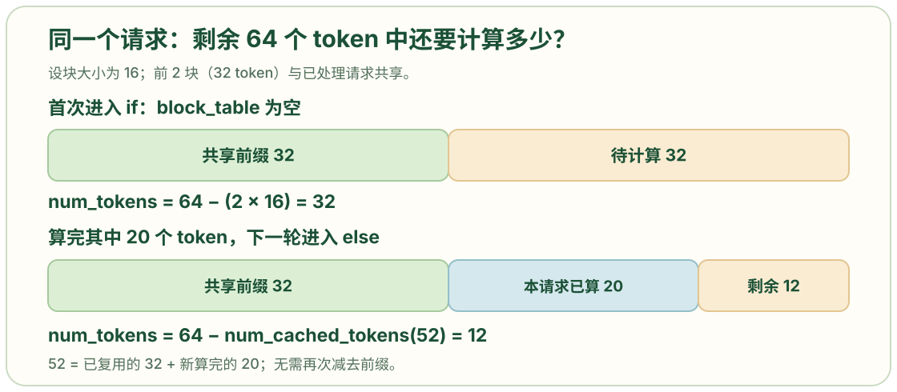
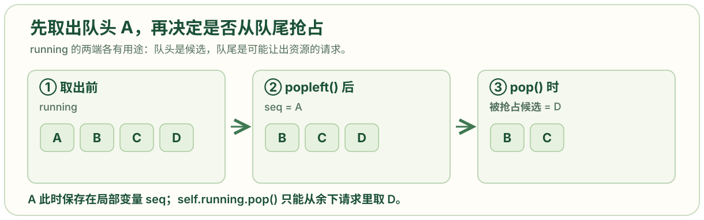
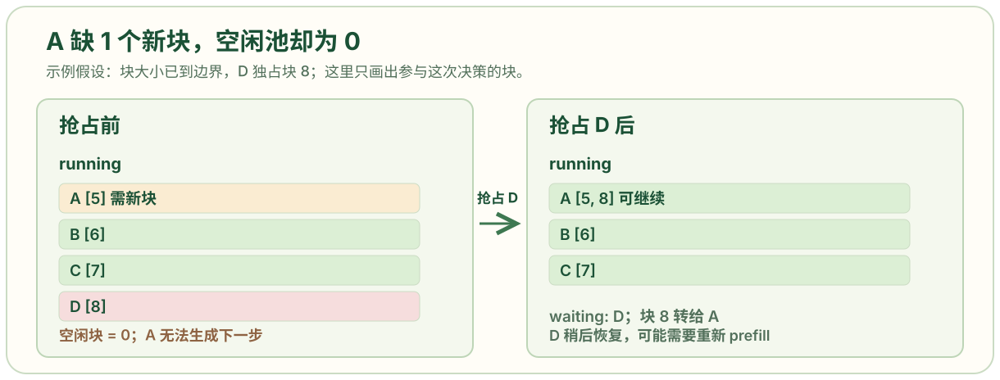

# scheduler.py: 选择每轮请求并管理 KV 块资源

```python
from collections import deque
from nanovllm.config import Config
from nanovllm.engine.sequence import Sequence, SequenceStatus
from nanovllm.engine.block_manager import BlockManager

class Scheduler:

    def __init__(self, config: Config):
        self.max_num_seqs = config.max_num_seqs
        self.max_num_batched_tokens = config.max_num_batched_tokens
        self.eos = config.eos
        self.block_size = config.kvcache_block_size
        self.block_manager = BlockManager(config.num_kvcache_blocks, config.kvcache_block_size)
        # self.waiting - 变量名（实例属性）deque[Sequence] - 类型注解- deque 是容器类型（双端队列）- [Sequence] 说明这个 deque 里存放的是 Sequence 类型的对象- 相当于告诉别人："这是一个装着 Sequence 对象的 deque"
        self.waiting: deque[Sequence] = deque()# 等待队列，包含新请求和需要继续 prefill 或抢占后重新进入的请求。
        self.running: deque[Sequence] = deque()# 运行队列，包含完整 prompt 已被安排处理、后续可能进行 decode 的请求。

    def is_finished(self):   #供 LLMEngine.generate() 结束循环。
        return not self.waiting and not self.running

    def add(self,seq: Sequence):
        self.waiting.append(seq)

        # schedule() 返回 list[Sequence] 与 bool。布尔值为 True 表示本轮走 prefill，False 表示 decode。
    def schedule(self) -> tuple[list[Sequence], bool]:
        scheduled_seqs = []
        num_batched_tokens = 0

        while self.waiting and len(scheduled_seqs) < self.max_num_seqs:
            seq = self.waiting[0]
            remaining = self.max_num_batched_tokens - num_batched_tokens  # 本轮还可以计算多少 prefill token。
            if remaining == 0:
                break
            # If: 减去的是前缀缓存命中（来自其他请求的共享前缀）。
            # Else: 减去的是本请求已计算部分；其中已包含共享前缀和 chunked prefill 的进度。
            if not seq.block_table:     # 没有块表意味着这是第一次为它分配 KV 块，或者抢占后块表被清空。
                num_cached_blocks = self.block_manager.can_allocate(seq)   # 查询可复用前缀块数，并同时确认块数是否足够；返回 -1 表示当前不能分配。
                if num_cached_blocks == -1:
                    break
                num_tokens = seq.num_tokens - num_cached_blocks * self.block_size    # 第一次分配时，待计算 token 数等于当前序列长度减去已命中的完整前缀块长度。
            else:          # 已有块表表示某个分块 prefill 尚未完成；待计算量改为当前序列总长度减去已算好的 token 数。
                num_tokens = seq.num_tokens - seq.num_cached_tokens  #为什么else分支不去剪掉共享前缀？因为在 else 分支时，共享前缀已经被处理过了。（之前必然经历过if分支）
            if remaining < num_tokens and scheduled_seqs:          # 当前请求放不进剩余 token 预算，且本轮已经安排过其他请求时，先停止。因此当前实现只允许本轮第一个请求使用不完整的 prefill chunk。
                break
            if not seq.block_table:        # 仅在没有块表时执行真实的块编号分配与前缀块关联。已分块处理过的请求继续使用原块表。
                self.block_manager.allocate(seq, num_cached_blocks)
            seq.num_scheduled_tokens = min(num_tokens, remaining)
            num_batched_tokens += seq.num_scheduled_tokens  # 一个批次包含一次运算一起要进行的token数num_batched_tokens；一个批次为了提高计算效率，会把多个请求的序列一起计算，这一个请求的token就是scheduledtokens
            if seq.num_cached_tokens + seq.num_scheduled_tokens == seq.num_tokens:   # 若已缓存进度加本轮计划量等于当前序列长度，说明完整 prompt 已被安排在本轮算完。
                seq.status = SequenceStatus.RUNNING     # 把请求标成运行中。这个状态变化发生在本轮模型计算之前
                self.waiting.popleft()     # 从 waiting 队头移除，并追加到 running 队尾。
                self.running.append(seq)
            scheduled_seqs.append(seq)# 无论 prompt 本轮是否算完，只要安排了一个 chunk，就加入本轮执行列表。

        if scheduled_seqs:
            return scheduled_seqs, True

        # 只有没有 prefill 请求被选中时，控制流才到这里。
        # decode
        # 从运行队列选请求，最多选 max_num_seqs 个。
        while self.running and len(scheduled_seqs) < self.max_num_seqs:
            seq = self.running.popleft() # deque.popleft() 从队头取出请求；deque.pop() 从队尾取出请求，两者都能高效地操作队列两端。
            while not self.block_manager.can_append(seq):
                if self.running:
                    self.preempt(self.running.pop()) #抢占：腾出显存资源，让其他请求能继续运行
                else:
                    self.preempt(seq)
                    break
            else:
                seq.num_scheduled_tokens = 1      # Decode 对这个请求每轮计算一个 token。
                seq.is_prefill = False             # 标记它进入 decode 输入准备路径，也影响多卡传输时只发送最后一个 token。
                self.block_manager.may_append(seq)   # 如跨过块边界，正式给请求追加一个物理 KV 块。
                scheduled_seqs.append(seq)   # 将当前请求放进本轮 decode batch。
        assert scheduled_seqs             # 要求本轮最终至少有一个请求可执行；
        self.running.extendleft(reversed(scheduled_seqs))# 把选中的请求按原顺序放回运行队列左端，等待模型执行和后处理；反转是为了抵消 extendleft 逐个插入时的顺序变化。
        return scheduled_seqs, False
    def preempt(self, seq: Sequence):         # 定义抢占：把请求从当前运行条件撤回。调用者负责从 running 中取出它。
        seq.status = SequenceStatus.WAITING
        seq.is_prefill = True           # 下次调度需走 prefill 恢复路径；若之前的 KV 块可通过前缀缓存命中，可减少重算。
        self.block_manager.deallocate(seq)    # 释放该请求对 KV 块的引用并清空块表、缓存进度。
        self.waiting.appendleft(seq)   # 抢占请求放在等待队列前端，比普通新请求更早再次尝试。

    def postprocess(self, seqs: list[Sequence], token_ids: list[int], is_prefill: bool):# postprocess() 接收本轮请求列表、模型为它们采样的 token ID 列表和本轮路径标记。
        for seq, token_id in zip(seqs, token_ids):
            self.block_manager.hash_blocks(seq)            # 给本轮刚算完的完整 KV 块登记内容哈希，使后续请求有机会复用。
            seq.num_cached_tokens += seq.num_scheduled_tokens     # 将本轮已完成的模型计算计入缓存进度。
            seq.num_scheduled_tokens = 0             # 清除本轮计划量，下一轮由 schedule() 重新设置。
            if is_prefill and seq.num_cached_tokens < seq.num_tokens:    #  意思是prefill还没完全看完，第一个token都没有生成。如果本轮只是长 prompt 的中间 chunk，就忽略此次采样 token；prompt 尚未完整，不能把它当成真正的生成结果。
                continue
            seq.append_token(token_id)                      # 对完整 prefill 或 decode，把采样 token 追加到序列末尾，更新总长度和 last_token。这个新 token 的 KV 要在下一轮 decode 才计算。
            if (not seq.ignore_eos and token_id == self.eos) or seq.num_completion_tokens == seq.max_tokens: # ignore_eos=False 且采样到 EOS，或已生成数恰好达到 max_tokens 时，结束请求。
                seq.status = SequenceStatus.FINISHED
                self.block_manager.deallocate(seq)
                self.running.remove(seq)
```

## 为什么 `if` 减去共享前缀，`else` 却减去 `num_cached_tokens`

```python
if not seq.block_table:
    num_cached_blocks = self.block_manager.can_allocate(seq)
    if num_cached_blocks == -1:
        break
    num_tokens = seq.num_tokens - num_cached_blocks * self.block_size
else:
    num_tokens = seq.num_tokens - seq.num_cached_tokens
```

### 核心问题：两个分支计算的是同一个量

**这两个分支都在回答同一个问题：这个请求还有多少 token 需要计算？**

但它们使用不同的减数，是因为请求所处的阶段不同：
- **`if` 分支**：第一次分配 KV 块（或被抢占后重新分配）
- **`else` 分支**：已有块表，正在进行分块 prefill 的后续轮次

### `if` 分支：减去共享前缀（来自其他请求）

**场景：请求 B 首次调度，发现可以复用请求 A 的前缀。**

```python
# 请求 A（已处理完成）
seq_A.token_ids = [101, 102, ..., 116, 117, ...]  # “你是helpful assistant...”
seq_A.block_table = [5, 6, 7]

# 块的哈希已登记
blocks[5].hash = 0xAAAA  # 前 16 个 token
blocks[6].hash = 0xBBBB  # 前 32 个 token
hash_to_block_id[0xAAAA] = 5
hash_to_block_id[0xBBBB] = 6

# 请求 B（新请求，前 32 个 token 相同）
seq_B.token_ids = [101, 102, ..., 116, 200, ...]  # “你是helpful assistant。翻译...”
seq_B.num_tokens = 64
seq_B.block_table = []  # 还没分配！← 进入 if 分支
```

**第一步：查询可复用前缀**

```python
num_cached_blocks = self.block_manager.can_allocate(seq_B)
# 内部逻辑：
# - 计算 seq_B 前 16 个 token 的哈希 → 0xAAAA ✓ 找到块 5
# - 计算 seq_B 前 32 个 token 的哈希 → 0xBBBB ✓ 找到块 6  
# - 计算 seq_B 前 48 个 token 的哈希 → 0xCCCC ✗ 找不到
# 返回 num_cached_blocks = 2
```

**第二步：计算需要处理的 token 数**

```python
num_tokens = seq_B.num_tokens - num_cached_blocks * block_size
           = 64 - 2 * 16
           = 64 - 32
           = 32  # 需要计算 32 个 token
```

**关键点：此时 `seq_B.num_cached_tokens` 还是 0！**

因为还没有执行 `allocate()`，请求 B 的进度还没有更新。不能用 `seq_B.num_cached_tokens` 来计算，只能用查询结果 `num_cached_blocks`。

**第三步：关联共享块**

```python
self.block_manager.allocate(seq_B, num_cached_blocks=2)
# 内部执行：
# 1. 关联共享前缀块
seq_B.block_table = [5, 6, ...]  # 复用块 5, 6
blocks[5].ref_count += 1  # A 和 B 共享
blocks[6].ref_count += 1

# 2. 更新缓存进度
seq_B.num_cached_tokens = 2 * 16 = 32

# 3. 分配新块给剩余部分
# ... 后续处理
```

### `else` 分支：减去累计进度（包含共享前缀 + 已计算部分）

**场景：请求 B 的 prefill 分成多轮，第二轮继续处理。**

```python
# 第一轮 prefill 之后
seq_B.num_tokens = 64
seq_B.num_cached_tokens = 32 + 20 = 52
# ↑ 32 来自共享前缀，20 是第一轮新计算的
seq_B.block_table = [5, 6, 7]  # 已有块表！← 进入 else 分支
```

**计算剩余 token：**

```python
num_tokens = seq_B.num_tokens - seq_B.num_cached_tokens
           = 64 - 52
           = 12  # 还需计算 12 个 token
```

**为什么不再减共享前缀？**

因为 `num_cached_tokens = 52` **已经包含了**：
- 共享前缀：32 个 token（来自块 5, 6）
- 第一轮计算：20 个 token（写入块 7）

如果再减一次共享前缀，就会**重复扣除**：

```python
# ❌ 错误的做法
num_tokens = seq_B.num_tokens - num_cached_blocks * block_size - seq_B.num_cached_tokens
           = 64 - 32 - 52
           = -20  # 错误！负数了
```



### 时间线完整示例

```python
block_size = 16

# ===== t=0: 请求 B 首次调度 =====
seq_B.num_tokens = 64
seq_B.num_cached_tokens = 0
seq_B.block_table = []  # 空 → if 分支

# can_allocate 查询
num_cached_blocks = 2  # 可复用 2 个块

# 计算待处理量
num_tokens = 64 - 2*16 = 32

# 假设本轮只处理 20 个 token
seq_B.num_scheduled_tokens = 20

# allocate 关联共享块
seq_B.block_table = [5, 6, 7]
seq_B.num_cached_tokens = 32

# 计算后 postprocess 更新进度
seq_B.num_cached_tokens += 20  # 32 → 52


# ===== t=1: 请求 B 第二轮调度 =====
seq_B.num_tokens = 64
seq_B.num_cached_tokens = 52
seq_B.block_table = [5, 6, 7]  # 非空 → else 分支

# 计算待处理量
num_tokens = 64 - 52 = 12

# 本轮处理完剩余的 12 个
seq_B.num_scheduled_tokens = 12

# 计算后更新
seq_B.num_cached_tokens += 12  # 52 → 64

# prefill 完成！
```

### 前缀缓存的价值

**不关联共享块的情况（浪费）：**

```python
# 请求 A
seq_A.block_table = [5, 6, 7, 8]
# 计算了前 64 个 token 的 KV cache

# 请求 B（前 32 个相同，但没有复用）
seq_B.block_table = [9, 10, 11, 12]  # 分配了新块
# 重新计算全部 64 个 token 的 KV cache
# 浪费：前 32 个 token 重复计算了
```

**关联共享块的情况（高效）：**

```python
# 请求 A
seq_A.block_table = [5, 6, 7, 8]

# 请求 B（复用前缀）
seq_B.block_table = [5, 6, 11, 12]  # 前两个块复用
#                    └─┴─共享
# 只需计算后 32 个 token 的 KV cache
# 节省：50% 的计算量
```

**收益分析：**

假设场景：100 个用户都以 “你是一个helpful assistant” 开始对话（100 tokens）

- 不复用：需要存储和计算 100 × 100 = 10,000 tokens 的 KV
- 复用：存储 100 tokens（共享）+ 100 × 各自独特部分
- 节省：接近 100 倍的显存和计算

### 总结

**两个分支的本质区别：**

| 分支 | 条件 | 减数来源 | 含义 |
|------|------|---------|------|
| **`if`** | `block_table` 为空 | `num_cached_blocks`（刚查询到的） | 来自其他请求的共享前缀 |
| **`else`** | `block_table` 已存在 | `num_cached_tokens`（累计进度） | 共享前缀 + 本请求已计算部分 |

**设计原则：**
- `if` 分支：首次分配时，通过前缀缓存查询减少计算量
- `else` 分支：后续轮次，通过累计进度避免重复扣除

这个设计巧妙地将**前缀缓存**和**分块 prefill** 两个优化机制融合在一起，既避免了跨请求的重复计算，又支持了单个长请求的渐进式处理。

## 为什么先用 `popleft()` 把 A 从运行队列取出

```python
seq = self.running.popleft()
while not self.block_manager.can_append(seq):
    if self.running:
        self.preempt(self.running.pop())
```

### 疑问：为什么要"弹出-检查-放回"？

**表面上看起来很低效：** 先用 `popleft()` 把请求 A 从队列取出，检查资源，如果可以继续就加入 `scheduled_seqs`，最后又要放回 `running`。为什么不直接 `seq = self.running[0]` 查看队头，需要时再取出？

### 原因 1：`deque` 的高效操作模式

`deque`（双端队列）的设计就是为了高效的两端操作：

```python
# deque 的高效操作（O(1)）
deque.popleft()   # 从队头取出
deque.pop()       # 从队尾取出
deque.append()    # 添加到队尾
deque.appendleft() # 添加到队头

# 不高效的操作（可能 O(n)）
deque[0]          # 索引访问（虽然可行，但不是设计初衷）
```

**如果不弹出而是"偷看"：**

```python
# 方案 A：peek 模式（看起来"节省"，实际更繁琐）
seq = self.running[0]  # 只看不取

if self.block_manager.can_append(seq):
    seq = self.running.popleft()  # 还是要取出
    # 处理...
    scheduled_seqs.append(seq)
    # 还要放回... 
else:
    # 不能继续，需要抢占
    # 但 seq 还在队列里，逻辑更复杂
```

**当前方案（直接操作两端）：**

```python
# 方案 B：pop 模式（符合 deque 设计）✅
seq = self.running.popleft()  # 直接取出队头

if self.block_manager.can_append(seq):
    # 可以继续，加入批次
    scheduled_seqs.append(seq)
else:
    # 不能继续，需要抢占其他请求
    # seq 已经在手里，队列中只剩其他请求
    self.preempt(self.running.pop())  # 从队尾抢占
```

### 原因 2：简化抢占逻辑

这是**关键设计点**：通过先取出 A，让后续的 `pop()` 操作不会误伤 A。



**完整的操作序列：**

```python
# 初始状态
running = [A, B, C, D]  # A 在队头，D 在队尾

# 步骤 1：取出队头请求
seq = self.running.popleft()  # seq = A
# 现在: seq = A, running = [B, C, D]

# 步骤 2：检查 A 是否能继续
while not self.block_manager.can_append(seq):
    # A 需要新块，但没有空闲块
    
    # 步骤 3：从队尾抢占
    if self.running:
        victim = self.running.pop()  # victim = D
        # 现在: running = [B, C]
        self.preempt(victim)
        # D 被抢占，释放块，running = [B, C]
    
    # 步骤 4：再次检查 A
    # 如果 D 释放的块够用，循环结束
    # 如果还不够，继续抢占 C, B...

# 步骤 5：A 获得资源，加入批次
seq.num_scheduled_tokens = 1
scheduled_seqs.append(seq)  # scheduled_seqs = [A]
```

**如果不先取出 A，会发生什么？**

```python
# ❌ 错误的实现
running = [A, B, C, D]

# 不取出 A，只是"看"
seq = running[0]  # seq 指向 A，但 A 还在队列里

# 检查 A，发现需要抢占
while not block_manager.can_append(seq):
    # 从队尾取出
    victim = running.pop()  # victim = D ✓
    preempt(victim)

# 问题：如果需要继续抢占
# running = [A, B, C]
victim = running.pop()  # victim = C ✓

# running = [A, B]  
victim = running.pop()  # victim = B ✓

# running = [A]
victim = running.pop()  # victim = A ❌ 错误！抢占了正在等待的 A！
```

**通过先取出 A，避免了这个问题：**

```python
# ✅ 正确的实现
running = [A, B, C, D]
seq = running.popleft()  # A 被取出，不在队列中

# 现在: seq = A (局部变量), running = [B, C, D]

# 即使抢占到队列空了
running.pop()  # D
running.pop()  # C  
running.pop()  # B
# running = []，队列空了

# 此时：
if self.running:
    self.preempt(self.running.pop())  # 不会执行，running 空了
else:
    self.preempt(seq)  # 只能抢占 A 自己
    break
```

### 原因 3：代码清晰性

虽然看起来是"弹出-放回"，但这种模式让代码逻辑更清晰：

```python
# 处理每个候选请求的模板：
while self.running and len(scheduled_seqs) < max_num_seqs:
    # 1. 取出候选
    seq = self.running.popleft()
    
    # 2. 检查资源（可能需要抢占）
    while not can_allocate(seq):
        preempt_others()
    
    # 3. 分配资源
    allocate(seq)
    
    # 4. 加入批次
    scheduled_seqs.append(seq)

# 5. 统一放回（稍后执行）
self.running.extendleft(reversed(scheduled_seqs))
```

这种"取出-处理-放回"的模式：
- **职责清晰**：取出时检查，放回时恢复
- **状态一致**：`scheduled_seqs` 和 `running` 各司其职
- **易于理解**：符合"从队列取任务-处理-归位"的直觉

### 性能考虑

**"弹出-放回"真的低效吗？**

```python
# 单次操作的时间复杂度
popleft()    # O(1)
pop()        # O(1)
append()     # O(1)
extendleft() # O(k)，k 是插入元素数量

# 完整循环
for i in range(n):  # n 个请求
    popleft()   # O(1)
    can_append()  # O(1) 检查
    # ...
    append(seq)  # O(1)

extendleft(n)  # O(n)

# 总复杂度：O(n)
```

相比之下，GPU 计算一次 decode 需要 **~500 μs**，而这些队列操作总共只需要 **~1-2 μs**。

**开销占比：< 0.5%，完全可以接受。**

### 实际代码流程

```python
# 初始：running = [A, B, C]，每个请求都能继续

# 第 1 次循环
seq = running.popleft()  # seq=A, running=[B,C]
# 检查 A → 可以
scheduled_seqs.append(A)  # scheduled=[A]

# 第 2 次循环  
seq = running.popleft()  # seq=B, running=[C]
# 检查 B → 可以
scheduled_seqs.append(B)  # scheduled=[A,B]

# 达到 max_num_seqs，停止循环

# 放回
running = [C]
scheduled = [A, B]
reversed(scheduled) = [B, A]
extendleft([B, A]) → running = [A, B, C]
# 顺序恢复！
```

### 总结

**为什么用 `popleft()` 而不是 `[0]` 查看？**

| 原因 | 说明 |
|------|------|
| **1. 符合 deque 设计** | `popleft()`/`pop()` 是 O(1) 高效操作 |
| **2. 简化抢占逻辑** | 避免 `pop()` 误抢占正在等待的请求 |
| **3. 代码清晰** | "取出-处理-放回"模式职责分明 |
| **4. 性能开销低** | < 0.5% 的总时间，可忽略 |

**这不是低效设计，而是符合 deque 数据结构特性的正确用法。** 表面上的"弹出-放回"实际上简化了逻辑，提高了代码的健壮性和可读性。

这是一个经典的案例：**选择正确的数据结构，然后按照其设计意图使用，往往能写出既简洁又高效的代码。**

## A 需要新 KV 块时，为什么抢占 D 而不是等它结束

```python
while not self.block_manager.can_append(seq):
    if self.running:
        self.preempt(self.running.pop())
    else:
        self.preempt(seq)
        break
```

### 为什么需要抢占机制？

**核心问题：Decode 阶段的资源只会越来越紧张。** 当 A 需要新 KV 块但空闲池已空时，如果选择"等待"策略，会面临严重的问题。

#### 等待策略的困境

假设当前状态：
- 请求 A：需要新块才能继续 decode
- 请求 B, C, D：正在运行

如果选择让 A 等待 B、C、D 自然完成：

```
轮次 1: B, C, D 各生成 1 个 token，A 等待
轮次 2: B, C, D 各生成 1 个 token，A 等待
轮次 3: B, C, D 各生成 1 个 token，A 等待
...
轮次 N: A 还在等待！
```

**为什么 A 可能永远等不到资源？**

1. **正在运行的请求不会主动释放 KV 块**：B、C、D 只在生成完成时才释放资源，在此之前它们只会占用（甚至申请更多）KV cache 块。

2. **资源消耗递增**：每次 decode 生成新 token，可能需要更多 KV 块存储。时刻 T+1 的资源占用通常 ≥ 时刻 T。

3. **死锁风险**：
   ```
   A 等待 B、C、D 释放块
   B 还在生成，不会主动释放
   C 还在生成，不会主动释放  
   D 还在生成，不会主动释放
   → A 可能永远等不到资源
   → A 的用户体验极差（完全无响应）
   ```

#### 抢占策略的必要性



代码采用**主动抢占**而非被动等待：

```python
# 持续检查和抢占，直到 A 获得所需资源
while not self.block_manager.can_append(seq):
    if self.running:
        # 从队尾抢占最新进入的请求
        self.preempt(self.running.pop())
    else:
        # 队列空了，只能抢占 A 自己
        self.preempt(seq)
        break
```

**为什么从队尾抢占？** 基于 FIFO 公平性原则：
- 队头请求（如 A）等待时间最长，优先级最高
- 队尾请求（如 D）最近才进来，抢占它影响最小
- 被抢占的请求会放回 `waiting` 队头，资源空出来后优先恢复

### 抢占的代价与权衡

虽然抢占会带来额外开销，但这是保证系统可用性的必要代价。

#### 抢占的成本

当 D 被抢占时：
```python
def preempt(self, seq):
    seq.status = SequenceStatus.WAITING
    seq.is_prefill = True  # 下次需要重新 prefill
    self.block_manager.deallocate(seq)  # 释放 KV 块，清空块表
    self.waiting.appendleft(seq)  # 放回等待队列前端
```

D 的状态变化：
- **块表清空**：`seq.block_table = []`
- **进度清零**：`seq.num_cached_tokens = 0`  
- **需要重新 prefill**：下次调度时重新计算 KV cache

**开销分析：**

假设 D 被抢占时已生成 50 个 token（prompt 100 + 已生成 50 = 150 tokens）

```
恢复时的计算成本：
- 最好情况（高前缀命中率）：
  如果 prompt 的 100 个 token 能命中前缀缓存
  只需重算已生成的 50 个 token
  开销 = 50 tokens 的 prefill 计算

- 最坏情况（无前缀命中）：
  需要重算全部 150 个 token
  开销 = 150 tokens 的 prefill 计算
```

**相对成本：**
- 1 次 decode：计算 1 个 token
- 重新 prefill 150 tokens：相当于 150 次 decode 的计算量

#### 权衡分析：为什么仍然值得抢占

尽管抢占有重算成本，但不抢占的代价更大：

| 策略 | 优点 | 缺点 |
|------|------|------|
| **等待** | 无重算开销 | • A 可能饥饿<br>• 资源越等越紧<br>• 用户体验极差<br>• 可能死锁 |
| **抢占** | • 保证进度<br>• 公平性<br>• 避免饥饿 | • D 需要重算<br>• 增加计算量 |

**核心原则：**
```
正确性和可用性 > 计算效率

宁可让所有用户都慢一点，
也不能让某些用户完全卡死。
```

实际场景中：
- 前缀缓存可以显著降低重算成本（可能降低 50-80%）
- 抢占频率不高（只在资源真正不足时触发）
- 避免饥饿带来的用户体验提升远超重算的成本

### 共享块的处理

如果 D 的某个 KV 块被其他请求共享：

```python
# D 的块表
seq_D.block_table = [5, 6, 7]

# 假设块 5 和 6 也被请求 E 使用
blocks[5].ref_count = 2  # D 和 E 共享
blocks[6].ref_count = 2  # D 和 E 共享
blocks[7].ref_count = 1  # D 独占

# 抢占 D 后：
blocks[5].ref_count = 1  # E 还在用，不释放
blocks[6].ref_count = 1  # E 还在用，不释放
blocks[7].ref_count = 0  # 释放，进入空闲池
```

**这就是为什么用 `while` 循环：** 一次抢占可能只释放部分块，需要继续抢占直到获得足够资源。

这个设计体现了 LLM 推理系统中**资源管理**和**用户体验**之间的精妙平衡：通过主动的资源调度，确保所有请求都能稳定推进，而不是让部分请求因资源竞争而完全停滞。
