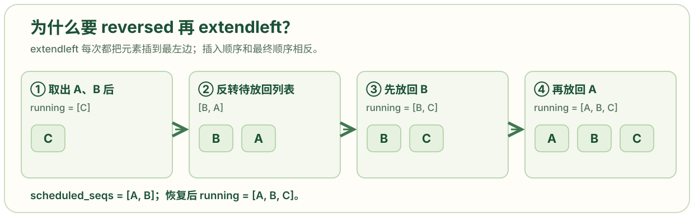

# scheduler.py: 选择每轮请求并管理 KV 块资源

```python
from collections import deque
from nanovllm.config import Config
from nanovllm.engine.sequence import Sequence, SequenceStatus
from nanovllm.engine.block_manager import BlockManager

class Scheduler:

    def __init__(self, config: Config):
        self.max_num_seqs = config.max_num_seqs
        self.max_num_batched_tokens = config.max_num_batched_tokens
        self.eos = config.eos
        self.block_size = config.kvcache_block_size
        self.block_manager = BlockManager(config.num_kvcache_blocks, config.kvcache_block_size)
        # self.waiting - 变量名（实例属性）deque[Sequence] - 类型注解- deque 是容器类型（双端队列）- [Sequence] 说明这个 deque 里存放的是 Sequence 类型的对象- 相当于告诉别人："这是一个装着 Sequence 对象的 deque"
        self.waiting: deque[Sequence] = deque()# 等待队列，包含新请求和需要继续 prefill 或抢占后重新进入的请求。
        self.running: deque[Sequence] = deque()# 运行队列，包含完整 prompt 已被安排处理、后续可能进行 decode 的请求。

    def is_finished(self):   #供 LLMEngine.generate() 结束循环。
        return not self.waiting and not self.running

    def add(self,seq: Sequence):
        self.waiting.append(seq)

        # schedule() 返回 list[Sequence] 与 bool。布尔值为 True 表示本轮走 prefill，False 表示 decode。
    def schedule(self) -> tuple[list[Sequence], bool]:
        scheduled_seqs = []
        num_batched_tokens = 0

        while self.waiting and len(scheduled_seqs) < self.max_num_seqs:
            seq = self.waiting[0]
            remaining = self.max_num_batched_tokens - num_batched_tokens  # 本轮还可以计算多少 prefill token。
            if remaining == 0:
                break
            # If: 减去的是前缀缓存命中（来自其他请求的共享前缀）。
            # Else: 减去的是本请求已计算部分；其中已包含共享前缀和 chunked prefill 的进度。
            if not seq.block_table:     # 没有块表意味着这是第一次为它分配 KV 块，或者抢占后块表被清空。
                num_cached_blocks = self.block_manager.can_allocate(seq)   # 查询可复用前缀块数，并同时确认块数是否足够；返回 -1 表示当前不能分配。
                if num_cached_blocks == -1:
                    break
                num_tokens = seq.num_tokens - num_cached_blocks * self.block_size    # 第一次分配时，待计算 token 数等于当前序列长度减去已命中的完整前缀块长度。
            else:          # 已有块表表示某个分块 prefill 尚未完成；待计算量改为当前序列总长度减去已算好的 token 数。
                num_tokens = seq.num_tokens - seq.num_cached_tokens  #为什么else分支不去剪掉共享前缀？因为在 else 分支时，共享前缀已经被处理过了。（之前必然经历过if分支）
            if remaining < num_tokens and scheduled_seqs:          # 当前请求放不进剩余 token 预算，且本轮已经安排过其他请求时，先停止。因此当前实现只允许本轮第一个请求使用不完整的 prefill chunk。
                break
            if not seq.block_table:        # 仅在没有块表时执行真实的块编号分配与前缀块关联。已分块处理过的请求继续使用原块表。
                self.block_manager.allocate(seq, num_cached_blocks)
            seq.num_scheduled_tokens = min(num_tokens, remaining)
            num_batched_tokens += seq.num_scheduled_tokens  # 一个批次包含一次运算一起要进行的token数num_batched_tokens；一个批次为了提高计算效率，会把多个请求的序列一起计算，这一个请求的token就是scheduledtokens
            if seq.num_cached_tokens + seq.num_scheduled_tokens == seq.num_tokens:   # 若已缓存进度加本轮计划量等于当前序列长度，说明完整 prompt 已被安排在本轮算完。
                seq.status = SequenceStatus.RUNNING     # 把请求标成运行中。这个状态变化发生在本轮模型计算之前
                self.waiting.popleft()     # 从 waiting 队头移除，并追加到 running 队尾。
                self.running.append(seq)
            scheduled_seqs.append(seq)# 无论 prompt 本轮是否算完，只要安排了一个 chunk，就加入本轮执行列表。

        if scheduled_seqs:
            return scheduled_seqs, True

        # 只有没有 prefill 请求被选中时，控制流才到这里。
        # decode
        # 从运行队列选请求，最多选 max_num_seqs 个。
        while self.running and len(scheduled_seqs) < self.max_num_seqs:
            seq = self.running.popleft() # deque.popleft() 从队头取出请求；deque.pop() 从队尾取出请求，两者都能高效地操作队列两端。
            while not self.block_manager.can_append(seq):
                if self.running:
                    self.preempt(self.running.pop()) #抢占：腾出显存资源，让其他请求能继续运行
                else:
                    self.preempt(seq)
                    break
            else:
                seq.num_scheduled_tokens = 1      # Decode 对这个请求每轮计算一个 token。
                seq.is_prefill = False             # 标记它进入 decode 输入准备路径，也影响多卡传输时只发送最后一个 token。
                self.block_manager.may_append(seq)   # 如跨过块边界，正式给请求追加一个物理 KV 块。
                scheduled_seqs.append(seq)   # 将当前请求放进本轮 decode batch。
        assert scheduled_seqs             # 要求本轮最终至少有一个请求可执行；
        self.running.extendleft(reversed(scheduled_seqs))# 把选中的请求按原顺序放回运行队列左端，等待模型执行和后处理；反转是为了抵消 extendleft 逐个插入时的顺序变化。
        return scheduled_seqs, False
    def preempt(self, seq: Sequence):         # 定义抢占：把请求从当前运行条件撤回。调用者负责从 running 中取出它。
        seq.status = SequenceStatus.WAITING
        seq.is_prefill = True           # 下次调度需走 prefill 恢复路径；若之前的 KV 块可通过前缀缓存命中，可减少重算。
        self.block_manager.deallocate(seq)    # 释放该请求对 KV 块的引用并清空块表、缓存进度。
        self.waiting.appendleft(seq)   # 抢占请求放在等待队列前端，比普通新请求更早再次尝试。

    def postprocess(self, seqs: list[Sequence], token_ids: list[int], is_prefill: bool):# postprocess() 接收本轮请求列表、模型为它们采样的 token ID 列表和本轮路径标记。
        for seq, token_id in zip(seqs, token_ids):
            self.block_manager.hash_blocks(seq)            # 给本轮刚算完的完整 KV 块登记内容哈希，使后续请求有机会复用。
            seq.num_cached_tokens += seq.num_scheduled_tokens     # 将本轮已完成的模型计算计入缓存进度。
            seq.num_scheduled_tokens = 0             # 清除本轮计划量，下一轮由 schedule() 重新设置。
            if is_prefill and seq.num_cached_tokens < seq.num_tokens:    #  意思是prefill还没完全看完，第一个token都没有生成。如果本轮只是长 prompt 的中间 chunk，就忽略此次采样 token；prompt 尚未完整，不能把它当成真正的生成结果。
                continue
            seq.append_token(token_id)                      # 对完整 prefill 或 decode，把采样 token 追加到序列末尾，更新总长度和 last_token。这个新 token 的 KV 要在下一轮 decode 才计算。
            if (not seq.ignore_eos and token_id == self.eos) or seq.num_completion_tokens == seq.max_tokens: # ignore_eos=False 且采样到 EOS，或已生成数恰好达到 max_tokens 时，结束请求。
                seq.status = SequenceStatus.FINISHED
                self.block_manager.deallocate(seq)
                self.running.remove(seq)
```

## 为什么 `if` 减去共享前缀，`else` 却减去 `num_cached_tokens`

```python
if not seq.block_table:
    num_cached_blocks = self.block_manager.can_allocate(seq)
    if num_cached_blocks == -1:
        break
    num_tokens = seq.num_tokens - num_cached_blocks * self.block_size
else:
    num_tokens = seq.num_tokens - seq.num_cached_tokens
```

**这里要算的是同一个量：这个请求还有多少 token 需要送进模型。** 两个分支使用不同的减数，是因为它们进入时保存的进度不同。`block_table` 是请求使用的 KV 块编号表；它为空，表示这次还没有建立块映射。新请求第一次处理，以及被抢占后块表被清空，都会走 `if`。已有块表、但 prompt 尚未处理完的请求，下一轮继续 prefill 时走 `else`。


在 `if` 中，`can_allocate(seq)` 查出可复用的**完整前缀块数**。例如另一个请求已经算好相同的前 32 个 token，每块 16 个 token，这里得到 `num_cached_blocks = 2`。当前请求总长 64，于是待计算量是 `64 - 2 × 16 = 32`。此时尚未执行下方的 `allocate()`，不能靠当前请求的 `num_cached_tokens` 得到这 32 个命中 token；代码直接使用查询结果。[`BlockManager.can_allocate()`](https://github.com/GeeeekExplorer/nano-vllm/blob/bb823b3e06983d71485a8e1f23715ebd87d98ef8/nanovllm/engine/block_manager.py)

随后，`allocate(seq, num_cached_blocks)` 把共享前缀块关联到这个请求，并设置 `seq.num_cached_tokens = num_cached_blocks * block_size`。如果本轮又计算了 20 个 token，`postprocess()` 会执行 `seq.num_cached_tokens += seq.num_scheduled_tokens`，将进度从 32 更新到 52。下一轮块表已经存在，`else` 计算 `64 - 52 = 12`。**52 已经包含共享前缀 32 和本请求新算的 20**；再单独减一次前缀，就会重复扣除。[`BlockManager.allocate()`](https://github.com/GeeeekExplorer/nano-vllm/blob/bb823b3e06983d71485a8e1f23715ebd87d98ef8/nanovllm/engine/block_manager.py)、[`Scheduler.postprocess()`](https://github.com/GeeeekExplorer/nano-vllm/blob/bb823b3e06983d71485a8e1f23715ebd87d98ef8/nanovllm/engine/scheduler.py)

图中的 token 数是解释性示例。图上方对应 `if`，下方对应 `else`：变化的是**已经计入进度的范围**，所以减数从“刚查到的前缀长度”变成了“累计已完成长度”。

## 为什么先用 `popleft()` 把 A 从运行队列取出

```python
seq = self.running.popleft()
while not self.block_manager.can_append(seq):
    if self.running:
        self.preempt(self.running.pop())
```

**疑问在于：A 明明还在生成，为什么先从 `running` 删除它？** 这里的删除是暂时取出一个候选请求，放到局部变量 `seq`，并非宣告 A 已结束。`popleft()` 取队头 A；资源不足时，`pop()` 从余下队列的尾部取抢占对象。两者都是 `deque` 的两端操作，选择不同端点是为了让当前候选 A 留在手里，让靠后的请求先让出资源。


图中 `running` 原本是 `[A, B, C, D]`。执行 `popleft()` 后，`seq` 指向 A，队列只剩 `[B, C, D]`；此时 `pop()` 取出 D，不会误取正在等待块的 A。A 是否能计算，要等 `can_append(A)` 的检查结果；能计算时，它会进入本轮的 `scheduled_seqs`。

## A 需要新 KV 块时，为什么抢占 D 而不是等它结束

```python
while not self.block_manager.can_append(seq):
    if self.running:
        self.preempt(self.running.pop())
    else:
        self.preempt(seq)
        break
```

**问题的触发条件**是：A 的下一步需要一个新 KV 块，而空闲池里没有块。`can_append(A)` 只有在 `len(A) % block_size == 1` 时才要求空闲块；如果当前块还有空位，空闲池为零也能继续。下面的图假设 A 恰好跨过块边界，B、C、D 正占用其余块，D 的块没有被别人共享。[`BlockManager.can_append()`](https://github.com/GeeeekExplorer/nano-vllm/blob/bb823b3e06983d71485a8e1f23715ebd87d98ef8/nanovllm/engine/block_manager.py)


如果只让 A 等待 B、C、D 自然生成到结束，A 可能很久没有下一步输出。B、C、D 仍能生成时，这表现为 A 的长时间等待；如果它们也都需要新块且无人能释放块，计算就无法继续。代码优先抢占队尾 D：`preempt(D)` 使 D 回到 `waiting`，`deallocate(D)` 解除 D 对 KV 块的引用；若释放出空闲块，下一次 `can_append(A)` 就能通过。若 D 的块还被别的请求共享，抢占一次可能没有空闲块，所以这里用 `while` 继续检查和抢占。[`preempt()`](https://github.com/GeeeekExplorer/nano-vllm/blob/bb823b3e06983d71485a8e1f23715ebd87d98ef8/nanovllm/engine/scheduler.py)、[`deallocate()`](https://github.com/GeeeekExplorer/nano-vllm/blob/bb823b3e06983d71485a8e1f23715ebd87d98ef8/nanovllm/engine/block_manager.py)

抢占使 D 的块表和已缓存进度清零；D 下次要从 prefill 路径恢复。完整块若仍能从前缀缓存命中，可免去部分重算，否则会增加计算量。这里牺牲 D 的当前进度，换取 A 尽快继续生成。如果连 A 自己也只能被抢占，且本轮没有其他请求成功入选，后面的 `assert scheduled_seqs` 会报错；这份代码没有覆盖这种极端容量情况。

## 选中 A、B 后，为什么又把它们放回 `running`

```python
seq.num_scheduled_tokens = 1
seq.is_prefill = False
self.block_manager.may_append(seq)
scheduled_seqs.append(seq)
```

```python
assert scheduled_seqs
self.running.extendleft(reversed(scheduled_seqs))
return scheduled_seqs, False
```

**疑问在于：已经放入 `scheduled_seqs`，为什么还要放回运行队列？** 两个容器记录不同的事。`scheduled_seqs` 只列出**本轮交给模型计算**的请求；`running` 保存**下一轮仍可能继续生成**的请求。模型计算后，`postprocess()` 会在请求结束时调用 `self.running.remove(seq)`，因此选中的请求在执行前需要重新出现在 `running` 中。



假设本轮最多选两个请求，初始 `running = [A, B, C]`。两次 `popleft()` 后，`scheduled_seqs = [A, B]`、`running = [C]`。`extendleft()` 会逐个从左边插入；先把列表反转为 `[B, A]`，插入 B 再插入 A，最终得到 `[A, B, C]`。代码恢复的是选中请求原来的队头顺序，未把它们轮换到队尾。
