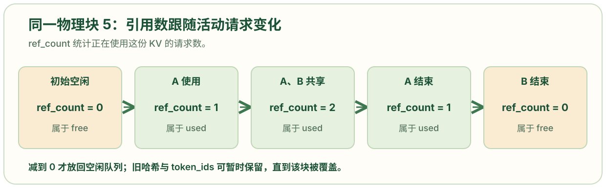
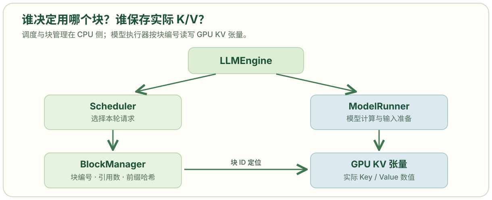
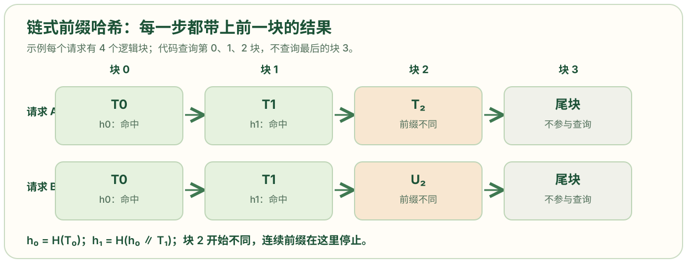
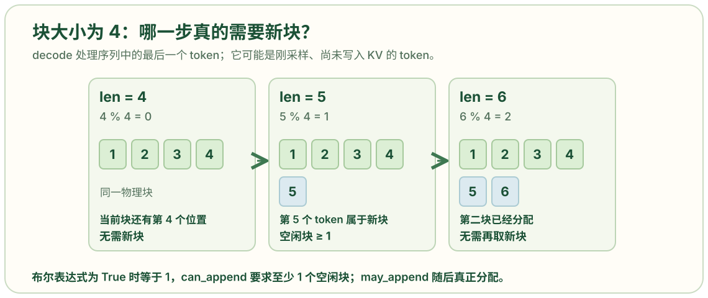

# block_manager.py: 管理物理 KV 块与前缀缓存

```python
from collections import deque
import xxhash          # 计算前缀块的快速内容哈希，供下一个请求查找可能复用的块。
import numpy as np

from nanovllm.engine.sequence import Sequence

class Block:        # 一个物理 KV 块的 CPU 元数据对象。它不存 GPU 中实际的 K/V 数值。
    def __init__(self, block_id):
        self.block_id = block_id    # 给每个物理块一个固定整数编号，作为块表中的引用。
        self.ref_count = 0          # 初始没有活动请求引用它；多个请求共享完整前缀时可大于 1。
        self.hash = -1               # -1 表示当前没有已登记的完整块哈希。
        self.token_ids = []         # 暂存该已完成块对应的 token ID，用于命中时再次核对内容。

    def update(self, hash: int ,token_ids: list[int]):    # 完整块算完后，把哈希和 token 内容登记到该块元数据。
        self.hash = hash
        self.token_ids = token_ids

    def reset(self):
        self.ref_count = 1
        self.hash = -1
        self.token_ids = []

class BlockManager:                # 定义块资源管理器；每个引擎的调度器持有一个实例。
    def __init__(self, num_blocks: int, block_size: int):
        self.block_size = block_size
        self.blocks: list[Block] = [Block(i) for i in range(num_blocks)]# 为每个块编号建立一个 Block 元数据对象；数量由模型执行器对 GPU 可用显存的估算决定。
        self.hash_to_block_id: dict[int, int] = dict()  # 从完整前缀块哈希映射到物理块 ID，以便快速寻找复用候选。
        self.free_block_ids: deque[int] = deque(range(num_blocks))
        self.used_block_ids: set[int] = set()

    @classmethod
    def compute_hash(cls, token_ids: list[int], prefix: int = -1):
        h = xxhash.xxh64()    #创建的是一个"哈希计算器"对象，而不是简单的哈希值。这样设计是为了支持增量哈希计算，特别适合处理大数据。
        if prefix != -1:
            h.update(prefix.to_bytes(8, "little"))# 除首块外，先把前一段前缀哈希的 8 字节表示写入当前哈希状态。因此相同当前块出现在不同历史前缀之后，会得到不同的链式哈希。
        h.update(np.array(token_ids).tobytes())   # 再加入当前块 token ID 的字节表示。
        return h.intdigest()   # 返回整数哈希，作为 hash_to_block_id 的键。

    def _allocate_block(self) -> int :    # 从空闲池为新内容取一个物理块。开头的下划线表示它是管理器内部方法。

        block_id = self.free_block_ids.popleft()   # 从空闲队列队头取块 ID；调用者应事先确认还有空闲块。
        block = self.blocks[block_id]    # 按 ID 找到该块元数据。
        assert block.ref_count == 0      # 只有没有活动引用的块才可重新分配，否则会覆盖别人的 KV 数据。
        if block.hash != -1 and self.hash_to_block_id.get(block.hash) == block_id:    # 如果这个空闲块仍是某个哈希的当前登记目标，先从字典删除该映射；这是覆盖旧缓存内容时的淘汰步骤。
            del self.hash_to_block_id[block.hash]
        block.reset()      # 清除旧内容标识，开始一份新内容，引用数置为 1。
        self.used_block_ids.add(block_id)   # 记录该块现在被活动请求占用。
        return block_id

    def _deallocate_block(self, block_id: int):   # 引用数降至 0 后，将物理块放回空闲池。
        assert self.blocks[block_id].ref_count == 0        # 防止仍被其他请求共享的块错误地放回空闲池。
        self.used_block_ids.remove(block_id)               # 从活动占用集合删除块 ID。
        self.free_block_ids.append(block_id)               # 放到空闲队列末尾；这里没有清除 hash 和 token_ids，因此仍可能在覆盖前复用，也就是说块被释放后，内容还在，可以继续被前缀缓存命中

    def can_allocate(self, seq: Sequence) -> int:    # 在真正改动块状态之前，检查这个请求有多少完整前缀块可复用、需要多少可用块。成功返回复用块数；失败返回 -1。
        h = -1
        num_cached_blocks = 0              # 当前找到的连续前缀命中块数。只要中间断开，就停止继续匹配。
        num_new_blocks = seq.num_blocks    # 先按整个请求当前长度估算要占用的块数。即使本轮只做部分 prefill，当前代码也先为整段 prompt 预留块编号。
        for i in range(seq.num_blocks - 1): # 只尝试匹配最后一个逻辑块之前的完整块；最后一个块留给本次计算。长度 513、块大小 256 时，最多检查第 0、1 块。
            token_ids = seq.block(i)       # 取第 i 个逻辑块的 token ID。
            h = self.compute_hash(token_ids, h)    # 高效的增量哈希计算：将当前块合并到前缀哈希中

            block_id = self.hash_to_block_id.get(h ,-1)   # 在已登记的完整块字典里找物理块 ID；不存在时用 -1。即查找"是否有现成的块可以复用"
            if block_id == -1 or self.blocks[block_id].token_ids != token_ids:     # 即使哈希查到了块，也用保存的 token ID 再核对；当前块没命中，就不再查后续块，因为前缀复用必须连续。

                break

            num_cached_blocks += 1    # 确认多一个完整前缀块可复用。
            if block_id in self.used_block_ids:   # 已被活动请求占用的命中块可以增加引用数直接共享，不需要从空闲队列取出，因此减少后面所需空闲块数。
                num_new_blocks -= 1
        if len(self.free_block_ids) < num_new_blocks:  # 若空闲池不足以容纳其余块，返回 -1。命中但目前空闲的块仍在空闲队列中，所以也计入需要从空闲池取出的数量。
            return -1
        return num_cached_blocks

    def allocate(self, seq: Sequence, num_cached_blocks: int):     # 正式为新请求关联命中块和分配其余块。
        assert not seq.block_table          # 只接受尚未建立块表的请求；已做部分 prefill 的请求沿用原块表。
        h = -1
        for i in range(num_cached_blocks):     # 依照相同的哈希顺序找到每个命中块对应的 block_id 和 Block 对象。
            token_ids = seq.block(i)
            h = self.compute_hash(token_ids, h)
            block_id = self.hash_to_block_id[h]
            block = self.blocks[block_id]
            if block_id in self.used_block_ids:     # 若块正被其他活动请求使用，将引用数加 1，允许两个请求共享同一份完整前缀 KV。
                block.ref_count += 1
            else:    # 若命中块原本是空闲的，把引用数设为 1，从空闲队列取出，并加入活动占用集合。它的已计算 KV 内容继续保留。
                block.ref_count = 1
                self.free_block_ids.remove(block_id)
                self.used_block_ids.add(block_id)
            seq.block_table.append(block_id)     # 按逻辑顺序把命中块的物理编号加入请求块表。
        for i in range(num_cached_blocks, seq.num_blocks):  # 对没有命中的逻辑块逐个调用 _allocate_block()，分配全新的物理块编号。
            seq.block_table.append(self._allocate_block())
        seq.num_cached_tokens = num_cached_blocks * self.block_size    # 命中 n 个完整块，则前 n × block_size 个 token 已有可用 KV，不必再 prefill。

    def deallocate(self, seq: Sequence):# 当请求完成或被抢占时，解除它对每个物理块的引用。
        for block_id in reversed(seq.block_table):    # 从块表末尾向前处理；这个顺序也使请求尾部通常先回到空闲池。
            block = self.blocks[block_id]
            block.ref_count -= 1
            if block.ref_count == 0:
                self._deallocate_block(block_id)   # 只有无人使用的块才调用 _deallocate_block()，重新进入空闲队列。
        seq.num_cached_tokens = 0    # 清除该请求的已算 token 进度；抢占后再调度要重新检查哪些完整前缀还能命中。
        seq.block_table.clear()      # 清空请求对物理块的映射。GPU KV 大张量本身仍由执行器持有，不在这里销毁。

    def can_append(self, seq: Sequence) -> bool:       #判断下一轮 decode 是否有足够块空间。

        return len(self.free_block_ids) >= (len(seq) % self.block_size == 1)

    def may_append(self, seq: Sequence):   # 条件同上；跨块边界时正式分配一个新块并追加到 seq.block_table。调用前应已通过 can_append() 检查。
        if len(seq) % self.block_size == 1:
            seq.block_table.append(self._allocate_block())

    def hash_blocks(self, seq: Sequence):    # 将本轮计算后成为完整块的内容登记为可复用前缀。它在 postprocess() 更新 num_cached_tokens 之前调用。
        start = seq.num_cached_tokens // self.block_size
        end = (seq.num_cached_tokens + seq.num_scheduled_tokens) // self.block_size
        if start == end: return
        h = self.blocks[seq.block_table[start - 1]].hash if start > 0 else -1 # 若前面已有完整块，从上一块保存的链式哈希继续；否则从 -1 开始。
        for i in range(start, end):
            block = self.blocks[seq.block_table[i]]
            token_ids = seq.block(i)
            h = self.compute_hash(token_ids, h) # 计算到当前块为止的前缀哈希。
            block.update(h, token_ids)# 在块元数据中保存当前完整内容的哈希与 token ID。
            self.hash_to_block_id[h] = block.block_id# 让以后的请求可以根据前缀哈希找到该物理块。
```

## 一个物理块的 `ref_count` 为 0、1、2 时，分别表示什么

```python
class Block:
    def __init__(self, block_id):
        self.block_id = block_id
        self.ref_count = 0
        self.hash = -1
        self.token_ids = []
```

**要解决的问题是：A 和 B 共享同一个前缀块时，A 结束会不会把 B 正在使用的块释放？** `ref_count` 记录当前有多少个请求持有这个物理块。刚创建时是 0；A 使用时是 1；B 也复用它时是 2；若还有第三个请求共享，就是 3。此时 A 结束只会把引用数从 2 减到 1，B 仍可以读取这份 KV 数据。

```python
if block_id in self.used_block_ids:
    block.ref_count += 1
else:
    block.ref_count = 1
    self.free_block_ids.remove(block_id)
    self.used_block_ids.add(block_id)
```

`allocate()` 中，命中的块若已经被活动请求占用，就增加 `ref_count`；若命中的是空闲但内容尚未被覆盖的块，就从空闲队列移出，并把引用数设为 1。释放请求时，`deallocate()` 对它块表中的每个块减 1；只有减到 0 才放回空闲队列。[`allocate()` 与 `deallocate()` 源码](https://github.com/GeeeekExplorer/nano-vllm/blob/bb823b3e06983d71485a8e1f23715ebd87d98ef8/nanovllm/engine/block_manager.py)

```python
for block_id in reversed(seq.block_table):
    block = self.blocks[block_id]
    block.ref_count -= 1
    if block.ref_count == 0:
        self._deallocate_block(block_id)
```



图中的块 5 是解释性示例。`ref_count = 0` 表示**当前没有请求持有**，并不表示该块的旧内容立刻消失：`_deallocate_block()` 只把编号放回空闲队列，没有清空 `hash` 和 `token_ids`。旧内容尚未被新分配覆盖时，前缀缓存仍可能命中它；真正拿它写新内容时，`_allocate_block()` 才移除旧哈希映射并调用 `reset()`。

## 引擎、调度器和块管理器分别负责什么

```python
class BlockManager:
    def __init__(self, num_blocks: int, block_size: int):
        self.block_size = block_size
        self.blocks: list[Block] = [Block(i) for i in range(num_blocks)]
        self.hash_to_block_id: dict[int, int] = dict()
        self.free_block_ids: deque[int] = deque(range(num_blocks))
        self.used_block_ids: set[int] = set()
```

**这里要定位的是：这份文件管理的究竟是 GPU 上的 KV 数据，还是决定如何使用这些数据的记录？** `BlockManager` 保存的是 CPU 侧的块元数据：每个编号对应的 `Block`、空闲与使用中的编号，以及从前缀哈希查块编号的字典。`Block` 的 `token_ids` 用来核对缓存内容；实际的 Key/Value 张量由模型执行器持有。[`ModelRunner` 源码](https://github.com/GeeeekExplorer/nano-vllm/blob/bb823b3e06983d71485a8e1f23715ebd87d98ef8/nanovllm/engine/model_runner.py)



请求由 `LLMEngine.add_request()` 加入调度器，`generate()` 驱动后续轮次。`Scheduler.schedule()` 决定本轮选哪些请求，并调用 `BlockManager` 检查、分配或追加块；请求被抢占时由 `Scheduler.preempt()` 解除块引用，正常结束时由 `Scheduler.postprocess()` 解除引用。`LLMEngine` 同时持有 `ModelRunner`，后者按请求的块表把本轮 token 的 KV 写入 GPU 张量。图中的两条分支说明了职责边界：块管理器维护**编号和占用关系**，执行器计算并保存**实际 K/V 数值**。[`LLMEngine`](https://github.com/GeeeekExplorer/nano-vllm/blob/bb823b3e06983d71485a8e1f23715ebd87d98ef8/nanovllm/engine/llm_engine.py)、[`Scheduler`](https://github.com/GeeeekExplorer/nano-vllm/blob/bb823b3e06983d71485a8e1f23715ebd87d98ef8/nanovllm/engine/scheduler.py)

## `_allocate_block` 的下划线与 `__init__` 的双下划线有何区别

```python
class BlockManager:
    def __init__(self, num_blocks: int, block_size: int):
        self.block_size = block_size
```

```python
def _allocate_block(self) -> int:
    block_id = self.free_block_ids.popleft()
    block = self.blocks[block_id]
    assert block.ref_count == 0
```

**问题落在方法名上：`_allocate_block()` 前面只有一个下划线，Python 会禁止外部调用吗？** 不会。单个前导下划线是“供类内部使用”的命名约定。这个方法只从空闲队列取出一个物理块、核对引用数并准备覆盖旧内容；对外的 `allocate(seq, num_cached_blocks)` 会先处理前缀共享，再在未命中的位置调用 `_allocate_block()`。调用方应使用完成整套步骤的公开方法，而不是绕过它直接分配一个块。

笔记里还比较了另外两种名字，含义不同：

| 写法 | 在此处的例子 | Python 如何处理 |
| --- | --- | --- |
| `_name` | `_allocate_block` | 约定为内部接口，名称本身仍可访问。 |
| `__name` | 假设写成 `__secret` | 类内名称会改写为 `_BlockManager__secret`；本文件没有这种成员。 |
| `__name__` | `__init__` | Python 识别的特殊方法；构造对象时自动调用。 |

## 查询前缀缓存时，为什么要把上一块的哈希接进来

```python
@classmethod
def compute_hash(cls, token_ids: list[int], prefix: int = -1):
    h = xxhash.xxh64()
    if prefix != -1:
        h.update(prefix.to_bytes(8, "little"))
    h.update(np.array(token_ids).tobytes())
    return h.intdigest()
```

```python
for i in range(seq.num_blocks - 1):
    token_ids = seq.block(i)
    h = self.compute_hash(token_ids, h)
    block_id = self.hash_to_block_id.get(h, -1)
```

**要匹配的是从请求开头到当前块为止的完整前缀，而不只是当前块本身。** 设逻辑块 0、1 的 token 分别是 `T₀`、`T₁`。首块得到 `h₀ = H(T₀)`；下一块把 `h₀` 的 8 字节表示与 `T₁` 的字节依次送进哈希计算器，得到 `h₁ = H(h₀ ∥ T₁)`。分别计算两个块的哈希再相加，不能表示这样一段有顺序的前缀。相同的 `T₁` 接在不同的首块后面通常得到不同的前缀哈希；若发生哈希碰撞，后文的 token 核对会阻止错误复用。代码每次创建一个哈希计算器，通过传入上一个结果形成这条链。[`compute_hash()` 与 `can_allocate()` 源码](https://github.com/GeeeekExplorer/nano-vllm/blob/bb823b3e06983d71485a8e1f23715ebd87d98ef8/nanovllm/engine/block_manager.py)



图中的 A、B 前两块 token 相同，因此查询 B 时先命中块 0，再以相同的 `h₀` 计算并命中块 1。`hash_blocks()` 在模型算完完整块后，把链式哈希登记到 `hash_to_block_id`；`can_allocate()` 从请求开头逐块查这个字典，遇到首个不匹配就停止。循环只检查 `range(seq.num_blocks - 1)`，即当前最后一个逻辑块不作为可复用前缀候选。

## 哈希已经命中，为什么还要比较 `token_ids`

```python
block_id = self.hash_to_block_id.get(h, -1)
if block_id == -1 or self.blocks[block_id].token_ids != token_ids:
    break
```

**疑问是：字典已经找到了块编号，为什么还可能判定失败？** 哈希把大量不同的 token 序列压缩为有限大小的整数，理论上不同内容可能得到同一个值。查到的 `block_id` 只是候选；代码再比较该物理块保存的当前块 `token_ids` 与请求的当前块是否逐项相同。若不同，就不复用，并停止检查后面的块。前面的完整块已经在前几次循环中逐一核对，所以这里只需要检查当前块。

例如，设块大小为 2，假设块 0 的哈希恰好把内容 `[1, 2]` 与 `[9, 9]` 映射成相同的整数。查询请求 `[9, 9]` 时字典可能返回存着 `[1, 2]` 的块；第二个条件会挡住这次错误复用。这个数字例子只说明判断顺序，不表示真实运行中观测到哈希碰撞。

## `can_append()` 为什么只在余数为 1 时要求空闲块

```python
def can_append(self, seq: Sequence) -> bool:
    return len(self.free_block_ids) >= (len(seq) % self.block_size == 1)

def may_append(self, seq: Sequence):
    if len(seq) % self.block_size == 1:
        seq.block_table.append(self._allocate_block())
```

**问题在于：块大小为 4 时，序列长度恰好为 4 看起来已经填满，为什么此时不检查新块；长度变成 5 才检查？** `Sequence` 的 token 列表包含刚采样出来、尚未为其计算 KV 的最后一个 token。decode 本轮要处理这个最后的 token。长度为 4 时，它仍占第一个逻辑块的末尾位置；本轮处理后又采样出第 5 个 token，序列长度变为 5。下一轮处理第 5 个 token 时，它才需要第二个物理块。[`Sequence.append_token()`](https://github.com/GeeeekExplorer/nano-vllm/blob/bb823b3e06983d71485a8e1f23715ebd87d98ef8/nanovllm/engine/sequence.py)



括号里的比较式产生布尔值：余数是 1 时为 `True`，在整数比较中相当于 1，所以 `can_append()` 要求空闲块数至少为 1；其他余数得到 `False`，相当于 0，条件总能通过。真正取出新块的是紧接着的 `may_append()`。图中长度 4、5、6 与代码的余数 0、1、2 一一对应。
