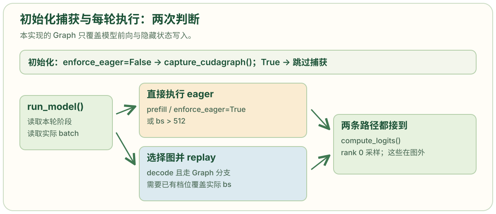
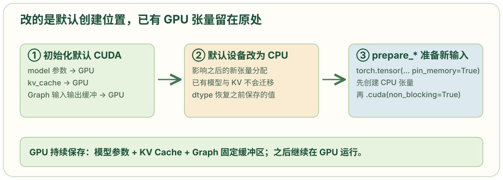
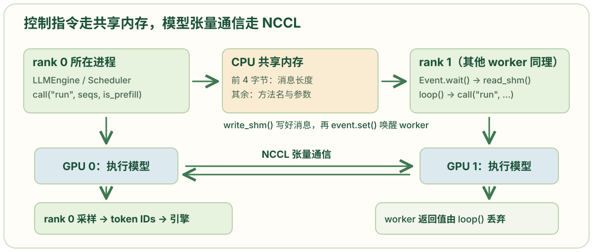
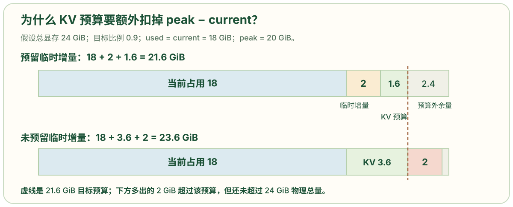
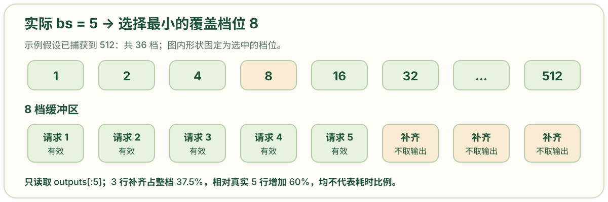
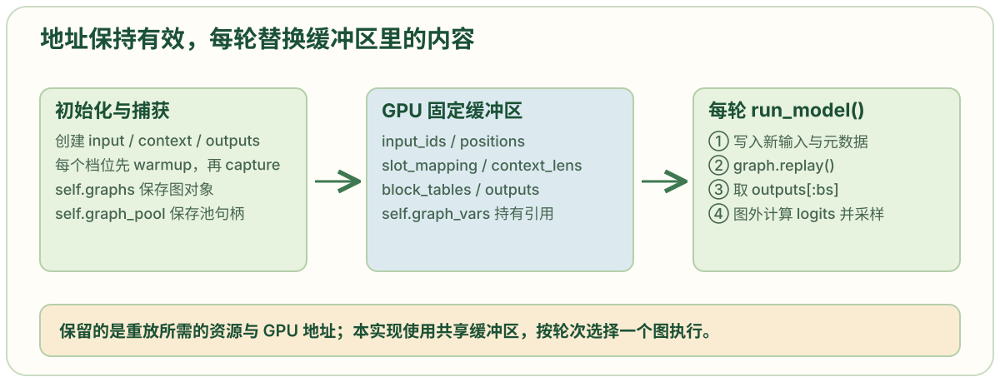

# model_runner.py: 模型执行与 CUDA Graph 优化

```python
import pickle
import torch
import torch.distributed as dist   # 初始化 NCCL 进程组，多 GPU 时提供通信；代码在单卡时也初始化大小为 1 的组。
from multiprocessing.synchronize import Event
from multiprocessing.shared_memory import SharedMemory

# 分别取配置、请求、Qwen3 模型、采样器、Attention 上下文操作和权重加载函数。
from nanovllm.config import Config
from nanovllm.engine.sequence import Sequence
from nanovllm.models.qwen3 import Qwen3ForCausalLM
from nanovllm.layers.sampler import Sampler
from nanovllm.utils.context import set_context, get_context, reset_context
from nanovllm.utils.loader import load_model

class ModelRunner:
    def __init__(self, config: Config, rank: int, event: Event | list[Event]):
        # 保存配置、模型配置、KV 块大小、是否强制 eager、rank 总数、当前 rank 和通信事件，供后续方法使用。
        self.config = config
        hf_config = config.hf_config
        self.block_size = config.kvcache_block_size
        self.enforce_eager = config.enforce_eager
        self.world_size = config.tensor_parallel_size
        self.rank = rank
        self.event = event

        dist.init_process_group("nccl","tcp://localhost:2333", world_size = self.world_size, rank = rank)# 在本机 TCP 地址上初始化 NCCL 进程组，大小为 world_size。单卡 rank 0 也会进入这一行。端口 2333 是当前源码的固定值。
        torch.cuda.set_device(rank)  # 当前进程选择 rank 对应的 GPU；rank 是通信组内编号，与操作系统进程 ID 不同。
        default_dtype = torch.get_default_dtype()  # 保存原本的默认浮点类型，以便模型初始化后恢复。
        torch.set_default_dtype(hf_config.dtype)    # 让随后创建的模型参数使用模型配置指定的 dtype。
        torch.set_default_device("cuda")      # 让随后无显式设备参数的张量默认创建在 GPU 上。
        self.model = Qwen3ForCausalLM(hf_config)  # 创建 Qwen3 模块和参数结构，权重由下一行 load_model() 读入。
        load_model(self.model, config.model)       # 从模型目录的 safetensors 文件把权重写入对应参数。
        self.sampler = Sampler()  # 创建采样器：本版按温度缩放 logits、计算 softmax，并用指数随机数实现采样。
        self.warmup_model()                      # 做一次预热，记录较大运行时内存占用，为后续 KV 块容量计算提供依据。
        self.allocate_kv_cache()                # 按剩余预算申请一整块 GPU KV 张量，并将各层 Attention 指向其对应切片。

        if not self.enforce_eager:
            self.capture_cudagraph()

        torch.set_default_device("cpu")  # 后续新张量默认在 CPU 创建；已有 GPU 张量仍保留在 GPU。
        torch.set_default_dtype(default_dtype)

         # rank 0 创建名为 nanovllm 的共享内存并同步；其他 rank 等待后连接它，再进入自己的消息循环。单卡 world_size=1 时跳过整个分支。
        if self.world_size > 1:     # 多卡场景（world_size > 1）需要进程间通信。
            if rank == 0:           # rank 0 是主进程，负责创建共享内存和协调。
                self.shm = SharedMemory(name = "nanovllm", create = True, size = 2**20)  # rank 0 创建 1 MiB 的 CPU 共享内存，用来传方法名和参数；模型张量不走这里。
                dist.barrier()      # 主进程等待所有工作进程到达这个同步点，确保共享内存创建完成后工作进程才尝试打开它。
            else:                   # rank > 0 是工作进程，负责在其他 GPU 上执行模型计算。
                dist.barrier()      # 工作进程先在屏障处等待，确保主进程已创建好共享内存。
                self.shm = SharedMemory(name = "nanovllm")      # 工作进程打开主进程创建的共享内存（create=False 表示附加到已存在的内存）。
                self.loop()  # worker 持续接收并执行命令；返回值由 loop 丢弃，直到执行 exit 后离开循环。

    def exit(self):
        if self.world_size > 1:         # 多卡场景需要清理共享内存和同步。
            self.shm.close()            # 每个进程关闭自己对共享内存的访问（解除映射），但共享内存块仍然存在。
            dist.barrier()              # 等待所有进程都关闭访问后再删除，避免有进程还在使用时被删除导致段错误。
            if self.rank == 0:          # 只有主进程负责真正删除共享内存。
                self.shm.unlink()       # 从操作系统中删除共享内存块（释放 /dev/shm 或类似资源），只能调用一次。
        if not self.enforce_eager:      # 使用了 CUDA Graph 优化的场景需要释放图对象。
            del self.graphs, self.graph_pool  # 删除图对象和池句柄引用；相关显存的生命周期还取决于持有缓冲区的张量。
        torch.cuda.synchronize()        # 等待当前 CUDA 设备上所有未完成的操作执行完毕，确保后续清理不会影响正在执行的 kernel。
        dist.destroy_process_group()  # 销毁当前分布式进程组。

    def loop(self):
        while True:
            method_name, args = self.read_shm()
            self.call(method_name, *args)
            if method_name == "exit":
                break

    # 非 rank 0 worker 从共享内存读取 rank 0 发送的方法调用指令。
    def read_shm(self):
        assert self.world_size > 1 and self.rank > 0       # 确保只有多卡场景的工作进程（rank > 0）调用此方法，主进程不应读取共享内存。
        self.event.wait()       # 阻塞等待事件信号，直到 rank 0 通过 event.set() 通知有新消息可读。
        n = int.from_bytes(self.shm.buf[0:4], "little")        # 从共享内存的前 4 字节读取消息体长度（小端序整数），rank 0 在 write_shm 时写入。
        method_name, *args = pickle.loads(self.shm.buf[4:n+4])        # 从第 5 字节开始读取 n 字节的序列化数据，反序列化得到方法名和参数列表。
        self.event.clear()      # 清除事件标志，为下一次消息做准备（避免重复读取同一消息）。
        return method_name, args        # 返回方法名和参数，供 loop() 调用对应方法。

    # rank 0 主进程将方法调用指令序列化后写入共享内存，通知所有工作进程执行。
    def write_shm(self, method_name, *args):
        assert self.world_size > 1 and self.rank == 0      # 确保只有多卡场景的主进程（rank 0）调用此方法，工作进程不应写入共享内存。
        data = pickle.dumps([method_name, *args])       # 将方法名和参数列表序列化为字节流，方便跨进程传输。
        n = len(data)       # 获取序列化后的数据长度，用于告诉接收方读取多少字节。
        self.shm.buf[0:4] = n.to_bytes(4, "little")     # 在共享内存的前 4 字节写入消息长度（小端序），作为消息头。
        self.shm.buf[4:n+4] = data      # 从第 5 字节开始写入序列化数据（消息体）。
        for event in self.event:        # 遍历所有工作进程的事件对象（每个 rank > 0 对应一个 event）。
            event.set()     # 触发事件信号，唤醒对应工作进程的 read_shm() 中的 wait()，通知有新消息可读。

    # 统一的方法调用入口：rank 0 从外部调用时广播+执行，rank > 0 在 loop 中被 read_shm 触发时仅执行。
    def call(self, method_name, *args):
        if self.world_size > 1 and self.rank == 0:     # 多卡场景且是主进程时，先广播给其他工作进程。
            self.write_shm(method_name, *args)      # 通过共享内存将方法名和参数发送给所有 rank > 0，它们会在各自的 loop() 中读取并调用 call()。
        method = getattr(self, method_name, None)       # 通过反射获取当前对象的同名方法（如 "run"、"exit" 等）。
        return method(*args)        # 在本进程执行该方法：rank 0 执行并返回结果给调用方；rank > 0 在 loop 中执行，返回值被丢弃。

    # 在真正服务请求前运行一个合成 batch，观察模型计算的峰值内存，为后续 KV cache 容量计算提供依据。
    def warmup_model(self):
        torch.cuda.empty_cache()        # 要求 PyTorch 释放缓存分配器中可回收的空闲显存，降低此前活动对估算的干扰。
        torch.cuda.reset_peak_memory_stats()        # 将峰值统计重置到预热开始附近，确保 peak 值反映的是预热期间的真实峰值。
        max_num_batched_tokens, max_model_len = self.config.max_num_batched_tokens, self.config.max_model_len      # 获取单轮 token 预算和配置的最大序列长度。
        seq_len = min(max_num_batched_tokens, max_model_len)        # 预热序列长度取"单轮 token 预算"和"配置长度"中较小者，避免超出限制。
        num_seqs = min(max_num_batched_tokens // seq_len, self.config.max_num_seqs)       # 用 token 预算除以序列长度，确定能放下的预热请求数，再受最大请求数限制。
        seqs = [Sequence([0] * seq_len) for _ in range(num_seqs)]     # 生成若干由 token 0 填充的合成请求，它们不经过正常调度和块分配。
        for seq in seqs:        # 为每个合成请求设置本轮计算量。
            seq.num_scheduled_tokens = seq_len      # 把各自的本轮计算量设为完整预热长度，模拟真实 prefill。
        self.run(seqs, True)        # 直接按 prefill 路径（is_prefill=True）执行一次模型与采样，以形成内存统计。
        torch.cuda.empty_cache()        # 清理预热后可回收的缓存显存，为后续 KV cache 分配腾出空间。

   # 开始估算并分配真正用于服务的 KV Cache。
    def allocate_kv_cache(self):
        config = self.config    # 后面需要 GPU 使用比例、模型层数、KV 头数、dtype 等字段。
        hf_config = config.hf_config
        free, total = torch.cuda.mem_get_info()    # 查询当前 GPU 空闲字节数与总字节数（从 CUDA 驱动获取物理显存信息）。
        used = total - free             # 算出此刻已被占用的显存（模型参数、其他程序占用等）。
        peak = torch.cuda.memory_stats()["allocated_bytes.all.peak"]  # PyTorch 分配器在预热统计期内的 allocated_bytes 峰值，包含常驻张量与当时的临时张量。
        current = torch.cuda.memory_stats()["allocated_bytes.all.current"]   # 从 PyTorch 分配器读出当前已分配字节数（预热后当前持有的显存，通常 current < peak）。
        num_kv_heads = hf_config.num_key_value_heads // self.world_size        # 张量并行时，每个 rank 只保存自己负责的 KV 头；单卡时就是全部 KV 头。
        head_dim = getattr(hf_config, "head_dim", hf_config.hidden_size // hf_config.num_attention_heads)     # 优先使用模型配置显式给出的头维度；若不存在，则按隐藏维度除以注意力头数计算。
        # 一个物理 KV 块的字节数：2 × 层数 × 每块 token 数 × 每卡 KV 头数 × 头维度 × 每元素字节数。前面的 2 分别表示 K 和 V。
        # block_size 是每个物理 KV 块可容纳的 token 数，来自 config.kvcache_block_size。
        block_bytes = 2 * hf_config.num_hidden_layers * self.block_size * num_kv_heads * head_dim * hf_config.dtype.itemsize

        # 计算可分配的 KV cache 块数：(目标预算 - 已占用 - 运行峰值增量) // 每块字节数
        # total * gpu_memory_utilization 是配置的目标显存预算。
        # used: 当前已占用显存（模型参数等）
        # peak - current 是从预热统计估计的临时增量。
        config.num_kvcache_blocks = int (total * config.gpu_memory_utilization - used - peak + current) // block_bytes
        assert config.num_kvcache_blocks > 0        # 至少要有一个 KV 块；显存预算不足时在初始化阶段失败。
        # 分配形状为 [K/V, 层, 物理块, 块内 token, KV 头, 头维] 的 GPU 张量。torch.empty 不清零；块内容只有写入后才可用。
        self.kv_cache = torch.empty(2, hf_config.num_hidden_layers, config.num_kvcache_blocks, self.block_size, num_kv_heads, head_dim)
        layer_id = 0        # 从模型中的第一层 Attention 开始关联 KV 切片。
        for module in self.model.modules():     # 遍历模型的所有子模块，找到带 k_cache、v_cache 属性的 Attention 层。
            if hasattr(module, "k_cache") and hasattr(module, "v_cache"):
                module.k_cache = self.kv_cache[0, layer_id]        # 把大张量中相应层的 K 切片赋给该层的 k_cache 属性。
                module.v_cache = self.kv_cache[1, layer_id]        # 把大张量中相应层的 V 切片赋给该层的 v_cache 属性。
                layer_id += 1       # 层号加一，继续处理下一层。

    def prepare_block_tables(self, seqs: list[Sequence]):
        max_len = max(len(seq.block_table) for seq in seqs)  # 取本轮最长块表的长度。
        block_tables = [seq.block_table + [-1] * (max_len - len(seq.block_table)) for seq in seqs]  # 把短块表用 -1 补齐，拼成每个请求一行的二维表。
        block_tables = torch.tensor(block_tables, dtype = torch.int32, pin_memory = True).cuda(non_blocking = True)
        return block_tables

    # 将本轮多个不同长度的请求整理成一段连续输入和配套边界元数据，避免 padding 浪费。
    def prepare_prefill(self, seqs: list[Sequence]):
        # 分别准备输入 token、位置、Q/K 累计长度边界、Q/K 最大长度、KV 写入槽位和可选块表。
        input_ids = []      # 本轮所有请求的 token ID 拼接成一维列表（如 req1=[1,2,3], req2=[4,5] → [1,2,3,4,5]）。
        positions = []      # 每个 token 在其原始序列中的位置，用于 RoPE 位置编码（如 [10,11,12, 0,1] 表示 req1 从位置 10 开始，req2 从 0 开始）。
        cu_seqlens_q = [0]      # Q（新 token）的累计长度边界，从 0 开始，每加入一个请求追加累计和（如 [0,3,5] 表示 req1 在 [0:3]，req2 在 [3:5]）。
        cu_seqlens_k = [0]      # K（包含历史 KV）的累计长度边界（如 [0,13,15] 表示 req1 的 KV 总长 13，req2 的 KV 总长 2）。
        max_seqlen_q = 0  # 记录本轮各请求新输入长度的最大值，提供给 FlashAttention。
        max_seqlen_k = 0  # 记录本轮各请求可访问 KV 长度的最大值，提供给 FlashAttention。
        slot_mapping = []       # 每个新 token 的 KV 应写入物理 KV cache 的哪个槽位（如 [0,1,2,16,17] 表示前 3 个写入块 0，后 2 个写入块 1）。
        block_tables = None     # 每个请求的逻辑块到物理块的映射表（二维，如 [[0,1,2], [3,4,-1]]），前缀缓存或分块 prefill 时需要。
        for seq in seqs:   # 逐个读取调度器本轮选中的请求。
            start = seq.num_cached_tokens    # 本轮从尚未完成模型计算的位置开始。若前缀复用或前一轮分块 prefill 已算过一段，就跳过它
            seqlen_q = seq.num_scheduled_tokens  # 本轮真正送入模型的新 token 数。
            end = start + seqlen_q    # end = start + seqlen_q；可供当前 Q 访问的完整历史长度等于 end，包含旧 KV 和本轮新 KV。
            seqlen_k = end
            input_ids.extend(seq[start:end])
            positions.extend(range(start, end))
            cu_seqlens_q.append(cu_seqlens_q[-1] + seqlen_q)
            cu_seqlens_k.append(cu_seqlens_k[-1] + seqlen_k)
            max_seqlen_q = max(seqlen_q, max_seqlen_q)     # 保存本轮请求中最大的两种长度，供 FlashAttention 调用。
            max_seqlen_k = max(seqlen_k, max_seqlen_k)
            if not seq.block_table:            # 预热合成请求没有经过 BlockManager，因而无需生成 KV 写入槽位。正常调度请求应有块表。
                continue
            start_block = start // self.block_size    # 算出本轮新 token 跨越的逻辑块区间；结束块采用向上取整。
            end_block = (end + self.block_size - 1) // self.block_size
            for i in range(start_block, end_block):     # 遍历本轮新 token 跨越的每个逻辑块，计算它们映射到的物理槽位范围。
                slot_start = seq.block_table[i] * self.block_size      # 当前逻辑块映射到的物理块的起始槽位（如块3 → 槽位48）。
                if i == start_block:        # 如果是首块，可能有历史 token 占用了块内前几个槽位。
                    slot_start += start % self.block_size       # 跳过块内已被历史 token 占用的槽位（如 start=10, block_size=16 → 跳过前10个，从槽位10开始）。
                if i != end_block - 1:      # 如果不是最后一块，说明这个块会被本轮新 token 写满。
                    slot_end = seq.block_table[i] * self.block_size + self.block_size      # 结束槽位 = 物理块起始 + 块大小（如块3 → 槽位48+16=64，写满整个块）。
                else:       # 如果是最后一块，可能只用到块内的一部分槽位。
                    slot_end = seq.block_table[i] * self.block_size + end - i * self.block_size  # 末块只写到 end；例如 end=35、i=2、块大小16、物理块ID为3时，slot_end=48+3=51。
                slot_mapping.extend(range(slot_start, slot_end))        # 把这个块的槽位范围添加到 slot_mapping，后续写 KV 时按这个映射表写入。
        if cu_seqlens_k[-1] > cu_seqlens_q[-1]:     # 如果 KV 总长度 > 新 token 数，说明有历史 KV（前缀缓存命中或分块 prefill），需要准备块表供 Attention 读取已缓存的 KV。
            block_tables = self.prepare_block_tables(seqs)      # 准备逻辑块到物理块的映射表（二维张量），FlashAttention 用它定位历史 KV 存储在哪些物理块。
        # 把 Python 列表转换为 GPU 张量，pin_memory=True 启用页锁定内存（加速 CPU→GPU 传输），non_blocking=True 允许异步传输（CPU 不等待传输完成即可继续）。
        input_ids = torch.tensor(input_ids, dtype = torch.int64, pin_memory = True).cuda(non_blocking = True)        # 输入 token ID 列表转为 int64 张量并异步拷贝到 GPU。
        positions = torch.tensor(positions, dtype = torch.int64, pin_memory = True).cuda(non_blocking = True)        # 位置索引列表转为 int64 张量并异步拷贝到 GPU，供 RoPE 使用。
        cu_seqlens_q = torch.tensor(cu_seqlens_q, dtype = torch.int32, pin_memory = True).cuda(non_blocking = True)        # Q 的累计长度边界转为 int32 张量并异步拷贝到 GPU，FlashAttention 用它识别各请求边界。
        cu_seqlens_k = torch.tensor(cu_seqlens_k, dtype = torch.int32, pin_memory = True).cuda(non_blocking = True)        # K 的累计长度边界转为 int32 张量并异步拷贝到 GPU，FlashAttention 用它访问完整 KV 长度。
        slot_mapping = torch.tensor(slot_mapping, dtype =torch.int32, pin_memory = True).cuda(non_blocking = True)        # KV 写入槽位映射转为 int32 张量并异步拷贝到 GPU，Attention 按此映射写入物理 KV cache。
        set_context(True, cu_seqlens_q, cu_seqlens_k, max_seqlen_q, max_seqlen_k, slot_mapping, None, block_tables)        # 将本轮 prefill 元数据放进全局 Context，让每层 Attention 与输出头读取。第一个参数 True 表示 is_prefill。
        return input_ids, positions        # 返回模型前向最直接需要的两个张量；其他元数据经 Context 访问。

    # 为每个运行请求准备恰好一个新模型输入 token 和历史 KV 元数据。
    def prepare_decode(self, seqs: list[Sequence]):
        input_ids = []           # 分别收集最后 token、位置、新 KV 槽位和包含当前输入的上下文长度。
        positions = []
        slot_mapping = []
        context_lens = []
        for seq in seqs:      # 输入是 seq.last_token，位置是 len(seq)-1；上下文长度是 len(seq)；新写入槽位取最后一个物理块编号与块内偏移。
            input_ids.append(seq.last_token)
            positions.append(len(seq) - 1)
            context_lens.append(len(seq))
            slot_mapping.append(seq.block_table[-1] * self.block_size + seq.last_block_num_tokens  - 1)

        input_ids = torch.tensor(input_ids, dtype=torch.int64, pin_memory=True).cuda(non_blocking=True)
        positions = torch.tensor(positions, dtype=torch.int64, pin_memory=True).cuda(non_blocking=True)
        slot_mapping = torch.tensor(slot_mapping, dtype=torch.int32, pin_memory=True).cuda(non_blocking=True)
        context_lens = torch.tensor(context_lens, dtype=torch.int32, pin_memory=True).cuda(non_blocking=True)

        block_tables = self.prepare_block_tables(seqs)           # 为 decode Attention 准备各请求的历史块表。
        set_context(False, slot_mapping = slot_mapping, context_lens = context_lens, block_tables = block_tables)# 表明本轮是 decode，并提供槽位、上下文长度和块表。
        return input_ids, positions

    def prepare_sample(self, seqs: list[Sequence]):# 从每个 Sequence 读出温度，形成 GPU 浮点张量；rank 0 负责最后采样。
        temperatures = [seq.temperature for seq in seqs]
        temperatures = torch.tensor(temperatures, dtype = torch.float32, pin_memory = True).cuda(non_blocking = True)
        return temperatures

    @torch.inference_mode()   # 关闭自动求导相关记录，因为此代码只做推理。
    # 接收已整理好的输入与位置，返回该 batch 的 logits。根据条件选择 eager 或 CUDA Graph 模式。
    def run_model(self, input_ids: torch.Tensor, positions: torch.Tensor, is_prefill: bool):
        # Prefill、强制 eager 或 batch 大于 512 时，直接用 eager 模式（不用图）。
        if is_prefill or self.enforce_eager or input_ids.size(0) > 512:
            return self.model.compute_logits(self.model(input_ids, positions))     # 直接调用模型前向并计算 logits（灵活但有启动开销）。

        # Decode 且 bs ≤ 512 时，使用 CUDA Graph 优化（减少启动开销）。
        else:
            bs = input_ids.size(0)      # 当前实际的 batch size。
            context = get_context()     # 读取全局 Attention 上下文（slot_mapping, context_lens, block_tables）。
            graph = self.graphs[next(x for x in self.graph_bs if x >= bs)]  # 选择列表中不小于实际 bs 的最小档位；本实现每轮只重放这一张图。
            graph_vars = self.graph_vars        # 图捕获时预分配的输入缓冲区（地址固定，重放时只改内容）。
            # 把本轮实际数据复制到图的预分配缓冲区（只填充前 bs 个位置）。
            graph_vars["input_ids"][:bs] = input_ids        # 复制实际的 token ID 到缓冲区前 bs 个位置。
            graph_vars["positions"][:bs] = positions        # 复制位置索引。
            graph_vars["slot_mapping"].fill_(-1)        # 先用 -1 填充整个缓冲区（标记未使用的槽位）。
            graph_vars["slot_mapping"][:bs] = context.slot_mapping      # 把实际的槽位映射写入前 bs 个位置。
            graph_vars["context_lens"].zero_()      # 先清零整个缓冲区。
            graph_vars["context_lens"][:bs] = context.context_lens      # 写入实际的上下文长度。
            graph_vars["block_tables"][:bs, :context.block_tables.size(1)] = context.block_tables        # 写入实际的块表（前 bs 行）。
            graph.replay()  # 重放所选档位的模型前向；整档都会执行，只保留前 bs 行作为有效结果。
            return self.model.compute_logits(graph_vars["outputs"][:bs])        # 从输出缓冲区取前 bs 个有效结果并计算 logits（多余的输出被丢弃）。

    def run(self, seqs: list[Sequence], is_prefill: bool) -> list[int]:
        input_ids, positions = self.prepare_prefill(seqs) if is_prefill else self.prepare_decode(seqs)  # 按本轮阶段准备输入 token、位置和 Attention 上下文。
        temperatures = self.prepare_sample(seqs) if self.rank == 0 else None  # 只有 rank 0 准备采样温度。
        logits = self.run_model(input_ids, positions, is_prefill)  # 执行模型前向与输出头；各 rank 按张量并行分工参与。
        token_ids = self.sampler(logits, temperatures).tolist() if self.rank == 0 else None  # 仅 rank 0 采样并将结果转为 Python token ID 列表。
        reset_context()
        return token_ids

    # 用最大 batch 和配置上下文长度创建固定形状的输入、块表、槽位及输出缓冲；Graph 需要复用这些张量地址。
    @torch.inference_mode()
    def capture_cudagraph(self):

        config = self.config
        hf_config = config.hf_config
        max_bs = min(self.config.max_num_seqs, 512)     # 最大 batch size 限制为 512，超过此值直接用 eager 模式（避免图太大）。
        max_num_blocks = (config.max_model_len + self.block_size - 1) // self.block_size       # 计算最大序列长度需要的逻辑块数（向上取整）。
        # 创建固定形状的输入缓冲区，供所有档位的图复用（地址固定，重放时只改内容）。
        input_ids = torch.zeros(max_bs, dtype=torch.int64)     # Token ID 输入缓冲（最大 batch）。
        positions = torch.zeros(max_bs, dtype=torch.int64)     # 位置索引缓冲（供 RoPE 使用）。
        slot_mapping = torch.zeros(max_bs, dtype=torch.int32)      # KV 写入槽位映射缓冲。
        context_lens = torch.zeros(max_bs, dtype=torch.int32)      # 各请求的上下文长度缓冲。
        block_tables = torch.zeros(max_bs, max_num_blocks, dtype=torch.int32)      # 逻辑块到物理块的映射表缓冲（二维，每个请求一行）。
        outputs = torch.zeros(max_bs, hf_config.hidden_size)       # 模型输出缓冲（隐藏状态，后续计算 logits）。

        # 准备 batch size 档位列表、图字典和共享内存池。
        self.graph_bs = [1, 2, 4, 8] + list(range(16, max_bs + 1, 16))  # 小档位为 1、2、4、8，其后按 16 递增；实际 bs 必须能在列表中找到不小于它的档位。
        self.graphs = {}  # 以档位 bs 为键保存 CUDAGraph 对象，本实现每次查询并重放其中一个。
        self.graph_pool = None  # 保存共享图内存池的句柄；首次捕获后取得，后续捕获使用同一池。

        # 从大到小遍历每个 batch 档位，逐个捕获 CUDA Graph（从大到小是为了让共享内存池按最大需求分配）。
        for bs in reversed(self.graph_bs):  # 从最大档位向下捕获，先让共享池接触大 batch 的分配需求。
            graph = torch.cuda.CUDAGraph()      # 创建一个新的 CUDA Graph 对象（用于记录 kernel 调用序列和显存地址）。
            set_context(False, slot_mapping=slot_mapping[:bs], context_lens=context_lens[:bs], block_tables=block_tables[:bs])        # 设置 decode 模式的 Attention 上下文（is_prefill=False），传入当前档位的元数据切片（前 bs 个）。
            outputs[:bs] = self.model(input_ids[:bs], positions[:bs])    # warmup：先执行一次模型前向，让 CUDA 预分配显存、优化 kernel 选择（捕获前的热身，避免捕获时的冷启动开销）。
            with torch.cuda.graph(graph, self.graph_pool):      # 进入 CUDA Graph 捕获上下文，记录模型前向的所有 kernel 调用和显存操作。self.graph_pool 是共享内存池，None 表示首次创建，非 None 表示复用已有池。
                outputs[:bs] = self.model(input_ids[:bs], positions[:bs])    # capture：再次执行模型前向，这次的操作被记录到 graph 中（包括 kernel 序列、参数、显存地址）。后续重放时会按此记录一次性启动所有 kernel。
            if self.graph_pool is None:  # 首次捕获后保存池句柄；首次档位是列表中的最大档位。
                self.graph_pool = graph.pool()  # 取得当前图的内存池句柄，供后续档位捕获复用。
            self.graphs[bs] = graph     # 把捕获好的图存入字典，键是档位 bs，运行时根据实际 bs 查表选择对应图。
            torch.cuda.synchronize()        # 等待 GPU 完成所有操作（确保捕获完成），避免异步执行导致的竞态问题。
            reset_context()     # 清空全局 Attention 上下文，为下一个档位的捕获做准备（避免上一轮的元数据残留）。

        # 保存输入输出缓冲的引用，供 run_model() 填入新数据并读取重放结果。
        self.graph_vars = dict(
            input_ids=input_ids,
            positions=positions,
            slot_mapping=slot_mapping,
            context_lens=context_lens,
            block_tables=block_tables,
            outputs=outputs,
        )
```

## enforce_eager 控制什么，为什么调试时常用 eager

```python
if not self.enforce_eager:
    self.capture_cudagraph()
```

```python
if is_prefill or self.enforce_eager or input_ids.size(0) > 512:
    return self.model.compute_logits(self.model(input_ids, positions))
```

**需要区分两个时刻：初始化时要不要捕获图，真正运行时要不要重放图。** 第一段位于 `__init__()`：`enforce_eager=True` 时跳过图捕获。第二段位于 `run_model()`：prefill、强制 eager 或实际 batch 超过 512 时，直接调用模型。其余情况才进入选择 Graph 档位的分支。图中把这两次判断分开画出。



eager 路径每轮都会执行这段 Python 前向调用，便于在模型中加打印、断点或查看报错位置。Graph 路径则先记录可重放的 GPU 工作，后续从已有缓冲区读取本轮数据执行它。重放主要减少 CPU 逐算子调度和提交工作的开销；图内 Python 代码不会在每次重放时重新执行。[PyTorch CUDA Graph 说明](https://docs.pytorch.org/docs/2.14/notes/cuda.html#cuda-graphs)

**本文件捕获的范围是 `self.model(...)` 及其输出写入。** `compute_logits()` 在重放后读取有效隐藏状态计算 logits，采样器再选 token，二者都在这次手工捕获范围之外。因此代码中的“Graph 模式”仍有输入准备、复制、输出头和采样工作。这里对 prefill 使用 eager 是当前实现的选择；不能由此推导 CUDA Graph 普遍无法处理 prefill。具体加速幅度取决于模型、batch 和硬件，不能把固定微秒数或百分比当成本实现的保证。

## 初始化时切到 CUDA，结束时切回 CPU，会把模型搬回去吗

```python
torch.cuda.set_device(rank)
default_dtype = torch.get_default_dtype()
torch.set_default_dtype(hf_config.dtype)
torch.set_default_device("cuda")
self.model = Qwen3ForCausalLM(hf_config)
```

```python
torch.set_default_device("cpu")
torch.set_default_dtype(default_dtype)
```

**这里改变的是后续新张量的默认创建位置，已经存在的张量不会随这两行迁移。** `set_device(rank)` 先选中当前进程负责的 GPU；随后默认设备设为 `"cuda"`，让没有显式 `device` 的模型参数、KV Cache 和 Graph 缓冲区创建在这张 GPU 上。结束初始化时设回 CPU，影响的是之后的新分配。[`torch.set_default_device`](https://docs.pytorch.org/docs/2.14/generated/torch.set_default_device.html)



这能解释 `prepare_prefill()` 中下面的语句：先在 CPU 创建页锁定输入张量，再显式通过 `.cuda(non_blocking=True)` 送到 GPU。它不会因为构造函数结尾设了 CPU 就在 CPU 上运行模型。

```python
input_ids = torch.tensor(input_ids, dtype=torch.int64, pin_memory=True).cuda(non_blocking=True)
```

默认 dtype 和默认设备的恢复方式也不同：dtype 先通过 `get_default_dtype()` 保存，再恢复该值；设备没有保存进入函数前的值，源码结尾明确设为 `"cpu"`。所以准确的描述是“把默认设备设回 CPU”，而不是“总能恢复调用者原先的设备设置”。

## 为什么非 rank 0 进程停在 loop()，rank 0 却继续运行

```python
if self.world_size > 1:
    if rank == 0:
        self.shm = SharedMemory(name="nanovllm", create=True, size=2**20)
        dist.barrier()
    else:
        dist.barrier()
        self.shm = SharedMemory(name="nanovllm")
        self.loop()
```

**rank 0 所在进程要继续运行请求调度，其他 rank 则等待它发来同一轮模型计算的指令。** 调度决策由该进程中的 `Scheduler` 做出；`ModelRunner` 的职责是执行已经选好的请求。rank 0 创建 1 MiB 的 CPU 共享内存，其他 rank 在初始化屏障之后打开它。`world_size=1` 时不创建这条共享内存消息通路。

```python
def call(self, method_name, *args):
    if self.world_size > 1 and self.rank == 0:
        self.write_shm(method_name, *args)
    method = getattr(self, method_name, None)
    return method(*args)
```

例如引擎调用 `model_runner.call("run", seqs, is_prefill)`：rank 0 先通过 `write_shm()` 写入方法名和参数，再执行自己的 `run()`。每个 worker 的 `Event` 被设置后，从共享内存读取同一条命令，进入自己的 `call()`，并在各自 GPU 上参与模型计算。



```python
def loop(self):
    while True:
        method_name, args = self.read_shm()
        self.call(method_name, *args)
        if method_name == "exit":
            break
```

`read_shm()` 中的 `event.wait()` 使 worker 在没有新命令时等待；消息前 4 字节是长度，后面是 pickle 序列化的 `[method_name, *args]`。`getattr(self, method_name)` 根据名字找到 `run` 或 `exit`；`*args` 把收到的参数列表展开成位置参数。`event.clear()` 在方法执行前就发生，因此它表示“这条消息已读”，不能当成“模型计算已完成”的通知。

`loop()` 没有保存 `self.call(...)` 的返回值。源码中只有 rank 0 调用采样器并返回 token ID 列表，其他 rank 的 `run()` 返回 `None`；模型的张量并行通信通过 NCCL 完成。收到 `exit` 时，worker 先运行清理方法，再退出循环。[`LLMEngine.step()` 与调用入口](02-llm-engine.html)、[`ModelRunner.run()`](https://github.com/GeeeekExplorer/nano-vllm/blob/bb823b3e06983d71485a8e1f23715ebd87d98ef8/nanovllm/engine/model_runner.py)

## 已扣掉 used，为什么还要预留 peak - current

```python
free, total = torch.cuda.mem_get_info()
used = total - free
peak = torch.cuda.memory_stats()["allocated_bytes.all.peak"]
current = torch.cuda.memory_stats()["allocated_bytes.all.current"]
```

```python
config.num_kvcache_blocks = int(total * config.gpu_memory_utilization - used - peak + current) // block_bytes
```

**问题在于：分配 KV Cache 时看到的是预热结束后的占用，下一次前向计算还会再次需要临时张量。** `warmup_model()` 在运行合成 batch 前重置峰值统计；计算结束，一部分中间结果释放，当前分配量回落。`peak` 是这一统计期内的分配峰值，包含常驻张量和当时的临时张量；`current` 是现在还持有的分配量。两者差值才是源码用来预留的临时增量。[PyTorch allocated_bytes 统计定义](https://docs.pytorch.org/docs/2.14/generated/torch.cuda.memory.memory_stats.html)

`used` 与 `current` 来自不同统计范围。`used = total - free` 是 CUDA 驱动看到的当前设备占用；`current` 来自本进程的 PyTorch 分配器，已经包含在当前占用中。若把下一轮的 PyTorch 占用估计为 `peak`，总运行占用可以写成 `used - current + peak`。将这个估计值从目标预算扣除，就得到源码中的：

```text
KV 预算 = total × gpu_memory_utilization - used - (peak - current)
块数 = floor(KV 预算 / block_bytes)
```



图中是假设算例：总显存 24 GiB，利用率 0.9，所以目标预算为 21.6 GiB；当前 `used=current=18 GiB`，预热 `peak=20 GiB`。若只减当前占用，会给 KV Cache 留出 3.6 GiB，之后再出现 2 GiB 临时增量，预计占用变成 23.6 GiB，超过目标预算。扣除增量后，KV 预算约为 1.6 GiB；若每块占 1 MiB，向下取整为 1638 块。

这里估计的是预热负载下的临时增量。实际输入、其他进程占用以及后续 CUDA Graph 捕获都会影响显存需求；“不超过目标预算”也不同于“绝不会发生显存不足”。尤其本文件先分配 KV Cache，再捕获图，不能把 `peak-current` 当成已经测过所有 Graph 档位的额外占用。

## CUDA Graph 怎样捕获、选择档位并复用固定地址

### 为什么只捕获一组 batch 档位

```python
max_bs = min(self.config.max_num_seqs, 512)
```

```python
self.graph_bs = [1, 2, 4, 8] + list(range(16, max_bs + 1, 16))
self.graphs = {}
self.graph_pool = None
```

**实际请求数每轮可能不同，而一次捕获对应一组固定的张量形状，代码怎样把两者对接起来？** 本实现用少量已捕获 batch 形状覆盖多个实际 batch：小档位是 1、2、4、8，之后按 16 递增。`max_bs=256` 时有 20 档，`max_bs=512` 时有 36 档。减少档位会减少初始化时的捕获工作与图对象数量，但不代表显存按某个固定“每图 MB”线性减少。

```python
bs = input_ids.size(0)
context = get_context()
graph = self.graphs[next(x for x in self.graph_bs if x >= bs)]
```

`next(...)` 从按升序排列的档位中选第一个不小于实际 `bs` 的值。比如实际有 5 个请求，选择 8；实际有 17 个请求，选择 32。这里每轮选择一个图，不把多个小图拼成一个 batch。`bs>512` 由 `run_model()` 直接送入 eager 分支；512 是这份实现选择的图上限。



这段档位生成式还有一个具体边界：若自行把 `max_num_seqs` 设为 20，列表只生成到 16，实际 `bs=17` 时 `next(...)` 找不到候选，会触发 `StopIteration`。因此解释这份源码时，要同时看生成的档位列表，不能仅凭 `bs≤512` 就认定一定有可用图。

### 捕获保存什么，为什么要一直持有缓冲区

```python
for bs in reversed(self.graph_bs):
    graph = torch.cuda.CUDAGraph()
    set_context(False, slot_mapping=slot_mapping[:bs], context_lens=context_lens[:bs], block_tables=block_tables[:bs])
    outputs[:bs] = self.model(input_ids[:bs], positions[:bs])
    with torch.cuda.graph(graph, self.graph_pool):
        outputs[:bs] = self.model(input_ids[:bs], positions[:bs])
    if self.graph_pool is None:
        self.graph_pool = graph.pool()
    self.graphs[bs] = graph
    torch.cuda.synchronize()
    reset_context()
```

`capture_cudagraph()` 先创建最大 batch 尺寸的 `input_ids`、`positions`、槽位、上下文长度、块表和 `outputs`。对每个档位，它先运行一次模型预热，再在 `torch.cuda.graph(...)` 内捕获模型前向及输出写入。`reversed(self.graph_bs)` 使大档位先捕获；首次取得 `graph.pool()`，之后的捕获传入同一个池句柄，以便复用分配空间。



`self.graphs` 在程序中持有图对象，`self.graph_pool` 保存池句柄，`self.graph_vars` 持有输入输出张量引用。重放依赖捕获时使用的 GPU 地址；保留缓冲区，才能持续将新内容写到这些地址。图对象和句柄不是一整块 GPU 数据，不能把它们简单描述为“整张图都常驻显存”。本实现也没有将图保存到磁盘后恢复的路径。[PyTorch 图内存与共享池说明](https://docs.pytorch.org/docs/2.14/notes/cuda.html#graph-memory-management)

这些档位共用缓冲区，源码按轮次选择一个执行。共享池减少重复分配的机会，但实际显存还受各档位的算子分配行为影响；不能据此断言固定节省多少倍，更不能直接并发重放到同一组输入输出地址。

### bs=5 重放 8 档时，多出来的三行如何处理

```python
graph_vars["input_ids"][:bs] = input_ids
graph_vars["positions"][:bs] = positions
graph_vars["slot_mapping"].fill_(-1)
graph_vars["slot_mapping"][:bs] = context.slot_mapping
graph_vars["context_lens"].zero_()
graph_vars["context_lens"][:bs] = context.context_lens
graph_vars["block_tables"][:bs, :context.block_tables.size(1)] = context.block_tables
graph.replay()
return self.model.compute_logits(graph_vars["outputs"][:bs])
```

前五行填入本轮真实请求；剩余行的 `slot_mapping` 保持 -1，`context_lens` 保持 0。Attention 的 KV 写入 kernel 遇到槽位 -1 会跳过写入；模型重放后，`outputs[:bs]` 只取前五行计算 logits。输入 token 与位置缓冲的补齐行可能保留旧值，判断有效行依靠这些元数据和最终切片。[KV 写入 kernel](https://github.com/GeeeekExplorer/nano-vllm/blob/bb823b3e06983d71485a8e1f23715ebd87d98ef8/nanovllm/layers/attention.py)

8 行中有 3 行用于补齐，占图批次的 37.5%；相对于真实 5 行，行数增加 60%。这两个比例描述的是行数，不能直接当成耗时增加比例。收益来自减少 CPU 提交开销，代价包括补齐行的计算、输入复制、捕获时间和缓冲区占用。kernel 一般批量处理请求，启动次数并不等于 batch size，所以也不能用“5 个请求 × 每次启动耗时”推算 eager 延迟。是否更快，需要用相同模型和请求负载测量。
