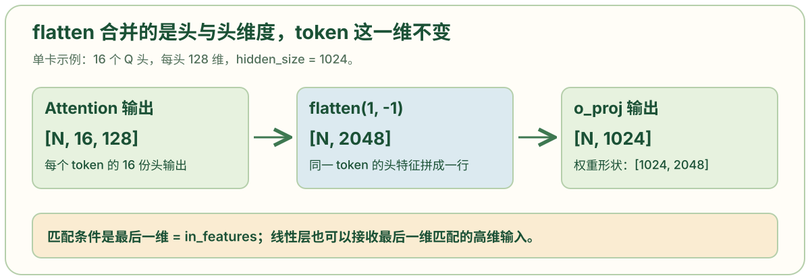
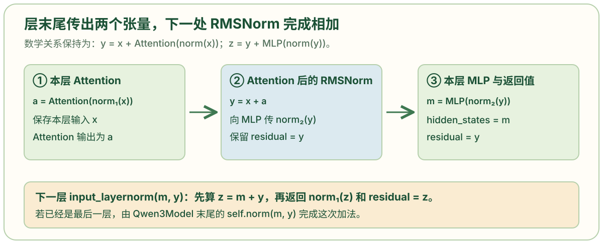
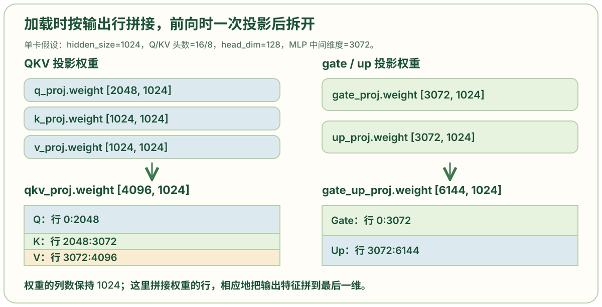

# qwen3.py: 组织注意力、残差连接与合并投影

```python
import torch
from torch import nn
import torch.distributed as dist
from transformers import Qwen3Config

from nanovllm.layers.activation import SiluAndMul
from nanovllm.layers.attention import Attention
from nanovllm.layers.layernorm import RMSNorm
from nanovllm.layers.linear import QKVParallelLinear, MergedColumnParallelLinear, RowParallelLinear
from nanovllm.layers.rotary_embedding import get_rope
from nanovllm.layers.embed_head import VocabParallelEmbedding, ParallelLMHead

class Qwen3Attention(nn.Module):
    def __init__(
        self,
        hidden_size: int,                   #隐藏维度
        num_heads: int,  # 模型总 Q 头数。
        num_kv_heads: int,  # 模型总 KV 头数，可以少于 Q 头数。
        max_position: int = 4096 * 32,  # RoPE 位置缓存覆盖的最大位置数，构造时从模型配置传入。
        head_dim: int | None = None,         #头维度， head_dim 这个变量可以是 int 类型或者是 None 类型，默认值设为 None
        rms_norm_eps: float = 1e-06,         #防除零常数
        qkv_bias: bool = False,               #投影偏置
        rope_theta: float = 10000,  # RoPE 频率计算的底数；get_rope() 用它生成不同维度的旋转频率。
        rope_scaling: dict | None = None,  # 可选 RoPE 配置；本文件只尝试从中读取 rope_theta。
    ) -> None:
        super().__init__()
        tp_size = dist.get_world_size()     # 取张量并行 rank 总数；单卡时为 1。
        self.total_num_heads = num_heads
        assert self.total_num_heads % tp_size == 0  # 这个库要求总 Q 头必须能被并行度整除；当前 rank 负责 total_num_heads / tp_size 个 Q 头。
        self.num_heads = self.total_num_heads // tp_size
        self.total_num_kv_heads = num_kv_heads
        assert self.total_num_kv_heads % tp_size == 0
        self.num_kv_heads = self.total_num_kv_heads // tp_size   # KV 头也按同样方式划分；Q 和 KV 头数可以不同，这是分组查询注意力的基础。意思是q头可以共享KV头
        self.head_dim = head_dim or hidden_size // self.total_num_heads  # 优先采用显式头维度；否则用隐藏维度除以总 Q 头数。
        self.q_size = self.num_heads * self.head_dim  # 本卡 Q 投影宽度等于本卡 Q 头数 × head_dim。
        self.kv_size = self.num_kv_heads * self.head_dim
        self.scaling = self.head_dim ** -0.5         # 注意力点积使用 1/√head_dim 进行缩放。
        self.qkv_bias = qkv_bias             # 保存是否给 QKV 投影加偏置，后面的归一化分支也使用这个标记。
        self.qkv_proj = QKVParallelLinear(  # 将同一隐藏状态一次投影为按 Q、K、V 排列的拼接向量。
            hidden_size,
            self.head_dim,
            self.total_num_heads,
            self.total_num_kv_heads,
            bias=qkv_bias,
        )
        self.o_proj = RowParallelLinear(         # 把 Attention 的 Q 头输出宽度映射回模型隐藏维度；多卡时这个层还会合并各 rank 的部分结果。
            self.total_num_heads * self.head_dim,
            hidden_size,
            bias=False,
        )
        if isinstance(rope_scaling, dict):        # 若配置含 RoPE 扩展字典，就可能从中取新的 rope_theta。
            rope_theta = rope_scaling.get("rope_theta", rope_theta)
        self.rotary_emb = get_rope(        # 为此注意力层取得旋转位置编码模块，旋转维度等于头维度，最大位置和底数来自配置。
            self.head_dim,
            rotary_dim=self.head_dim,
            max_position=max_position,
            base=rope_theta,
        )
        self.attn = Attention(        # 创建负责 KV 写入以及 prefill/decode 注意力计算的后端；这里传入本卡 Q/KV 头数与缩放系数。
            self.num_heads,
            self.head_dim,
            self.scaling,
            self.num_kv_heads,
        )
        if not self.qkv_bias:         # 当前实现当 QKV 投影无偏置时，为 Q 和 K 各建一个按头维度工作的 RMSNorm。
            self.q_norm = RMSNorm(self.head_dim, eps=rms_norm_eps)
            self.k_norm = RMSNorm(self.head_dim, eps=rms_norm_eps)

    def forward(
        self,
        positions: torch.Tensor,
        hidden_states: torch.Tensor,
    ) -> torch.Tensor:
        # 把隐藏状态一次映射成拼接的 Q/K/V 向量。
        qkv = self.qkv_proj(hidden_states)
        # 按上面计算的宽度拆开 Q、K 和 V。
        q, k, v = qkv.split([self.q_size, self.kv_size, self.kv_size], dim=-1)
        # 把每种投影的末维拆成“头数 × 每头维度”；-1 表示合并 batch 内的 token 总数由框架推导。
        q = q.view(-1, self.num_heads, self.head_dim)
        k = k.view(-1, self.num_kv_heads, self.head_dim)
        v = v.view(-1, self.num_kv_heads, self.head_dim)
        # 本实现分别归一化 Q 和 K；V 保持投影得到的值。
        if not self.qkv_bias:
            q = self.q_norm(q)
            k = self.k_norm(k)
        q, k = self.rotary_emb(positions, q, k)# 给 Q 和 K 加入位置信息（ROPE），V 保持原值。
        o = self.attn(q, k, v)
        output = self.o_proj(o.flatten(1, -1))# 将各 Q 头的输出拼回扁平向量，再映射回隐藏维度。
        return output  # 将当前 token 的注意力输出返回给解码层。

class Qwen3MLP(nn.Module):
    def __init__(
        self,
        hidden_size: int,
        intermediate_size: int,    #中间维度。MLP（前馈网络）层中间隐藏层的维度。
        hidden_act: str,
    ) -> None:
        super().__init__()
        # 一次投影生成 gate 和 up；在单卡下，两部分各宽 intermediate_size。
        self.gate_up_proj = MergedColumnParallelLinear(
            hidden_size,
            [intermediate_size] * 2,
            bias=False,
        )
        # 将门控后的中间向量映射回 hidden_size。
        self.down_proj = RowParallelLinear(
            intermediate_size,
            hidden_size,
            bias=False,
        )
        assert hidden_act == "silu"      # 当前代码只接受 hidden_act == 'silu'，用 SiluAndMul 实现门控：一半经过 SiLU，再与另一半逐元素相乘。
        self.act_fn = SiluAndMul()

    def forward(self, x):                   # 依次执行合并的 gate/up 投影、门控激活、down 投影，返回与输入隐藏维度相同的张量。
        gate_up = self.gate_up_proj(x)
        x = self.act_fn(gate_up)
        x = self.down_proj(x)
        return x

class Qwen3DecoderLayer(nn.Module):

    def __init__(
        self,
        config: Qwen3Config,
    ) -> None:
        super().__init__()
        self.self_attn = Qwen3Attention(
            hidden_size=config.hidden_size,
            num_heads=config.num_attention_heads,
            num_kv_heads=config.num_key_value_heads,
            max_position=config.max_position_embeddings,
            rms_norm_eps=config.rms_norm_eps,
            qkv_bias=getattr(config, 'attention_bias', True),
            head_dim=getattr(config, 'head_dim', None),
            rope_theta=getattr(config, "rope_theta", 1000000),
            rope_scaling=getattr(config, "rope_scaling", None),
        )
        self.mlp = Qwen3MLP(
            hidden_size=config.hidden_size,
            intermediate_size=config.intermediate_size,
            hidden_act=config.hidden_act,
        )
        self.input_layernorm = RMSNorm(config.hidden_size, eps=config.rms_norm_eps)  # Attention 之前的 RMSNorm；另一处 post_attention_layernorm 用于 MLP 之前。
        self.post_attention_layernorm = RMSNorm(config.hidden_size, eps=config.rms_norm_eps)

    def forward(
        self,
        positions: torch.Tensor,
        hidden_states: torch.Tensor,
        residual: torch.Tensor | None,  # 首层为 None；后续层传入上一层尚未加上 MLP 输出的残差。
    ) -> tuple[torch.Tensor, torch.Tensor]:
        if residual is None:
            # 首层保存输入 E，并计算 norm(E)。
            hidden_states, residual = self.input_layernorm(hidden_states), hidden_states
        else:
            # 合并上一层的 MLP 输出与 residual；返回归一化结果及相加后的残差。
            hidden_states, residual = self.input_layernorm(hidden_states, residual)
        hidden_states = self.self_attn(positions, hidden_states)
        # 将 Attention 输出加回本层输入，并归一化后送入 MLP。
        hidden_states, residual = self.post_attention_layernorm(hidden_states, residual)
        hidden_states = self.mlp(hidden_states)
        # 分别返回 MLP 输出和 Attention 残差；这次未做的相加留给下一处 RMSNorm。
        return hidden_states, residual

class Qwen3Model(nn.Module):    # 定义不含最终 logits 输出头的主模型。
    def __init__(
        self,
        config: Qwen3Config,
    ) -> None:
        super().__init__()
        self.embed_tokens = VocabParallelEmbedding(config.vocab_size, config.hidden_size)    # 把 token ID 映射为隐藏向量；词表可按张量并行 rank 分片。
        self.layers = nn.ModuleList([Qwen3DecoderLayer(config) for _ in range(config.num_hidden_layers)])  # 按 config.num_hidden_layers 创建解码层。
        self.norm = RMSNorm(config.hidden_size, eps=config.rms_norm_eps)   # 创建所有解码层之后的最终归一化。
    def forward(
        self,
        input_ids: torch.Tensor,
        positions: torch.Tensor,
    ) -> torch.Tensor:
        hidden_states = self.embed_tokens(input_ids)
        residual = None
        for layer in self.layers:                   # 顺序更新隐藏状态和残差；每层都会读取本轮 Attention 上下文与 KV Cache。
            hidden_states, residual = layer(positions, hidden_states, residual)
        hidden_states, _ = self.norm(hidden_states, residual)              # 最终合并残差并归一化，只保留归一化结果。
        return hidden_states                      # 将最终隐藏状态交给语言模型输出头。

class Qwen3ForCausalLM(nn.Module):

    # 将原始投影名映射到合并参数名及目标片段。
    # 作用：告诉权重加载器如何将 HuggingFace 原始模型的分离权重合并到优化后的结构
    #
    # 背景：
    # - HuggingFace 原始模型：q_proj, k_proj, v_proj 是三个独立的线性层
    # - nano-vllm 优化模型：qkv_proj 是一个合并的大矩阵（性能优化）
    #
    # 原始权重文件结构：
    #   model.layers.0.self_attn.q_proj.weight      [2048, 1024]
    #   model.layers.0.self_attn.k_proj.weight      [1024, 1024]
    #   model.layers.0.self_attn.v_proj.weight      [1024, 1024]
    #   model.layers.0.mlp.gate_proj.weight         [3072, 1024]
    #   model.layers.0.mlp.up_proj.weight           [3072, 1024]
    #
    # 优化后的模型结构：
    #   model.layers.0.self_attn.qkv_proj.weight    [4096, 1024] ← 合并了 q/k/v
    #   model.layers.0.mlp.gate_up_proj.weight      [6144, 1024] ← 合并了 gate/up
    #
    # 映射规则：
    #   "原始名": ("目标名", 标识)
    #   - 标识可以是字符串（"q", "k", "v"）或索引（0, 1）
    #
    # 合并方式：
    #   qkv_proj.weight = cat([q_proj.weight,    # [2048, 1024]
    #                          k_proj.weight,    # [1024, 1024]
    #                          v_proj.weight],   # [1024, 1024]
    #                         dim=0)             # [4096, 1024]
    #
    #   gate_up_proj.weight = cat([gate_proj.weight,  # [3072, 1024]
    #                              up_proj.weight],   # [3072, 1024]
    #                             dim=0)              # [6144, 1024]
    #
    # 为什么合并？
    #   1. 性能：3次矩阵乘法 → 1次矩阵乘法，减少 GPU Kernel 调用
    #   2. 融合：可以用优化的 CUDA Kernel 同时完成投影和分割
    #   3. 并行：张量并行时一次切分即可分配到多个 GPU
    # ============================================================================
    packed_modules_mapping = {
        "q_proj": ("qkv_proj", "q"),  # Q 权重写入 qkv_proj 的 Q 片段。
        "k_proj": ("qkv_proj", "k"),  # K 权重写入 qkv_proj 的 K 片段。
        "v_proj": ("qkv_proj", "v"),  # V 权重写入 qkv_proj 的 V 片段。
        "gate_proj": ("gate_up_proj", 0),  # Gate 权重写入 gate_up_proj 的第 0 个片段。
        "up_proj": ("gate_up_proj", 1),  # Up 权重写入 gate_up_proj 的第 1 个片段。
    }
    def __init__(
        self,
        config: Qwen3Config
    ) -> None:
        super().__init__()
        self.model = Qwen3Model(config)
        self.lm_head = ParallelLMHead(config.vocab_size, config.hidden_size)    # 创建将隐藏向量投影到词表维度的输出头。
        if config.tie_word_embeddings:                 # 若模型共享输入嵌入与输出头权重，就把输出头的权重数据指向输入嵌入的权重数据。
            self.lm_head.weight.data = self.model.embed_tokens.weight.data
    def forward(
        self,
        input_ids: torch.Tensor,
        positions: torch.Tensor,
    ) -> torch.Tensor:
        return self.model(input_ids, positions)

        # 调用 lm_head 计算词表 logits。ModelRunner.run_model() 先调用模型前向，再调用这里。
    def compute_logits(
        self,
        hidden_states: torch.Tensor,
    ) -> torch.Tensor:
        return self.lm_head(hidden_states)
```

## Attention 输出为什么先 flatten，再交给 o_proj

```python
q, k = self.rotary_emb(positions, q, k)
o = self.attn(q, k, v)
output = self.o_proj(o.flatten(1, -1))
return output
```

**这里要解决的是：每个 token 有多个注意力头的输出，怎样把它们合成输出投影所需的一行特征？** Attention 返回 `o`，形状是 `[N, 本卡 Q 头数, 每头维度]`。`N` 是本轮输入 token 数：prefill 可以包含多个请求的多段 token，decode 通常每个请求贡献一个 token。`flatten(1, -1)` 保留第 0 维，把后两维合成 `[N, 本卡 Q 头数 × 每头维度]`。



例如假设单卡有 16 个 Q 头、每头 128 维、`hidden_size=1024`，则形状变化为 `[N,16,128] → [N,2048] → [N,1024]`。`o_proj` 的输入特征宽度是 2048，输出宽度是 1024；它把同一个 token 的各头结果共同投影回隐藏状态。多卡时，每张卡先合并自己负责的 Q 头，`RowParallelLinear` 再合并各 rank 的部分输出。[`RowParallelLinear`](https://github.com/GeeeekExplorer/nano-vllm/blob/bb823b3e06983d71485a8e1f23715ebd87d98ef8/nanovllm/layers/linear.py)

展平的关键是**让最后一维与权重的输入特征数一致**。PyTorch 线性层也能处理高维张量，只要求最后一维等于 `in_features`。若把上例的 `[N,16,128]` 直接交给期待 2048 个输入特征的投影，最后一维 128 就不匹配；不是因为张量有三维才不能计算。[PyTorch Linear 输入形状](https://docs.pytorch.org/docs/2.14/generated/torch.nn.Linear.html)

## residual 为什么跨层更新，为什么每层返回两个张量

```python
if residual is None:
    hidden_states, residual = self.input_layernorm(hidden_states), hidden_states
else:
    hidden_states, residual = self.input_layernorm(hidden_states, residual)
hidden_states = self.self_attn(positions, hidden_states)
hidden_states, residual = self.post_attention_layernorm(hidden_states, residual)
hidden_states = self.mlp(hidden_states)
return hidden_states, residual
```

**疑问有两部分：残差为什么一直在变，以及最后为什么返回 MLP 输出与残差，而不当场相加？** 标准残差连接会把每个子层的输出加回该子层的输入；随着前向计算推进，这个输入也在更新。对一个先归一化、再执行 Attention 和 MLP 的解码层，其数学关系可以写为：

```text
a = Attention(RMSNorm₁(x))
y = x + a
m = MLP(RMSNorm₂(y))
z = y + m
```

`x` 是本层输入，`a` 是注意力输出，`y` 是相加后的状态，`m` 是 MLP 输出，`z` 是完整的本层输出。每个子层接回自己的输入，并非每次都加最开始的 embedding。[Transformers 的 Qwen3 解码层](https://github.com/huggingface/transformers/blob/main/src/transformers/models/qwen3/modeling_qwen3.py)

Nano-vLLM 保持这两次加法的数学关系，但改变了执行位置。在 `post_attention_layernorm(hidden_states, residual)` 处，Attention 输出 `a` 与本层输入 `x` 相加，返回 `RMSNorm₂(y)` 和 `y`。随后 MLP 得到 `m`，本层返回 `(hidden_states=m, residual=y)`。**尚未执行的 `y+m`，交给下一层的 `input_layernorm` 与归一化一起完成。**



传入两个张量时，`RMSNorm.forward()` 会调用 `add_rms_forward()`。其中与残差有关的实际语句如下：

```python
orig_dtype = x.dtype
x = x.float().add_(residual.float())
residual = x.to(orig_dtype)
var = x.pow(2).mean(dim=-1, keepdim=True)
x.mul_(torch.rsqrt(var + self.eps))
x = x.to(orig_dtype).mul_(self.weight)
return x, residual
```

它先相加，再分别保留“归一化结果”和“相加后的残差”。加法与 RMSNorm 被放进同一个 `torch.compile` 函数，给编译器融合计算、减少独立中间写回的机会；具体 kernel 数取决于编译结果。由于这里还涉及 float32 转换和原 dtype 的恢复，数学关系一致不意味着所有精度下都逐位相同。[`RMSNorm.add_rms_forward()`](https://github.com/GeeeekExplorer/nano-vllm/blob/bb823b3e06983d71485a8e1f23715ebd87d98ef8/nanovllm/layers/layernorm.py)

下面只追踪加法，假设 embedding 为 10，两层 Attention 输出依次为 2、4，MLP 输出依次为 3、5。这些是帮助理解状态变化的假设值，不是模型实测输出。

| 代码位置 | 此时执行的加法 | 保存或传出的状态 |
| --- | --- | --- |
| 第 0 层首次进入 | 尚不相加，保存输入 10 | `residual=10`，Attention 接收 `norm(10)` |
| 第 0 层 Attention 之后 | `2+10=12` | `residual=12`，MLP 接收 `norm(12)` |
| 第 0 层返回 | 暂不执行 `3+12` | `hidden_states=3, residual=12` |
| 第 1 层输入归一化 | `3+12=15` | `residual=15`，Attention 接收 `norm(15)` |
| 第 1 层 Attention 之后 | `4+15=19` | `residual=19`，MLP 接收 `norm(19)` |
| 第 1 层返回 | 暂不执行 `5+19` | `hidden_states=5, residual=19` |
| 模型末尾最终归一化 | `5+19=24` | 返回 `norm(24)` |

最后一层已经没有“下一层”可接收未完成的加法，所以 `Qwen3Model.forward()` 在循环后调用 `self.norm(hidden_states, residual)`，完成最后一次相加与归一化：

```python
for layer in self.layers:
    hidden_states, residual = layer(positions, hidden_states, residual)
hidden_states, _ = self.norm(hidden_states, residual)
return hidden_states
```

这种写法优化的是加法和归一化的组织方式。将前面输出代数展开后写进 `residual`，不等于每层信息都被无损保存，也不能单凭这段推理代码得出训练更稳定的结论。

## packed_modules_mapping 怎样把分离权重装进合并投影

```python
packed_modules_mapping = {
    "q_proj": ("qkv_proj", "q"),
    "k_proj": ("qkv_proj", "k"),
    "v_proj": ("qkv_proj", "v"),
    "gate_proj": ("gate_up_proj", 0),
    "up_proj": ("gate_up_proj", 1),
}
```

**这里的矛盾是：权重文件按 Q、K、V 分别保存，本模型却只有一个 qkv_proj 参数，加载器怎样知道每份权重放到哪里？** 这个字典为每个原始名称提供“目标参数名”和“片段标识”。例如 `"k_proj": ("qkv_proj", "k")` 表示将 K 投影权重写到 `qkv_proj` 的 K 片段；`"up_proj": ("gate_up_proj", 1)` 表示写到合并 MLP 投影的第 1 个片段。

先以单卡为例，假设 `hidden_size=1024`、Q 头数为 16、KV 头数为 8、每头 128 维、`intermediate_size=3072`。线性层权重按 `[输出特征数, 输入特征数]` 排列，因此 Q/K/V 沿权重的行维拼接：



| 原始权重 | 原始形状 | 合并参数中的目标行，左闭右开 |
| --- | --- | --- |
| `q_proj.weight` | `[2048,1024]` | `qkv_proj.weight[0:2048]` |
| `k_proj.weight` | `[1024,1024]` | `qkv_proj.weight[2048:3072]` |
| `v_proj.weight` | `[1024,1024]` | `qkv_proj.weight[3072:4096]` |
| `gate_proj.weight` | `[3072,1024]` | `gate_up_proj.weight[0:3072]` |
| `up_proj.weight` | `[3072,1024]` | `gate_up_proj.weight[3072:6144]` |

真正执行映射的是 `utils/loader.py`。读到类似 `model.layers.0.self_attn.k_proj.weight` 的名称后，它把 `k_proj` 替换成 `qkv_proj`，找到已经创建好的合并参数，并将标识 `"k"` 传给这个参数的 `weight_loader`：

```python
v, shard_id = packed_modules_mapping[k]
param_name = weight_name.replace(k, v)
param = model.get_parameter(param_name)
weight_loader = getattr(param, "weight_loader")
weight_loader(param, f.get_tensor(weight_name), shard_id)
```

这段加载代码里的 `v` 是目标模块名字符串，例如 `"qkv_proj"`，与 Attention 的 V 张量无关。`QKVParallelLinear.weight_loader()` 根据 `"q" / "k" / "v"` 算出目标行的起点和宽度，再把原权重复制进去。`MergedColumnParallelLinear` 则根据 0、1 计算 gate/up 的片段位置。也就是说，**装载时填写合并参数的各个片段，前向时直接使用装好的参数**。[权重加载入口](https://github.com/GeeeekExplorer/nano-vllm/blob/bb823b3e06983d71485a8e1f23715ebd87d98ef8/nanovllm/utils/loader.py)、[两种合并线性层的 weight_loader](https://github.com/GeeeekExplorer/nano-vllm/blob/bb823b3e06983d71485a8e1f23715ebd87d98ef8/nanovllm/layers/linear.py)

合并的用途可以直接对照 `Qwen3Attention.forward()`：同一份 `hidden_states` 经过一次 `qkv_proj`，便得到按 Q、K、V 排列的输出，再按宽度拆开。

```python
qkv = self.qkv_proj(hidden_states)
q, k, v = qkv.split([self.q_size, self.kv_size, self.kv_size], dim=-1)
```

在相同输入上，使用拼好的权重做一次线性投影，与分别计算 Q、K、V 后沿输出特征维拼接具有相同的数学结果。MLP 的 gate/up 也采用同样方式：一次投影得到两半，`SiluAndMul` 对 gate 做 SiLU 后与 up 逐元素相乘，`down_proj` 再映射回隐藏维度。收益来自减少线性算子调用、给较大矩阵运算提供机会；计算量不会因为写成一次调用就缩成三分之一。

多卡时，表中的单卡行范围需要换成每个 rank 的本地范围。加载器会先从**每份原始 Q/K/V 权重**中按行取当前 rank 的分片，再写到本卡的合并参数中。上例若使用两路张量并行，每张卡持有 `Q[1024,1024]`、`K[512,1024]`、`V[512,1024]`，合并后为 `[2048,1024]`。这种切分保证每张卡都有自己的 Q、K、V 片段；若直接把完整 `[Q;K;V]` 大矩阵一刀切成两半，就不能得到同样的分布。
