# 使用 Nsight Systems 分析 nano-vLLM 推理性能

大模型推理的总耗时由主机调度、GPU 计算、数据传输和结果处理共同决定。吞吐测试给出整体速度，性能报告进一步记录各项工作的时间关系，使优化能够围绕具体热点展开。

本文以 RTX 5070 上运行 Qwen3-0.6B 为例，从一段精简的计时脚本出发，使用 NVIDIA Nsight Systems 采集并阅读报告。分析过程依次覆盖实验条件、CPU/GPU 时间线、内核耗时汇总，以及一次 CPU 等待与 GPU 复制的关联事件。

## 1. 测试背景与基准脚本

### 1.1 完整测试代码

nano-vLLM 是一个实现大模型推理的 Python 项目，提供模型加载、请求调度、KV 缓存管理和文本生成等功能。下面的 `bench.py` 在项目原版基准脚本上补充了 GPU 同步、高精度计时和实际输出 token 计数，保持了单次批量推理的结构。

运行前需要准备可用的 nano-vLLM 环境和本地 Hugging Face 模型目录。以下是本例使用的完整脚本；默认路径对应实验机器，可通过 `NANOVLLM_MODEL_PATH` 指定自己的模型位置。

```python
import os
import time
import torch
from random import randint, seed
from nanovllm import LLM, SamplingParams
# from vllm import LLM, SamplingParams


def main():
    seed(0)
    num_seqs = 256
    max_input_len = 1024
    max_ouput_len = 1024

    path = os.environ.get("NANOVLLM_MODEL_PATH", "/home/wsj/MYPRJ/models/Qwen3-0.6B")
    llm = LLM(path, enforce_eager=False, max_model_len=4096)

    prompt_token_ids = [[randint(0, 10000) for _ in range(randint(100, max_input_len))] for _ in range(num_seqs)]
    sampling_params = [SamplingParams(temperature=0.6, ignore_eos=True, max_tokens=randint(100, max_ouput_len)) for _ in range(num_seqs)]
    # uncomment the following line for vllm
    # prompt_token_ids = [dict(prompt_token_ids=p) for p in prompt_token_ids]

    # 先预热；模型加载和这次预热不计入正式耗时。
    llm.generate(["Benchmark: "], SamplingParams(), use_tqdm=False)
    # CUDA 异步执行，计时前后同步，确保测到整批推理完成的时间。
    torch.cuda.synchronize()
    t = time.perf_counter()
    outputs = llm.generate(prompt_token_ids, sampling_params, use_tqdm=False)
    torch.cuda.synchronize()
    t = time.perf_counter() - t
    # 按实际生成的 token 数计算吞吐；耗时包含 prefill、decode 和最终反分词。
    total_tokens = sum(len(output["token_ids"]) for output in outputs)
    throughput = total_tokens / t
    print(f"Total: {total_tokens}tok, Time: {t:.2f}s, Throughput: {throughput:.2f}tok/s")


if __name__ == "__main__":
    main()
```

### 1.2 工作负载与计时边界

脚本执行一次离线批量生成：预先构造 256 条请求，然后交给 `llm.generate()` 处理，直到这些请求完成。每条请求的长度不同，可以观察混合长度负载下的调度、计算和缓存行为。

| 设置 | 本例取值 | 对测试的影响 |
| --- | --- | --- |
| `seed(0)` | Python 随机种子为 0 | 控制合成输入和目标输出长度的随机生成；模型采样另由 PyTorch 执行 |
| `num_seqs` | 256 | 一次提交的请求数量 |
| 输入长度 | 每条 100～1024 token | 构造不同规模的提示词处理任务 |
| 输入 token ID | 从 0～10000 中随机取值，包含两个端点 | 使用 Qwen3 词表范围内的合成输入，便于控制计算规模 |
| 目标输出长度 | 每条 100～1024 token | 让请求在不同生成步数完成，形成变化的运行批量 |
| `temperature=0.6` | 采样温度 | 调整生成 token 的概率分布 |
| `ignore_eos=True` | 忽略结束标记 EOS | 各请求按设定的 `max_tokens` 生成，便于比较工作量 |
| `enforce_eager=False` | 启用引擎的 CUDA Graph 路径 | 在适用的 decode 规模下重放预先捕获的 GPU 工作 |
| `max_model_len=4096` | 单条序列的上下文上限 | 为输入与已生成内容提供长度预算 |

**Prefill** 是处理提示词、计算历史 Key/Value 张量的阶段；**decode** 是利用这些历史张量逐步生成后续 token 的阶段。保存历史 Key/Value 张量的存储空间称为 **KV 缓存**。随着请求完成、上下文增长和缓存容量变化，调度器每一步选择的序列数也会变化，因此一次提交的 256 条请求会形成多个实际执行批次。

随机 token 构成的是合成计算负载，适合观察运行行为。模型回答质量则需要使用有语义的输入和相应评价方法。为了保持示例简洁，脚本按引擎默认策略管理前缀缓存，输入准备仅使用随机生成。

`LLM(...)` 初始化过程中会加载权重、执行内部预热、分配 KV 缓存，并按配置捕获 CUDA Graph。脚本随后用一条短提示词再执行一次生成，再进入正式计时：

```text
构造引擎与加载权重
    ↓
生成随机输入和采样参数
    ↓
执行短提示词预热
    ↓
同步 GPU，等待已有工作完成
    ↓
开始计时
    ↓
generate：请求调度 → prefill / decode → 采样与结果取回 → 最终反分词
    ↓
同步 GPU，等待本轮工作完成
    ↓
结束计时，汇总实际输出 token 数
```

CUDA 操作通常由 CPU 异步提交。计时前的同步使上一阶段工作完成，计时后的同步使本轮 GPU 工作完成，两个边界共同定义整批生成耗时。`time.perf_counter()` 提供高精度单调时钟，适合计算这段经过时间。

输入已经是 token ID，因而计时从引擎接收这些 ID 开始；`generate()` 返回前执行的文本反分词也包含在时间内。输出吞吐的计算方式是：

```text
输出吞吐 = 所有请求实际生成的 token 总数 / 整批 generate 的耗时
```

这是一轮完整生成的吞吐指标。短提示词预热覆盖了部分首次运行开销，正式随机批次仍可能触发新的形状相关编译或缓存准备。本例用于建立初步性能观察；评估代码优化时，应进一步固定输入、进行相同负载的预热并重复计时，观察结果分布。

### 1.3 实验环境与报告采集

本例使用以下环境，采集日期为 2026-10-19。

| 项目 | 条件 |
| --- | --- |
| GPU | NVIDIA GeForce RTX 5070 |
| CPU | AMD Ryzen 5 7500F |
| 操作系统 | Ubuntu 26.04 LTS |
| NVIDIA 驱动 | 595.91.07 |
| 模型 | Qwen3-0.6B，BF16 |
| nano-vLLM 源码版本 | `bb823b3e06983d71485a8e1f23715ebd87d98ef8` |
| PyTorch / FlashAttention | 2.9.1+cu130 / 2.8.3 |
| Nsight Systems | 2026.3.2 |

**Nsight Systems** 的命令行入口是 `nsys`，用于记录 CPU 调用、GPU 内核和内存活动的时间关系。**Nsight Compute** 的入口是 `ncu`，用于采集具体 GPU 内核的硬件性能指标。本文先使用 Systems 找到值得深入分析的计算和等待过程。

GPU **内核（kernel）** 是提交到 GPU 执行的一段计算程序。一个 Python 算子可能启动多个内核，编译器也可能将多个张量操作融合为一个内核。时间线通过这些实际执行单元呈现 GPU 工作。

在项目目录激活环境后，可先直接运行脚本保存普通计时结果，再单独进行 Nsight 采集。下面两处 `/path/to/...` 需要替换为实际目录：

```bash
cd /path/to/nano-vllm
source .venv/bin/activate
export NANOVLLM_MODEL_PATH=/path/to/Qwen3-0.6B

# 单独运行，记录普通计时结果。
python bench.py

# 在另一次运行中采集内部执行信息。
nsys profile \
  --trace=cuda \
  --sample=none \
  --cpuctxsw=none \
  --cuda-graph-trace=node \
  --output=/tmp/nano-timeline \
  python bench.py
```

示例假定 `nsys` 已加入 `PATH`；本实验机器上的命令位于 `/usr/local/cuda-13.4/bin/nsys`。采集参数的含义如下。

| 参数 | 本次作用 |
| --- | --- |
| `--trace=cuda` | 记录 CUDA API 调用、GPU 内核和显式内存操作 |
| `--sample=none` | 关闭 CPU 指令地址及调用栈采样 |
| `--cpuctxsw=none` | 关闭 CPU 线程上下文切换采集 |
| `--cuda-graph-trace=node` | 记录 CUDA Graph 内部各节点的活动 |
| `--output=/tmp/nano-timeline` | 将最终报告写为 `/tmp/nano-timeline.nsys-rep` |

本次以 CUDA 执行过程为观察重点。CPU 函数内部的耗时分布、线程运行状态，以及 GPU 的实时硬件吞吐指标，可以在后续实验中通过相应采集选项补充。

采集运行的终端输出为：

```text
Total: 133966tok, Time: 36.58s, Throughput: 3662.30tok/s
```

这组数值来自 Nsight 采集过程，包含工具带来的运行开销。普通计时结果用于性能比较，采集结果用于解释内部执行原因，两类结果分别保存。

当前命令采用整段程序采集，生成的报告包含初始化、预热、图捕获、正式推理和退出过程。后文的“全报告汇总”均采用这个范围。文章中的 12 张截图来自 Linux 版 Nsight Systems 实际打开该报告后的界面；Windows 版可按相同的英文视图名称操作。

## 2. 打开报告与核对采集信息

### 2.1 打开本地报告

1. 启动 **NVIDIA Nsight Systems**。
2. 使用 **File → Open**，或快捷键 **Ctrl+O**。
3. 选择 `nano-timeline.nsys-rep`，点击 **Open**。
4. 等待报告加载完成，进入离线分析。报告包含已采集的活动，查看端可独立阅读这些记录。

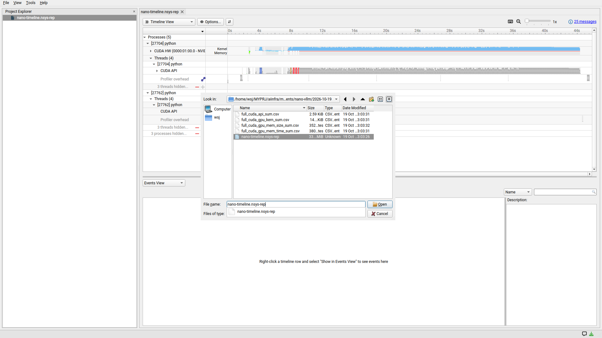

图 1：实际打开报告的对话框。文件选择器中的路径是查看报告这台机器上的路径。

跨机器查看时，将报告复制到查看端可访问的目录，再通过该端的文件选择器打开。例如在 Windows 上分析 Linux 采集的报告，可以先将文件保存到 Windows 本地目录。查看端使用与采集端相同或更新的 Systems 版本，安装时选择包含 GUI 的版本。版本与平台兼容关系见 [Nsight Systems 官方下载与平台说明](https://developer.nvidia.com/nsight-systems/get-started)。

### 2.2 Analysis Summary：确认实验身份与测量范围

**Analysis Summary（分析摘要）** 汇总这次实验的运行环境、采集配置和报告信息。阅读性能数据前，先用它确认三个条件：分析的是哪次运行、记录了多长时间、启用了哪些采集功能。

在报告左上方的视图下拉框中选择 **Analysis Summary**。

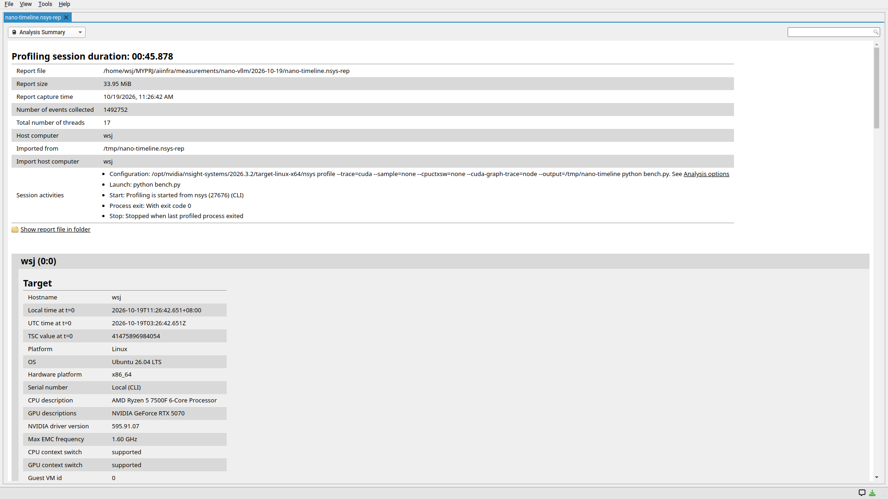

图 2：本例的分析摘要。上半部分是采集会话信息，下半部分的 Target 是实际执行被测程序的机器。

**报告信息与统计规模。** 图中各字段可以按下表阅读。

| 字段 | 本例内容 | 含义与分析用途 |
| --- | --- | --- |
| Profiling session duration | 45.878 秒 | 采集会话覆盖的时间范围，用于解释全报告统计的边界 |
| Report file | 当前打开的 `nano-timeline.nsys-rep` 路径 | 确认正在分析的报告副本 |
| Report size | 33.95 MiB | 报告的磁盘大小；长时间运行或高密度事件会增加加载和处理成本 |
| Report capture time | 2026-10-19 11:26:42 | 将报告与对应终端输出、实验日志联系起来 |
| Number of events collected | 1,492,752 | 报告中收集到的事件总数，涵盖采集配置启用的多类记录 |
| Total number of threads | 17 | 报告记录的线程数量，帮助了解被测进程及其相关进程的线程规模 |
| Host computer | `wsj` | 记录的主机名称，用于区分来自不同机器的报告 |
| Imported from / Import host computer | 原始文件路径及导入主机 | 追踪报告的来源；复制到其他位置后仍可保留原始来源信息 |

本例导出的 GPU kernel 表包含 1,049,499 次内核执行，而摘要页的 1,492,752 是更广的事件集合。比较事件数量时，先明确它来自哪个表、统计哪些类别。线程数量则用于识别执行主体；线程的活跃时段和并发关系需要结合线程活动记录分析。

**Session activities（会话活动）。** 这一组字段描述采集如何启动和结束，尤其适合核对一份来源已久的报告。

| 项目 | 本例内容 | 分析方法 |
| --- | --- | --- |
| Configuration | 包含 `--trace=cuda` 等实际参数 | 核对采集能力；其中的 **Analysis options** 链接可以跳到更完整的选项记录 |
| Launch | `python bench.py` | 确认被测入口和命令行参数 |
| Start | 由 `nsys` CLI 启动 | 说明本次通过命令行发起采集 |
| Process exit | Exit code 0 | 表示被测进程正常退出，可继续结合输出检查本轮工作量 |
| Stop | 最后一个被采集进程退出时停止 | 说明采集范围覆盖了相关进程的生命周期 |

从这组记录可以解释本例的两个时间：脚本的 **36.58 秒**对应正式 `generate()` 区间，摘要中的 **45.878 秒**覆盖整个采集会话。两者的差额由初始化、预热、退出和相关采集活动等多项工作构成。分析每个阶段的开销，需要在时间线上分别定位这些阶段。

**Target（目标机器）。** 性能数据属于实际执行程序的硬件和软件环境。跨机器查看报告时，应以 Target 中的信息描述测试条件。

| 字段组 | 本例内容 | 阅读重点 |
| --- | --- | --- |
| Hostname / Platform / OS | `wsj` / Linux / Ubuntu 26.04 LTS | 识别实际运行程序的机器和系统 |
| Hardware platform | x86_64 | 记录主机架构 |
| CPU description | Ryzen 5 7500F | 结合 CPU 提交任务与调度的成本理解主机条件 |
| GPU descriptions | RTX 5070 | 将内核配置和后续硬件指标对应到目标 GPU |
| NVIDIA driver version | 595.91.07 | 比较不同实验时核对驱动条件 |
| Local time at t=0 / UTC time at t=0 | 本地 11:26:42 与 UTC 03:26:42 | 将时间线起点与外部日志对齐；两者表示同一个时刻 |
| TSC value at t=0 | 目标机器记录的时间计数基准 | 为时间对齐提供信息，单报告分析通常使用界面横轴即可 |
| CPU / GPU context switch | `supported` | 描述目标支持的功能；本次实际启用情况由 Configuration 和 Analysis options 确认 |

例如，截图中 CPU context switch 显示 `supported`，采集配置同时记录了 `--cpuctxsw=none`。两条信息分别描述目标能力与本次实验选择，组合起来即可确定本报告采用的观测范围。

向下滚动时，Analysis Summary 还可展示进程、线程、模块、CPU、GPU 和工具版本等信息，具体分组随采集配置变化。**Process summary** 用于定位目标进程，**Thread summary** 用于查看线程组成，**Module summary** 用于识别加载的可执行文件和库；其中基于 CPU 采样计算的耗时字段，需要相应采样数据作为依据。页面中的 **Analysis options** 和 **Nsight Systems** 版本信息适合与实验记录一起保存。[官方 Analysis Summary 说明](https://docs.nvidia.com/nsight-systems/UserGuide/index.html#analysis-summary-view)

完成摘要检查后，本例的分析范围可以表述为：在 RTX 5070 上运行的一次完整进程采集，重点包含 CUDA API、GPU 内核和内存活动，正式推理约耗时 36.58 秒。自定义阶段名称和精确正式计时边界，需要在进一步采集中添加相应标记。

### 2.3 Diagnostics Summary：理解采集过程与数据状态

**Diagnostics Summary（诊断摘要）** 记录采集组件的状态、运行中的提示，以及报告处理阶段生成的消息。它帮助判断某类数据是否成功采集，并为缺失数据或异常现象提供排查线索。

选择 **Diagnostics Summary**，或点击时间线右上方的消息数量链接。

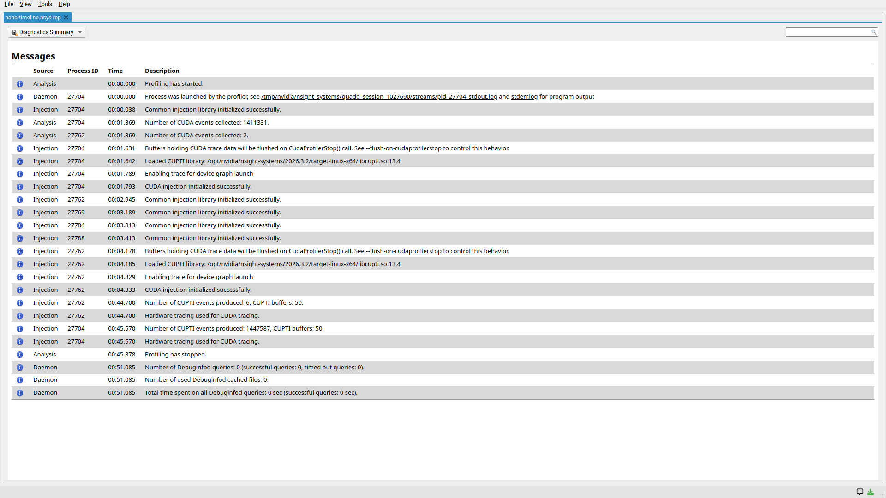

图 3：本例共 25 条消息，均以信息级别显示，覆盖启动、采集组件加载、数据收集和报告处理。

诊断表的每一行都应结合来源、进程和描述一起阅读：

| 字段 | 含义 | 本例的阅读方法 |
| --- | --- | --- |
| 左侧级别图标 | 信息、警告或错误级别 | 先按级别确定关注顺序，再阅读具体描述和受影响的数据 |
| Source | 生成消息的组件 | `Injection` 主要涉及目标进程中的采集组件；`Daemon` 涉及采集控制与管理；`Analysis` 涉及分析处理 |
| Process ID | 消息关联的进程编号 | 将主进程 27704 的消息与其他 Python 进程区分 |
| Time | 该诊断记录的时间信息 | 结合描述识别启动、运行、退出或后处理阶段 |
| Description | 具体事件、状态或问题 | 判断已经成功完成的采集步骤及后续应检查的对象 |

消息分为 **Informational messages**、**Warnings** 和 **Errors**。信息消息记录状态变化；警告提示需要关注的条件及其影响；错误提示某项操作失败。诊断还包含报告处理时补充的消息，因此应结合消息内容解释其所在阶段。[官方 Diagnostics Summary 说明](https://docs.nvidia.com/nsight-systems/UserGuide/index.html#diagnostics-summary-view)

本例中有几组值得具体阅读的记录。

| 图中的消息内容 | 技术含义 | 对本次分析的帮助 |
| --- | --- | --- |
| 目标进程已由 profiler 启动，并给出 stdout/stderr 路径 | Nsight 启动被测程序并关联其标准输出、标准错误 | 出现程序运行错误时，可以沿这些日志路径检查；跨机器共享时可另外保留终端日志 |
| 通用采集库和 CUDA 采集组件初始化成功 | 目标进程中的采集组件已就绪 | 支持继续检查这个进程的 CUDA 事件 |
| 已加载 `libcupti.so.13.4` | 加载 CUDA Profiling Tools Interface，即 CUDA 性能工具接口库 | 明确该次 CUDA 数据采集使用的接口库 |
| 启用 device graph launch 跟踪 | 采集器启用了相关图启动跟踪能力 | 结合采集选项和 GPU 轨道检查实际图活动 |
| 缓冲区将在 `cudaProfilerStop()` 调用时刷新 | 描述采集组件的一项数据刷新策略 | 实际停止触发方式继续由 Session activities 确认 |
| 主进程产生 1,447,587 条 CUPTI 事件，使用 50 个缓冲区 | 记录底层接口采集量及缓冲区使用情况 | 判断采集过程已产生数据，并与具体事件表交叉检查 |
| CUDA tracing 使用 hardware tracing | 此次 CUDA 时间跟踪采用硬件跟踪机制 | 记录采集方式，便于比较其他版本或配置下的结果 |
| 45.878 秒处采集停止 | 记录会话结束 | 与 Analysis Summary 的采集总时长对应 |
| Debuginfod 查询数为 0 | 本轮没有向该调试信息服务发起查询 | 需要源码级符号和调用栈分析时，再检查对应符号配置 |

**CUPTI** 提供 CUDA 活动记录所需的接口；诊断中的事件数属于该采集接口的记录口径。报告总事件数、CUPTI 记录数和 GPU 内核执行次数分别描述不同数据集合，核对数量时应选择对应类别。

**硬件跟踪**描述活动时间记录的采集机制。SM 活跃度、显存带宽、Tensor Core 吞吐等属于性能指标，需要使用相应的指标采集功能。这一区分使分析者能够根据实际数据选择下一步工具。

图中还可见 51.085 秒处的 Debuginfod 相关消息，发生在采集停止记录之后。它展示了报告后处理环节也会写入诊断，分析程序运行时段时应使用相应活动的时间边界。

对本例而言，初始化成功、产生 CUDA 数据、正常停止三组记录形成了完整的采集过程依据。随后可以进入 Timeline View 检查实际执行。如果其他实验出现丢失事件或缓冲区问题，应按消息定位受影响的阶段；若某项采集被关闭，则可在需要该数据的下一次实验中启用。

## 3. 时间线中的对象与时间含义

切换到 **Timeline View（时间线视图）**。界面上半部分按时间排列活动，下半部分用于事件详情或统计。如果需要扩大时间线区域，可以点击左侧 Project Explorer 面板的关闭按钮，将侧栏隐藏。

在本例的进程树中展开：

```text
Processes
└── [27704] python
    ├── CUDA HW
    │   ├── [All Streams]
    │   │   ├── Kernels
    │   │   └── Memory
    │   ├── Stream 168
    │   └── Default stream 7 等
    └── Threads
        └── [27704] python
            └── CUDA API
```

进程编号和 stream 编号在每次运行中分配。分析其他报告时，可以先按进程名称和启动参数定位目标，再展开具有 GPU 活动的进程。

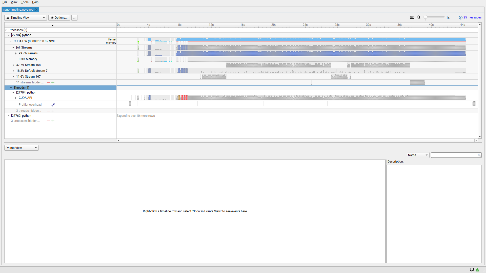

图 4：约 46 秒范围内的报告总览。上方是 GPU 活动，下方 Python 线程中的 CUDA API 是 CPU 侧调用。

阅读这个界面时需要区分四个对象：

| 对象 | 含义 | 本例的阅读方法 |
| --- | --- | --- |
| 横轴 | 相对采集起点的时间 | 开始看秒级全貌，随后放大到毫秒和微秒 |
| CUDA API | CPU 执行 CUDA 接口调用的区间 | 查看任务提交、复制调用、同步和等待 |
| GPU Kernels | GPU 实际执行计算内核的区间 | 查看内核时长、连续性和执行次序 |
| GPU Memory | 显式内存复制、清零等设备活动 | 查看复制方向、字节数和设备执行时长 |

**Stream 是 CUDA 工作的有序提交队列。** 同一 stream 中的操作按顺序执行，不同 stream 的操作在依赖满足、设备资源允许时可以重叠。观察并发时，将不同 stream 的事件投影到同一横轴，时间区间发生交叠即可看到实际重叠关系。

`All Streams` 将各条 stream 的活动聚合到一起，适合查看 GPU 的整体活动分布；具体 stream 则适合追踪队列内的执行顺序。汇总时选择其中一个层级，可使每个事件只参与一次统计。

全景图里每个像素可能对应许多短内核，所以会显示密集的色带。秒级视图适合识别活动阶段；放大到毫秒和微秒后，可以检查内核次序、执行时长和间隙。若要进一步分析计算单元在执行期间的效率，需要结合 GPU 硬件指标。

本图 `Kernels` 与 `Memory` 前的百分比表达相应活动的时间分布。`Memory` 轨道记录显式复制、清零等操作，Attention 内核执行中的显存读写则包含在 `Kernels` 活动中。研究数据搬运可查看 Memory 轨道，研究内核内部的访存效率则继续采集该内核的带宽和缓存指标。

## 4. 用汇总表定位累计耗时热点

**Stats System View（统计视图）** 将事件按名称或类别聚合，回答各类工作执行了多少次、累计花费多少时间。用它确定热点后，再进入 Events View 检查具体实例，便能将分析精力放在主要耗时位置。操作顺序为：

1. 保持上方为 **Timeline View**。
2. 在时间线下方左侧的视图下拉框中，选择 **Stats System View**。
3. 在下方列表选择 **CUDA GPU Kernel Summary**。
4. 等待表格生成，查看 **Total Time** 较大的行；需要时点击列标题调整排序。

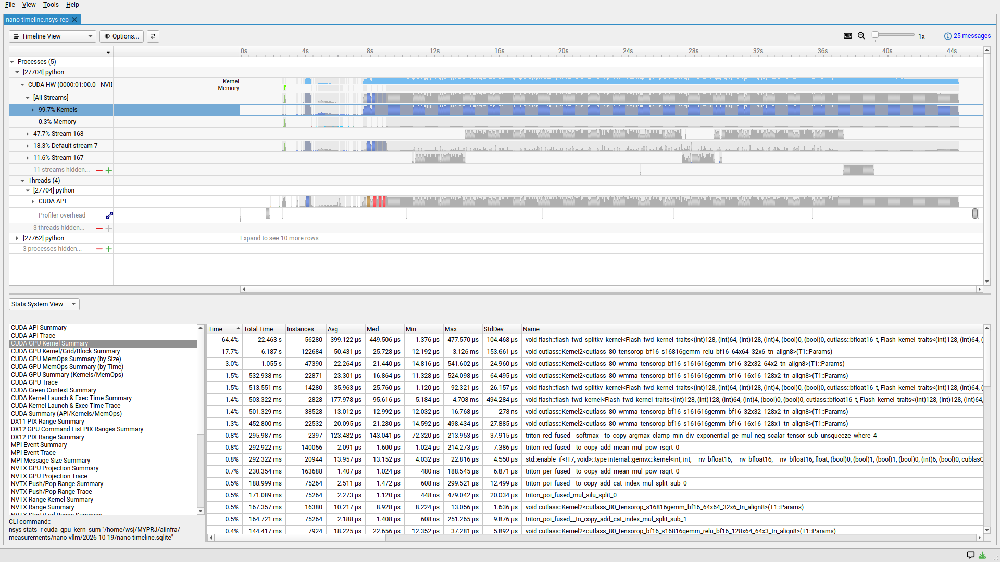

图 5：全报告的 GPU 内核汇总。第一行是 FlashAttention 的一个具体模板实例，第二行是一个 CUTLASS 矩阵乘内核实例。

这个表的字段含义如下：

| 字段 | 含义 | 用途 |
| --- | --- | --- |
| Name | 内核名称；可能包含很长的模板参数 | 识别实现类别并区分内核变体 |
| Instances | 该行内核的执行次数 | 结合单次耗时判断累计成本的来源 |
| Total Time | 这些实例的 GPU 执行时间总和 | 判断总体优化优先级 |
| Avg | 单次平均耗时 | 了解典型调用成本，但会混合不同输入规模 |
| Med | 单次耗时的中位数 | 与平均值对照，观察分布是否偏斜 |
| Min / Max | 最短、最长实例耗时 | 寻找差异较大的实例进一步检查 |
| StdDev | 单次耗时的标准差 | 描述这些实例的耗时分散程度 |
| Time | 该行累计时间占表内内核总时间的比例 | 判断相对占比；分母是内核累计时间 |

字段定义可对照 [官方 CUDA GPU Kernel Summary 说明](https://docs.nvidia.com/nsight-systems/AnalysisGuide/index.html#cuda-gpu-kern-sum-nvtx-name-base-mangled-cuda-gpu-kernel-summary)。

从实际 CSV 导出可核对两个主要条目：

| 内核名称缩写 | 累计 GPU 时间 | 调用次数 | 单次平均时间 | 表内占比 |
| --- | ---: | ---: | ---: | ---: |
| `flash_fwd_splitkv_kernel` 的第一行具体实例 | 22.462618 秒 | 56,280 | 399.123 微秒 | 64.4% |
| `cutlass_80_tensorop_bf16_s16816gemm_relu_bf16_64x64_32x6_tn_align8` | 6.187192 秒 | 122,684 | 50.432 微秒 | 17.7% |

全报告共记录 **1,049,499 次 GPU 内核执行**，累计内核时间约 **34.903558 秒**。第一行占比的计算为：

```text
22.462618 秒 ÷ 34.903558 秒 ≈ 64.4%
```

这里的分母是全报告内所有内核的累计执行时间，因此 64.4% 表示该具体实现对这一累计时间的贡献。若要分析某段正式推理，应先限定对应事件范围，再按同一范围计算占比。端到端经过时间还涉及 CPU/GPU 重叠关系，需要单独保留其测量边界。

内核名称中的模板参数有实际意义。同一个 `flash_fwd_splitkv_kernel` 基础名称可以对应多个不同实现实例，表里其他行也可能出现它。若只取第一行，就应写“该具体实例占 64.4%”；若要统计整个 Attention 类别，应明确选择和合并了哪些行。时间线按基础名称聚合的百分比，也可能与按完整名称分行的表格不同。

根据累计耗时，**这个 FlashAttention 实例适合作为下一步深入分析的对象**。后续先检查其具体执行规模和资源配置，再使用硬件指标判断计算、访存和资源占用对时间的影响。

## 5. 放大局部时间并定位具体事件

### 5.1 将轨道放入 Events View

**Events View** 是事件列表，每行对应一次具体调用或设备活动，适合检查起始时间、持续时间和详细参数。

在目标轨道左侧名称上点击右键，选择 **Show in Events View**。

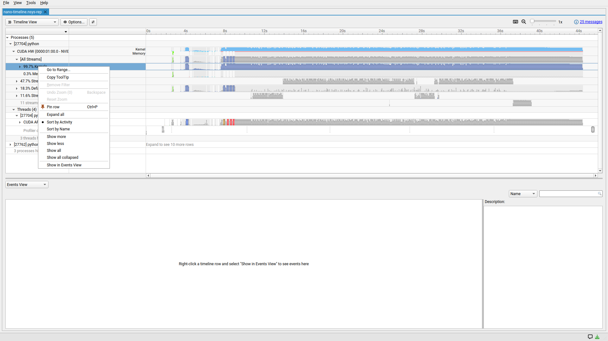

图 6：把 GPU Kernels 轨道送入事件列表的菜单入口。CPU 的 CUDA API 轨道和 GPU 的 Memory 轨道也可以用同样方式操作。

操作后，下面的视图应切换为 Events View。双击目标时间线事件，可以定位对应表格行并显示右侧 **Description**。若底部提示当前事件不在列表中，可以点击 **Show the corresponding Events View** 链接，再选择目标事件。

表格中用 **Start** 核对事件时间，用 **Duration** 核对耗时，用 **GPU / Context** 等列识别设备和执行上下文。右侧 Description 展示选中实例的具体参数。切换视图后，先核对 Start 列及过滤条件，再确定当前列表覆盖的时间范围。

### 5.2 拖选并放大时间范围

1. 在时间线的活动区域按住鼠标左键，从目标起点拖到终点。
2. 选区会以绿色背景显示，并标出持续时间。
3. 在选区内点击右键，选择 **Zoom into Selection**；本版菜单显示的快捷键是 **Shift+Z**。
4. 重复拖选和放大，直到能够区分单个内核。需要返回时使用 **Undo Zoom**，快捷键为 **Backspace**；恢复全景可以选择 **Reset Zoom**。

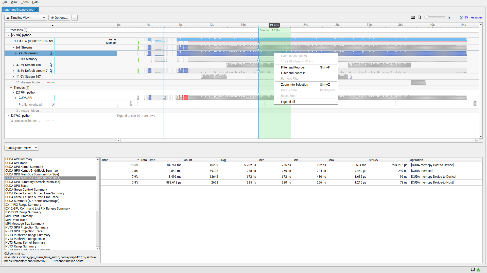

图 7：第一次从全景中选取约 4 秒区间，再缩小到 20 秒附近约 100 毫秒，便可观察多个重复的 decode 工作段。

这里选择 20 秒附近，是为了检查启动后持续活动中的一个局部样本。随着请求完成和历史 token 增多，实际 batch 大小与 KV 长度都会变化；分析其他时段时，应重新确认其执行规模。

**时间线缩放控制观察窗口，统计命令决定汇总范围。** 本例下方 Stats System View 的 **CLI command** 显示其查询对象为完整 SQLite 报告，图 5、图 9 和图 10均采用全报告汇总。需要局部统计时，应在相应查询或过滤配置中明确指定范围，并核对生成结果的时间边界。

若实验目标是比较精确的正式推理区间，可以在下一次采集中使用开始、结束标记限定范围。这样统计表的采集边界便能与基准计时边界对应。

### 5.3 查看 Attention 内核的执行参数

展开 GPU 的 `Kernels` 子轨道，选择 `flash_fwd_splitkv_kernel` 分组，将它送入 Events View。放大到 20 秒附近后，双击其中一个实际内核事件，查看右侧 Description。

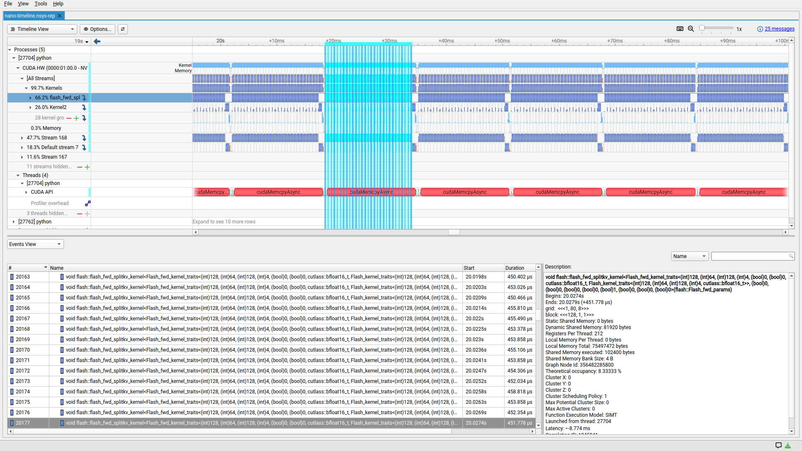

图 8：选中的内核实例执行约 **451.778 微秒**。蓝色关联线显示与其关联的提交和活动；CUDA Graph 中多个节点可能关联到同一次图提交。

截图里的字段可以这样读：

| 字段 | 本次实例 | 含义 |
| --- | --- | --- |
| Begins / Ends | 约 20.0274～20.0279 秒 | 此次内核在 GPU 上的起止时间 |
| Duration | 451.778 微秒 | 此次 GPU 执行耗时 |
| grid | `(1, 80, 8)` | 三维线程块网格，共 640 个 block；各维度含义由内核实现决定 |
| block | `(128, 1, 1)` | 每个 block 有 128 个线程 |
| Registers Per Thread | 212 | 每线程寄存器资源需求 |
| Dynamic Shared Memory | 81,920 bytes，即 80 KiB | 每个 block 请求的动态共享内存 |
| Theoretical occupancy | 8.33333% | 根据资源和设备约束计算的理论驻留 warp 比例 |

**SM（Streaming Multiprocessor，流多处理器）** 是 GPU 上执行线程块的计算单元，**warp** 是一组 32 个线程。**Occupancy** 用来描述 SM 中驻留 warp 数量相对于硬件上限的比例。截图中的 **Theoretical occupancy** 根据启动配置和资源约束计算理论可驻留比例；**achieved occupancy** 则通过运行期测量反映实际活跃 warp 情况，可在后续硬件采集中取得。

较高的每线程寄存器需求和每块共享内存需求，可能限制一个 SM 同时驻留的 block 数。截图为后续硬件分析提供了线索；要判断具体限制因素、实际访存效率和计算吞吐，应使用 Nsight Compute 继续采集。提高 occupancy 是否会缩短耗时，需要实际对照实验验证。

这个实例的约 452 微秒描述了一次具体执行；图 5 中的约 399 微秒则是多个输入状态和执行实例的平均值。将实例参数与耗时一起记录，有助于解释它相对平均值的差异。

## 6. 区分 CPU API 等待与 GPU 数据复制

### 6.1 对照两种汇总表

在 **Stats System View** 中选择 **CUDA API Summary**，查看 CPU 侧 CUDA 接口的累计耗时。

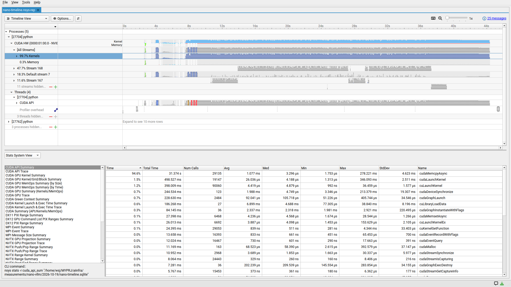

图 9：`cudaMemcpyAsync` 累计约 **31.374 秒**，占被汇总的 CUDA API 时间约 **94.6%**。

这个表统计从 CPU 进入 API 到返回的经过时间，包含调用内部执行和等待相关工作完成的时间。分析该值时，需要查看同一时段的 GPU 活动，确定设备正在执行什么工作。

随后选择 **CUDA GPU MemOps Summary (by Time)**，查看设备侧显式内存活动的累计执行时间。

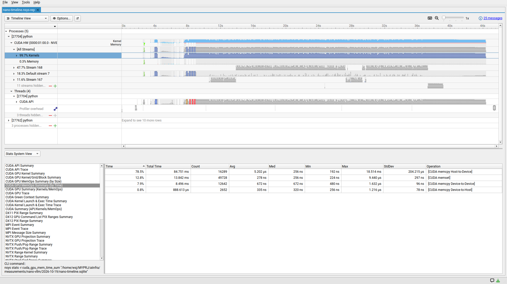

图 10：全报告中，Host-to-Device 复制累计约 **84.751 毫秒**，Device-to-Device 约 **8.496 毫秒**，Device-to-Host 约 **888.613 微秒**，另有 memset 清零约 **13.842 毫秒**。

方向缩写的含义是：

- **HtoD**：Host-to-Device，主机内存到 GPU 显存。
- **DtoH**：Device-to-Host，GPU 显存到主机内存。
- **DtoD**：Device-to-Device，设备内存之间的复制。

两张表分别计量 CPU 调用区间与 GPU 内存操作区间。本例的显著时间差提示存在较长的等待过程，可以通过下一节的单次关联事件检查。

### 6.2 用 Correlation ID 检查同一操作

**Correlation ID** 是将 CPU 提交记录与相关 GPU 活动对应起来的关联编号。查看同一次操作的两侧记录，可以分清时间究竟花在调用、等待还是设备执行上。

在前面放大的 20 秒附近，将 CPU **CUDA API** 轨道送入 Events View，双击一段较长的 `cudaMemcpyAsync`。

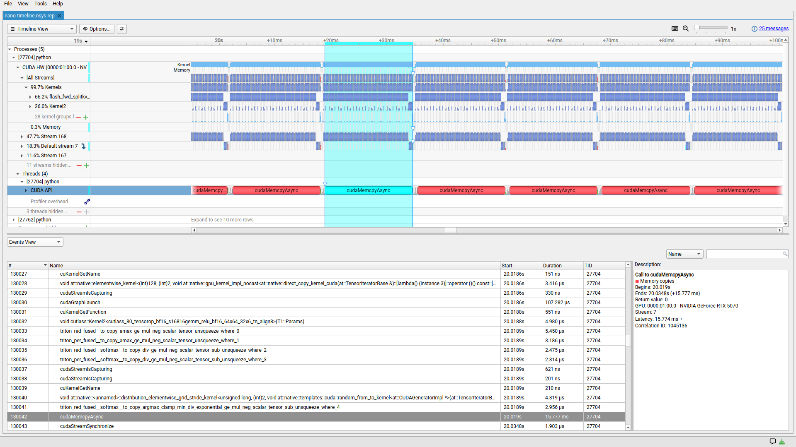

图 11：选中的 CPU 调用约从 **20.0190 秒**持续到 **20.0348 秒**，耗时 **15.777 毫秒**，Correlation ID 为 **1045136**。这段时间上方仍有持续的 GPU 内核执行。

然后将 GPU **Memory** 轨道送入 Events View，双击该调用末尾附近的关联复制事件。事件太窄时继续放大，或通过事件列表的 Start 列和右侧 Description 检查对应记录。

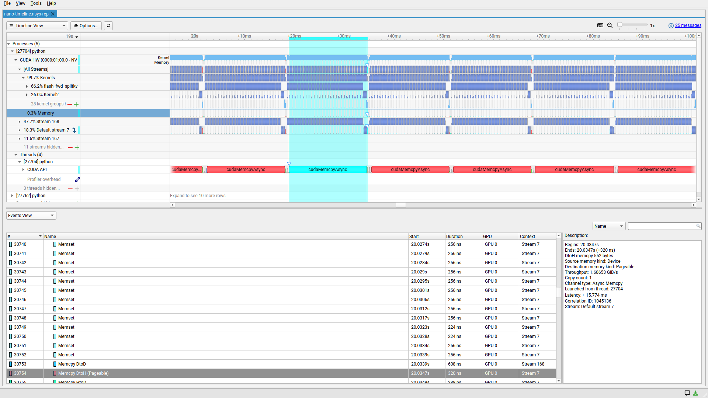

图 12：关联编号仍为 **1045136**，GPU 事件发生在约 **20.0347 秒**，方向为 DtoH，复制 **552 字节**，设备执行耗时仅 **320 纳秒**。

把两张图的证据排在一起：

| 观察对象 | 本次记录 |
| --- | --- |
| CPU API 的经过时间 | 约 15.777 毫秒 |
| GPU 复制的执行时间 | 320 纳秒，即 0.000320 毫秒 |
| 复制的数据量 | 552 字节 |
| 关联编号 | 两侧均为 1045136 |
| 时间关系 | CPU 调用较早进入，GPU 复制在前面的计算完成后才执行 |

**对这次事件的推断是：CPU API 的大部分时间消耗在等待相关工作完成，实际数据搬运很短。** 截图显示 GPU 在这个等待区间内仍执行计算，支持这一解释。

在本例版本的 [ModelRunner 实现](https://github.com/GeeeekExplorer/nano-vllm/blob/bb823b3e06983d71485a8e1f23715ebd87d98ef8/nanovllm/engine/model_runner.py)中，采样后通过 `.tolist()` 把生成 token 取回主机，随后调度器更新请求。这条执行路径与图中的小量 DtoH 复制及等待关系一致。因此，可以将本次等待解释为主机取回生成结果时的依赖等待；该解释结合了源码与事件关系，进一步的 Python 调用栈采集可用于精确定位调用来源。

后续 token 的生成依赖前面的计算结果，因此优化需要保留正确的数据依赖。可研究的方向包括减少多余同步，或安排其他独立工作与等待重叠，再通过端到端计时检验实际收益。

CPU 等待与 GPU 计算在时间线上可以重叠。计算端到端延迟时，应沿同一个起止区间测量经过时间；CPU API 表和 GPU 内核表分别用于解释这段区间中的主机与设备活动。

## 7. 从观察结果形成优化方向

性能分析可以按“观察证据、形成解释、设计验证”的顺序推进。基于本例的时间线和统计数据，可整理出以下验证方向。

| 实际证据 | 当前可以得出的结论 | 下一项验证 |
| --- | --- | --- |
| 某个 FlashAttention 实例占全报告内核累计时间的 64.4% | 它是优先检查的 GPU 热点 | 分别选择不同 batch、KV 长度下的实例，用 Compute 检查硬件效率 |
| 选中实例每线程 212 个寄存器、每块 80 KiB 动态共享内存，理论 occupancy 8.33% | 资源占用值得进一步分析 | 验证实际限制因素、achieved occupancy、显存与计算吞吐 |
| CPU 的长复制调用对应 GPU 上极短的小量复制 | 时间关系支持主机在等待前序计算完成的解释 | 检查等待依赖，以及可重叠的独立工作 |
| 时间线上有大量重复的内核组和图提交 | 可选择少量代表性区间做细粒度分析 | 核对这些区间的实际输入状态，避免混合不同执行规模 |

观察设备空档时，将所有相关 stream 的活动放到同一时间范围。若这一范围的设备轨道均为空白，可再查看 CPU 下一次提交任务的时刻，分析主机准备和任务依赖。需要追踪具体 Python 函数时，补充相应的主机采集信息。

在 Nsight Compute 中，后续实验可以围绕以下问题收集硬件证据：

- Attention 是否已经接近该输入规模下的显存带宽上限。
- Tensor Core 实际吞吐是否充分发挥。
- 理论 occupancy 较低是否就是运行时间较长的主要原因。
- 修改某个内核后，端到端性能能提高多少。

执行这些实验时，使用 `ncu` 重新运行选定负载并采集热点内核，获得相应硬件指标。之后改变一个实现因素、验证计算正确性，再重复普通计时，建立修改与性能变化之间的关系。指标含义与采集重放机制见 [Nsight Compute Profiling Guide](https://docs.nvidia.com/nsight-compute/ProfilingGuide/index.html)。

## 8. 用命令行核对和保存统计

GUI 适合检查具体时间关系，命令行适合保存可比较的表格。对已有报告运行 `nsys stats`，可以生成与前面 GUI 统计对应的结果：

```bash
nsys stats \
  --report cuda_gpu_kern_sum,cuda_api_sum,cuda_gpu_mem_time_sum,cuda_gpu_mem_size_sum \
  /tmp/nano-timeline.nsys-rep
```

首次处理时，工具可能先生成 SQLite 文件，将报告导出为可查询的数据表。原始 `.nsys-rep` 用于完整报告查看，SQLite 用于结构化查询，两者可以一起归档。

如需将统计保留为 CSV，可指定输出格式和文件名前缀：

```bash
mkdir -p analysis-results
nsys stats \
  --report cuda_gpu_kern_sum,cuda_api_sum,cuda_gpu_mem_time_sum,cuda_gpu_mem_size_sum \
  --format csv \
  --output analysis-results/full \
  /tmp/nano-timeline.nsys-rep
```

对应输出包括：

| 文件 | 内容 |
| --- | --- |
| `full_cuda_gpu_kern_sum.csv` | 各类 GPU 内核的次数和耗时 |
| `full_cuda_api_sum.csv` | CPU 侧 CUDA API 次数和经过时间 |
| `full_cuda_gpu_mem_time_sum.csv` | 各方向复制及清零操作的设备耗时 |
| `full_cuda_gpu_mem_size_sum.csv` | 各类显式内存操作的数据量 |

本文数值使用 GUI 和该类导出结果交叉核对。CSV 的时间列在本次导出中以纳秒表示，GUI 会自动选择秒、毫秒或微秒；读取时应先核对列标题中的单位：

```text
1 秒 = 1,000 毫秒
1 毫秒 = 1,000 微秒 = 1,000,000 纳秒
```

一份可复查的性能记录应包含：报告文件、采集命令、模型及输入规模、计时范围、主要热点、具体事件的证据和待验证假设。对比实现时固定这些条件，并将直接运行程序得到的普通计时结果与采集报告分别保存。

## 9. 官方资料与阅读顺序

本文使用 Nsight Systems 2026.3.2 的界面和实际报告展开分析。阅读其他版本时，可通过以下官方资料核对功能和字段：

1. [Nsight Systems Get Started](https://developer.nvidia.com/nsight-systems/get-started)：下载、平台兼容和培训入口。
2. [Nsight Systems User Guide](https://docs.nvidia.com/nsight-systems/UserGuide/index.html)：重点阅读 **Reading Your Report in the GUI**、**Timeline View**、**Events View** 和 **CUDA Trace**。
3. [Nsight Systems Post-Collection Analysis Guide](https://docs.nvidia.com/nsight-systems/AnalysisGuide/index.html)：核对各类统计表的字段、分母和导出方式。
4. [Nsight Compute Profiling Guide](https://docs.nvidia.com/nsight-compute/ProfilingGuide/index.html)：在已经找到热点后，继续理解硬件指标和内核重放。

本例的分析顺序是：**确认采集范围 → 阅读 CPU/GPU 时间线 → 找累计耗时热点 → 放大具体实例 → 关联 CPU 调用与 GPU 活动 → 形成下一步验证问题**。每一步都应保留时间范围和指标含义，才能将报告里的大数字转化为可靠的优化依据。
