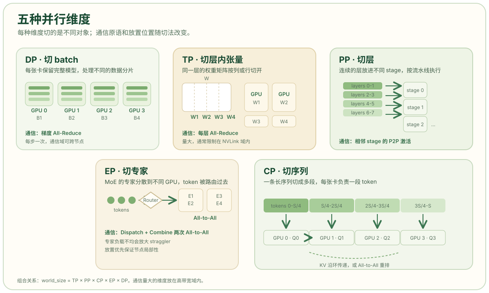

# 为什么需要并行：五种切法与一张通信地图

一个模型能不能在集群上跑起来，先要看两张账单：一张是显存，一张是通信。显存决定“放不放得下”，通信决定“切开之后跑得快不快”。大模型并行不是把矩阵随便分给几张卡，而是沿着不同的维度切分计算，并用一套固定的集合通信原语把结果拼回逻辑上正确的张量。理解这五种切法各自切什么、通信什么，后面读 Megatron、DeepSeek 或 vLLM 的并行配置时就不会迷路。

## 两道墙：显存与算力

先算一笔训练显存。以混合精度加 Adam 为例，每个参数通常要保存 FP16 权重（2 字节）、FP16 梯度（2 字节），以及 FP32 主权重、一阶动量和二阶动量（4 + 4 + 4 = 12 字节），合计约 16 字节。一个 7B 模型仅模型状态就需要约 112 GB，已经超过一张 80 GB 的 H100；70B 模型仅 FP16 权重就有 140 GB，单卡连权重都放不下。这个账本在 [Data Parallelism 与 ZeRO 的图解](https://zhuanlan.zhihu.com/p/656639603)和 [DeepSpeed 完全图解](https://yaoyuanzhou.github.io/topics/notes-deepspeed.html)里都有相同的拆法。

显存之外还有算力。即便模型勉强塞进一张卡，单卡的矩阵乘吞吐也远低于集群。训练希望缩短一个 iteration 的墙钟时间，推理希望在给定延迟内塞进更大的 batch；两者都需要把计算分出去。区别在于，训练还要同步梯度和优化器状态，推理则要把 KV Cache 一起切开。

激活值和 KV Cache 是另外两笔常被忽略的账。激活值随 batch、序列长度和层数增长；长上下文训练时，单层注意力的 Q/K/V 中间结果就能到 GB 级。推理的 KV Cache 则随并发请求数和上下文长度线性增长。后面的序列并行、上下文并行和 PagedAttention，本质上都在处理这两笔账。

## 五种切法：切 batch、切层内、切层间、切专家、切序列

Megatron Core 把并行策略归纳为五个正交维度：数据并行（DP）切 batch，张量并行（TP）切单层内的张量，流水线并行（PP）切模型深度，上下文并行（CP）切序列长度，专家并行（EP）切 MoE 专家。官方文档用一张表概括了它们的适用场景：DP 面向数据规模，TP 面向放不下的大层，PP 面向很深的模型，CP 面向 8K 以上的长序列，EP 面向 MoE。[Parallelism Strategies Guide](https://docs.nvidia.com/megatron-core/developer-guide/latest/user-guide/parallelism-guide.html)



| 维度 | 切什么 | 每张卡保留什么 | 主要通信 | 典型放置 |
| --- | --- | --- | --- | --- |
| DP | 全局 batch | 一份完整模型副本 | 梯度 All-Reduce 或 Reduce-Scatter + All-Gather | 跨节点，规模最大 |
| TP | 单层权重与激活的 hidden / head 维 | 每层的一片权重 | All-Reduce、All-Gather、Reduce-Scatter | 节点内 NVLink |
| PP | 连续的层 | 模型的一段 | 相邻 stage 的 P2P Send/Recv | 跨节点 |
| EP | MoE 的专家 | 一部分专家 | All-to-All | 跨节点，需高带宽 |
| CP | 序列维度 | 一段 token 的激活 | P2P 或 All-to-All 交换 KV | 节点内或跨节点 |

这张表最重要的信息不是“有五种”，而是“通信域不同”。TP 每层都要通信，量最大，所以被限制在 NVLink 域内；PP 只传 stage 边界的激活，量最小，可以跨节点；DP 在每个 step 同步一次梯度，介于两者之间；EP 的 All-to-All 同时跨 NVLink 和 InfiniBand，是 MoE 训练最贵的一笔通信。DeepSeek-V3 的技术报告给出的 H800 集群里，节点内 NVLink 约 160 GB/s，跨节点 IB 约 50 GB/s，相差三倍多，这个比例直接决定了哪种并行该放在哪里。[DeepSeek-V3 Technical Report](https://arxiv.org/html/2412.19437)

## 通信原语：五种切法共用的一套积木

所有并行策略最终都落到几个集合通信原语上。把它们分清，比记住框架参数更有用。

| 原语 | 语义 | 典型出现位置 |
| --- | --- | --- |
| All-Reduce | 所有 rank 的输入求和，每个 rank 都得到完整结果 | DDP 梯度同步、TP 行并行的输出合并 |
| All-Gather | 每个 rank 贡献一片，最后每个 rank 都拿到拼接后的完整张量 | FSDP 前向取回参数、Ulysses 换回头维 |
| Reduce-Scatter | 先求和，再把结果按片散回各 rank | ZeRO 梯度分片、TP 序列并行的激活规约 |
| All-to-All | 每个 rank 向其他每个 rank 发送不同分片 | MoE 的 token 分发与回收、Ulysses |
| Send/Recv | 点对点传输 | PP 的 stage 边界、Ring Attention 的 KV 传递 |

All-Reduce 可以拆成 Reduce-Scatter 加 All-Gather，这是理解 ZeRO 和 FSDP 的关键：DDP 用一次 All-Reduce 同步梯度，而 ZeRO 把它拆成两次通信，换来显存上的分片。TP 的行并行需要一次 All-Reduce，开启 Megatron 序列并行后，这次 All-Reduce 也会被替换成 Reduce-Scatter 加 All-Gather，以减少激活值显存。

环形算法下，一次 All-Reduce 在每个 rank 上的通信量约为 `2 × (N-1)/N × S`，其中 `N` 是组内 rank 数，`S` 是张量字节数。这个式子解释了两件事：组越大，单卡通信量越接近 `2S`，不会无限增长；但延迟和带宽争用会随组增大而变差。所以 TP 通常不超过单机 8 卡，而 DP 可以开到成百上千卡。

## 拓扑：为什么 TP 在机内，PP 在机间

把并行维度映射到硬件时，一条经验规则是“通信量大的放近，通信量小的放远”。NVIDIA 在 Megatron-Turing NLG 530B 的系统设计里写得很明确：三种策略中 TP 的通信开销最大，所以优先把 TP worker 放在同一节点内；PP 的通信量最小，可以把 stage 跨节点摆放；DP 则尽量放在节点内或相邻节点，以加速梯度通信。[Megatron-Turing NLG 530B](https://arxiv.org/html/2201.11990v3)

这条规则在真实配置里反复出现。GPT-3 175B 的训练使用 8 路 TP 加 8 路 PP，再叠加 DP，在 1024 张 A100 上完成；MT-NLG 530B 的每个模型副本占 280 张 A100，节点内 8 路 TP、跨节点 35 路 PP，再用 DP 扩到数千卡。两套配置都把 TP 压在 8 卡以内，把 PP 放到节点之间。[Scaling Language Model Training to a Trillion Parameters](https://developer.nvidia.com/blog/scaling-language-model-training-to-a-trillion-parameters-using-megatron.md/)

## 一张组合公式

Megatron 用一条乘法关系描述所有维度的组合：

```text
world_size = TP × PP × CP × EP × DP
```

例如 2048 张卡、PP=16、EP=64，若 TP=1、CP=1，则 DP=2。DeepSeek-V3 正好采用 16 路 PP、64 路 EP 和 ZeRO-1 DP，在 2048 张 H800 上训练；它还刻意避开了 TP，因为 H800 的节点内带宽和模型形状让 TP 不划算。[DeepSeek-V3 Technical Report](https://arxiv.org/html/2412.19437)

这条公式也是排障的起点。看到 `world_size` 不能被某个维度整除、某个 stage 的层数分不均、或者 EP 组跨越了太多节点，先回到这条式子和拓扑图上检查，比直接调框架参数有效。

## 本系列的阅读顺序

这一组文章按“先切数据，再切层内，再切层间，最后处理稀疏与长序列”的顺序展开：

1. [数据并行](02-data-parallel.html)：复制模型、切分 batch，用 ZeRO 和 FSDP 分摊训练状态。
2. [张量并行](03-tensor-parallel.html)：列并行与行并行，以及每层四次 All-Reduce 的来历。
3. [流水线并行](04-pipeline-parallel.html)：GPipe、1F1B、交错式调度与气泡公式。
4. [专家并行](05-expert-parallel.html)：MoE 的 All-to-All、负载均衡和 DeepEP。
5. [序列与上下文并行](06-context-parallel.html)：Ring Attention、Ulysses 与 Megatron 序列并行。
6. [组合与选型](07-combination.html)：把五种维度拼成真实集群配置。

每一篇都尽量给出“切的是什么、通信多少、显存省在哪、什么时候不该用”这四个答案。读完再回头看框架的并行参数，应该能判断每个数字为什么取那个值，而不是只记住一组能跑通的配置。

## 参考资料

- NVIDIA Megatron Core：[Parallelism Strategies Guide](https://docs.nvidia.com/megatron-core/developer-guide/latest/user-guide/parallelism-guide.html)
- NVIDIA NeMo Framework：[Parallelisms](https://docs.nvidia.com/nemo-framework/user-guide/25.11/nemotoolkit/features/parallelisms.html)
- NVIDIA Technical Blog：[Scaling Language Model Training to a Trillion Parameters Using Megatron](https://developer.nvidia.com/blog/scaling-language-model-training-to-a-trillion-parameters-using-megatron.md/)
- Shoeybi et al.，[Megatron-LM: Training Multi-Billion Parameter Language Models Using Model Parallelism](https://arxiv.org/html/1909.08053v4)
- Narayanan et al.，[Efficient Large-Scale Language Model Training on GPU Clusters Using Megatron-LM](https://arxiv.org/html/2104.04473v5)
- DeepSeek-AI，[DeepSeek-V3 Technical Report](https://arxiv.org/html/2412.19437)
- 知乎：[图解大模型训练之：数据并行（DP、DDP 与 ZeRO）](https://zhuanlan.zhihu.com/p/656639603)
- CSDN：[数据并行（DP）、张量模型并行（TP）、流水线并行（PP）](https://blog.csdn.net/yuanyuanxingxing/article/details/132412847)
- LLM Infra Atlas：[大规模训练的并行策略总览](https://llm-infra-atlas.github.io/parallel/)
