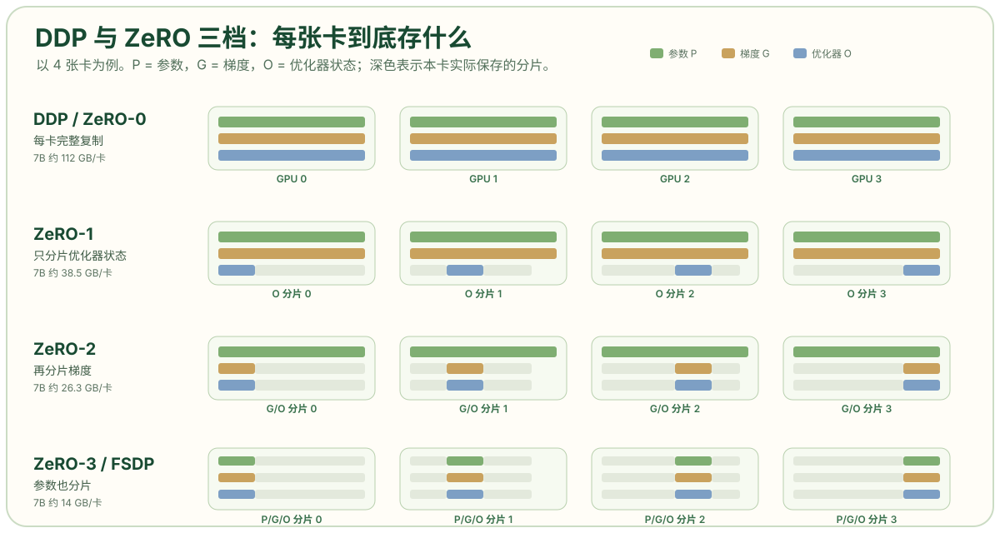

# 数据并行：从 DDP 到 ZeRO 与 FSDP

数据并行是最先该尝试的方案。它不切模型，只切数据：每张卡保留一份完整模型，各自跑不同的 batch，反向传播后把梯度加起来，再各自更新参数。它的计算效率最高、实现最简单，只要模型放得下，通常就是首选。真正的问题是“放不下”时怎么办——ZeRO 和 FSDP 给出的答案是：模型结构不动，把训练状态分片。

## DDP：复制模型，切分 batch

设数据并行组有 `N` 张卡，全局 batch 被分成 `N` 份，每张卡用本地 batch 做一次前向和反向，得到本地梯度。DDP 在每个 step 结束时对所有卡的梯度做一次 All-Reduce，使每张卡都拿到完整的平均梯度，然后各自执行优化器更新。因为初始参数相同、梯度相同，更新后的参数也保持相同，副本不会漂移。



这里有一个容易忽略的细节：DDP 的 All-Reduce 是“梯度求和再广播”，每张卡最终都保存完整梯度。ZeRO 则把这个 All-Reduce 拆成 Reduce-Scatter 和 All-Gather：先规约并把梯度分片散回各卡，优化器只更新自己负责的那一片，下一次前向前再把参数 All-Gather 回来。PyTorch 的 FSDP 文档把这件事说得很直接：FSDP 可以看作把 DDP 的 All-Reduce 分解成 Reduce-Scatter 与 All-Gather。[Getting Started with FSDP](https://docs.pytorch.org/tutorials/intermediate/FSDP_tutorial.html)

## 显存账本：16 字节从哪里来

混合精度加 Adam 的训练状态，常按每参数 16 字节估算：

| 状态 | 精度 | 每参数字节 | 7B 模型 |
| --- | --- | --- | --- |
| 模型权重 | FP16/BF16 | 2 | 14 GB |
| 梯度 | FP16/BF16 | 2 | 14 GB |
| FP32 主权重 | FP32 | 4 | 28 GB |
| Adam 一阶动量 | FP32 | 4 | 28 GB |
| Adam 二阶动量 | FP32 | 4 | 28 GB |
| 合计 |  | 16 | 112 GB |

7B 模型就要 112 GB，单张 80 GB 卡已经放不下；这还没有算激活值、通信缓冲区和临时 workspace。这个账本与[知乎的 ZeRO 图解](https://zhuanlan.zhihu.com/p/656639603)和 [Datawhale 的显存计算教程](https://datawhalechina.github.io/llm-algo-leetcode/01_Hardware_Math_and_Systems/06_VRAM_Calculation_and_ZeRO.html)给出的拆法一致。不同框架的精度策略会改变系数，但“优化器状态占大头”这个结论不变。

有了账本，ZeRO 的三档就很自然了：

| 方案 | 分片对象 | 每卡模型状态（7B，N=8） | 主要通信 |
| --- | --- | --- | --- |
| DDP / ZeRO-0 | 不分片 | 112 GB | 梯度 All-Reduce |
| ZeRO-1 | 优化器状态 | 2 + 2 + 12/8 = 5.5 B/参数 ≈ 38.5 GB | Reduce-Scatter + All-Gather |
| ZeRO-2 | 优化器状态 + 梯度 | 2 + 14/8 = 3.75 B/参数 ≈ 26.3 GB | Reduce-Scatter + All-Gather |
| ZeRO-3 / FSDP | 优化器状态 + 梯度 + 参数 | 16/8 = 2 B/参数 = 14 GB | 每层 All-Gather 参数 + Reduce-Scatter 梯度 |

这张表说明 ZeRO-1 的性价比最高：只切优化器状态，就把 112 GB 降到 38.5 GB，通信量与 DDP 基本同一量级。ZeRO-2 再切梯度，收益递减；ZeRO-3 把参数也切了，显存最省，但每次前向都要把整层参数 All-Gather 回来，通信量约为 DDP 的 1.5 倍，层越小、切得越细，开销越明显。

## FSDP：把 ZeRO-3 做进 PyTorch

FSDP 的流程可以按一次前向拆开：

1. 构造时把参数切成 shard，每张卡只保留自己那一片。
2. 进入某一层前，All-Gather 该层的完整参数。
3. 前向计算，随后立即丢弃非本卡参数，释放显存。
4. 反向时再次 All-Gather 参数，计算梯度。
5. 反向结束后 Reduce-Scatter 梯度，每张卡留下自己负责的梯度分片。
6. 优化器只更新本地参数分片和对应的优化器状态。

PyTorch 文档强调，FSDP 应该按层（或按 Transformer block）调用 `fully_shard`，让 All-Gather 和释放以层为单位发生；如果把整个模型当成一个 FSDP 单元，就会在计算前把全部参数聚合回来，失去显存收益。[torch.distributed.fsdp.fully_shard](https://docs.pytorch.org/docs/main/distributed/fsdp.fully_shard.html)

FSDP2 用 DTensor 表示分片参数，并支持 `ShardingStrategy.SHARD_GRAD_OP`（等价于 ZeRO-2，只切梯度和优化器状态）等策略。选择哪一档，取决于“显存放不下”还是“通信吃不消”：显存紧就上 FULL_SHARD，通信紧就退到 SHARD_GRAD_OP。

## 梯度累积与全局 batch

数据并行的 batch 有三层：

```text
global_batch = micro_batch × grad_accum × DP_size
```

`micro_batch` 是单卡一次前向的样本数，`grad_accum` 是在一次参数更新前累积多少个 micro-batch，`DP_size` 是数据并行组大小。显存不够时，减小 `micro_batch`、增大 `grad_accum`，可以在不改变全局 batch 的情况下降低激活值峰值。但梯度累积不会减少模型状态的显存，也不会减少每步的通信次数——它只是把一次大 batch 拆成多次小 batch 计算。

调整全局 batch 时，学习率通常要一起调。线性缩放规则（learning rate 随 global batch 线性增长）是常见起点，但大 batch 训练还需要 warmup 和梯度裁剪，不能只改一个数字。

## DP 管不到的地方

数据并行只分摊“模型状态”，不分摊激活值。每张卡仍然要保存自己那份 batch 的完整激活，长序列或大 batch 时，激活值可能比模型状态还大。ZeRO 的论文和实现主要解决模型状态冗余，激活值要靠这些手段单独处理：

- **激活重计算（activation checkpointing）**：前向只保存少量边界，反向时重算中间结果，用算力换显存。
- **张量并行 / 序列并行 / 上下文并行**：把单层的激活切开，见本系列第 3、6 篇。
- **流水线并行**：把层分段，每张卡只保存自己那段的激活，见第 4 篇。

另一个常见误区是把 DP 当成“推理并行”的万能答案。推理没有梯度和优化器状态，DP 复制模型、切分请求，确实能提高吞吐；但每个副本都要独立保存自己的 KV Cache，显存并不会因为 DP 而减少。模型放不下时，推理更需要 TP、PP 或 EP。

## 什么时候用 DP

把数据并行放在决策顺序的第一位，原因是它的计算效率最高：每张卡都在做完整的矩阵乘，没有 TP 的小 GEMM 效率损失，也没有 PP 的气泡。NVIDIA NeMo 的性能调优指南给出的顺序也是先 DP，模型放不下再上 TP，TP 还不够再上 PP。[Performance Tuning Guide](https://docs.nvidia.com/nemo-framework/user-guide/25.09/performance/performance-guide.html)

适合 DP 的信号：

- 模型状态加激活值能装进单卡，只是单卡算得慢；
- 集群规模扩大主要靠增加副本，而不是切模型；
- 通信预算有限，希望每个 step 只同步一次梯度。

不适合 DP 的信号：

- 单卡连权重都放不下；
- 激活值随序列长度爆炸，DP 无法分摊；
- 优化器状态已经成为显存瓶颈，而通信带宽又不足以支撑 ZeRO-3 的频繁 All-Gather。

## 参考资料

- NVIDIA NeMo：[Parallelisms · Data Parallelism](https://docs.nvidia.com/nemo-framework/user-guide/25.11/nemotoolkit/features/parallelisms.html)
- NVIDIA Megatron Core：[Parallelism Strategies Guide](https://docs.nvidia.com/megatron-core/developer-guide/latest/user-guide/parallelism-guide.html)
- PyTorch：[Getting Started with Fully Sharded Data Parallel (FSDP2)](https://docs.pytorch.org/tutorials/intermediate/FSDP_tutorial.html)
- PyTorch：[torch.distributed.fsdp.fully_shard](https://docs.pytorch.org/docs/main/distributed/fsdp.fully_shard.html)
- Rajbhandari et al.，[ZeRO: Memory Optimizations Toward Training Trillion Parameter Models](https://arxiv.org/abs/1910.02054)
- 知乎：[图解大模型训练之：数据并行上篇（DP、DDP 与 ZeRO）](https://zhuanlan.zhihu.com/p/656639603)
- 知乎：[图解大模型训练之：数据并行下篇（DeepSpeed ZeRO）](https://zhuanlan.zhihu.com/p/654910335)
- 博客：[DeepSpeed 完全图解：ZeRO / 3D 并行 / Offload 从零讲清楚](https://yaoyuanzhou.github.io/topics/notes-deepspeed.html)
