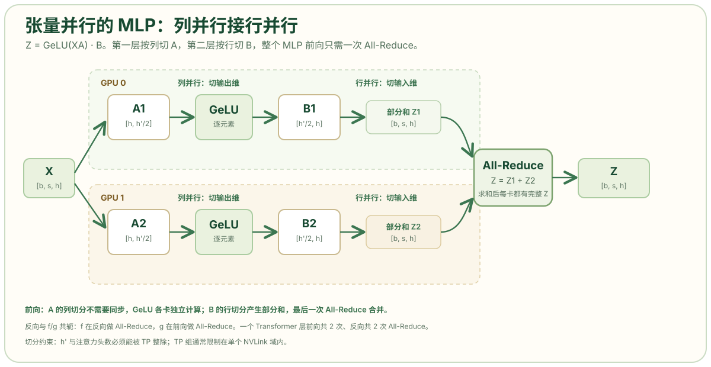

# 张量并行：层内切分、通信模式与适用边界

张量并行（Tensor Parallelism，TP）把同一层内的权重矩阵和激活切分到多张 GPU。它解决的是“单层权重或单层激活放不进一张卡”的问题，代价是每一层都要执行集合通信。本文说明线性层的列并行与行并行、Transformer 层中通信的位置和次数、序列并行的配套作用，以及张量并行通常限制在 NVLink 域内的原因。

## 问题定位

数据并行复制完整模型，无法降低单卡权重占用。当单层权重或激活值超过一张卡的容量时，需要把这一层本身切开。切分方式必须满足两个条件：切分后的局部计算可以独立完成，且最终结果与不切分时数值一致。Megatron-LM 的贡献是找到一组切分顺序，使一个 Transformer 层的前向和反向各只需要两次 All-Reduce，而不是每切一刀就同步一次。[Megatron-LM 论文](https://arxiv.org/html/1909.08053v4)

## 线性层的两种切分

设线性层为 `Y = XA`，其中 `X` 的形状是 `[batch, seq, hidden]`，`A` 的形状是 `[hidden, output]`。权重 `A` 可以沿两个维度切分。

沿输出维切分称为列并行：`A = [A1, A2]`，每张卡计算 `Y1 = X A1` 和 `Y2 = X A2`，输出按列拼接。输入 `X` 需要完整复制到每张卡。前向没有通信；反向需要对 `X` 的梯度执行全规约（All-Reduce），因为每张卡只算了输入梯度的一部分。

沿输入维切分称为行并行：`A = [A1; A2]`，输入也按列切分为 `[X1, X2]`，每张卡计算 `Y1 = X1 A1` 和 `Y2 = X2 A2`，两张卡的输出是部分和，需要 All-Reduce 求和得到完整 `Y`。前向有一次 All-Reduce；反向没有通信，梯度按列切分后直接传回。

| 线性层 | 切权重的方式 | 输入 | 输出 | 前向通信 | 反向通信 |
| --- | --- | --- | --- | --- | --- |
| ColumnParallelLinear | 沿输出维（列）切 | 完整复制 | 按列切分 | 无 | 对输入梯度 All-Reduce |
| RowParallelLinear | 沿输入维（行）切 | 按列切分 | 部分和 | All-Reduce 求和 | 无 |

两种切分的通信位置互补。Megatron 用 `f` 和 `g` 两个共轭算子描述这一关系：`f` 在前向是恒等、反向是 All-Reduce；`g` 在前向是 All-Reduce、反向是恒等。把列并行与行并行串联，通信落在 MLP 的两端，而不是中间。

## MLP 的列并行与行并行

Transformer 的多层感知机（MLP）可以写成 `Y = GeLU(XA) · B`，其中 `A` 把 hidden 映射到中间维，`B` 再映射回 hidden。若按行切分 `A`，得到 `X1A1 + X2A2`，必须先求部分和才能通过 GeLU，因为 GeLU 是非线性的：

```text
GeLU(X1A1 + X2A2) ≠ GeLU(X1A1) + GeLU(X2A2)
```

这使得同步点被夹在两层线性之间。Megatron 改为按列切分 `A`：

```text
A = [A1, A2]
Y = XA = [X A1, X A2] = [Y1, Y2]
GeLU(Y) = [GeLU(Y1), GeLU(Y2)]
```

每张卡独立计算自己那组输出列，GeLU 逐元素作用，不需要通信。随后把 `B` 按行切分：

```text
B = [B1; B2]
Z = YB = Y1 B1 + Y2 B2
```

每张卡得到一个部分和，最后一次 All-Reduce 求和得到完整 `Z`。MLP 的前向只有一次 All-Reduce，反向也只有一次。



示意图中上方和下方的虚线框分别表示 GPU 0 和 GPU 1 的计算范围。`X` 位于两个范围之间，通过两条箭头同时进入两卡；`A1`、`A2` 是同一权重矩阵的两列分片，因此两张卡都收到完整输入。`GeLU` 框位于各卡内部，说明逐点激活不需要跨卡同步。`B1`、`B2` 沿输入维切分，两个“部分和”框之间没有直接箭头，而是分别汇入右侧的 All-Reduce；All-Reduce 执行求和后输出完整 `Z`。

## 自注意力（Attention）的按头切分

多头注意力的各个头本身独立，适合按头切分。Megatron 把 Q、K、V 的投影矩阵按列切分，每个 rank 负责一部分头；每个头在自己的卡上完成 `QK^T`、softmax 和 `AV`；输出投影矩阵按行切分，最后 All-Reduce 一次。这样，一个 Transformer 层的前向有两次 All-Reduce：一次在 Attention 的输出投影后，一次在 MLP 的输出投影后。反向对应两次。合起来是每层前向两次、反向两次 All-Reduce。[Efficient Large-Scale Language Model Training on GPU Clusters Using Megatron-LM](https://arxiv.org/html/2104.04473v5)

每次 All-Reduce 的张量大小是 `batch × seq × hidden`。以 `batch=1, seq=4096, hidden=8192`、BF16 为例，一次通信的完整张量约为 64 MB；环形 All-Reduce 在每个 rank 上的通信量约为 `2 × (N-1)/N × 64 MB`。`N=8` 时约 112 MB，`N=16` 时约 120 MB。单次通信量随组增大的幅度有限，但 All-Reduce 是同步操作，延迟和带宽争用会随组增大而上升，这是 TP 通常不超过单机 8 卡的原因。

## 示例：Llama-3 70B 的 FFN 显存

Llama-3 70B 的一层 FFN 中，`W1` 的形状是 `8192 × 28672`。FP16 下该矩阵约 470 MB；加上 FP32 主权重、Adam 的 `m` 和 `v`，这一层带来的训练状态接近 5 GB。80 层堆叠后，纯 DDP 无法容纳。[LLM Infra Atlas · TP/SP](https://llm-infra-atlas.github.io/parallel/02_tp_sp/)

切到 8 路 TP 后，每张卡保留 `8192 × 3584` 的一片，权重降到约 59 MB，优化器状态按同一比例缩小。代价是每层多出两次 All-Reduce，以及更小的通用矩阵乘（GEMM）。TP 的收益和代价来自同一件事：切得越细，显存线性下降，单卡矩阵乘的 `M` 或 `N` 也线性下降，算术强度降低，通信占比上升。该算例为解释性构造，用于说明切分比例；实际占用还取决于框架的权重布局和精度策略。

## 序列并行与词表并行

标准 TP 只切分 Attention 和 MLP 的矩阵乘。LayerNorm、Dropout、残差相加等逐点操作仍在每个 rank 上保存完整的 `[batch, seq, hidden]` 激活。序列并行（Megatron Sequence Parallelism）把这些区域沿序列维切开，每个 rank 只保存 `1/TP` 的 token，LayerNorm 和 Dropout 在自己的分片上独立计算。

代价是 TP 区域的边界需要更换通信方式。原本行并行输出的一次 All-Reduce，被替换成 Reduce-Scatter（把完整激活规约并散回各卡）加 All-Gather（进入 TP 区域前把序列拼回来）。两者合起来的通信量与 All-Reduce 相当，但激活值显存下降，反向时能保存更多激活，或者使用更大的 batch。Megatron 的 `--sequence-parallel` 打开的是这一优化。[Megatron Core · Parallelism Guide](https://docs.nvidia.com/megatron-core/developer-guide/latest/user-guide/parallelism-guide.html)

该机制要求序列长度能被 TP 整除；否则 Reduce-Scatter 和 All-Gather 无法均分张量。名称上，Megatron 的“序列并行”切的是 TP 区域内未被切到的逐点操作；上下文并行切的是整个注意力的序列维，两者不是同一件事。

词表并行是 TP 的另一项配套。Embedding 和 LM Head 在词表维上很大，TP 把词表切开：每个 rank 只保存一部分 token 的 embedding，输出 logits 只算自己那一段，最后对 logits 执行 All-Reduce 或 All-Gather，再计算交叉熵。这样 embedding 和 LM Head 的显存也随 TP 下降；约束是词表大小必须能被 TP 整除，且 logits 通信量与词表大小成正比。

## 推理中的张量并行

推理没有梯度和优化器状态，TP 的显存收益主要来自权重和 KV Cache 的切分。vLLM 的 `tensor_parallel_size` 把每层权重按输出维切开，注意力头也按 rank 分配，每个 rank 只保存自己那部分头的键值缓存（KV Cache）。

这带来一项约束：注意力头数必须能被 TP 整除。对分组查询注意力（GQA）或多查询注意力（MQA）模型，KV 头数可能少于 Q 头数；当 TP 大于 KV 头数时，部分 rank 没有 KV 头可分，框架通常把 KV 头复制到多个 rank，或者要求 TP 不超过 KV 头数。部署前需要核对模型的 `num_attention_heads` 和 `num_key_value_heads`。

推理 TP 也影响延迟。TP 越大，单卡 GEMM 越小，All-Reduce 的相对开销越高；在小 batch 的 decode 阶段，通信延迟可能超过计算收益。常见做法是 prefill 使用较大的 TP 提高吞吐，decode 使用较小的 TP 或改用 EP/DP。DeepSeek 的推理系统将 prefill 与 decode 分离部署，使用的就是不同并行度。

## 限制与适用条件

张量并行适合以下条件：

- 单层权重或单层激活无法放进一张卡；
- hidden size 较大（4096 以上），切分后每卡仍有足够大的 GEMM；
- 有 NVLink/NVSwitch，TP 组能压在一个节点内。

张量并行不适合以下条件：

- 模型能靠 DP 或 ZeRO 容纳，TP 只会增加通信；
- TP 度超过单机 GPU 数，All-Reduce 被迫走 InfiniBand；
- 注意力头数或词表大小不能被 TP 整除；
- batch 很小、序列很短，GEMM 已经很小，继续切分只会放大通信开销。

## 结论

张量并行通过列并行与行并行的组合，把一个 Transformer 层的通信压缩到前向两次、反向两次 All-Reduce。它同时降低权重和激活的显存，但每层都要通信，因此适合放在 NVLink 域内，并行度通常不超过单机 GPU 数。序列并行和词表并行进一步降低 TP 区域外的激活与词表状态，但有整除约束。

## 参考资料

- Shoeybi et al.，[Megatron-LM: Training Multi-Billion Parameter Language Models Using Model Parallelism](https://arxiv.org/html/1909.08053v4)
- Narayanan et al.，[Efficient Large-Scale Language Model Training on GPU Clusters Using Megatron-LM](https://arxiv.org/html/2104.04473v5)
- NVIDIA Megatron Core：[Parallelism Strategies Guide](https://docs.nvidia.com/megatron-core/developer-guide/latest/user-guide/parallelism-guide.html)
- NVIDIA NeMo：[Parallelisms · Tensor Parallelism](https://docs.nvidia.com/nemo-framework/user-guide/25.11/nemotoolkit/features/parallelisms.html)
- LLM Infra Atlas：[Tensor Parallelism（TP）与 Sequence Parallelism（SP）](https://llm-infra-atlas.github.io/parallel/02_tp_sp/)
- CSDN：[图解大模型分布式训练：张量并行 Megatron-LM 方法](https://blog.csdn.net/Antai_ZHU/article/details/144409187)
- CSDN：[Megatron 的并行与优化原理](https://happyprince.blog.csdn.net/article/details/163314037)
- 博客园：[模型并行分布式训练 Megatron（3）——模型并行实现](https://www.cnblogs.com/rossiXYZ/p/15871062.html)
