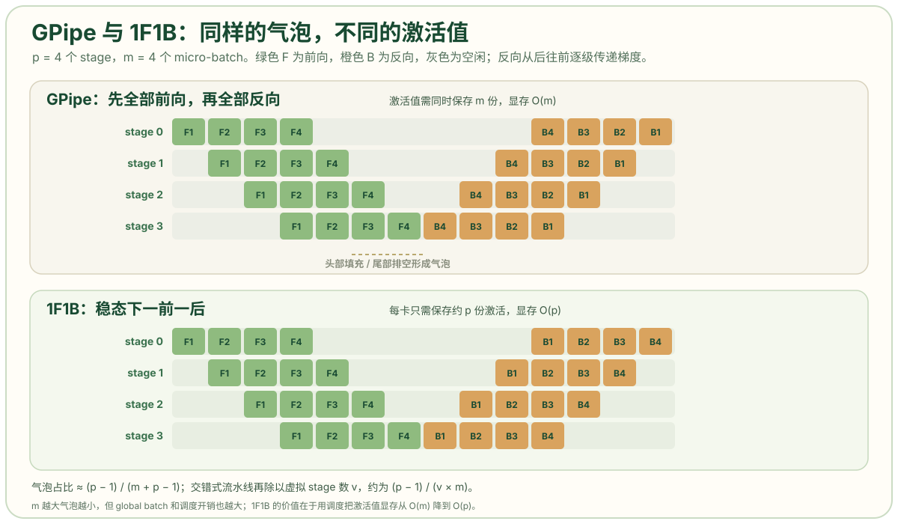

# 流水线并行：调度、气泡与激活值显存

流水线并行（Pipeline Parallelism，PP）按层切分模型，把连续的若干层放进一个 stage，每个 stage 放在一张或一组 GPU 上。一个 batch 依次经过各 stage，反向沿相反方向传回。若一次只送一个 batch，任意时刻只有一个 stage 在计算，其余 stage 空闲。PP 的调度算法围绕两个目标展开：用 micro-batch 填充流水线，以及在填充和排空造成的空闲时间内控制激活值显存。

## 问题定位

设模型有 `L` 层，切成 `p` 个 stage，每个 stage 负责 `L/p` 层。一个 mini-batch 的前向必须依次经过 stage 0 到 stage `p-1`，反向再沿反方向传回。不切 micro-batch 时，同一时刻只有一个 stage 在工作，设备利用率约为 `1/p`。把 mini-batch 切成 `m` 个 micro-batch 后，stage 0 算完第一个 micro-batch 就把激活传给 stage 1，自己继续算第二个；stage 1 收到后开始计算，多个 stage 可以同时工作。

流水线在头部需要填充、在尾部需要排空，这两段时间内仍有 stage 空闲，形成气泡（bubble）。气泡的比例由 `p` 和 `m` 共同决定。调度算法的演进主要改变激活值的保存方式，以及在气泡之外增加计算与通信的重叠。

## 基本模型：stage 与 micro-batch

将一个训练 batch 记为 `m` 个 micro-batch。每个 micro-batch 的 forward 时间为 `t_f`，backward 时间为 `t_b`。理想情况下，一个 stage 处理全部 `m` 个 micro-batch 的时间为 `m(t_f + t_b)`。流水线的头部填充需要 `p-1` 个 forward，尾部排空需要 `p-1` 个 backward，因此气泡时间为 `(p-1)(t_f + t_b)`，气泡占整个迭代墙钟时间的比例为：

```text
bubble / total = (p - 1) / (m + p - 1) ≈ (p - 1) / m
```

`p` 越大，气泡越大；`m` 越大，气泡越小，但收益递减。`p=4, m=4` 时气泡约占 43%，`p=8, m=32` 时约 18%，`p=16, m=64` 时仍有约 19%。实际训练通常让 `m` 显著大于 `p`，以压低气泡比例。[LLM Infra Atlas · PP](https://llm-infra-atlas.github.io/parallel/03_pp/)

## GPipe 调度

GPipe 把 `m` 个 micro-batch 的 forward 全部执行完，再统一执行全部 backward。`p=4, m=4` 的时序如下：

```text
stage 0: F1 F2 F3 F4 .  .  .  .  .  .  B4 B3 B2 B1
stage 1: .  F1 F2 F3 F4 .  .  .  .  B4 B3 B2 B1 .
stage 2: .  .  F1 F2 F3 F4 .  .  B4 B3 B2 B1 .  .
stage 3: .  .  .  F1 F2 F3 F4 B4 B3 B2 B1 .  .  .
```

该调度的气泡与公式一致，但激活值显存为 `O(m)`：backward 依赖 forward 的中间结果，而 GPipe 在做完所有 forward 之后才开始 backward，因此 `m` 个 micro-batch 的激活必须同时驻留。减小气泡需要增大 `m`，增大 `m` 又会提高激活值峰值，两者直接冲突。GPipe 用激活重计算缓解这一矛盾，但没有改变调度的显存阶数。

## 1F1B 调度

PipeDream-Flush（通常称为 1F1B）让一个 micro-batch 完成 forward 后尽快执行 backward，随后立即释放其激活。稳态下，每个 stage 按“一次 forward、一次 backward”交替执行：

```text
stage 0: F1 F2 F3 F4 .  .  .  .  .  .  B1 B2 B3 B4
stage 1: .  F1 F2 F3 F4 .  .  .  .  B1 B2 B3 B4 .
stage 2: .  .  F1 F2 F3 F4 .  .  B1 B2 B3 B4 .  .
stage 3: .  .  .  F1 F2 F3 F4 B1 B2 B3 B4 .  .  .
```

气泡比例仍为 `(p-1)/(m+p-1)`，与 GPipe 相同。区别在激活值：每张卡同时只需要保存约 `p` 个 micro-batch 的激活，而不是 `m` 个。这样，气泡由 `m` 控制，激活值峰值由 `p` 控制，两个问题被解耦。Megatron-LM 的默认流水线调度是 1F1B。



示意图中上下两个面板均为 `p=4, m=4`。绿色 `F` 表示 forward，橙色 `B` 表示 backward，灰色格子表示 stage 空闲。GPipe 面板中，四个 stage 的 forward 依次向右错开，全部完成后才开始 backward；1F1B 面板中，backward 紧跟在 forward 之后，但同样存在头部填充和尾部排空。两个面板的灰色格子数量相同，说明气泡比例相同；差异在 backward 的起始位置和激活值的保存时长。

## 交错式流水线

交错式调度（interleaved，也称 virtual pipeline）把每个物理 stage 再切成 `v` 个虚拟 stage，每个物理 rank 持有 `v` 段不连续的层。例如 8 张卡、`v=2` 时，rank 0 可能持有第 1–5 层和第 41–45 层，rank 1 持有第 6–10 层和第 46–50 层。调度器看到的是 16 个虚拟 stage，而不是 8 个。

气泡比例变为：

```text
bubble / total = (p - 1) / (v × m + p - 1) ≈ (p - 1) / (v × m)
```

`p=8, v=2, m=32` 时，气泡从约 18% 降到约 10%。代价是每个 micro-batch 在 stage 之间多走 `v` 次，P2P 通信次数和调度复杂度上升。Megatron 用 `--num-layers-per-virtual-pipeline-stage` 或 `--virtual-pipeline-model-parallel-size` 控制该参数。[Megatron Core · Pipeline Parallel](https://docs.nvidia.com/megatron-core/developer-guide/latest/api-guide/core/pipeline_parallel.html)

## DualPipe 与 zero-bubble

DeepSeek-V3 的 DualPipe 把 forward 和 backward 拆成更细的块，让两个方向的流水线同时流动，并把 MoE 的全对全（All-to-All）通信放入计算空隙。DeepSeek 的技术报告称，DualPipe 比现有 PP 方法气泡更少，并能重叠前向、反向的计算与通信，以掩盖跨节点专家并行的开销。[DeepSeek-V3 Technical Report](https://arxiv.org/html/2412.19437)

zero-bubble pipeline 采用另一种调度：把 backward 拆成“计算权重梯度”和“计算输入梯度”两部分，将不依赖后续 stage 的部分提前执行，以填充气泡。这些调度都在同一组约束内取舍：气泡、激活值显存和通信次数无法同时达到最优。

## 通信与放置

PP 的通信只发生在 stage 边界：前向传递激活，反向传递梯度，均为相邻 rank 之间的点对点（P2P）Send/Recv。单个 micro-batch 的激活大小为 `micro_batch × seq × hidden × 字节数`，与 TP 每层 All-Reduce 的累计量相比更小。

因此，TP 通常放在节点内，PP 可以跨节点。NVIDIA 在 MT-NLG 530B 的系统设计中说明：TP 通信开销最大，优先放在节点内；PP 通信量最小，可以跨节点；DP 尽量放在节点内或相邻节点。[Megatron-Turing NLG 530B](https://arxiv.org/html/2201.11990v3)

PP 的显存收益按 stage 均分。一个 `L` 层的模型切成 `p` 段，每段只保存 `L/p` 层的权重、梯度和优化器状态；若每段内部再用 TP 切开，就形成“PP 管深度、TP 管宽度”的二维组合。

## 限制与适用条件

流水线并行需要处理以下约束：

- **stage 负载**：`L` 不能被 `p` 整除时，部分 stage 多一层，气泡和显存会向这些 stage 倾斜。Embedding 和 LM Head 通常放在首尾 stage，也会造成额外不平衡。
- **micro-batch 数**：`m` 必须能整除 global batch，且通常需要显著大于 `p`。`m` 太小时，气泡占比过高；`m` 太大时，激活值和调度开销上升。
- **输入输出共享词嵌入（tied embedding）**：输入 embedding 和输出 LM Head 共享权重时，首尾 stage 需要特殊处理，否则参数同步会出错。
- **与 DP 的交互**：PP 组内的 stage 按顺序通信，DP 组在每个 step 末尾同步梯度；两组通信可能争用同一张网卡，需要通过拓扑映射和通信重叠缓解。
- **推理延迟**：PP 能跨节点容纳大模型，但每个 token 需要经过所有 stage，尾延迟增加。在线服务通常更倾向 TP/EP 或 prefill-decode 分离，PP 多用于离线吞吐或多机部署。

流水线并行适合模型很深（50 层以上）、单机 TP 后仍放不下、且能接受较大 global batch 的场景。模型能靠 TP 或 ZeRO 放进单机时，PP 的气泡和 stage 间串行会成为额外负担。batch 很小、延迟敏感时，PP 也不适合作为主要扩展手段。

## 结论

流水线并行按层切分模型，用 micro-batch 填充 stage。GPipe 与 1F1B 的气泡比例相同，均为 `(p-1)/(m+p-1)`；1F1B 通过尽早执行 backward 把激活值显存从 `O(m)` 降到 `O(p)`。交错式调度用更多 P2P 通信换取更小气泡。PP 的通信量最小，适合跨节点放置，但需要较大的 `m` 和均衡的 stage 划分。

## 参考资料

- Huang et al.，[GPipe: Efficient Training of Giant Neural Networks using Pipeline Parallelism](https://arxiv.org/abs/1811.06965)
- Narayanan et al.，[Efficient Large-Scale Language Model Training on GPU Clusters Using Megatron-LM](https://arxiv.org/html/2104.04473v5)
- NVIDIA Megatron Core：[Pipeline Parallel package](https://docs.nvidia.com/megatron-core/developer-guide/latest/api-guide/core/pipeline_parallel.html)
- NVIDIA Megatron Core：[Parallelism Strategies Guide](https://docs.nvidia.com/megatron-core/developer-guide/latest/user-guide/parallelism-guide.html)
- LLM Infra Atlas：[Pipeline Parallelism（PP）](https://llm-infra-atlas.github.io/parallel/03_pp/)
- LLM Infra Atlas：[GPipe / 1F1B](https://llm-infra-atlas.github.io/parallel/03_pp/01_gpipe_1f1b/)
- 知乎：[论文解读系列第四篇：谷歌 GPipe 训练超大规模神经网络](https://zhuanlan.zhihu.com/p/113233933)
- 技术栈：[流水线并行 PP（NaivePP/GPipe/F-then-B/PipeDream/1F1B）](https://jishuzhan.net/article/1940984006488666114)
