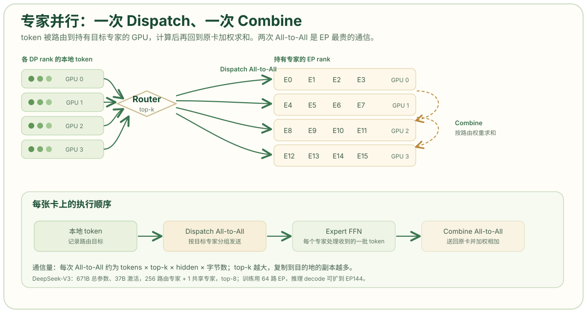

# 专家并行：MoE 的 All-to-All 与负载均衡

稠密模型的并行，切的是同一个矩阵；MoE 模型的并行，切的是“哪些参数被激活”。DeepSeek-V3 有 671B 参数，但每个 token 只激活 37B；256 个路由专家分散在不同的 GPU 上，每个 token 由路由器选出 8 个专家，然后被送到持有这些专家的卡上计算。专家并行（EP）就是为这种稀疏激活设计的第五个维度：它不切层内的矩阵，也不切层，而是把专家本身分到不同 GPU 上。

## MoE 的一次前向

一个 MoE 层包含一个路由器和若干专家。对每个 token，路由器计算它到各专家的分数，选出 top-k 个专家；每个被选中的专家对 token 做一次 FFN；最后按路由权重把各专家的输出加权求和。

```text
token x
  → Router: 计算 256 个专家的分数
  → Top-8: 选中 8 个专家
  → Dispatch: 把 x 发送到持有这 8 个专家的 GPU
  → Expert FFN: 每个专家处理自己收到的 token
  → Combine: 把 8 份输出送回原 GPU，按权重相加
```

稠密模型每个 token 都经过同一组 FFN 权重；MoE 每个 token 只经过少数专家，所以总参数量可以很大，而单 token 的计算量保持较小。DeepSeek-V3 的配置是 256 个路由专家加 1 个共享专家，每个 token 激活 8 个路由专家，总参数 671B、激活 37B。[DeepSeek-V3 Technical Report](https://arxiv.org/html/2412.19437)

## EP 怎样把专家分到多卡

设专家并行度为 `EP`，模型有 `E` 个路由专家，则每张卡持有 `E/EP` 个专家。以 DeepSeek-V3 的 256 个专家、`EP=64` 为例，每张卡持有 4 个专家；如果再加上冗余专家，每张卡持有的数量会相应增加。



关键在于，token 不再固定留在某张卡上。它必须离开原来的 GPU，去到持有目标专家的 GPU；计算完再回来。这一次“去”和一次“回”，就是 MoE 训练中最昂贵的两笔 All-to-All：

- **Dispatch All-to-All**：每张卡把本地 token 按目标专家分组，发送给对应的卡；
- **Combine All-to-All**：每张卡把专家算完的结果发回 token 原来的卡。

每次 All-to-All 的数据量与 `token 数 × top-k × hidden × 字节数` 成正比。`top-k=8` 意味着同一个 token 要被复制到 8 个目的地，通信量是稠密模型激活传输的数倍。这也是 EP 必须和计算重叠、必须用高带宽网络的原因。

## EP 与 DP 的耦合

在 Megatron 的并行布局里，EP 通常叠加在 DP 之上：Attention 部分按 DP 复制，MoE 部分按 EP 切分。也就是说，一个 DP 组内的多张卡，在 MoE 层里变成了一组 EP rank；Attention 仍然各自持有完整副本。

这带来一个有用的性质：EP 不要求每张卡都保存全部专家，因此单卡显存可以显著下降。671B 的 FP16 权重约 1.3 TB，一张 H100 的 80 GB 放不下；但每张卡只放一部分专家，加上 Attention 的 DP 副本，就能把模型摊到几十张卡上。代价是 token 要在 EP 组内往返，All-to-All 成为新的瓶颈。

DeepSeek-V3 的训练配置是 16 路 PP、64 路 EP（跨 8 个节点）、ZeRO-1 DP，在 2048 张 H800 上完成；它没有使用 TP。官方在后续的系统分析里解释过原因：H800 的节点内带宽和模型形状让 TP 不划算，而 EP 能把专家分散到更多节点，配合 DualPipe 把 All-to-All 藏进计算里。[DeepSeek-V3 Technical Report](https://arxiv.org/html/2412.19437)

## 负载均衡：EP 最难的部分

EP 的通信量不是固定的，它取决于路由结果。如果某个专家特别热门，持有它的 GPU 就会收到大量 token，成为 straggler；其它 GPU 则在等它。更糟的是，路由是动态的，负载会随训练数据变化。

常见手段有三类：

**辅助负载均衡损失。** 在训练损失里加一项，惩罚专家负载的方差，鼓励路由器把 token 分得更均匀。这是 GShard、Switch Transformer 以来的标准做法，但辅助损失可能损害模型质量。

**无辅助损失的偏置调整。** DeepSeek-V3 给每个专家维护一个偏置项，根据负载动态调整路由分数，而不在损失函数里加惩罚。这样既平衡了负载，又避免了辅助损失对语言建模目标的干扰。

**冗余专家与重排。** 对高负载专家复制多份，再把副本打包到不同 GPU 上。DeepSeek 开源的 EPLB（Expert Parallelism Load Balancer）做的就是这件事：根据估计的专家负载，先按节点做分层打包，保证节点间负载均衡，再在节点内复制和放置专家；得益于 group-limited routing，它还会尽量把同一组专家放在同一节点，减少跨节点流量。[EPLB](https://github.com/deepseek-ai/EPLB)

DeepSeek-V3 还使用了 node-limited routing：256 个路由专家分成 8 组、每组 32 个，部署时每组放在一个节点上，算法保证每个 token 最多被路由到 4 个节点。这样跨节点的 All-to-All 流量就有了上界，不会因为路由到太多节点而爆炸。[Insights into DeepSeek-V3](https://arxiv.org/pdf/2505.09343)

## DeepEP：把 All-to-All 做成专用内核

DeepSeek 开源的 DeepEP 是面向 MoE 的通信库，目标是把 EP 的 All-to-All 做得更高效：

- 同时支持 NVLink 和 RDMA，节点内走 NVLink，节点间走 InfiniBand；
- 为 prefill 提供高吞吐内核，为 decode 提供低延迟内核；
- 原生支持 FP8 调度，降低通信带宽需求；
- 通过 SM 分配和通信/计算重叠，减少 All-to-All 对计算资源的占用。

这些优化对应的正是 EP 的两个阶段：prefill 阶段 token 多、吞吐优先；decode 阶段每步 token 少、延迟优先。两者的最优内核和并行度并不相同，所以 DeepSeek 在生产部署里把 prefill 和 decode 分开配置。

## 推理中的 EP：越宽越好吗

DeepSeek 公开的推理系统给出了一个很有参考价值的配置：prefill 阶段使用路由专家 EP32，MLA 和共享专家 DP32，一个部署单元跨 4 个节点，每张卡负责 9 个路由专家加 1 个共享专家；decode 阶段使用 EP144，一个部署单元跨 18 个节点，每张卡只负责 2 个路由专家加 1 个共享专家。两者都是 TP1，即不做张量并行。[DeepSeek-V3/R1 Inference System Overview](https://github.com/deepseek-ai/open-infra-index/blob/main/202502OpenSourceWeek/day_6_one_more_thing_deepseekV3R1_inference_system_overview.md)

为什么 decode 要用更大的 EP？因为 decode 每步只有少量 token，单卡上的专家如果太多，每个专家分到的 batch 太小，GEMM 效率低；把专家摊到更多卡上，每张卡只留少量专家，可以让每个专家获得更合适的 batch，同时降低单卡显存。代价是 All-to-All 的跨节点跳数增加，必须靠 DeepEP 的低延迟内核和双 micro-batch 重叠来掩盖。

这也说明 EP 不是“越大越好”。EP 度受这些因素约束：

- 专家总数必须能被 EP 整除，冗余专家的放置还要额外处理；
- EP 组越大，All-to-All 的跨节点流量越大，网络成为瓶颈；
- 每张卡上的专家太少，单个专家的 GEMM 变小，计算效率下降；
- 路由负载不均时，EP 度越大，straggler 的影响越明显。

## EP 与其他维度的对比

| 维度 | 切分对象 | 适用模型 | 主要通信 | 显存收益 | 主要风险 |
| --- | --- | --- | --- | --- | --- |
| DP | batch | 稠密与 MoE | 梯度 All-Reduce | 无（副本复制） | 模型状态冗余 |
| TP | 层内矩阵 | 稠密与 MoE 的 Attention | All-Reduce | 权重与激活按 TP 下降 | 通信频繁，受 NVLink 域限制 |
| PP | 层 | 稠密与 MoE | P2P | 按 stage 下降 | 气泡与负载不均 |
| EP | 专家 | MoE | All-to-All | 专家权重按 EP 下降 | 路由不均、All-to-All 延迟 |

EP 的特殊之处在于，它只作用于 MoE 层。Attention、LayerNorm、Embedding 仍然需要 DP、TP 或 PP 来处理。所以真实配置往往是“Attention 用 DP/TP，MoE 用 EP”，再叠加 PP 管深度。DeepSeek-V3 的 `PP16 + EP64 + DP(ZeRO-1)` 就是这种组合。

## 参考资料

- DeepSeek-AI，[DeepSeek-V3 Technical Report](https://arxiv.org/html/2412.19437)
- DeepSeek-AI，[Insights into DeepSeek-V3: Scaling Challenges and Reflections on Hardware for AI Architectures](https://arxiv.org/pdf/2505.09343)
- DeepSeek-AI，[DeepSeek-V3/R1 Inference System Overview](https://github.com/deepseek-ai/open-infra-index/blob/main/202502OpenSourceWeek/day_6_one_more_thing_deepseekV3R1_inference_system_overview.md)
- DeepSeek-AI，[EPLB: Expert Parallelism Load Balancer](https://github.com/deepseek-ai/EPLB)
- NVIDIA Megatron Core：[Parallelism Strategies Guide · Expert Parallelism](https://docs.nvidia.com/megatron-core/developer-guide/latest/user-guide/parallelism-guide.html)
- 博客：[专家并行（EP）深度解析——MoE 时代的第五种并行维度](https://forceinjection.github.io/09_inference_system/parallelism/expert_parallelism_deep_dive.html)
- 火山引擎开发者社区：[DeepSeek-V3 技术报告（中文）](https://developer.volcengine.com/articles/7542491735755063342)
