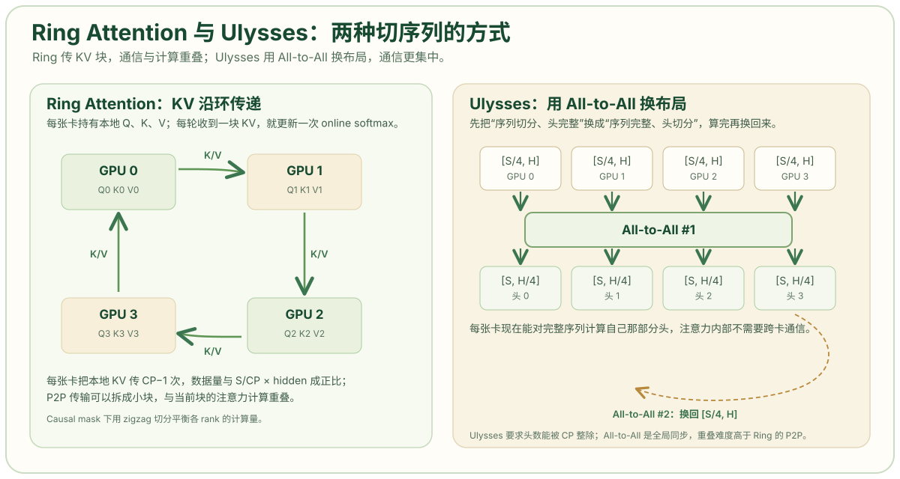

# 上下文并行：长序列切分与注意力通信

上下文并行（Context Parallelism，CP）沿序列维切分输入，每张 GPU 负责一段 token 的 Transformer 计算。它解决的是长上下文下激活值超过单卡容量的问题，代价是注意力层需要跨卡交换键值（Key-Value，KV）。本文区分 Megatron 序列并行与长序列上下文并行，说明 Ring Attention、DeepSpeed Ulysses 和 Megatron CP 的通信模式，以及长序列训练和推理中的适用条件。

## 问题定位

设 `batch=1`、`seq=128K`、64 个 Q 头、8 个 KV 头、`head_dim=128`、BF16。单层注意力需要保存的 Q、K、V 和输出如下：

| 张量 | 形状 | 大小 |
| --- | --- | --- |
| Q | `[1, 128K, 64, 128]` | 2 GB |
| K | `[1, 128K, 8, 128]` | 0.5 GB |
| V | `[1, 128K, 8, 128]` | 0.5 GB |
| O | `[1, 128K, 64, 128]` | 2 GB |

单层合计 5 GB，几十层堆叠后，80 GB 卡无法容纳。该算例取自[飞桨开源社区的序列并行分析](https://pfcc.blog/posts/context-parallel-sharing)。把序列按 CP 切成 8 段，每张卡只保存 `1/8` 的 Q、K、V、O，激活值降到原来的八分之一。

注意力不是逐点操作。每个 query token 都要与序列中所有 key 计算点积；每张卡只持有本地 KV 时，无法独立完成完整注意力。CP 的核心问题是：在切分序列的同时，让每张卡获得完整的 KV，并控制通信量。

## 序列并行的两种含义

“序列并行”在文献和框架中对应两种不同机制：

- **Megatron 序列并行**：张量并行的配套优化，切分 LayerNorm、Dropout 等逐点操作的激活，目标是减少 TP 区域外的激活冗余。它不改变注意力的计算范围，序列长度仍需被 TP 整除。
- **上下文并行（长序列序列并行）**：把整条序列切到多张卡上，每张卡负责一段 token 的完整 Transformer 计算，注意力层通过 P2P 或 All-to-All 交换 KV。

两者的切分对象和通信模式不同。本文后续内容均指第二种。Megatron 序列并行在第 3 篇讨论张量并行时已说明，它与 CP 可以同时使用：SP 在 TP 组内切逐点激活，CP 在更外层切整条序列。

## Ring Attention

Ring Attention 让每张卡持有本地序列段的 Q、K、V，然后沿一个环，把本地 KV 块依次传给下一张卡。每收到一块 KV，就用它和本地 Q 计算一部分注意力，直到所有 KV 块都经过一次。

```text
rank 0 持有 Q0 K0 V0
rank 1 持有 Q1 K1 V1
rank 2 持有 Q2 K2 V2
rank 3 持有 Q3 K3 V3

第 1 轮：每张卡用本地 KV 计算局部注意力
第 2 轮：KV 传给下一张卡，继续计算
……
第 CP 轮：所有 KV 块都参与过一次计算
```

softmax 不能直接分段相加。Ring Attention 使用 online softmax：每算完一块 KV，就更新当前的最大值和归一化因子，把新块的贡献合并进来。这样不需要保存完整的 `S × S` 注意力矩阵，显存从 `O(S²)` 降到 `O(S)`，计算与通信可以重叠：当前块的注意力在计算，下一块 KV 已经在传输。

每张卡把本地 KV 传 `CP-1` 次，数据量与 `S/CP × hidden` 成正比。传输使用点对点（P2P）通信，可以拆成小块与计算重叠，不需要全局同步。这是 Ring Attention 在超长序列上仍可用的原因。[Ring Attention 论文](https://arxiv.org/abs/2310.01889)

## DeepSpeed Ulysses

Ulysses 不传递 KV，而是重新排列 Q、K、V 的布局。它先沿序列维切分、头维完整，执行一次 All-to-All，变成“序列完整、头维切分”；每张卡只计算一部分头，但能看到完整序列；计算完成后，再执行一次 All-to-All 换回原布局。

```text
切分前：每张卡 [S/CP, H]        —— 序列切分，头完整
All-to-All：交换序列块与头块
切分后：每张卡 [S, H/CP]        —— 序列完整，头切分
计算注意力：每张卡负责 H/CP 个头
All-to-All：换回 [S/CP, H]
```

注意力计算本身不需要跨卡，每张卡在自己的头上执行完整的 `S × S` 注意力；通信集中在两次 All-to-All 上。Ulysses 的通信更集中，适合具有高带宽互联的集群；约束是头数必须能被 CP 整除，且 All-to-All 是全局同步，重叠难度高于 Ring Attention 的 P2P。[DeepSpeed Ulysses 论文](https://arxiv.org/abs/2309.14509)



示意图中左侧面板是 Ring Attention。四个 GPU 排列成环，箭头从 GPU 0 指向 GPU 1、从 GPU 1 指向 GPU 2，依此类推，标注 `K/V` 表示传递的是键值块。右侧面板是 Ulysses。上排四个框的形状为 `[S/4, H]`，表示序列切分、头完整；箭头向下进入 `All-to-All #1`；下排四个框变为 `[S, H/4]`，表示序列完整、头切分。底部的虚线箭头表示第二次 All-to-All，将布局换回原状。

## Megatron 上下文并行

Megatron 的上下文并行更接近 Ring Attention：沿序列维切分，注意力通过 P2P 交换 KV，支持因果掩码（causal mask），并可与 TP、PP、DP 组合。NVIDIA 文档将 CP 定位为序列长度 8K 以上的并行维度，并指出同样大小的张量下，CP 的通信量通常低于 TP。[Megatron Core · Parallelism Guide](https://docs.nvidia.com/megatron-core/developer-guide/latest/user-guide/parallelism-guide.html)

## 负载均衡与显存

自回归注意力的 causal mask 使计算量呈三角形分布：前面的 token 需要 attend 到更多位置，后面的 token 更少。若简单地把序列切成连续几段，各 rank 的计算量并不相等。

常见解法是 zigzag 切分：把序列按块编号，rank 0 取第 1 块和最后 1 块，rank 1 取第 2 块和倒数第 2 块，依此类推，使每张卡分到的“query 数 × KV 数”大致相等。Ring Attention 和 Megatron CP 的实现都采用这一策略。长序列训练中若不做负载均衡，CP 的加速比会明显低于线性。

CP 的显存收益与切分段数成正比，但每张卡仍需要保存交换过程中的 KV 缓冲。序列切成过多段时，每段 token 太少，注意力计算的算术强度下降，通信占比上升。CP 度需要与序列长度、头数和网络带宽共同确定。

## CP 与 TP 的关系

| 维度 | 切分对象 | 注意力是否跨卡 | 主要通信 | 适用场景 |
| --- | --- | --- | --- | --- |
| TP | hidden 或 head 维 | 是，每个头被切开 | 每层 All-Reduce | 层放不下，hidden 大 |
| Megatron SP | 序列维（仅逐点操作） | 否 | All-Gather / Reduce-Scatter | 配合 TP 降激活 |
| CP | 序列维（整个 Transformer） | 是，交换 KV | P2P 或 All-to-All | 序列很长（8K 以上） |

NVIDIA NeMo 的性能指南给出判断依据：当序列长度显著大于 hidden size 时，激活值会先成为瓶颈，此时 CP 比继续加大 TP 更有效；同样大小的张量，CP 的通信量通常低于 TP。[Performance Tuning Guide](https://docs.nvidia.com/nemo-framework/user-guide/25.09/performance/performance-guide.html)

Megatron SP 和 CP 可以同时使用：SP 在 TP 组内切逐点激活，CP 在更外层切整条序列。长上下文训练配置常见 `TP × CP × PP × DP` 的组合，CP 通常放在节点内或相邻节点，因为 KV 交换对带宽要求较高。

## 推理中的长上下文

训练中的 CP 主要解决激活值；推理中的主要瓶颈是键值缓存（KV Cache）。长上下文推理时，KV Cache 随 `seq × batch` 线性增长，可能超过模型权重。推理系统采用以下三类方法：

- **TP/EP 切分 KV Cache**：把 KV 头或层切到多张卡上，每张卡只保存一部分 KV；
- **CP 切分预填充（prefill）**：长 prompt 的预填充阶段把序列切开，并行计算注意力，缩短首 token 延迟；
- **PagedAttention 管理 KV**：不切并行度，把 KV 分页存储，减少碎片和重复。

解码（decode）阶段每步只生成一个 token，序列维并行的收益有限，通信反而增加。生产系统通常只在 prefill 或超长上下文场景使用 CP，decode 更依赖 TP/EP 和 KV Cache 管理。DeepSeek 将 prefill 与 decode 分离部署，原因之一就是两阶段的并行瓶颈不同。

## 限制与适用条件

CP 适合以下条件：

- 序列长度 8K 以上，激活值成为显存瓶颈；
- hidden size 不够大，继续增加 TP 的收益已经很低；
- 框架和注意力内核支持 CP（Ring Attention、Megatron CP 或 Ulysses）；
- 序列长度能被 CP 整除，且能处理 causal mask 的负载不均。

CP 不适合以下条件：

- 序列很短，通信和调度开销超过收益；
- 头数太少，Ulysses 的 All-to-All 无法均分；
- 框架不支持 CP 的注意力实现，只能退化为全局 All-Gather；
- 推理 decode 阶段，序列维并行没有足够的工作量。

## 结论

上下文并行沿序列维切分长序列，通过交换 KV 完成注意力。Ring Attention 用 P2P 传递 KV 块并与计算重叠，Ulysses 用两次 All-to-All 在序列维与头维之间重排，Megatron CP 采用前者并支持 causal mask 与负载均衡。CP 降低长序列的激活值，但要求足够长的序列和合适的注意力内核；推理中它主要用于 prefill，decode 更依赖 KV Cache 分片与分页管理。

## 参考资料

- Liu et al.，[Ring Attention with Blockwise Transformers for Near-Infinite Context](https://arxiv.org/abs/2310.01889)
- Jacobs et al.，[DeepSpeed Ulysses: System Optimizations for Enabling Training of Extreme Long Sequence Transformer Models](https://arxiv.org/abs/2309.14509)
- Korthikanti et al.，[Reducing Activation Recomputation in Large Transformer Models](https://arxiv.org/abs/2205.05198)
- NVIDIA Megatron Core：[Parallelism Strategies Guide · Context Parallelism](https://docs.nvidia.com/megatron-core/developer-guide/latest/user-guide/parallelism-guide.html)
- NVIDIA Megatron Core：[Context Parallel Overview](https://docs.nvidia.com/megatron-core/developer-guide/latest/user-guide/features/context_parallel.html)
- NVIDIA NeMo：[Performance Tuning Guide](https://docs.nvidia.com/nemo-framework/user-guide/25.09/performance/performance-guide.html)
- 飞桨开源社区：[大模型训练中的序列并行技术与优化策略](https://pfcc.blog/posts/context-parallel-sharing)
- Hugging Face 博客：[Ulysses + Ring-Attention 技术原理与实现](https://huggingface.co/blog/exploding-gradients/ulysses-ring-attention)
- LLM Infra Atlas：[Tensor Parallelism（TP）与 Sequence Parallelism（SP）](https://llm-infra-atlas.github.io/parallel/02_tp_sp/)
