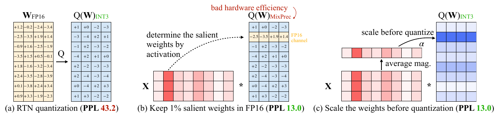
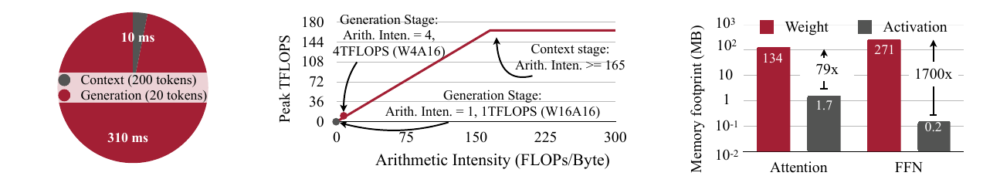
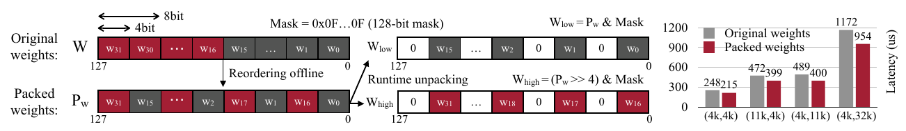
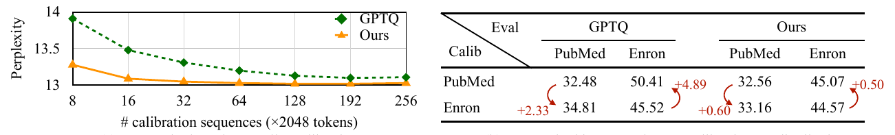
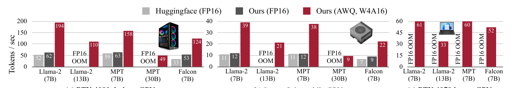

# AWQ：激活感知权重量化与设备端推理加速

本文精读 Lin 等人的 *AWQ: Activation-aware Weight Quantization for On-Device LLM Compression and Acceleration*。阅读依据是 [arXiv v6 英文原文](https://arxiv.org/pdf/2306.00978v6)（2026 年 4 月修订；论文发表于 MLSys 2024）及带批注的中英对照 PDF。对照 PDF 中的译文歧义以英文原文核对：**AWQ 根据激活分布判断哪些权重通道值得保护**。下文依次解释量化目标、缩放的等效关系与误差条件、离线搜索、TinyChat 的运行时实现和论文证据。读者需要了解线性层矩阵乘法及自回归生成中的提示处理与逐 token 生成。除明确标为“本地单点核验”的结果外，数字均来自论文。

## 主要工作

激活感知权重量化（Activation-aware Weight Quantization，**AWQ**）是一种训练后、低比特、**仅量化权重**的方法。它在少量校准输入上统计每个输入通道的激活幅度，借此判断该通道对应的权重在量化后对输出的影响。论文先用“保留少量重要权重为 FP16”的实验揭示这种影响，再用**量化前放大相应权重列、同时反向缩小输入通道**的等效变换保护它们。实际 AWQ 仍可把整层权重统一存为 INT3 或 INT4，不需要为少数通道单独保存 FP16 权重。[论文，§1、§3.1–3.2，图 2](https://arxiv.org/pdf/2306.00978v6#page=2)

作者还实现了 **TinyChat**：在推理时读取压缩权重、在矩阵计算中即时反量化，并配合权重打包与算子融合，把低比特存储带来的带宽收益转为实际速度。论文报告，在其批量为 1 的设备端测试中，TinyChat 的 4 比特 AWQ 模型相对 Hugging Face FP16 实现，在桌面及移动 GPU 上平均快约 3.2–3.3 倍。这个系统数字同时受量化、内核和基线实现影响；算法精度要由独立的困惑度等实验判断。[论文，§1、§4、§5.4，图 9](https://arxiv.org/pdf/2306.00978v6#page=10)

## 研究背景

线性层将输入特征 $X$ 与权重 $W$ 相乘。FP16 权重每个元素占 16 bit；若权重改用 4 bit 表示，**仅就原始权重位数**而言可降为四分之一，但分组尺度、零点与其他模型状态仍占空间。`W4A16` 表示权重采用 4 bit 存储、激活保留 16 bit；这与同时将权重和激活量化为 8 bit 的 `W8A8` 是两种执行条件。W4A16 需要在浮点计算中处理低比特权重与 FP16 激活，因此算子实现更困难。论文在这里提到 W8A8，是为了比较存储精度与计算精度一致时的工程路径，而非把它作为 AWQ 精度表的直接基线。[论文，§2、§4](https://arxiv.org/pdf/2306.00978v6#page=2)

训练后量化（post-training quantization，**PTQ**）在模型训练完后确定整数表示；舍入到最近值（round-to-nearest，**RTN**）是直接按量化尺度舍入权重的基线。**分组量化**把一个输出通道上的连续若干权重归为一组，让组内共享量化参数；论文常用的 `INT3-g128` 是 3 bit 权重、每组 128 个权重。GPTQ 是另一种 PTQ 方法，通过量化过程中的误差补偿改善结果。AWQ 的搜索不更新原权重，也不通过反向传播训练模型；它选择预量化缩放，并可进一步搜索权重裁剪阈值。[论文，§2、§3.2、§5.1](https://arxiv.org/pdf/2306.00978v6#page=3)

模型精度主要用 WikiText-2 的**困惑度**（perplexity，PPL）比较：它是平均下一个 token 负对数似然的指数，同一测试集、分词与评估口径下越低越好。PPL 衡量预测分布，并不等于问答正确率或生成质量。端侧推理还关心逐 token 生成速度，因为小批量解码每一步都要重新读取大量权重；减少权重读取字节数才有机会降低延迟。[论文，§4.1、§5.1](https://arxiv.org/pdf/2306.00978v6#page=5)

## 问题定义

设 $W\in\mathbb{R}^{m\times n}$、$X\in\mathbb{R}^{n\times t}$，则输出 $Y=WX$。**输入通道 $j$** 是 $X$ 的第 $j$ 行，对应 $W$ 的第 $j$ 列；该列的权重作用于同一个输入特征。若量化使权重 $w_{ij}$ 变为 $w_{ij}+e_{ij}$，那么单个输出位置的误差为 $\delta y_i=\sum_j e_{ij}x_j$。因此，权重误差 $e_{ij}$ 的影响还取决于它所乘的激活 $x_{j}$：即使权重本身不大，若相应激活幅度大，其量化误差仍可能明显改变输出。这是论文利用激活统计选择重要权重通道的直接动机，通道“重要”仍需由实验验证。[论文，§1、§3.1–3.2](https://arxiv.org/pdf/2306.00978v6#page=3)

论文表 1 用同样的 `INT3-g128` 设置对比三种“保留 1% 通道为 FP16”的选法。以 OPT-1.3B 为例，WikiText-2 PPL 从 RTN 的 **119.00** 降到按激活选取时的 **16.91**；按权重幅度选取为 **98.55**，随机选取为 **109.38**。OPT-6.7B 上对应值为 23.54、11.39、22.37、24.23。这里的 1% 指被选中的输入通道比例：整列权重受到保护，所以在该层也约对应 1% 的权重。实验说明**选择依据来自输入激活，保护对象仍是权重**；只看权重幅度在这些设置下没有得到相同收益。[论文，表 1](https://arxiv.org/pdf/2306.00978v6#page=4)

*图 2：左图直接 RTN；中图按红色激活列选择权重列并保留 FP16；右图在量化前缩放相应权重列。截取自 [Lin 等，原文图 2](https://arxiv.org/pdf/2306.00978v6#page=3)。图 2 与表 1 都标注 OPT-6.7B、INT3-g128，但 PPL 数值不一致；原文未解释差异，本文不将两处数值合并比较。*

图 2 左侧把所有权重直接舍入为 INT3，重要输入通道对应的权重也一起受误差影响。中间的红色激活列标出“依据”：保留对应权重列为 FP16 后，图示 PPL 降低，但计算要同时处理整数权重与散落的 FP16 权重，增加存储布局及内核复杂度。右侧仍把整层量化为 INT3，先调整不同列的尺度，使重要列在量化格点上得到更有利的表示。AWQ 要解决的正是**不引入混合精度通道时怎样接近其精度收益**。[论文，图 2、§3.1](https://arxiv.org/pdf/2306.00978v6#page=3)

## 方法原理

### 按列缩放的等效变换

为每个输入通道选一个正缩放因子 $s_{j}$，组成对角矩阵 $D=\operatorname{diag}(s)$。右乘 $WD$ 会把 $W$ 的第 $j$ 列整体乘以 $s_{j}$；左乘 $D^{-1}X$ 则把 $X$ 的第 $j$ 行除以同一个 $s_{j}$。在尚未量化的数学运算中，两步严格抵消：

$$
\begin{aligned}
(WD)(D^{-1}X) &= W(DD^{-1})X = WX, \\
Y_{\mathrm q} &= Q(WD)D^{-1}X
\end{aligned} \tag{1}
$$

$Q$ 是权重的分组量化和反量化操作。由于舍入、量化尺度及可能的裁剪会随输入权重改变，通常有 $Q(WD) \ne Q(W)D$，所以**先缩放再量化**能改变误差，即使原始线性层函数没有变化。推理时，$D^{-1}$ 可折入前一算子或前一层的参数，避免每次单独执行一次按通道除法；具体折叠方式取决于相邻算子的结构。[论文，§3.2，式 (4)](https://arxiv.org/pdf/2306.00978v6#page=5)

### 缩放收益的条件与算例

论文式 (1)–(3) 用一个简化的对称均匀量化组解释误差。设原量化步长为 $\Delta$、缩放后步长为 $\Delta'$，$r(z)=\operatorname{Round}(z)-z$ 是舍入残差。对某个权重 $w$ 及输入 $x$，缩放前后的输出误差分别可写为：

$$
\begin{aligned}
E_{\mathrm{before}} &= \Delta\,r\!\left(\frac{w}{\Delta}\right)x, \\
E_{\mathrm{after}} &= \frac{\Delta'}{s}\,r\!\left(\frac{ws}{\Delta'}\right)x
\end{aligned} \tag{2}
$$

若两次舍入残差的典型幅度相近，且放大这一列没有明显改变组内步长，即 $\Delta'\approx \Delta$，则**典型误差幅度的比值**约为 $(\Delta'/\Delta)/s\approx 1/s$。这不是每个元素的严格误差上界，也不是任意 $s>1$ 都能提高模型精度的证明。缩放太大时，组内最大值、尺度或裁剪情况可能变化；别的列也会使用改变后的组尺度，因而会受损。[论文，§3.2，式 (1)–(3)、表 2](https://arxiv.org/pdf/2306.00978v6#page=4)

一个**解释性构造**可以看到这一步：假设某组步长由其他权重固定在 $0.1$，某通道有 $w=0.26$、$x=8$。原乘积是 $2.08$，直接舍入得到 $Q(w)=0.3$，乘积变成 $2.4$，误差为 $0.32$。取 $s=2$ 后，等效输入为 $x'=4$、待量化权重为 $w'=0.52$，原乘积仍是 $2.08$；若步长保持 $0.1$，$Q(w')=0.5$ 给出 $2.0$，误差绝对值降为 $0.08$。这些数只说明**固定步长条件下**的作用；真实分组量化会重算尺度，不能把这个构造当作论文实测。[论文，§3.2](https://arxiv.org/pdf/2306.00978v6#page=4)

论文表 2 给出了这个权衡的实证：OPT-6.7B 的 `INT3-g128` 设置下，给 1% 显著通道乘 $s\in\{1,1.25,1.5,2,4\}$，PPL 依次为 **23.54、12.87、12.48、11.92、12.36**。到 $s=4$ 时，被改变的组尺度比例升至 21.2%，全模型 PPL 反而比 $s=2$ 差。由此，方法需要同时考虑显著列的保护和其他列的误差。[论文，表 2](https://arxiv.org/pdf/2306.00978v6#page=4)

### 激活统计与缩放搜索

论文把校准输入记为 $X$，以量化输出和原始输出之间的差作为搜索目标：

$$
\begin{aligned}
L(s) &= \left\|Q\!\left(W\operatorname{diag}(s)\right)
  \operatorname{diag}(s)^{-1}X-WX\right\|, \\
s_{X,j} &= \operatorname{mean}_{\mathrm{calibration}}|X_j|, \\
s_j &= (s_{X,j})^{\alpha},\quad \alpha\in[0,1]
\end{aligned} \tag{3}
$$

$s_{X,j}$ 是校准样本上第 $j$ 个输入通道的平均绝对激活。$\alpha=0$ 对应不按激活幅度缩放；较大的 $\alpha$ 更强调幅度大的通道。论文在 $[0,1]$ 上网格搜索 $\alpha$，用量化前后的**层输出差**判断候选，而不是对语言模型重新训练；实验设置给出 20 个网格候选。每层找到尺度后再搜索权重裁剪阈值，以降低量化权重的均方误差。校准集来自 Pile 的少量预训练文本。激活统计决定搜索方向，层输出差则衡量所有通道综合后的效果。[论文，§3.2，式 (4)–(5)、§5.1](https://arxiv.org/pdf/2306.00978v6#page=5)

这一过程说明 AWQ 为什么不等同于“将 1% 权重留为 FP16”：表 1 的混合精度只是验证重要通道存在的实验；最终缩放系数作用于输入通道，量化时整层仍采用同一低比特格式。搜索也不保证任意校准分布都合适；它依赖样本中的激活幅度能代表部署时遇到的特征。[论文，§3.1–3.2、§5.3](https://arxiv.org/pdf/2306.00978v6#page=5)

### TinyChat 的运行时映射

*图 3：左为提示处理与逐 token 生成时间；中为 RTX 4090 的带宽受限分析；右为注意力与前馈网络中权重、激活的读取量。截取自 [Lin 等，原文图 3](https://arxiv.org/pdf/2306.00978v6#page=5)。*

图 3 左侧在 Llama-2-7B、RTX 4090、批量 1 的示例中，处理 200 个提示 token 用约 10 ms，而生成 20 个 token 用约 310 ms；两段 token 数不同，图用来展示**逐 token 生成阶段的实际耗时瓶颈**，不能据此直接比较单个 token 的算法复杂度。中图以论文采用的约 165 TFLOPS 算力与 1 TB/s 带宽构成屋顶线：FP16 生成阶段算术强度约 1 FLOP/Byte，低于计算受限阈值约 165 FLOP/Byte。右图中，注意力权重访问约 134 MB、激活约 1.7 MB；前馈网络权重约 271 MB、激活约 0.2 MB。这组特定模型的访问量说明为什么压缩**权重**有机会减少小批量生成的内存流量。[论文，§4.1、图 3](https://arxiv.org/pdf/2306.00978v6#page=5)

但 W4A16 不能只改文件位宽。TinyChat 将 4 bit 权重按设备布局打包，在矩阵乘法内核中读入并**即时反量化**为计算所需的浮点值，直接参加乘加，不把完整的反量化权重中间张量写回显存。它还融合 QKV 投影、层归一化及部分注意力相关操作，减少中间读写与内核启动；因此图 9 的速度收益不能单独归给 AWQ 缩放算法。[论文，§4.2](https://arxiv.org/pdf/2306.00978v6#page=6)

*图 4：离线重排后的 4 bit 权重可在运行时用掩码和移位并行解包；右侧是四种矩阵尺寸的内核延迟对比。截取自 [Lin 等，原文图 4](https://arxiv.org/pdf/2306.00978v6#page=6)。*

图 4 以 128 bit ARM NEON 寄存器为例。原始顺序为 $w_0,w_1,\ldots,w_{31}$ 时，32 个 4 bit 值虽能装进一个寄存器，逐个拆到 8 bit 计算位却不便；离线重排为 $w_0,w_{16},w_1,w_{17},\ldots,w_{15},w_{31}$ 后，每个字节的低 4 bit 恰好组成前 16 个值，高 4 bit 组成后 16 个值。图中的 `Mask`、右移和按位与分别提取两半，令 SIMD 指令一次处理多个权重。右侧四组矩阵乘法内核延迟由原打包的 248、472、489、1172 μs 降至 215、399、400、954 μs；这是**ARM 权重布局的局部比较**，并非完整模型 3 倍加速的单独来源。[论文，§4.2、图 4](https://arxiv.org/pdf/2306.00978v6#page=6)

## 实验与证据

### 语言模型量化精度

论文表 3 比较了 OPT 系列在 `INT3-g128` 下的 WikiText-2 PPL。下表摘出三种规模；“1% FP16”是混合精度对照，“AWQ”仍把权重统一量化为 INT3。[论文，表 3](https://arxiv.org/pdf/2306.00978v6#page=4)

| 模型与指标 | FP16 | RTN INT3-g128 | 1% FP16 对照 | AWQ INT3-g128 |
| --- | ---: | ---: | ---: | ---: |
| OPT-1.3B，WikiText-2 PPL ↓ | 14.62 | 119.47 | 16.91 | **16.32** |
| OPT-6.7B，WikiText-2 PPL ↓ | 10.86 | 23.54 | 11.39 | **11.39** |
| OPT-13B，WikiText-2 PPL ↓ | 10.13 | 46.04 | 10.43 | **10.56** |

在 OPT-1.3B 上，AWQ 把 RTN 的 119.47 降至 16.32；在 OPT-6.7B 上与保留 1% FP16 的对照同为 11.39。OPT-13B 上混合精度对照为 10.43，AWQ 为 10.56，显示“接近”并非每项都更好。论文表 1 把 OPT-1.3B 的 RTN 写为 119.00，而表 3 为 119.47；本文按所在表分别引用，不把两表数字混作同一次测量。[论文，表 1、表 3](https://arxiv.org/pdf/2306.00978v6#page=4)

表 4 将方法扩展到 LLaMA 与 Llama-2 的 INT3/INT4。以 Llama-2-7B、WikiText-2 PPL 为例：FP16 为 5.47，`INT4-g128` 的 RTN、GPTQ、AWQ 分别为 **5.73、5.69、5.60**；`INT3-g128` 分别为 **6.66、6.43、6.24**。这些比较控制了模型与比特数，支持 AWQ 在该表中对 RTN、GPTQ 的精度优势；数字本身不证明推理速度。论文另用 Vicuna、OpenFlamingo、VILA 及代码、数学任务检查适用范围，但评估协议与指标不同，不能把所有结果压成同一个 PPL 增益。[论文，表 4–8、§5.2](https://arxiv.org/pdf/2306.00978v6#page=7)

### 校准数据与分布变化

*图 8：左侧比较不同校准序列数下 AWQ 与 GPTQ 的 PPL；右侧比较 PubMed、Enron 校准分布与评估分布相同或不同时的 PPL。截取自 [Lin 等，原文图 8](https://arxiv.org/pdf/2306.00978v6#page=10)。*

图 8 左侧横轴是每条 2048 token 的校准序列数量，纵轴是 PPL；橙线 AWQ 在 16 条序列时已接近其更多数据下的水平，绿色 GPTQ 需要更多序列才能接近同一范围。右侧固定 OPT-6.7B、`INT3-g128`，分别以 PubMed 摘要和 Enron 邮件校准，并在两个领域评估。PubMed 校准、Enron 评估时，AWQ 从同域的 44.57 增到 45.07（+0.50），GPTQ 从 45.52 增到 50.41（+4.89）；反方向 AWQ 增加 0.60，GPTQ 增加 2.33。两种方法都以同域校准较好，但该实验中 AWQ 对分布变化更稳健。**这是所测两个领域与该模型的结果**，不能推成对任何未见任务都不会过拟合。[论文，§5.3、图 8](https://arxiv.org/pdf/2306.00978v6#page=10)

### 设备端运行速度

*图 9：三个设备面板分别对应 RTX 4090、Jetson Orin 和笔记本 RTX 4070；柱高为每秒生成 token 数，OOM 表示该 FP16 对照在相应显存条件下无法加载。截取自 [Lin 等，原文图 9](https://arxiv.org/pdf/2306.00978v6#page=10)。*

论文按批量 1、4 token 提示、连续生成 200 token 的协议测试，并报告多次运行的中位延迟。图 9 中，RTX 4090 上 Llama-2-7B 的 Hugging Face FP16、TinyChat FP16 与 TinyChat W4A16 分别为 **52、62、194 token/s**；同一设备同一模型下，相对 Hugging Face 的总收益约 3.73 倍，相对 TinyChat 自身 FP16 基线约 3.13 倍。Jetson Orin 上对应为 **11、12、39 token/s**。后一个比较更接近隔离低比特路径的贡献，但仍包含量化内核与运行时的所有差异。图中 OOM 的格子说明某些 FP16 基线在给定显存下不能运行，不能把 OOM 当作一个可计算的速度比值。[论文，§5.4、图 9](https://arxiv.org/pdf/2306.00978v6#page=10)

### 本地单点核验

另用本机 RTX 5070 对官方代码中的 OPT-1.3B 做了一次精度核验：模型相同、WikiText-2 测试口径相同，AWQ 搜索使用 Pile 校准文本；RTN 与 AWQ 都采用 `INT3-g128` 的 **fake quantization**，即舍入后仍用浮点张量模拟计算。实际日志给出的 PPL 为 FP16 **14.62**、RTN **119.46**、AWQ **16.27**，接近论文表 3 的 14.62、119.47、16.32。这支持这一模型和测试集上的精度对比；fake quantization 不产生真实的 3 bit 权重占用，**不能验证 TinyChat 加速或实际 INT3 显存节省**。本地 CUDA INT4 扩展另有数值偏差待排查，因此这里也不报告 INT4 内核性能。[论文，表 3](https://arxiv.org/pdf/2306.00978v6#page=4)

## 局限性

AWQ 的缩放收益取决于激活统计、分组尺度和其他通道的损失。式 (2) 的误差分析中，$\Delta'\approx\Delta$ 只是便于解释的条件；当缩放改变组的最大值或裁剪范围时，重要通道可能受益而其他通道受损。离线搜索通过层输出差和裁剪选择折中，因此实际精度要在目标模型、位宽、分组与任务上测量。[论文，§3.2、表 2](https://arxiv.org/pdf/2306.00978v6#page=4)

低比特权重的理论 4 倍位数压缩也不会自动成为 4 倍吞吐。若内核解包、反量化、启动、KV 缓存访问或别的算子占主导，端到端速度可能不同；图 3 的屋顶线分析只针对其设备及小批量生成场景。图 9 的 Hugging Face FP16、TinyChat FP16 和 AWQ W4A16 三根柱必须同时看，才能分别估计运行时优化与低比特路径的影响。[论文，§4.1–4.2、§5.4](https://arxiv.org/pdf/2306.00978v6#page=10)

## 结论

AWQ 把“重要权重”的判断从权重幅度转到**对应输入通道的激活幅度**。在 $WD\cdot D^{-1}X=WX$ 的等效关系下，它调节量化前的权重列尺度，再以量化输出误差选取折中，使整层保持统一低比特格式。论文的混合精度对照、缩放消融及多模型 PPL 结果支持这一精度机制；TinyChat 的即时反量化、权重打包与算子融合则提供设备端加速所需的实现。读这篇论文时，区分**算法的量化精度**、**权重存储的理论压缩**和**特定运行时的实测吞吐**，才能正确解释每张表与每幅图的结论。[论文，§3–5](https://arxiv.org/pdf/2306.00978v6#page=4)
