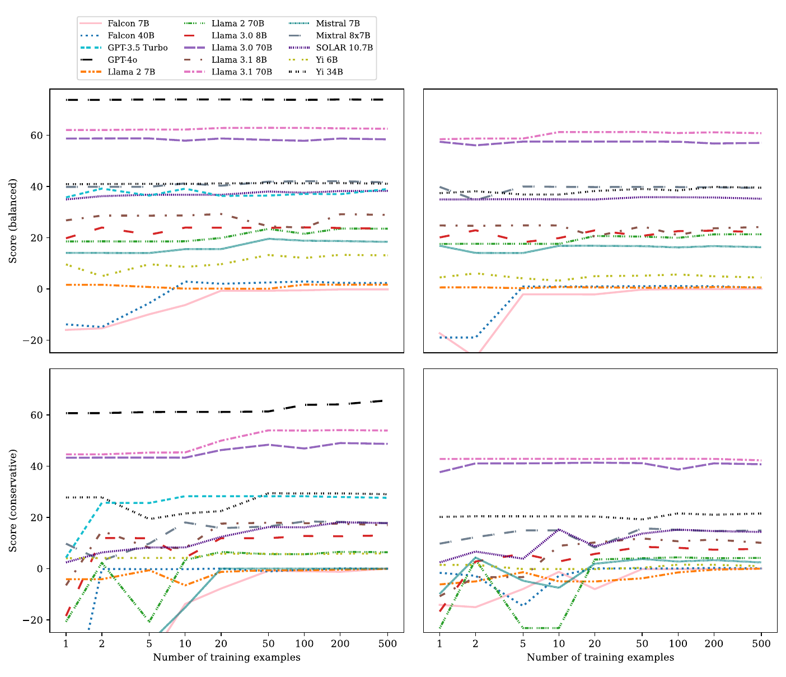
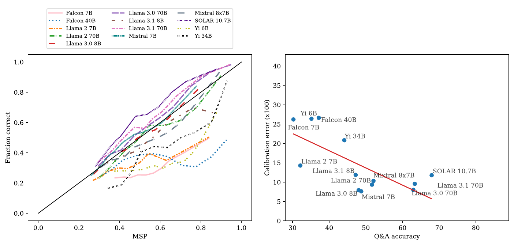

# 聊天模型的概率校准与正确性预测

本文精读 Benjamin Plaut、Nguyen X. Khanh 与 Tu Trinh 的 *Probabilities of Chat LLMs Are Miscalibrated but Still Predict Correctness on Multiple-Choice Q&A*，依据中英对照 PDF 所收录的英文原文，即 [arXiv:2402.13213v4，2025 年 8 月 7 日版本](https://arxiv.org/abs/2402.13213v4)。论文发表于 *Transactions on Machine Learning Research*（TMLR，2025 年 8 月），研究对象是多项选择问答中的聊天大语言模型。本文解释概率的取法、两类不确定性评价及弃权实验；图表与模型结果来自论文，算例另行标明，未重新运行大模型评测。

## 论文的研究问题与主要主张

论文研究的是：**模型给选中答案分配的概率，究竟能告诉我们多少关于答案正确性的信息？** 作者把这个问题拆成两项可以独立检验的性质。第一项是**校准**（calibration）：当模型给出 0.9 的置信分数时，这类回答是否约有 90% 正确。第二项是**正确性预测**（correctness prediction）：正确回答的分数是否通常比错误回答更高。前者关心数值能否直接解释为正确概率，后者关心分数对正确与错误的区分能力。[论文，§1.1](https://arxiv.org/pdf/2402.13213v4#page=2)

作者使用模型已有的**最大 softmax 概率**（maximum softmax probability，MSP）和最大 logit 作为分数，没有为主实验训练新的正确性分类器。对 15 个聊天模型、5 个选择题数据集和两种提示措辞的统一评测表明：多数聊天模型的 MSP 明显过度自信，但仍能帮助区分正确与错误回答。模型平均问答准确率与 MSP 正确性预测能力高度相关，而与校准误差没有检出显著线性相关。最后，作者用少量标注选择分数阈值，让模型放弃部分回答，验证这种排序信息具有实际用途。[论文，§3–6](https://arxiv.org/pdf/2402.13213v4#page=5)

这是一篇以测量、对照和统计证据为核心的实证论文。原文 §2 将贡献定位为：

> “our primary contribution is scientific, not methodological.”

因此，理解本文的重点是弄清楚**同一份分数的哪些性质被测量、结果怎样支持结论、结论在哪些条件下成立**。弃权阈值是这些发现的概念验证，不是作者提出并宣称最优的新训练算法。[论文，§2，p.5](https://arxiv.org/pdf/2402.13213v4#page=5)

## 研究背景：聊天微调后的不确定性信息

语言模型的输出概率直接描述的是“在当前上下文之后，哪个 token 更可能出现”。要把这个概率用于错误检测，还需要检验它与事实正确性的关系。一个模型可以稳定输出某个错误答案，也可以因为多个候选答案都看似合理而降低最大概率。**输出偏好的强弱与答案的真实性属于不同对象，需要通过带标准答案的数据建立联系。**

论文把先前有关基础模型的研究作为主要对照。基础模型（base LLM）指尚未经过聊天微调的模型；聊天模型（chat LLM）经过后训练，能够更好地遵循指令、进行助手式对话。Kadavath 等人的工作主要研究基础模型，发现它们在相应任务上具有较好的校准表现，并且校准随模型能力增强而改善。本文关注这些发现能否推广到实际用户更常接触的聊天模型。[论文，§2](https://arxiv.org/pdf/2402.13213v4#page=3)

如果聊天模型的 MSP 已经失准，仍有两种可能：分数完全失去了正确性信息，或者分数的绝对尺度发生了扭曲，但正确回答仍倾向于获得更高的分数。后者正是论文要检验的假设。它也解释了研究为什么同时需要校准误差和排序指标：只计算其中一个，无法区分这两种情况。

## MSP 的计算：从答案 token 得到一道题的分数

### 选择题输入、答案位置与正确性标签

论文采用给定选项、恰有一个标准答案的选择题。图 1 的问题涉及氮循环，A–D 对应四段候选内容；模型被要求只给答案字母和句号，不解释过程。选项可以包含复杂的知识或语义关系，但本文评价的答案由一个选项字母表示。[论文，§3、图 1](https://arxiv.org/pdf/2402.13213v4#page=2)

*原文图 1：上部规定回答格式，中部给出问题，下部列出 A–D 四个候选项。模型在答案位置对各字母的概率构成本文的测量对象。截取自[论文 p.2](https://arxiv.org/pdf/2402.13213v4#page=2)。*

这里有些读者可能会疑惑：**论文研究的是固定 ABCD 选择题，还是语义复杂的自由文本回答？** 输出形式属于前一种，但题目和选项的语义可以很复杂。例如 HellaSwag 要选择合理的文本续写，WinoGrande 要根据上下文补全指代对象。A–D 只是图 1 的例子，实际答案集合随题目的候选项而定，WinoGrande 是二选一。本文没有对一段自由生成的解释逐 token 求平均，也没有在生成长推理链之后评价最终答案。

需要进一步精确区分“答案由一个 token 表示”与“整个生成串只有一个 token”。提示中还要求句号，少数模型在答案前会先输出一个固定的占位 token。原文脚注 7 说明，对这类模型改取第二个响应 token；一般情况则取第一个响应 token。**统计只使用承载答案字母的位置，后续标点和解释不参与 MSP 计算。**[论文，§3、脚注 7](https://arxiv.org/pdf/2402.13213v4#page=6)

设问题连同选项组成提示 $x$，标准答案为 $y^*$，模型选择的答案为 $\hat y$。每道题对应一个二值正确性标签：

$$
C(x)=\mathbf 1\{\hat y=y^*\}.
$$

其中 $\mathbf 1\{\cdot\}$ 在条件成立时取 1，否则取 0。后面的两种评价都使用同样的“分数、正确性标签”数据对；差别在于评价方式。

### 全词表 softmax 与答案集合重新归一化

**logit** 是模型在 softmax 之前为每个候选 token 给出的实数分数。令 $V$ 为完整词表，$L(y\mid x)$ 为提示 $x$ 之后 token $y$ 的 logit，则全词表概率为：

$$
P(y\mid x)=\frac{\exp L(y\mid x)}{\sum_{z\in V}\exp L(z\mid x)}.
$$

论文接着只保留可能作为答案的 token 集合 $T$，例如 $T=\{A,B,C,D\}$。原文 §3 明确写道：

> “The probabilities were also renormalized to sum to 1 over tokens in T.”

也就是把答案集合内的概率重新归一化。为方便推导，本文把重新归一化后的概率记作 $q$：

$$
q(y\mid x)=\frac{P(y\mid x)}{\sum_{z\in T}P(z\mid x)}
=\frac{\exp L(y\mid x)}{\sum_{z\in T}\exp L(z\mid x)},\qquad y\in T.
$$

第二个等号来自全词表 softmax 分母的约去。因此，该操作等价于只对答案 token 的 logits 做一次 softmax。模型答案和两个置信分数分别是：

$$
\begin{aligned}
\hat y&=\arg\max_{y\in T}q(y\mid x),\\
\operatorname{MSP}(x)&=q(\hat y\mid x)=\frac{\max_{y\in T}P(y\mid x)}{\sum_{y\in T}P(y\mid x)},\\
\operatorname{MaxLogit}(x)&=\max_{y\in T}L(y\mid x).
\end{aligned}
$$

softmax 和集合内重新归一化都保持同一道题各选项的大小关系，因此两个分数对应同一个选中答案。MSP 在 0 与 1 之间；Max Logit 是实数，没有“0.9 就意味着 90% 正确”的概率含义，论文只用它评价正确性预测。[论文，§3、§5，脚注 9](https://arxiv.org/pdf/2402.13213v4#page=6)

下面是**解释性构造算例**，用来说明单题 MSP 怎样恰好得到 0.95，并非论文的原始样本：

| 候选 token | 全词表概率 $P$ | 在答案集合内重新归一化后的 $q$ |
| --- | ---: | ---: |
| A | 0.380 | 0.950 |
| B | 0.010 | 0.025 |
| C | 0.006 | 0.015 |
| D | 0.004 | 0.010 |
| 其余词表 token 合计 | 0.600 | 不参与答案集合归一化 |

答案 token 的原始概率之和为 $0.4$，所以模型选 A，$\operatorname{MSP}=0.38/0.4=0.95$。这个 0.95 表示“在候选答案集合内部，模型把 95% 的概率分给 A”。它没有使用标准答案；只有再把 A 与 $y^*$ 比较，才知道本题是否正确。概率运算本身不能把输出偏好转换成事实保证。

这一处理同时消除了模型分配给其他输出形式的概率质量。若基础模型更想接着写一段话，A–D 的原始概率可能都很小，但其中一个仍可在重新归一化后占很大比例。后文基础模型对照中的格式适应问题，正来自这里。

## 校准：分数的数值能否对应正确率

### 校准定义、分桶估计与误差

令 $S=\operatorname{MSP}(x)$。理想校准关系可以写为：

$$
\Pr(C=1\mid S=s)=s.
$$

它描述一组分数相同或相近的回答的统计行为。例如，收集大量分数接近 0.8 的回答，约 80% 应正确。单道题的结果只有 0 或 1，校准需要在样本集合上检验。

实际实验很少出现大量分数完全相同的样本，因此作者按分位数把分数分为 10 个桶，目标是让各桶样本量相近。对第 $b$ 个桶 $B_b$，计算：

$$
\bar s_b=\frac{1}{|B_b|}\sum_{i\in B_b}s_i,\qquad
\bar c_b=\frac{1}{|B_b|}\sum_{i\in B_b}C_i.
$$

校准曲线以 $\bar s_b$ 为横坐标、$\bar c_b$ 为纵坐标。理想情况落在 $y=x$ 上；曲线低于对角线，说明分数高于实际正确比例，即**过度自信**；高于对角线则是低估正确率。作者把各桶的绝对偏差取平均：

$$
E_{\mathrm{cal}}=\frac{1}{B}\sum_{b=1}^{B}|\bar s_b-\bar c_b|,
\qquad B=10\text{（预设桶数）}.
$$

这里按论文 §4 的口径写出等频分桶下的均值；作者代码会移除空桶，再对剩余桶取均值。论文表 1 将该指标称为 expected calibration error（期望校准误差，ECE）。一般 ECE 常按桶内样本占比加权，等频时与上述平均一致。表格通常把误差乘 100，例如 11.5 对应原始误差 0.115。[论文，§4、附录 A.1](https://arxiv.org/pdf/2402.13213v4#page=6)；[作者的分桶与误差实现](https://github.com/bplaut/llm-calibration-and-correctness-prediction/blob/main/plotting_functions.py)

为了避免大数据集压过小数据集，作者对每个“模型—数据集—提示措辞”分别算误差，再对 5 个数据集、2 种措辞的 10 个误差等权平均。**图 2 左侧校准曲线采用另一种汇总办法**：附录 A.1 说明，作者把较小数据集的样本重复并补采样，使每个数据集达到 6,000 个点后再绘图。例如 TruthfulQA 的 817 题重复 7 次得到 5,719 个点，再随机补足到 6,000；ARC 的 2,590 题也做类似处理。这是在调整绘图时的数据集权重，并没有获得新的独立问题。[论文，附录 A.1，pp.19–20](https://arxiv.org/pdf/2402.13213v4#page=19)

### “MSP 超过 0.95、正确率只有 60%”的统计层次

原文 §4 的表述是：

> “most models produce MSPs above 0.95 even when they are correct only 60% of the time.”

这句话需要结合图 2 左侧的校准曲线理解。每个绘图点代表一个分数桶，不是一段回答的多个 token。沿纵坐标约 0.6 的高度观察，多条曲线的横坐标已经接近 1，说明这些回答组的平均 MSP 很高，但其中仍有相当多的错误。[论文，§4、图 2](https://arxiv.org/pdf/2402.13213v4#page=7)

*原文图 2：左图横轴为桶内平均 MSP、纵轴为桶内正确比例，黑色对角线表示理想校准；右图每个点是一种模型，纵轴误差乘以 100。左图说明过度自信，右图检验它是否随模型问答能力变化。截取自[论文 p.7](https://arxiv.org/pdf/2402.13213v4#page=7)。*

这里有些读者可能会疑惑：**0.95 是一个 token 的概率，还是所有回答 token 概率的平均？** 有两层运算需要分开。单道题先在答案位置计算一个 MSP；画图时，再对同一桶内许多题的 MSP 求平均。假设一个桶有 10 题，每题 MSP 都为 0.96，其中 6 题答对，那么图中点就是 $(0.96,0.60)$，该桶绝对校准偏差为 $|0.96-0.60|=0.36$。这是解释图义的构造算例，平均发生在**题目之间**。

论文的 0.95 与 60% 是对观察结果的描述，文中没有列出对应模型、桶号及逐样本明细，不能从表 6 的总校准误差反推出这一坐标。精确复核需要使用原始回答分数，并按照图 2 的重采样和分桶过程重绘。它也不表示“一个总体准确率为 60% 的模型，其所有回答的 MSP 都大于 0.95”。

右图检验的是另一个层次：**跨模型**的平均准确率与平均校准误差。线性回归得到 $R^2=0.07$、$p=0.33$。$R^2$ 是决定系数，在这项拟合中约 7% 的校准误差差异能由问答准确率的线性关系解释；p 值检验零斜率假设。这里没有检出显著关系，不能据此证明两者在所有条件下完全无关。论文的主要启示是：在这组聊天模型中，能力增强没有表现为稳定的校准改善。[论文，§4](https://arxiv.org/pdf/2402.13213v4#page=6)

## 正确性预测：分数能否区分正确与错误回答

### 从阈值分类到 AUROC

正确性预测把 $C=1$ 当作正例、$C=0$ 当作负例。选择一个阈值 $\tau$，若 $S\ge\tau$ 就预测该回答正确，否则预测错误。逐渐降低阈值，会把更多回答判为“正确”：既可能增加真正的正确回答，也可能放入错误回答。

**受试者工作特征曲线**（receiver operating characteristic curve，ROC）记录不同阈值下的两个比例：横轴为错误回答被误判成正确的比例，即假阳性率；纵轴为正确回答被判为正确的比例，即真阳性率。**ROC 曲线下面积**（area under the ROC curve，AUROC）把所有阈值下的区分表现汇总成一个数。它不是问答准确率，也不是某个固定阈值的分类准确率。[论文，§5.1](https://arxiv.org/pdf/2402.13213v4#page=7)

更容易计算的等价表达是：随机选一份正确回答和一份错误回答，比较二者分数。考虑并列分数时：

$$
\operatorname{AUROC}
=\Pr(S^+>S^-)+\frac12\Pr(S^+=S^-).
$$

$S^+$ 来自正确回答，$S^-$ 来自错误回答。AUROC 为 1 表示全部正负样本对都按正确方向排序；0.5 表示在这一成对比较指标上没有优于随机排序；0 表示完全反向排序，反转分数就能得到完美排序。因此，AUROC=0 的精确含义是“排序反向”，不是任意阈值下每一道二分类预测都错。

以一个**四题构造算例**说明：正确回答的分数为 $[0.98,0.93]$，错误回答为 $[0.96,0.85]$。四种正负配对中，0.98 大于两个错误分数，0.93 只大于 0.85，于是 AUROC 为 $3/4=0.75$。这组数据的问答准确率为 $2/4=0.5$。两个指标分别在评价“答对多少题”与“分数能否识别哪些题答对”，数值自然可以不同。

### 失准与有效排序的同时成立

原文 §1.1 用一个极简例子说明标题中的现象：正确回答的 MSP 总是 0.9，错误回答总是 0.8。于是选择 $\tau=0.85$ 可以完全分开两类回答，AUROC=1；但 0.9 分数组的实际正确率为 1，0.8 分数组的实际正确率为 0，两个分数都没有校准。[论文，§1.1](https://arxiv.org/pdf/2402.13213v4#page=2)

若进一步构造数量相同的两组，按两个分数组平均的绝对校准误差是 $(|0.9-1|+|0.8-0|)/2=0.45$。这个算例说明，**一个相当差的概率尺度仍然可以保留非常好的顺序**。对所有分数施加严格递增变换，大小次序保持不变，AUROC 也保持不变；校准误差通常会改变，因为它直接比较分数与正确比例。

“Calibration”和“MSP correctness prediction”的区别可归纳如下：

| 比较维度 | 校准 | MSP 正确性预测 |
| --- | --- | --- |
| 核心关系 | 分数 $s$ 对应约 $s$ 的正确比例 | 正确回答通常具有更高分数 |
| 本文主要指标 | 分桶后的绝对校准误差 | AUROC |
| 对数值尺度的要求 | 数值本身应有正确概率含义 | 主要依赖分数排序 |
| 严格递增变换后的表现 | 通常改变 | 保持不变 |
| 用于弃权时的作用 | 理想条件下可由风险或代价直接导出阈值 | 还需选择适合任务与代价的阈值 |

原文表 1 的两列另有一层含义：左列是 Chat LLMs，右列是 Base LLMs。表中“校准不好”和“仍可预测正确性”是在**同一组聊天模型**上同时出现的性质；左右两列则用于比较聊天模型和基础模型。基础模型那一列的勾号概括的是实验趋势，统计强度还需要结合后文的 p 值判断。

### Max Logit、margin 与概率尺度

论文同时研究 Max Logit，是为了检查 softmax 前的输出分数是否也包含正确性信息。原始 logit 与同题其他选项的相对差异共同决定概率；其绝对大小还可能包含与该题有关的整体偏移。例如，两道题的答案 logits 分别为 $[5,4,3,2]$ 和 $[105,104,103,102]$，两题的答案概率完全相同，但 Max Logit 从 5 变成了 105。这是说明尺度性质的构造例子，不能当作作者观测到的成因。

附录 C 还比较了**间隔**（margin，最高分与次高分之差）和概率分布的**熵**（entropy，衡量分布分散程度）。logit margin 在上述加常数时不变，所以能够消除这种共同偏移。作者发现 logit margin 的 AUROC 及其与问答能力的相关性好于 Max Logit，并推测这与类似归一化的作用有关；概率侧的 margin 和熵没有带来同样明显的改进。熵越高通常越不确定，用作“越大越可能正确”的排序分数时要反转方向。margin 与熵也都不是某个答案正确的概率，因而论文没有对它们直接做同样的概率校准分析。[论文，§5.2、附录 C](https://arxiv.org/pdf/2402.13213v4#page=27)

## 实验与证据：能力、校准与排序的不同关系

### 模型、数据与汇总单位

主实验覆盖 13 个开放权重聊天模型和 2 个通过 API 访问的模型。开放权重模型包括 Falcon、Llama 2、Llama 3.0、Llama 3.1、Mistral、Mixtral、SOLAR 和 Yi 的不同规模版本；API 模型为 GPT-3.5 Turbo 和 GPT-4o。开放权重模型采用动态 4-bit 量化，并使用 NVIDIA RTX A6000 GPU。论文报告开放权重实验约 2,000 GPU 小时，API 实验约 110 美元；这些是作者实验成本，不是完成本文阅读报告的成本。[论文，§3](https://arxiv.org/pdf/2402.13213v4#page=5)

| 数据集 | 在本文中的作用 | 题量 |
| --- | --- | ---: |
| ARC-Challenge | 科学知识与推理选择题 | 2,590 |
| HellaSwag | 合理文本续写选择 | 随机抽取 6,000 |
| MMLU | 多学科知识选择题 | 随机抽取 6,000 |
| TruthfulQA | 容易诱发错误知识回答的选择题 | 817 |
| WinoGrande | 上下文指代补全 | 随机抽取 6,000 |

合计 21,407 题。主实验使用零样本提示（zero-shot prompting，即不提供示范题），每题用两种措辞测试，得到 $15\times21{,}407\times2=642{,}210$ 次提示。正确性预测结果按“模型 × 数据集 × 措辞 × 分数类型”单独统计。MSP 有 150 个 AUROC，Max Logit 有 130 个，因为当时使用的两个 OpenAI 模型接口不返回 softmax 前 logits。合计 280 个 AUROC **是 280 种评测配置的汇总指标**，不是 280 道题，也不是 280 个独立模型。[论文，§3、§5.1](https://arxiv.org/pdf/2402.13213v4#page=5)

每个模型的平均 AUROC 是 5 个数据集、2 种措辞的 10 个 AUROC 的算术平均。若把所有题合成一个大集合再计算 AUROC，题量更多的数据集会占据更大权重，还会引入来自不同数据集的正负配对；作者采用逐配置计算、再等权平均，正是为了明确控制这种影响。

### 显著性检验与跨模型相关性

作者使用 **Mann–Whitney U 检验**（MWU，一种基于秩比较两组样本的统计检验），检验正确回答与错误回答的分数是否存在排序差异。其 U 统计量与成对比较、AUROC 有直接关系。在本文的检验设置下，作者检验真实 AUROC=0.5 的零假设，再结合观测 AUROC 的方向判断是否优于随机。[论文，§5.1](https://arxiv.org/pdf/2402.13213v4#page=7)

单次检验常用 0.05 阈值，但同时做 280 次检验会累积误报机会。作者使用 **Bonferroni 校正**，把单次阈值收紧到 $0.05/280\approx1.8\times10^{-4}$，实际采用更严格且方便表述的 $10^{-4}$。280 种配置中，245 种的 AUROC 高于随机并满足这一阈值；去掉 Falcon 和 Llama 2 系列后为 196/200。该比例支持“很多配置保留了正确性信号”，并没有宣称每个模型、每个数据集都有效。[论文，§5.1–5.2](https://arxiv.org/pdf/2402.13213v4#page=8)

下面选取表 2 和表 6 的若干行对照。除误差乘 100 外，准确率与 AUROC 均以百分数表示；这些量采用不同定义，不能直接相减当作改进幅度。

| 聊天模型 | 问答准确率 | 校准误差 ×100 | MSP AUROC | Max Logit AUROC |
| --- | ---: | ---: | ---: | ---: |
| Falcon 7B | 30.1 | 14.8 | 52.0 | 51.9 |
| Llama 2 7B | 39.7 | 40.7 | 58.6 | 57.8 |
| Mistral 7B | 57.0 | 40.9 | 66.1 | 62.8 |
| Llama 3.1 8B | 62.0 | 10.8 | 72.9 | 67.3 |
| Llama 3.1 70B | 80.6 | 9.2 | 83.4 | 69.6 |
| GPT-4o | 86.9 | 11.5 | 85.3 | 不可获取 |

Falcon 7B 的校准误差小于 Mistral 7B，却在问答准确率和 MSP 排序上都更弱，说明校准误差不能用作一般能力评分。GPT-4o 的平均 MSP AUROC 为 85.3%，其含义是在这些数据集的成对排序评价中表现较强，不是“模型能以 85.3% 的准确率断定任意回答的对错”。[论文，表 2、表 6](https://arxiv.org/pdf/2402.13213v4#page=9)

*原文图 3：每个点对应一个模型，横轴为平均问答准确率；左图纵轴为 MSP AUROC，右图为 Max Logit AUROC，直线为线性拟合。左图随准确率上升更集中，支持 MSP 区分能力与问答能力的强相关。截取自[论文 p.9](https://arxiv.org/pdf/2402.13213v4#page=9)。*

图 3 中，平均问答准确率与 MSP AUROC 的线性拟合达到 $R^2=0.94$，与 Max Logit AUROC 为 $R^2=0.71$，二者 $p<10^{-3}$。跨模型分析另按 18 次相关性检验校正，作者采用 $10^{-3}$ 阈值。这里的样本是 15 个模型的汇总点，Max Logit 则只有 13 个模型。$R^2=0.94$ 描述这组点的拟合强度，不能解释为“某个模型 94% 的答案都知道对错”，也不能把 642,210 次提示当作跨模型回归的独立样本量。[论文，§5.2、脚注 11](https://arxiv.org/pdf/2402.13213v4#page=8)

作者将这一趋势外推为：在相近的聊天微调范式下，更有能力的模型可能具有更有用的正确性信号。这个判断是基于跨模型观察的推测，实验没有单独控制训练数据、模型结构和后训练方法来建立因果关系。参数规模与 AUROC 的相关性也更弱：MSP 对应 $R^2=0.35$、$p=0.03$，Max Logit 对应 $R^2=0.16$、$p=0.17$，都没有通过作者的 $10^{-3}$ 阈值。因此正文中的“能力”应主要理解为问答准确率，而不能直接替换成参数量。[论文，§5.2、图 4](https://arxiv.org/pdf/2402.13213v4#page=10)

### WinoGrande 与提示变化的边界

WinoGrande 的平均 MSP AUROC 仅为 60.8%，低于 ARC-Challenge 的 78.1%、HellaSwag 的 71.0%、MMLU 的 73.3% 和 TruthfulQA 的 71.0%。它的问答准确率也是 60.8%，与 HellaSwag 的 60.1% 接近；这两个 60.8 是不同指标的数值巧合。困难主要表现在“分数能否识别错误”，并不能用整体问答准确率低简单解释。[论文，表 3](https://arxiv.org/pdf/2402.13213v4#page=10)

论文举出 Neil 与 Craig 分担照看孩子的指代题：同一段上下文可能让读者在“承担责任”和“分配责任”之间产生歧义。作者推测 WinoGrande 的对抗性设计使模型更容易确信错误解释，但没有通过单独实验确定原因。更强模型在该数据集上仍能取得较好的排序结果：Llama 3.1 70B 为 75.8%，GPT-4o 为 78.3%。这说明平均现象也不能替代具体模型、具体任务的检验。[论文，§5.2、表 25](https://arxiv.org/pdf/2402.13213v4#page=8)

两种提示措辞产生了相近趋势，附录 B 的五样本提示（5-shot，提供五个示例题）也获得类似主要结果。这些对照提高了结论对所测提示变化的稳健性；它们覆盖的是直接选项回答，尚未检验长思维链、工具调用或自由问答中的不确定性聚合。[论文，图 5、附录 B](https://arxiv.org/pdf/2402.13213v4#page=24)

## 选择性弃权：把排序信号变成回答策略

### 评分目标与风险阈值

**弃权**（abstention）指系统在可能答错时选择不提供原答案。论文复用已经记录的回答与分数：分数低于阈值，就在分析中把该回答记为弃权；其余保留原答案。作者没有再提示模型生成一段“我不知道”，也没有在这一阶段重新训练语言模型。[论文，§6.1](https://arxiv.org/pdf/2402.13213v4#page=11)

给定答错代价 $c>0$，答对得 1 分，弃权得 0 分，答错得 $-c$ 分。对 $N$ 道题，定义策略效用：

$$
U_c(\tau)=\frac1N\sum_{i=1}^{N}\mathbf 1\{s_i\ge\tau\}
\bigl[C_i-c(1-C_i)\bigr].
$$

分母是全部问题数，包括弃权的问题；因此该分数同时考虑回答数量和错误代价。论文使用 $c=1$ 的 balanced score（平衡评分）与 $c=2$ 的 conservative score（保守评分）。按数据集分别归一化后，汇总结果对数据集等权平均，表格再乘 100。[论文，§6、表 4](https://arxiv.org/pdf/2402.13213v4#page=11)；[作者评分与汇总代码](https://github.com/bplaut/llm-calibration-and-correctness-prediction/blob/main/plotting_functions.py)

下面的推导解释校准为什么能直接指导决策。若已知某个回答正确的概率为 $p$，回答的期望效用为 $p-c(1-p)=(1+c)p-c$，弃权效用为 0。因此在该效用模型下，回答有正收益的条件是：

$$
p>\frac{c}{1+c}.
$$

$c=1$ 时阈值为 0.5，$c=2$ 时为 $2/3$。这些是对**正确概率**的理论阈值。聊天模型的原始 MSP 未校准，把它直接代入 $p$ 会把高输出概率误当成高正确概率，所以作者改用标注数据选择 MSP 阈值。

原文 §1.1 还给出另一种目标：如果分数理想校准，并只回答 $S>1-\varepsilon$ 的题，则在该分布下，被保留回答的平均错误概率不超过 $\varepsilon$。它是总体统计关系下的条件风险结论；用有限数据看起来接近对角线，并不能自动获得有限样本保证，更不能保证任务分布改变后仍然成立。效用最大化与错误率约束是两个不同的目标，阈值应由使用场景决定。[论文，§1.1](https://arxiv.org/pdf/2402.13213v4#page=2)

### 少量标注选择一个跨数据集阈值

原文 §6.1 先说随机选择每个数据集的 $k$ 道题，随后说明：

> “for each model, we chose the threshold which performed best on those 5k questions.”

主实验使用 $k=20$，因此是**每个数据集 20 条，五个数据集合计 100 条**。对每个模型、分数类型和答错代价，使用训练子集选择效用最好的阈值，再在保留的测试数据上评价。同一个已选阈值用于五个数据集，避免为每个数据集独立调一个阈值。作者代码也体现了训练集选阈值、测试集算分数的顺序。[论文，§6.1](https://arxiv.org/pdf/2402.13213v4#page=11)；[作者阈值选择实现](https://github.com/bplaut/llm-calibration-and-correctness-prediction/blob/main/plotting_functions.py)

这里有些读者可能会疑惑：**前面说“不训练分类器”，后面为什么又需要训练集？** 主实验用已有 MSP 计算 AUROC，不学习新模型；弃权实验需要决定一个具体阈值，因而用少量带正确性标签的数据调这个标量。语言模型权重没有变化。AUROC 回答“分数有没有区分能力”，阈值选择回答“在给定代价下怎样使用这种能力”。

以下继续使用前面的四题算例：正确分数为 0.98、0.93，错误分数为 0.96、0.85。在 $c=2$ 下：

| 回答规则 | 保留的回答 | 总效用除以 4 |
| --- | --- | ---: |
| 全部回答 | 2 正确、2 错误 | $(2-2\times2)/4=-0.50$ |
| 阈值 0.90 | 2 正确、1 错误 | $(2-2)/4=0$ |
| 阈值 0.97 | 1 正确、0 错误 | $1/4=0.25$ |
| 全部弃权 | 无 | 0 |

这个算例展示了提高阈值的代价：能剔除一些错误，也会放弃部分正确答案。它只演示评分机制；论文的实际阈值必须在训练子集选定，不能依据测试题答案挑选。

### 弃权收益、覆盖率与实际边界

论文图 10 比较阈值选择所需的数据量。横轴是**每个数据集**的训练样本数 $k$，不是总样本量；上排为平衡评分，下排为保守评分，左列使用 MSP，右列使用 Max Logit。很多曲线从很小的 $k$ 增至约 20 时改善，此后趋于平缓，支持作者在本实验中使用 $k=20$ 的选择。[论文，附录 A.2](https://arxiv.org/pdf/2402.13213v4#page=21)

*原文图 10：横轴为每个数据集用于选阈值的样本数，纵轴为平均效用乘 100；上、下排的错误惩罚分别为 1 和 2。左列为 MSP，右列为 Max Logit，曲线颜色和线型对应不同模型。截取自[论文 p.21](https://arxiv.org/pdf/2402.13213v4#page=21)。*

下表摘录保守评分结果，同时列出 MSP 弃权率。**覆盖率**是系统实际回答的比例，等于 1 减弃权率。效用改善与覆盖率下降应一起阅读。[论文，表 4、表 7](https://arxiv.org/pdf/2402.13213v4#page=11)

| 聊天模型 | 全答效用 ×100 | MSP 弃权后效用 ×100 | MSP 弃权率 |
| --- | ---: | ---: | ---: |
| Falcon 7B | −109.7 | −7.8 | 86.5% |
| Mistral 7B | −29.0 | 0.0 | 100.0% |
| Llama 3.1 8B | −14.2 | 17.6 | 67.2% |
| Llama 3.1 70B | 41.8 | 49.9 | 11.4% |
| GPT-3.5 Turbo | 2.6 | 28.3 | 47.6% |
| GPT-4o | 60.7 | 61.1 | 0.4% |

Llama 3.1 8B 的效用由负转正，但只回答约三分之一的问题；Llama 3.1 70B 的效用提高，同时保留了 88.6% 的覆盖率。Mistral 7B 的改善来自全部弃权，因此不能单凭效用提高就认为系统已经能提供有用答案。Falcon 7B 的选定策略在测试集上仍为负分，说明少量数据选出的阈值也可能泛化不足；始终弃权的效用本来就是 0。

还需要区分原文概括与表格本身。§6.2 称该方法在所有条件下达到或超过不弃权基线，但表 4 的 Mixtral 8x7B 在保守评分、Max Logit 条件下为 8.2，低于全答基线 9.8。因此严格依据表格，应该写作：**弃权方法在绝大多数所测条件下改善或持平，尤其在错误惩罚较高时常有收益；具体分数类型和模型仍存在例外。**本文不把这句总体概括扩大成每种阈值法都必然有效。[论文，表 4、§6.2](https://arxiv.org/pdf/2402.13213v4#page=11)

## 基础模型与事后校准的对照

作者对 13 个开放权重模型的基础版本重复实验。图 6 左图的曲线总体更接近对角线，说明这些基础模型的概率尺度比聊天版本更贴近实际正确率；但图 6 不是“每种基础模型都完美校准”的证据。右图中，能力越强、校准误差越低的趋势对应 $R^2=0.51$、$p=0.006$。[论文，§7](https://arxiv.org/pdf/2402.13213v4#page=13)

*原文图 6：坐标含义与图 2 相同。左图用于比较概率与正确率的贴合程度；右图展示跨基础模型的下降趋势。该趋势的 p=0.006 未达到作者跨模型比较采用的 0.001 阈值。截取自[论文 p.13](https://arxiv.org/pdf/2402.13213v4#page=13)。*

这一 p 值小于常用的 0.05，但**未通过本文 Bonferroni 调整后采用的 $10^{-3}$ 阈值**。原文 §7 自己承认这一点，并因结果与先前研究一致而继续讨论其意义。因此，表 1 中“基础模型校准随能力改善”的勾号应理解为作者综合已有研究与本次趋势的概括，不能把它与聊天模型 MSP AUROC 的 $p<10^{-3}$ 当作同等统计强度的证据。基础模型的问答准确率与 MSP AUROC、Max Logit AUROC 则分别达到 $R^2=0.87$ 和 0.68，均 $p<10^{-3}$。[论文，§7、图 7](https://arxiv.org/pdf/2402.13213v4#page=13)

基础模型还有一个影响解释的条件：它们更不擅长按照提示直接输出答案字母。表 5 中 Falcon 7B 的未归一化最大答案概率中位数只有 0.002，Llama 2 7B 为 0.0037。前面的答案集合重新归一化会移除大量非字母输出的概率质量，因此这些结果描述的是“在候选答案 token 内部做选择”的行为。作者也明确提示应谨慎看待基础模型结果。[论文，§7、表 5](https://arxiv.org/pdf/2402.13213v4#page=12)

附录 D 从另一个方向验证“尺度扭曲但信号仍在”：对 MSP 做 **Platt scaling**，即用带两个参数的 sigmoid 函数，把原始分数映射成新的概率估计。原文公式为：

$$
\operatorname{Platt}_{A,B}(s)=\frac{1}{1+\exp(As+B)}.
$$

参数 $A,B$ 使用与弃权实验相同规模的标注训练集拟合，即每个数据集 20 条。图 17 和表 16 显示校准误差明显下降，但模型能力与新校准误差仍没有显著相关，$R^2=0.13$、$p=0.18$。[论文，附录 D](https://arxiv.org/pdf/2402.13213v4#page=30)

关于“Platt scaling 保持排序”，需要连同公式符号理解：在原文的写法中，$A<0$ 时该函数严格递增，保留 AUROC；$A>0$ 时严格递减，会反转排序。正文中“重标定可以改变校准而保留区分能力”的论证依赖于保序映射，不能推广为任意 $A,B$ 都保持大小关系。事后校准实验说明可以用标签学习更合适的概率尺度；它没有解释为什么问答准确率与原始 MSP AUROC 的相关性会强到 $R^2=0.94$，作者也把这一机制问题留作进一步研究。

## 局限性：从选择题统计到开放式回答的距离

**答案空间受到强约束。** 本文每题有唯一标准选项，答案绑定到单个 token，因此正确性标签和置信分数都很明确。自由回答往往包含多个断言，可能部分正确，也可能有多个语义等价的表达。一个答案写得更长，其序列概率自然受更多条件概率相乘影响；如何聚合 token 分数、合并语义等价答案、定位局部错误，均超出本文验证范围。论文 §8 明确把跨 token 与跨决策步骤的不确定性聚合列为未来方向。[论文，§8](https://arxiv.org/pdf/2402.13213v4#page=14)

**校准依赖被评价的数据分布。** 本文使用数据集等权汇总，并在作图时平衡不同数据集的样本数。换成另一种问题混合比例，得到的总体曲线和阈值效用也可能改变。每个数据集 20 条的阈值结果只支持所测分布上的概念验证，没有提供对新领域的错误率上界，也没有证明 20 是普遍足够的样本量。

**模型覆盖不等于覆盖所有后训练方法。** 论文比较多个聊天与基础版本，但没有对同一个模型逐个控制监督微调、偏好训练、数据构成等因素。因此，聊天后训练破坏概率尺度而保留排序信号，是得到对照支持的解释；具体由哪个训练环节造成、多大程度上由量化或提示格式影响，仍需受控实验。本文也不能据此判断 DeepSeek-R1 等长推理模型的行为。论文 §3 明确说，当时接口没有提供 o1、o3 的 logits 或概率，因而未测试这些推理模型；这是当时的实验限制。[论文，§3，脚注 5](https://arxiv.org/pdf/2402.13213v4#page=5)

**相关性支持趋势，不能保证未来模型。** $R^2=0.94$ 来自有限模型集合的跨模型拟合，同系列模型还共享结构、数据或训练传统。新模型可能改变输出概率的形成方式，新任务也可能更接近 WinoGrande 这种难以检测错误的情况。使用 MSP 设计实际策略时，应在目标任务上重新评价排序、阈值效用和覆盖率。

## 结论

这篇论文建立了一个明确区分：**MSP 的数值失准，不意味着 MSP 已经失去正确性信息。** 在所测聊天模型的多项选择问答中，原始 MSP 通常高估实际正确率，但较高分数仍倾向于对应正确回答；这种区分能力与问答准确率表现出很强的跨模型相关性。校准误差没有显示相应的稳定改善。

这一发现允许把分数用于选择性弃权，但完整决策还需要标注数据选择阈值、明确错误代价，并同时检查覆盖率。论文支持的是“在受控选择题场景中，已有输出分数仍有可利用的信息”，其方法与证据为开放问答中的错误检测提供了研究起点。

## 延伸问答

**问：这篇文章发的是顶会吗？**

答：它发表于 TMLR，是期刊论文。论文首页和 [arXiv 版本记录](https://arxiv.org/abs/2402.13213v4)均确认这一发表信息。TMLR 官方说明其采用滚动投稿、双盲评审，并通过 OpenReview 公开评审过程，评价强调技术正确性。[TMLR 官网](https://jmlr.org/tmlr/)另列有与 NeurIPS、ICML、ICLR 的期刊到会议展示通道；期刊论文获得会议展示机会，与在某会议正式论文集中发表属于不同记录。本文没有核实这篇论文是否获得特定会议的展示认证，因此不为它附加此类身份。

**问：TMLR 处于 CCF 什么层级？**

答：截至本文核查日期 **2026 年 10 月 26 日**，按 CCF 官方发布的第七版《中国计算机学会推荐国际学术会议和期刊目录》（2026 年 3 月正式发布，官网说明 4 月 9 日更新勘误），TMLR 未列入该目录，因此没有该目录中的 A/B/C 等级。人工智能期刊表列有 JMLR，但 JMLR 与 TMLR 是不同刊物，等级不能借用。此结论依据官方正式 PDF 的全文检索与人工智能期刊表核对。[CCF 正式发布页](https://www.ccf.org.cn/Academic_Evaluation/By_category/)；[CCF 第七版正式目录 PDF](https://www.ccf.org.cn/ccf/contentcore/resource/download?ID=112CF3BF7E1140ACEB271ADAED12A67ADFABB8FF099E40C2759502A85C8A281F)

**问：没有 CCF 等级，是否说明论文水平不高？**

答：目录收录情况与单篇论文的学术贡献需要分别判断。CCF 自己说明，目录是推荐建议，刊物或会议的影响力不能直接等同于其中单篇论文的影响力。就本文而言，可具体评价的贡献是区分两个常被混用的概念、进行统一跨模型测量、处理多重检验，并用弃权实验验证信号的用途；可具体质疑的地方则包括任务范围、跨模型相关性的因果解释、阈值泛化以及部分概括与表格的差异。它们比简单用刊物标签代替阅读更接近对研究本身的判断。[CCF 目录发布说明](https://www.ccf.org.cn/Academic_Evaluation/By_category/)

**问：这项工作能达到硕士毕业论文的层次吗？**

答：需要区分“学校的发表要求”与“能否形成一项完整研究”。发表要求由学校、学院和适用年份的正式文件决定，仅知道它是 TMLR 论文不足以判断是否达标。就研究设计而言，本文包含明确假设、多模型多数据集对照、统计检验、应用验证和局限性讨论，足以作为实证型硕士研究的有价值参照；这是对研究结构的评价，不是毕业资格认定。

它的贡献主要是系统性实证发现，没有提出新的核心学习算法。若以这类工作组织自己的学位论文，应明确独立贡献，例如扩展到自由回答的不确定性聚合、检验新后训练方式对概率尺度的影响，或研究阈值在分布变化下的可靠性。仅复述论文或重复已有表格，不能自动成为新的研究贡献。原文的 642,210 次提示、约 2,000 GPU 小时及三位作者分工说明了研究规模，也不能据此建立统一的“硕士论文工作量门槛”。[论文，§3、作者贡献](https://arxiv.org/pdf/2402.13213v4#page=14)
