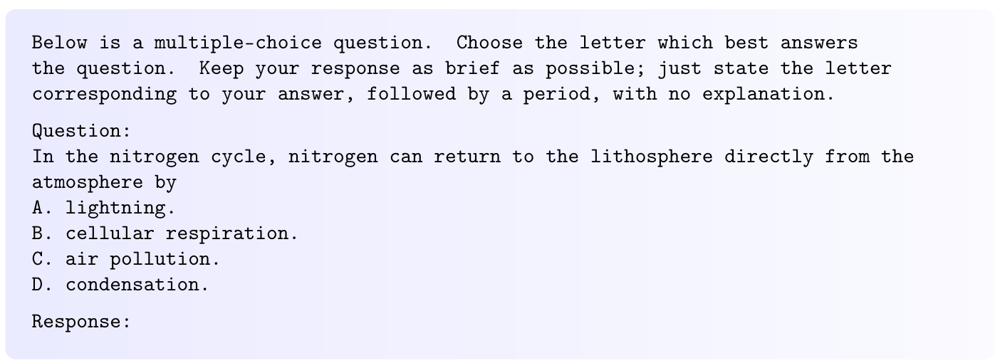
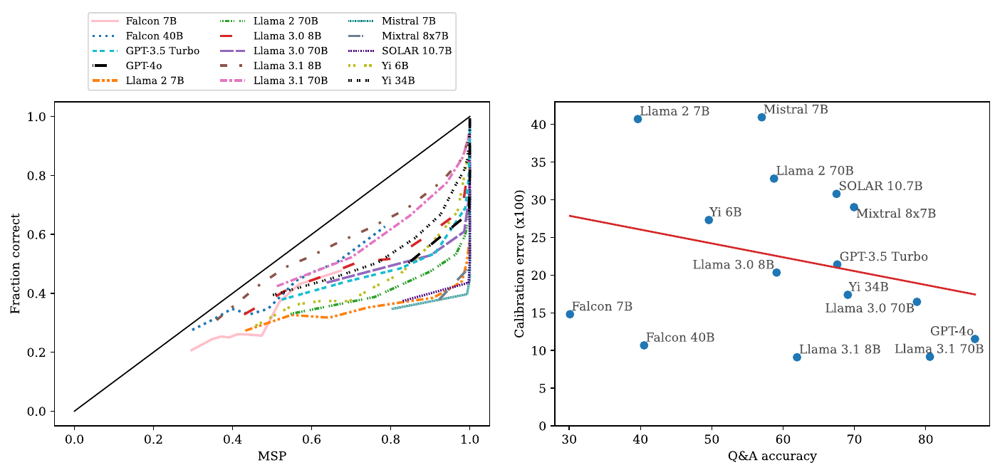
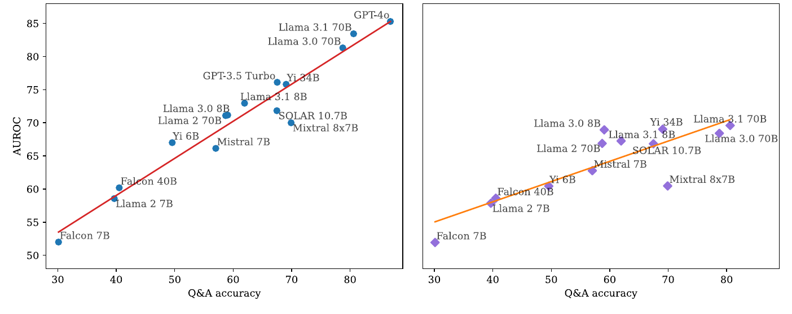

# 聊天模型的概率校准与正确性预测

本文精读 Benjamin Plaut、Nguyen X. Khanh 与 Tu Trinh 的 *Probabilities of Chat LLMs Are Miscalibrated but Still Predict Correctness on Multiple-Choice Q&A*，依据中英对照 PDF 所收录的英文原文，即 [arXiv:2402.13213v4，2025 年 8 月 7 日版本](https://arxiv.org/abs/2402.13213v4)。论文发表于 *Transactions on Machine Learning Research*（TMLR，2025 年 8 月），研究对象是多项选择问答中的聊天大语言模型。

**阅读建议：了解最开头“论文的研究问题与主要主张”一节的核心结论即可，无需深究作者研究的技术细节。**

## 论文的研究问题与主要主张

**论文的核心结论是：聊天模型给答案的概率通常偏高，不能直接当作正确率；但正确回答仍倾向于得到更高的概率，因此这些概率仍能帮助识别错误。模型问答能力越强，这种区分能力通常越好，概率数值本身却没有同步变得更准确。**[论文，§1.1、表 1](https://arxiv.org/pdf/2402.13213v4#page=3)

论文用**最大 softmax 概率**（maximum softmax probability，MSP）表示模型对所选答案的置信分数。在本文的选择题设置中，它是模型分给各答案字母的概率经过归一化后的最大值。理解核心结论只需区分两个概念：

- **校准（calibration）**：分数的数值能否对应实际正确率。例如，一组 MSP 为 0.9 的回答，是否约有 90% 正确。
- **正确性预测（correctness prediction）**：正确回答的分数是否通常高于错误回答。例如，正确回答常得 0.99，错误回答常得 0.95，虽然两者都很高，仍可利用分数差异区分它们。

作者比较了**聊天模型**与**基础模型**：前者经过面向助手对话的后训练，后者尚未经过聊天微调。论文中的“能力”主要以选择题的问答准确率衡量。原文表 1 将结果归纳为以下四项：

| 比较内容 | 聊天模型（Chat LLMs） | 基础模型（Base LLMs） |
| --- | :---: | :---: |
| MSP 的数值与实际正确率是否匹配，即是否校准 | ✗ 通常过度自信 | ✓ 总体校准较好 |
| 校准是否随问答能力提升而改善 | ✗ 未观察到稳定改善 | ✓ 呈改善趋势 |
| MSP 是否能够预测回答的正确性 | ✓ 能够提供区分信号 | ✓ 能够提供区分信号 |
| MSP 的正确性预测能力是否随问答能力提升而增强 | ✓ 增强 | ✓ 增强 |

*依据[论文表 1](https://arxiv.org/pdf/2402.13213v4#page=3)整理。“✓”概括所测模型的总体结果；基础模型校准随能力改善的趋势，未通过作者采用的多重检验显著性阈值，证据弱于正确性预测的相关性结果。*

表中最关键的是聊天模型一列：**“没有校准”与“仍能预测正确性”可以同时成立。** 校准要求数值准确，正确性预测只需要分数能较好地区分对错。作者进一步验证，利用少量标注选择分数阈值，让模型放弃部分低分回答，可以在考虑答错代价时提高整体收益。[论文，§6](https://arxiv.org/pdf/2402.13213v4#page=11)

这篇论文的贡献是通过多模型、多数据集实验厘清上述关系。后文重点解释 MSP 怎样计算、校准与正确性预测怎样衡量，以及这些结论怎样用于选择性弃权。

## MSP 的计算：从答案 token 得到一道题的分数

### 选择题输入、答案位置与正确性标签

论文采用给定选项、恰有一个标准答案的选择题。图 1 的问题涉及氮循环，A–D 对应四段候选内容；模型被要求只给答案字母和句号，不解释过程。选项可以包含复杂的知识或语义关系，但本文评价的答案由一个选项字母表示。[论文，§3、图 1](https://arxiv.org/pdf/2402.13213v4#page=2)

*原文图 1：上部规定回答格式，中部给出问题，下部列出 A–D 四个候选项。模型在答案位置对各字母的概率构成本文的测量对象。截取自[论文 p.2](https://arxiv.org/pdf/2402.13213v4#page=2)。*

**本文研究的是给定固定候选项、用 A/B/C/D 等字母作答的选择题。** 每题的答案对应一个明确选项，正确与否可以直接判定，因此更容易研究 MSP 与回答正确性的关系。语义复杂的自由文本回答则可能包含多个断言、部分正确的内容或不同的等价表述，还需要决定怎样合并多个 token 的概率，研究难度更高。本文的结论限定在这种选择题设置下。[论文，§3、§8](https://arxiv.org/pdf/2402.13213v4#page=5)

设问题连同选项组成提示 $x$，标准答案为 $y^*$，模型选择的答案为 $\hat y$。每道题对应一个二值正确性标签：

$$
C(x)=\mathbf 1\{\hat y=y^*\}.
$$

其中 $\mathbf 1\{\cdot\}$ 在条件成立时取 1，否则取 0。后面的两种评价都使用同样的“分数、正确性标签”数据对；差别在于评价方式。

### 全词表 softmax 与答案集合重新归一化

**logit** 是模型在 softmax 之前为每个候选 token 给出的实数分数。令 $V$ 为完整词表，$L(y\mid x)$ 为提示 $x$ 之后 token $y$ 的 logit，则全词表概率为：

$$
P(y\mid x)=\frac{\exp L(y\mid x)}{\sum_{z\in V}\exp L(z\mid x)}.
$$

论文接着只保留可能作为答案的 token 集合 $T$，例如 $T=\{A,B,C,D\}$。原文 §3 明确写道：

> “The probabilities were also renormalized to sum to 1 over tokens in T.”

也就是把答案集合内的概率重新归一化。为方便推导，本文把重新归一化后的概率记作 $q$：

$$
q(y\mid x)=\frac{P(y\mid x)}{\sum_{z\in T}P(z\mid x)}
=\frac{\exp L(y\mid x)}{\sum_{z\in T}\exp L(z\mid x)},\qquad y\in T.
$$

第二个等号来自全词表 softmax 分母的约去。因此，该操作等价于只对答案 token 的 logits 做一次 softmax。模型答案和两个置信分数分别是：

$$
\begin{aligned}
\hat y&=\arg\max_{y\in T}q(y\mid x),\\
\operatorname{MSP}(x)&=q(\hat y\mid x)=\frac{\max_{y\in T}P(y\mid x)}{\sum_{y\in T}P(y\mid x)},\\
\operatorname{MaxLogit}(x)&=\max_{y\in T}L(y\mid x).
\end{aligned}
$$

**MSP 公式计算“选中答案在全部候选答案中占多大概率”。** 分子 $\max_{y\in T}P(y\mid x)$ 是答案集合中最大的原始概率；分母 $\sum_{y\in T}P(y\mid x)$ 是所有答案 token 的原始概率之和。两者相除，就得到选中答案在集合内归一化后的概率，也就是 $q(\hat y\mid x)$。

**Max Logit 公式计算“候选答案中最大的原始输出分数”。** $L(y\mid x)$ 是答案 token $y$ 在 softmax 之前的分数，$\max_{y\in T}$ 表示只在答案集合 $T$ 中找最大值。这个公式直接保留最大 logit，不进行 softmax 或概率归一化。作者用它与 MSP 对照，考察原始输出分数是否也能区分正确与错误回答。[论文，§3](https://arxiv.org/pdf/2402.13213v4#page=6)

下面是**解释性构造算例**，用来说明单题 MSP 怎样恰好得到 0.95，并非论文的原始样本：

| 候选 token | 全词表概率 $P$ | 在答案集合内重新归一化后的 $q$ |
| --- | :---: | :---: |
| A | 0.380 | 0.950 |
| B | 0.010 | 0.025 |
| C | 0.006 | 0.015 |
| D | 0.004 | 0.010 |
| 其余词表 token 合计 | 0.600 | 不参与答案集合归一化 |

答案 token 的原始概率之和为 $0.4$，所以模型选 A，$\operatorname{MSP}=0.38/0.4=0.95$。这个 0.95 表示“在候选答案集合内部，模型把 95% 的概率分给 A”。

## 校准：分数的数值能否对应正确率

### 校准定义、分桶估计与误差

令 $S=\operatorname{MSP}(x)$。理想校准关系可以写为：

$$
\Pr(C=1\mid S=s)=s.
$$

它描述一组分数相同或相近的回答的统计行为。例如，收集大量分数接近 0.8 的回答，约 80% 应正确。单道题的结果只有 0 或 1，校准需要在样本集合上检验。

实际实验很少出现大量分数完全相同的样本，因此作者按分位数把分数分为 10 个桶，目标是让各桶样本量相近。对第 $b$ 个桶 $B_b$，计算：

$$
\bar s_b=\frac{1}{|B_b|}\sum_{i\in B_b}s_i,\qquad
\bar c_b=\frac{1}{|B_b|}\sum_{i\in B_b}C_i.
$$

校准曲线以 $\bar s_b$ 为横坐标、$\bar c_b$ 为纵坐标。理想情况落在 $y=x$ 上；曲线低于对角线，说明分数高于实际正确比例，即**过度自信**；高于对角线则是低估正确率。作者把各桶的绝对偏差取平均：

$$
E_{\mathrm{cal}}=\frac{1}{B}\sum_{b=1}^{B}|\bar s_b-\bar c_b|,
\qquad B=10\text{（预设桶数）}.
$$

该指标衡量分数与正确率的平均偏离程度，越小表示校准越好。论文称之为 expected calibration error（期望校准误差，ECE），图表中的误差通常乘以 100 展示。[论文，§4](https://arxiv.org/pdf/2402.13213v4#page=6)

### “MSP 超过 0.95、正确率只有 60%”的统计层次

原文 §4 的表述是：

> “most models produce MSPs above 0.95 even when they are correct only 60% of the time.”

这句话需要结合图 2 左侧的校准曲线理解。每个绘图点代表一个分数桶，不是一段回答的多个 token。沿纵坐标约 0.6 的高度观察，多条曲线的横坐标已经接近 1，说明这些回答组的平均 MSP 很高，但其中仍有相当多的错误。[论文，§4、图 2](https://arxiv.org/pdf/2402.13213v4#page=7)

*原文图 2：左图横轴为桶内平均 MSP、纵轴为桶内正确比例，黑色对角线表示理想校准；右图每个点是一种模型，纵轴误差乘以 100。左图说明过度自信，右图检验它是否随模型问答能力变化。截取自[论文 p.7](https://arxiv.org/pdf/2402.13213v4#page=7)。*

## 正确性预测：分数能否区分正确与错误回答

### 从阈值分类到 AUROC

正确性预测把 $C=1$ 当作正例、$C=0$ 当作负例。选择一个阈值 $\tau$，若 $S\ge\tau$ 就预测该回答正确，否则预测错误。逐渐降低阈值，会把更多回答判为“正确”：既可能增加真正的正确回答，也可能放入错误回答。

**受试者工作特征曲线**（receiver operating characteristic curve，ROC）记录不同阈值下的两个比例：横轴为错误回答被误判成正确的比例，即假阳性率；纵轴为正确回答被判为正确的比例，即真阳性率。**ROC 曲线下面积**（area under the ROC curve，AUROC）把所有阈值下的区分表现汇总成一个数。它不是问答准确率，也不是某个固定阈值的分类准确率。[论文，§5.1](https://arxiv.org/pdf/2402.13213v4#page=7)

更容易计算的等价表达是：随机选一份正确回答和一份错误回答，比较二者分数。考虑并列分数时：

$$
\operatorname{AUROC}
=\Pr(S^+>S^-)+\frac12\Pr(S^+=S^-).
$$

$S^+$ 来自正确回答，$S^-$ 来自错误回答。AUROC 为 1 表示全部正负样本对都按正确方向排序；0.5 表示在这一成对比较指标上没有优于随机排序；0 表示完全反向排序，反转分数就能得到完美排序。因此，AUROC=0 的精确含义是“排序反向”，不是任意阈值下每一道二分类预测都错。

以一个**四题构造算例**说明：模型答对了两题，分数分别是 0.98、0.93；答错了两题，分数分别是 0.96、0.85。计算 AUROC 时，每次取一份正确回答和一份错误回答，检查正确回答的分数是否更高。

正确回答有 2 份可选，错误回答也有 2 份可选，所以共有 $2\times2=4$ 种配对：

| 配对 | 正确回答的分数 | 错误回答的分数 | 正确回答是否排在前面 |
| --- | :---: | :---: | :---: |
| 1 | 0.98 | 0.96 | 是，0.98 > 0.96 |
| 2 | 0.98 | 0.85 | 是，0.98 > 0.85 |
| 3 | 0.93 | 0.96 | 否，0.93 < 0.96 |
| 4 | 0.93 | 0.85 | 是，0.93 > 0.85 |

**四种配对中有三种把正确回答排在错误回答前面**，所以：

$$
\operatorname{AUROC}=\frac{\text{正确回答分数更高的配对数}}{\text{全部正负配对数}}
=\frac{3}{4}=0.75.
$$

这里的分母 4 来自四种“正确—错误”配对。这组数据的问答准确率则是“答对 2 题 / 总共 4 题”，即 $2/4=0.5$。**准确率在数答对的题，AUROC 在数排对顺序的配对。**如果某次配对的两个分数相同，则计半次排序成功；本算例没有并列分数。

### 失准与有效排序的同时成立

原文 §1.1 用一个极简例子说明标题中的现象：正确回答的 MSP 总是 0.9，错误回答总是 0.8。于是选择 $\tau=0.85$ 可以完全分开两类回答，AUROC=1；但 0.9 分数组的实际正确率为 1，0.8 分数组的实际正确率为 0，两个分数都没有校准。[论文，§1.1](https://arxiv.org/pdf/2402.13213v4#page=2)

若进一步构造数量相同的两组，按两个分数组平均的绝对校准误差是 $(|0.9-1|+|0.8-0|)/2=0.45$。这个算例说明，**一个相当差的概率尺度仍然可以保留非常好的顺序**。对所有分数施加严格递增变换，大小次序保持不变，AUROC 也保持不变；校准误差通常会改变，因为它直接比较分数与正确比例。

“Calibration”和“MSP correctness prediction”的区别可归纳如下：

| 比较维度 | 校准 | MSP 正确性预测 |
| --- | --- | --- |
| 核心关系 | 分数 $s$ 对应约 $s$ 的正确比例 | 正确回答通常具有更高分数 |
| 本文主要指标 | 分桶后的绝对校准误差 | AUROC |
| 对数值尺度的要求 | 数值本身应有正确概率含义 | 主要依赖分数排序 |
| 严格递增变换后的表现 | 通常改变 | 保持不变 |
| 用于弃权时的作用 | 理想条件下可由风险或代价直接导出阈值 | 还需选择适合任务与代价的阈值 |

## 实验与证据：能力、校准与排序的不同关系

**实验最重要的结果是：问答能力更强的聊天模型，MSP 往往更能区分正确与错误回答，但校准没有同步改善。** 这一结论来自 15 个聊天模型在 ARC-Challenge、HellaSwag、MMLU、TruthfulQA 和 WinoGrande 五个选择题数据集上的评测。[论文，§3–5](https://arxiv.org/pdf/2402.13213v4#page=5)

图 2 已展示校准结果：多数聊天模型的分数高于实际正确比例，右图也没有显示能力越强、校准误差就越小的稳定关系。图 3 则呈现了明显不同的结果。

*原文图 3：每个点代表一个模型；横轴为平均问答准确率，纵轴为正确性预测 AUROC。左图使用 MSP，右图使用 Max Logit。截取自[论文 p.9](https://arxiv.org/pdf/2402.13213v4#page=9)。*

左图中的点总体沿左下到右上排列：模型越能答对题，其 MSP 越能把正确回答排在错误回答前面。例如 Falcon 7B 的问答准确率为 30.1%、MSP AUROC 为 52.0%；Llama 3.1 70B 分别为 80.6% 和 83.4%；GPT-4o 分别为 86.9% 和 85.3%。右图的 Max Logit 也有上升趋势，但较分散，说明在这些实验中 MSP 与问答能力的关系更紧密。[论文，表 2、图 3](https://arxiv.org/pdf/2402.13213v4#page=9)

任务类型也会影响这种信号。WinoGrande 上的平均 MSP AUROC 只有 60.8%，明显低于 ARC-Challenge 的 78.1%。因此，论文支持的是所测模型的总体趋势；在具体任务上，仍需要检查分数能否有效识别错误。[论文，表 3](https://arxiv.org/pdf/2402.13213v4#page=10)

## 选择性弃权：把排序信号变成回答策略

**MSP 即使没有校准，也可以用于减少错误回答：保留高分回答，放弃低分回答。** 论文把这种做法称为选择性弃权（selective abstention）。在答错需要付出代价的评分下，它通常能提高整体收益；代价是系统会少回答一些问题。[论文，§6](https://arxiv.org/pdf/2402.13213v4#page=11)

策略的含义很直接：设定一个阈值，MSP 达到阈值就回答，低于阈值就弃权。由于 MSP 的数值没有校准，合适的阈值需要通过少量已知正确答案的题目确定。

作者比较了两种答错代价：答对都得 1 分，弃权都得 0 分，答错分别扣 1 分或 2 分。下面列出**答错扣 2 分**时的部分结果；效用是总得分除以全部题数，再乘 100，弃权题也计入分母。[论文，表 4、表 7](https://arxiv.org/pdf/2402.13213v4#page=11)

| 聊天模型 | 全部回答的效用 | 使用 MSP 弃权后的效用 | 弃权比例 |
| --- | :---: | :---: | :---: |
| Llama 3.1 8B | −14.2 | 17.6 | 67.2% |
| Llama 3.1 70B | 41.8 | 49.9 | 11.4% |
| GPT-3.5 Turbo | 2.6 | 28.3 | 47.6% |
| GPT-4o | 60.7 | 61.1 | 0.4% |

Llama 3.1 8B 通过放弃较多回答，把整体效用由负转正；Llama 3.1 70B 只放弃约一成问题，也得到收益。GPT-4o 原本正确率就高，弃权带来的改善较小。**评价弃权策略时，需要同时看错误代价下的收益和仍能回答多少问题**：仅靠大量不回答提高得分，并不意味着系统更实用。

## 局限性：从选择题统计到开放式回答的距离

本文的结论直接适用于所测模型的选择题回答。自由文本可能有多个语义等价的表达，一段回答也可能同时包含正确与错误的陈述；如何把多个 token 的分数合成为整段回答的可信程度，论文尚未解决。跨模型观察到的趋势，也需要在新的模型和任务上重新验证。[论文，§8](https://arxiv.org/pdf/2402.13213v4#page=14)

## 结论

MSP 有两种不同用途：把数值当作正确概率，要求校准；利用分数高低识别更可能出错的回答，要求区分能力。本文发现，聊天模型在前一种用途上表现不佳，在后一种用途上仍保留了有用信号，而且这种信号通常随问答能力增强。选择性弃权是这一发现的直接应用。
