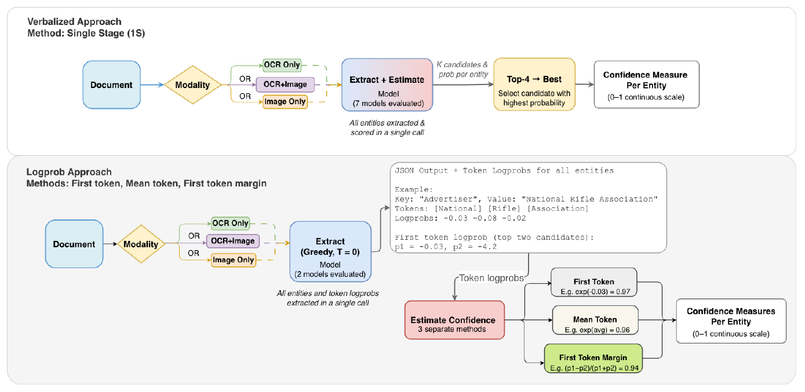
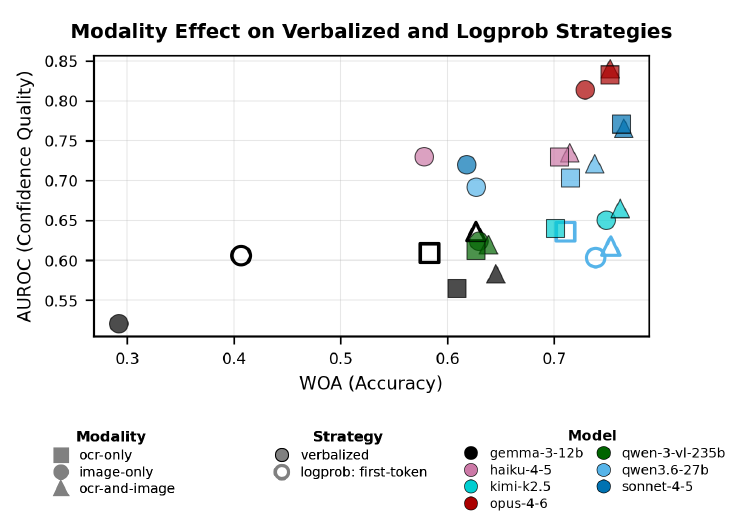
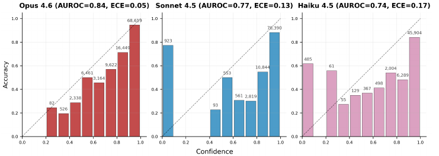

# ConfBench：文档抽取置信度的四项实证发现

这篇论文与博客中的[《聊天模型的概率校准与正确性预测》](https://wsj040303.github.io/papers/chat-llm-calibration/)很相似：两者都关心模型的置信分数能否反映答案是否正确，以及这些分数能否帮助识别错误。前一篇只研究多项选择题，答案用一个选项字母表示； **ConfBench 将问题推进到更复杂的文档抽取：一个字段值可以包含多个 token，一次输出包含多个字段和嵌套的表格行项目。** 它仍有预定义的字段结构和可比较的标准答案，研究范围尚未扩展到任意长篇回答的整体可信度。

本文阅读 Priyashree Roy 等人的 *Can You Trust the Confidence? ConfBench for Vision-Language Models on Document Extraction*，依据所提供中英对照 PDF 的英文原文：[arXiv:2608.01792v1，2026 年 8 月 3 日](https://arxiv.org/abs/2608.01792v1)。重点是实验发现及其适用范围，方法只保留理解结果必需的部分。文中数值和原图来自论文，未重新运行模型评测。

## 论文的研究问题与主要主张

**ConfBench 的主要价值是说明：文档抽取中的置信度确实有用，但输入模态、模型能力、分数来源和实际使用方式都会影响它的可靠程度。** “把错误排在前面”与“报出的 0.9 真能对应约 90% 的正确率”是两项不同要求。论文摘要的四项发现可以整理如下。

| 主要发现 | 论文证据支持的具体含义 |
| --- | --- |
| **OCR 文本与图像结合，置信度质量更好** | 在所测配置中，OCR+Image 的抽取质量与对错区分能力最好；OCR 文本还包含 OCR 引擎自身的识别置信度。 |
| **模型能力比跨模型的参数量更有解释力** | Claude 系列中，Opus、Sonnet、Haiku 的置信度质量依次降低；Qwen 3.6-27B 的区分能力却高于更大的 Qwen 3 VL-235B。 |
| **绝对校准差异很大，后处理的用途取决于路由规则** | Opus 在本基准上校准较好，部分模型明显过度自信。保持排序的分数重映射可用于调整阈值路由，却不会改善固定预算下的复核顺序；论文没有报告后处理后的实验结果。 |
| **logprob 方法中，首 token 分数的排序效果最好** | 在两个接受此项比较的模型上，first-token 的 AUROC 都高于 mean-token 和 margin；这一领先不等于绝对校准也更好。 |

*依据[论文摘要、§5、表 3](https://arxiv.org/pdf/2608.01792v1#page=9)整理。这里的“更好”都对应具体实验与指标，不作为所有模型、所有文档任务的普遍结论。*

结果还有一个实际落点：用最佳配置的置信度挑选最低分的 30% 字段进行复核，能找到随机复核同样数量字段时 **2.43 倍** 的错误。这说明即使抽取还不完美，置信度也能帮助安排有限的人工复核量。[论文，§5.4、表 3](https://arxiv.org/pdf/2608.01792v1#page=9)

## 任务与方法：从发票抽取字段，再为字段打分

### 输入文档与固定字段结构

论文中的 **IDP 是 Intelligent Document Processing，即智能文档处理** 。

这里的任务属于 **关键信息抽取** （Key Information Extraction，KIE）：根据预先指定的 schema，也就是字段名称、类型及含义组成的输出结构，从文档中找到相应的值。模型可接收 OCR 识别文本、文档图像，或两者结合。六个文档级字段包括代理机构、广告主、总金额、付款条款、代理佣金和应付净额；此外还有长度可变的 `LineItems` 数组，每条记录含日期、播出日（Days）、描述、费率等五个子字段。[论文，附录 A.5](https://arxiv.org/pdf/2608.01792v1#page=15)

下面只展示输出的一部分， **这是解释性构造示例，不是论文中的真实预测** 。数组里的两个对象代表两个行项目；同名子字段通过所属对象区分。

```json
{
  "Agency": "Example Media",
  "GrossTotal": 1200,
  "NetAmountDue": 1020,
  "LineItems": [
    {"LineItemDescription": "Morning News", "LineItemRate": 100},
    {"LineItemDescription": "Evening News", "LineItemRate": 200}
  ]
}
```

### 两类置信度与多 token 字段

论文比较两条路线： **verbalized confidence（显式自报置信度）** 让模型在回答中写出概率； **logprob confidence（对数概率置信度）** 从生成 token 时的概率计算字段分数。



*原文图 2：两条路线都按实体输出分数。上方在一次调用中生成候选与概率；下方先生成结构化答案，再由各字段值对应的 token 概率计算分数。截取自[论文 p.6](https://arxiv.org/pdf/2608.01792v1#page=6)。*

沿图 2 上半部分，模型对每个字段给出四个候选值及各自的概率，选概率最高的候选作为抽取结果，并保留它的概率作为置信度。论文称其为 **1S-TopK** ：single-stage 表示抽取和打分在同一次调用内完成。例如，模型为某金额的四个不同候选分别自报 0.70、0.15、0.10、0.05，最终采用第一个候选及分数 0.70。这个数是模型生成的回答内容，尚需用实验检验是否可信。[论文，§4.1、附录 A.6](https://arxiv.org/pdf/2608.01792v1#page=5)

沿图 2 下半部分，模型只生成一份 JSON 答案。评估程序找到每个字段值对应的 token 区间，再将这个区间的生成概率转换成一个字段分数。 **因此，一个字段跨越多个 token，最终仍只对应一个置信分数。** 首 token、平均 token 和 margin 是三种计算方式，后文只展开与主要结论相关的区别。

两种方法也存在实验上的差别：自报方法要求模型考虑候选并打分，可能改变最终抽取内容；logprob 的打分发生在生成之后。因此，表 3 中同一个模型使用两种方法时，抽取质量不完全相同。论文只在 Qwen 3.6-27B 和 Gemma 3-12B 上比较了两条路线，因为这些实验配置能获得 token 概率；这是本文的接口和算力条件，不能概括成 logprob 在原理上只适用于开放权重模型。[论文，§5.2、附录 A.6](https://arxiv.org/pdf/2608.01792v1#page=19)

## 评价对象：字段正确性、分数排序与绝对校准

**论文判断抽取结果是否正确的单位是实体：从表格或文档中提取的一个字段值，就是一个实体。** 例如，总金额是一个实体，某个行项目中的费率也是一个实体。一个字段可以包含多个 token，但评价时作为一个整体与标准答案比较，并对应一个置信分数。

AUROC 和 ECE 都基于这些实体的置信分数与对错标签计算，分别衡量排序能力与绝对校准：

| 指标 | 衡量的问题 | 读法 |
| --- | --- | --- |
| **AUROC** ：受试者工作特征曲线下面积 | 正确字段能否通常得到比错误字段更高的分数 | 可理解为随机抽取一个正确字段和一个错误字段，正确者排在前面的概率，并对同分计一半；0.5 相当于随机排序，1 表示完全分开。 |
| **ECE** ：Expected Calibration Error，期望校准误差 | 自报概率是否接近实际正确比例 | 将预测按分数分组，比较每组平均置信度与实际正确率，再按组内样本数加权；越低越好。本文使用 5 个基于分位数的自适应分组。 |

*定义见[论文 §4.2](https://arxiv.org/pdf/2608.01792v1#page=6)。AUROC 衡量区分能力；ECE 衡量分组后的数值偏差，结果也受分组方式影响。*

论文正文给出一个很直观的区分：正确字段都得 0.99、错误字段都得 0.90，排序完全正确，但错误字段的置信度严重偏高；反过来，若一批字段有 70% 正确，模型对所有字段都报 0.70，平均校准可以很好，却无法帮助挑出任何更可能出错的字段。 **校准好和排序好可以同时发生，也可以彼此分离。**

## 发现一：OCR 文本与图像结合更有效

**在本文实验中，OCR+Image 同时改善了抽取质量和置信度的区分能力。** 三种输入配置里，OCR Only 居中，Image Only 最弱；小模型对是否提供 OCR 更敏感。[论文，§5.1](https://arxiv.org/pdf/2608.01792v1#page=7)



*原文图 3：颜色区分模型，方形表示 OCR，圆形表示图像，三角形表示 OCR+Image；实心与空心分别表示自报与首 token logprob 方法。截取自[论文 p.7](https://arxiv.org/pdf/2608.01792v1#page=7)。*

图的横轴 WOA（Weighted Overall Accuracy，加权整体准确率）衡量字段值与标准答案的平均相似程度，越往右表示抽取质量越高；纵轴 AUROC 越往上表示更能区分正确与错误字段。比较同一颜色、同一填充方式下的不同形状，结合 OCR 的三角形通常位于更右上方。论文报告，从 OCR+Image 改为 Image Only，Gemma 3-12B 的 AUROC 降低约 0.06，Opus 4.6 降低约 0.03。这说明较强模型仅凭图像也能保留较多有效信号，较弱模型更依赖额外的文字输入。

输入中的 OCR 信息不只有识别后的文字。附录 A.5 说明，Amazon Textract 的输出被序列化为按阅读顺序排列的 **`(word, confidence)` 对** ，即识别词与 OCR 置信度；OCR+Image 还同时提供文档图像。文字、识别可靠程度和视觉版式可以相互补充，这是结果的一种合理解释。实验没有单独移除 OCR 置信度，因此不能把全部提升只归因于“多了一份文本”，也不能分离各部分的独立贡献。

## 发现二：能力层级有参考价值，参数量不能单独预测

以下整理表 3 中所有模型的 **自报置信度、OCR+Image** 结果。WOA 越高越好，AUROC 越高越好，ECE 越低越好。ECARB@30% 表示复核最低分的 30% 字段时，相比随机复核同样数量字段的错误捕获倍数，越高越好。

| 模型 | WOA ↑ | AUROC ↑ | ECE ↓ | ECARB@30% ↑ |
| --- | :---: | :---: | :---: | :---: |
| Claude Opus 4.6 | 0.75 | **0.84** | **0.05** | **2.43** |
| Claude Sonnet 4.5 | **0.77** | 0.77 | 0.13 | 2.24 |
| Claude Haiku 4.5 | 0.71 | 0.74 | 0.17 | 1.96 |
| Qwen 3.6-27B | 0.74 | 0.72 | 0.22 | 1.93 |
| Kimi K2.5 | 0.76 | 0.67 | 0.20 | 1.68 |
| Qwen 3 VL-235B | 0.64 | 0.62 | 0.25 | 1.53 |
| Gemma 3-12B | 0.65 | 0.58 | 0.31 | 1.39 |

*数据来自[论文表 3](https://arxiv.org/pdf/2608.01792v1#page=9)，均未经过后处理校准。*

Claude 的三个能力层级呈现一致趋势：Opus → Sonnet → Haiku，AUROC 和 ECARB 依次降低，ECE 逐步增大。但 **“能力更强”不能在这里简单等同于“本任务 WOA 更高”** ：Sonnet 的 WOA 0.77 高于 Opus 的 0.75，置信度指标却由 Opus 领先。论文的结论支持能力层级与置信度质量有关，并没有证明抽取准确率与校准质量逐模型严格单调对应。

参数量也不足以决定结果。Qwen 3.6-27B 的 AUROC 为 0.72，高于 Qwen 3 VL-235B 的 0.62。两个模型属于不同代际与模型配置，这个比较足以说明“更大就一定更会判断自己是否正确”不成立，但没有控制训练数据、架构和后训练方法，无法单独识别是哪一项造成差异。[论文，§5.3、附录 A.8](https://arxiv.org/pdf/2608.01792v1#page=8)

这种差别会直接影响置信度方法的选择。同一输入条件下，Qwen 3.6-27B 的自报方法优于首 token logprob（AUROC 0.72 对 0.62），Gemma 3-12B 则相反（0.58 对 0.64）。 **自报概率与读取 token 概率没有在本文中产生跨模型统一的赢家。** 作者也明确指出，两组比较不足以建立“达到某种能力就应该改用自报方法”的一般规律。[论文，§5.2](https://arxiv.org/pdf/2608.01792v1#page=7)

## 发现三：后处理校准改变分数尺度，不自动改善错误排序

**Opus 在此基准上的自报分数已经较好地对应实际正确率，而其他一些模型明显偏高。** 原文图 5b 展示了 Claude 三个层级的可靠性图：横轴是置信度，纵轴是对应分组的实际正确率，虚线 $y=x$ 表示理想校准。



*原文图 5b：从左到右为 Opus 4.6、Sonnet 4.5、Haiku 4.5，ECE 分别为 0.05、0.13、0.17。柱高低于对角线表示置信度高于实际正确率；少于 30 个样本的分组被省略。截取自[论文 p.8](https://arxiv.org/pdf/2608.01792v1#page=8)。*

左侧 Opus 的柱高总体贴近对角线；中间和右侧越来越多的分组落到线下，表示其给出的概率偏乐观。读图时还要注意每组样本数：ECE 是按样本数加权的平均误差，样本集中的高置信区间会主导最终数值。

后处理校准的目标，是用额外标注数据学习“原始分数应该对应多大的实际正确概率”。例如，若原始 0.95 附近的预测在独立数据上只有约 80% 正确，就应把这一段分数调整到接近 0.80。这是解释性示例，并非论文拟合出的映射。

这里有些读者可能会疑惑： **分数变准了，为什么错误识别指标不一定提高？** 因为两种业务规则依赖的信息不同：

- **固定复核比例** ：只检查分数最低的 30%。只要校准映射严格递增，同一批字段的先后顺序就不变，所检查的字段集合也不变，AUROC 与 ECARB 因而保持不变。
- **固定概率阈值** ：只自动接受分数超过 0.90 的字段。将虚高的 0.95 调整到 0.80，会改变它是否通过阈值，因此绝对校准影响这种路由决策。

这一论证适用于保持排序的变换。若变换把不同分数合并为同分，或使用额外特征重新打分，就需要重新考察排序和同分处理。即使总体 ECE 很低，业务上使用的某个高分区间也仍需单独验证。

**论文没有实际报告后处理校准后的结果。** §5.3 与附录 A.8 明确说明，可靠拟合与评价需要留出的校准数据，而现有语料规模不足以让作者放心设置这一划分。因此，摘要中的后处理结论应读为方法性质与应用判断：校准能调整概率尺度，但本文没有给出“某方法把 ECE 从多少降到多少”的实验依据。[论文，§5.3、附录 A.8](https://arxiv.org/pdf/2608.01792v1#page=22)

## 发现四：首 token 分数更适合排序，但证据范围有限

**first-token 指每个字段值的第一个 token，全文有多少个字段，就分别取多少次；它不是只取整个 JSON 的第一个 token。** 生成过程仍然完成全部字段内容，只是计算字段置信分数时选择了首位置的概率。设某个字段值含 $K$ 个 token，第 $k$ 个生成 token 的对数概率为 $\ell_k$，三种方法为：

| 方法 | 字段分数 | 保留的信息 |
| --- | --- | --- |
| first-token | $\exp(\ell_1)$ | 第一次开始生成该字段值时，所选 token 的概率。 |
| mean-token | $\exp(\frac{1}{K}\sum_{k=1}^{K}\ell_k)$ | 字段内 token 概率的几何平均；平均的是对数概率。 |
| margin | $(p_1-p_2)/(p_1+p_2)$ | 首位置上，全词表中最优与次优 token 的相对概率差。 |

*定义见[论文 §4.1、附录 A.6](https://arxiv.org/pdf/2608.01792v1#page=19)。$p_1$ 和 $p_2$ 是 **同一个生成位置** 上的两个候选概率，$p_2$ 不是答案中第二个 token 的概率。margin 可译为“间隔”，这里没有对多个完整答案做边缘概率求和。*

OCR+Image 条件下，表 3 的结果如下：

| 模型 | first-token：AUROC / ECE | margin：AUROC / ECE | mean-token：AUROC / ECE |
| --- | :---: | :---: | :---: |
| Gemma 3-12B | **0.64** / 0.36 | 0.63 / 0.35 | 0.60 / 0.36 |
| Qwen 3.6-27B | **0.62** / 0.21 | 0.61 / 0.21 | 0.59 / 0.21 |

**首 token 在 AUROC 上领先平均方法 0.03–0.04，领先 margin 约 0.01；ECE 没有同步优势。** “始终优于”的准确读法是：论文比较的这两个模型上，首 token 的排序指标都排第一。它没有证明所有长答案都应只看首 token，也没有建立这些小差距在所有设置下都具有统计显著性。[论文，表 3、§5.2](https://arxiv.org/pdf/2608.01792v1#page=9)

这里有些读者可能会疑惑： **只看开头，为什么反而比把整个字段都算进去更好？** 论文把首 token 解释为模型开始生成该值时的选择确定程度，但没有通过实验确认其领先机制。一个可能原因是：后续 token 的概率以已经生成的前缀为条件，即使开头选错，后续仍可能顺畅地延续这个错误答案；将这些高概率加入平均，会弱化最初的不确定信号。

用一个 **解释性构造算例** 说明：假设首 token 的对数概率为 $-2$，其余四个 token 的对数概率都接近 0。首 token 分数为 $e^{-2}\approx0.135$，五个 token 的平均分数却约为 $e^{-2/5}\approx0.670$。后续容易生成，并不直接意味着该字段在文档中抽取正确。这个算例只说明平均方法可能怎样改变分数；真实日期或金额也可能在后半段才发生歧义，首 token 同样可能漏掉关键信息。

附录 A.9 还观察到，mean-token 在部分中间置信区间反而更贴近可靠性图的对角线。这再次限定了结果： **首 token 是本文更好的 logprob 排序信号，不是经过验证的多 token 字段正确概率。**

## 数据与结论的适用范围

ConfBench 从 75 份人工校正过的 FCC 发票出发，施加 20 种图像退化流水线。论文报告初步生成 1,500 个退化文档，经质量过滤保留 1,346 个，单次运行包含约 7 万至 13 万个实体评估。加入噪声的目的，是让模型同时遇到容易与困难的字段：如果只测清晰文档，大部分输出都正确，就难以检验模型是否会对错误同样报高分。[论文，§3](https://arxiv.org/pdf/2608.01792v1#page=3)

理解四项发现时，最需要保留三个边界。第一， **大量退化变体仍来自 75 份源文档** ，覆盖一个领域、一类大体版式和一种语言，不能直接代表合同、手写表格或多语言材料。第二， **人工退化旨在覆盖难度范围** ，并非复现生产环境中的真实噪声比例；真实部署的阈值和错误捕获收益需要重新验证。第三， **跨模型比较并非完全相同的输出条件** ：输出预算、生成的行项目数量和可用于置信度评价的实体数会变化；逐实体计算也不意味着各模型面对的有效字段集合完全一致。因此，小幅跨模型差距应谨慎解释。[论文，Limitations、附录 A.6](https://arxiv.org/pdf/2608.01792v1#page=10)

作为阅读结论，可以把本文的实际启示归纳为：文档抽取应同时评价抽取质量与置信度质量；在本基准上优先考虑 OCR 与图像结合，逐模型比较自报与 logprob 分数；固定复核预算重点看排序与错误捕获，使用概率阈值时再验证绝对校准。四项发现提供了可检验的起点，具体取舍仍由目标文档及复核规则决定。

## 数据集获取

**问：RealKIE-FCC-Verified 与 ConfBench 在哪里下载？**

**答：** 原始人工校正语料见 [amazon-agi/RealKIE-FCC-Verified](https://huggingface.co/datasets/amazon-agi/RealKIE-FCC-Verified)，退化基准见 [amazon/ConfBench](https://huggingface.co/datasets/amazon/ConfBench)。两个页面均提供文件列表；前者的记录包含逐页图像路径、OCR 文本、JSON schema 和标准答案。阅读本文实验数字时以所给论文版本为准，使用在线数据复现时则应记录下载版本，并按实际文件与元数据确认样本组成。
