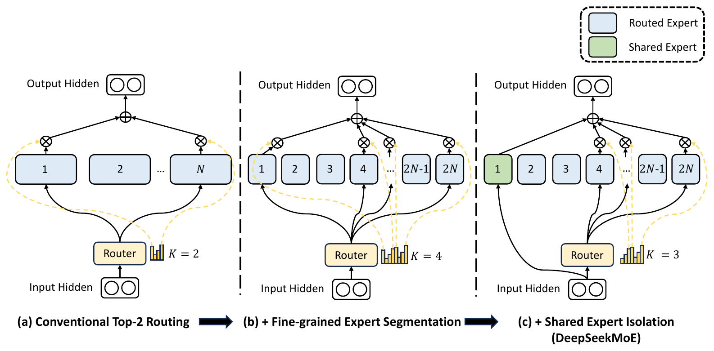
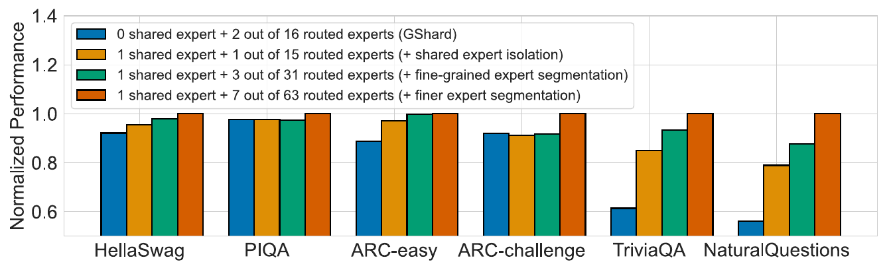
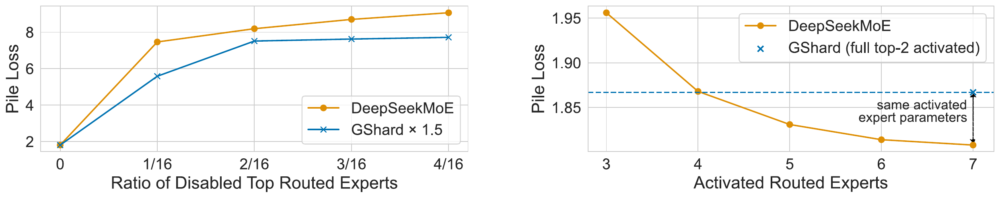
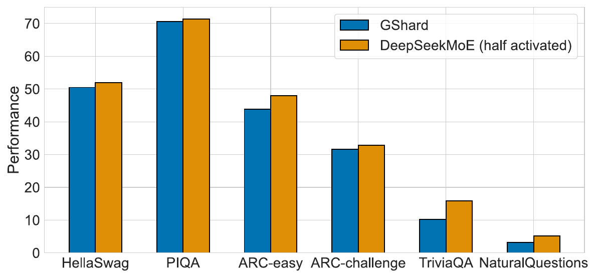

# DeepSeekMoE：以细粒度专家分割与共享专家隔离提高专家专业化

本文精读 Dai 等人发表于 ACL 2024 的 *DeepSeekMoE: Towards Ultimate Expert Specialization in Mixture-of-Experts Language Models*（[ACL Anthology 版 PDF](https://aclanthology.org/2024.acl-long.70.pdf)，预印本 [arXiv:2401.06066](https://arxiv.org/abs/2401.06066)）。论文提出两项架构改动，本文只讲这两项：怎样改变混合专家层的计算，针对什么问题，实验如何检验。读者需要了解 Transformer 中 token 与前馈网络的含义。图表编号、页码和数值来自 ACL 版论文，本文没有重新训练或评测模型；16B 模型只概括主要对比。

## 主要工作

混合专家（Mixture-of-Experts，MoE）层把 Transformer 中的一个前馈网络（feed-forward network，FFN）换成 $N$ 个并行的专家 FFN，由路由器（router）为每个 token 选出 $K$ 个计算。总参数随 $N$ 增长，每个 token 实际参与计算的参数（激活参数）和计算量（浮点运算次数 FLOPs）只随 $K$ 增长。论文认为，GShard（Lepikhin 等，2021，每个 token 激活 top-2 专家）一类只有少量大专家的设计，专家难以获得集中且互不重叠的知识，即**专家专业化**（expert specialization）不足。[论文，摘要、§1](https://aclanthology.org/2024.acl-long.70.pdf#page=1)

DeepSeekMoE 提出两项对应的改动。**细粒度专家分割**把每个专家 FFN 的中间维度缩小到 $1/m$，得到 $mN$ 个更小的专家，同时激活 $mK$ 个；专家参数总量和激活参数量不变，路由可选的专家组合却大幅增加。**共享专家隔离**把其中 $K_s$ 个专家设为共享专家，每个 token 都经过它们，路由器只在其余专家（称为路由专家）中选 $mK-K_s$ 个，使公共知识集中在共享专家中。[论文，§3.1–3.2](https://aclanthology.org/2024.acl-long.70.pdf#page=3)

在 9 层、约 2B 总参数、0.3B 激活参数的验证模型上（训练 100B token），相同总参数与激活参数下 DeepSeekMoE 的 Pile 测试损失为 1.808，GShard 为 1.867；它与专家参数和计算均为 1.5 倍的 GShard×1.5 损失相同，与把 16 份专家参数全部激活的 Dense×16 仅差 0.002（1.808 对 1.806）。扩展到 16.4B 总参数、2.8B 激活参数的 DeepSeekMoE 16B（训练 2T token）后，与 LLaMA2 7B、DeepSeek 7B 整体相当，计算量约为它们的 40%。[论文，§4.2–4.3、§5.2](https://aclanthology.org/2024.acl-long.70.pdf#page=5)

## 研究背景

### MoE 层的计算流程

论文 §2 把一个 Transformer 块写成两步：$u^l_{1:T}=\mathrm{Self\text{-}Att}(h^{l-1}_{1:T})+h^{l-1}_{1:T}$ 与 $h^l_t=\mathrm{FFN}(u^l_t)+u^l_t$。其中 $u_t^l$ 是第 $l$ 层自注意力之后第 $t$ 个 token 的 $d$ 维隐状态，$h_t^l$ 是该块的输出，两式中加回输入的项是残差连接，论文为简洁省略了层归一化。MoE 层把其中的单个 FFN 换成 $N$ 个结构相同的专家 FFN，每个 token 只由 $K$ 个专家计算，论文式 (3)–(5) 为：[论文，§2](https://aclanthology.org/2024.acl-long.70.pdf#page=2)

$$
h_t^l=\sum_{i=1}^{N} g_{i,t}\,\mathrm{FFN}_i\!\left(u_t^l\right)+u_t^l\tag{3}
$$

$$
g_{i,t}=\begin{cases}s_{i,t}, & s_{i,t}\in\mathrm{Topk}\!\left(\{s_{j,t}\mid 1\le j\le N\},\,K\right)\\ 0, & \text{otherwise}\end{cases}\tag{4}
$$

$$
s_{i,t}=\mathrm{Softmax}_i\!\left({u_t^l}^{\top}e_i^l\right)\tag{5}
$$

其中 $g_{i,t}$ 是第 $i$ 个专家对第 $t$ 个 token 的门控值，$s_{i,t}$ 是 token 与专家的亲和度，$\mathrm{Topk}(\cdot,K)$ 取最高的 $K$ 个，$e_i^l$ 是第 $l$ 层第 $i$ 个专家的质心（centroid）。论文指出：“for each token, only $K$ out of $N$ gate values are nonzero. This sparsity property ensures computational efficiency within an MoE layer.”

这里有些读者可能会疑惑：**多个专家算完是取平均吗？筛选是不是做了两次？** 结果是按门控值加权求和，并非取平均；路由只有一次，分三步：按式 (5) 给全部 $N$ 个专家打分；按式 (4) 留下最高的 $K$ 个、其余门控值置零；只对门控值非零的专家运行 FFN，输出乘门控值后求和，再加残差。置零意味着该专家不计算，所以参数按 $N$ 计、计算按 $K$ 计。下面是解释性算例（非论文数据）：$N=4$、$K=2$、亲和度 $s=[0.50,\,0.30,\,0.15,\,0.05]$ 时，$g=[0.50,\,0.30,\,0,\,0]$，输出为 $0.50\,\mathrm{FFN}_1(u)+0.30\,\mathrm{FFN}_2(u)+u$，专家 3、4 不运行，入选门控值之和 0.8 小于 1：softmax 在全部 $N$ 个专家上归一化，式 (4) 又直接取 $s_{i,t}$，没有在入选的 $K$ 个之间重新归一化。训练时的负载均衡损失（§3.3）按各专家被选中的频率与平均亲和度施加约束，推理时没有第二次筛选。[论文，§2、§3.3](https://aclanthology.org/2024.acl-long.70.pdf#page=4)

入选专家的门控值就是它的亲和度，亲和度来自 token 隐状态与质心的内积再经 softmax：把 $N$ 个质心按行堆成 $N\times d$ 的矩阵，乘以 $u_t^l$ 得到 $N$ 个内积，相当于一次线性变换。论文只称 $e_i^l$ 为质心，没有给出聚类或统计定义，本文按随训练更新的可学习向量理解（附录 A.1 说明所有可学习参数以标准差 0.006 随机初始化）；$e_i^l$ 带有层号 $l$，每一层各有一组，逐层独立路由。[论文，§2、附录 A.1](https://aclanthology.org/2024.acl-long.70.pdf#page=14)

### 现有 MoE 的两个问题

论文 §1 把 GShard 一类设计的问题归为两点。知识混杂（knowledge hybridity）：“tokens assigned to a specific expert will be likely to cover diverse knowledge”，同一专家的参数要容纳差别很大的几类知识，难以同时利用。知识冗余（knowledge redundancy）：“tokens assigned to different experts may require common knowledge”，多个专家各自学习同一份公共知识。二者限制了专家专业化，论文将其定义为 “each expert acquires non-overlapping and focused knowledge”：*focused*（集中）与知识混杂相对，*non-overlapping*（互不重叠）与知识冗余相对。这是论文的动机性假设，论文没有直接测量单个专家学到了什么，后文实验检验的是按这两点设计的结构能否取得更好的结果。[论文，§1](https://aclanthology.org/2024.acl-long.70.pdf#page=1)

## 问题定义

论文要解决的问题是：专家参数总量和每个 token 的激活参数量固定时，怎样划分和激活专家，使每个专家的知识更集中、互不重叠。验证实验让 GShard、DeepSeekMoE 和消融中的各配置取相同的两个预算：专家参数总量等于 16 个标准 FFN，激活的专家参数（共享专家与被选中的路由专家之和）等于 2 个标准 FFN；**标准 FFN** 指稠密 Transformer 中单个 FFN 的参数规模，在此用作计量单位。切分前每个专家恰为 1 个标准 FFN，所以 $N=16$、$K=2$ 同时是专家数和这两个预算。设计变量只有切分份数 $m$ 与共享专家数 $K_s$：GShard 是 $m=1$、$K_s=0$，DeepSeekMoE 取 $m=4$、$K_s=1$，即 $mN=64$ 个专家，其中 63 个路由专家，每次激活 $mK-K_s=7$ 个。这些模型使用同一语料和训练超参数，性能差异因而来自专家的划分与激活方式。[论文，§4.1–4.2](https://aclanthology.org/2024.acl-long.70.pdf#page=4)

## 方法原理

两项改动只调整专家的划分与激活方式：路由器的打分公式（论文式 (5)、(8)、(11) 形式相同）与单个专家的内部结构（FFN）不变，训练时仍用专家级负载均衡损失防止路由塌陷（路由器把大多数 token 交给少数专家）。论文图 1 把两项改动画在同一层结构上，三幅子图依次叠加。[论文，§3、§3.3](https://aclanthology.org/2024.acl-long.70.pdf#page=3)



*原文图 1：(a) 常规 top-2 路由，$N$ 个路由专家（蓝色）中选 2 个；(b) 每个专家切成两份，专家数为 $2N$，路由器选 $K=4$ 个；(c) 在 (b) 上把专家 1 设为共享专家（绿色），输入隐状态直接送入它，路由器在其余路由专家中选 $K=3$ 个。⊗ 表示乘以门控值，⊕ 表示求和；图中的 $K$ 是路由器选出的专家个数。截取自[论文图 1](https://aclanthology.org/2024.acl-long.70.pdf#page=3)。*

沿图 1 从左到右读。(a) 中路由器给每个专家打分，选中的 2 个（图中为专家 1 与 $N$）各自计算，输出经 ⊗ 乘以门控值，在 ⊕ 处相加。(b) 把每个专家切成两份（图中 $m=2$）：专家数变为 $2N$，路由器选 $K=4$ 个。(c) 把专家 1 换成绿色的共享专家：输入隐状态直接送入它（黑色曲线绕过路由器），输出没有 ⊗ 环节，直接汇入 ⊕；路由器只在其余 $2N-1$ 个路由专家中选 $K=3$ 个，共 $1+3=4$ 个专家参与计算，与 (b) 相同。[论文，图 1](https://aclanthology.org/2024.acl-long.70.pdf#page=3)

### 细粒度专家分割

论文的设想是：每个 token 路由到更多专家后，多样的知识可以分解到不同专家中分别学习。定义由两句话给出：“we segment each expert FFN into $m$ smaller experts by reducing the FFN intermediate hidden dimension to $\frac{1}{m}$ times its original size”；专家变小后，“we also increase the number of activated experts to $m$ times to keep the same computation cost”。FFN 的中间维度是两层线性变换之间的宽度：第一层把 $d$ 维隐状态投影到 $d_{\mathrm{ff}}$ 维，第二层投影回 $d$ 维。因此把式 (3)、(4) 中的 $N$、$K$ 换成 $mN$、$mK$，即得论文式 (6)、(7)，打分式 (8) 与式 (5) 相同。[论文，§3.1](https://aclanthology.org/2024.acl-long.70.pdf#page=3)

这里有些读者可能会疑惑：**“切分”是把已有权重矩阵拆开吗？拆出的几块能各自被路由吗？** 论文中的模型从随机初始化训练，“切分”描述的是架构：宽度为 $1/m$ 的专家取代宽度为 1 的专家。换成矩阵语言，相当于沿 $d_{\mathrm{ff}}$ 方向把第一层权重的列、第二层权重的行各分成 $m$ 组，每组是一个专家；下图为本文的解释性构造，论文没有写出矩阵式，也没有说明 FFN 内部有几个矩阵，被切分的都是 $d_{\mathrm{ff}}$ 这一条轴。每个小专家有自己的质心和亲和度，独立入选或落选，权重也相互独立：表 3 中 64 个小专家的专家参数总量为 1.89B，与由 16 个全尺寸 FFN 构成的 Dense×16 相同。[论文，§3.1](https://aclanthology.org/2024.acl-long.70.pdf#page=3)、[附录 A.1](https://aclanthology.org/2024.acl-long.70.pdf#page=14)

```text
标准专家（行向量写法 y = σ(x·W1)·W2）：
  x ──> W1 (d × d_ff) ──> σ ──> W2 (d_ff × d) ──> y

沿 d_ff 方向切成 m = 4 份：
  W1 = [ B1 | B2 | B3 | B4 ]        W2 = [ C1 ]
                                         [ C2 ]
                                         [ C3 ]
                                         [ C4 ]
  专家 j = (Bj, Cj)：宽度 d_ff/4，独立质心 e_j，独立参与 top-mK 选择
```

切分前后的参数与计算量如下（$N=16$、$K=2$、$m=4$；参数量以标准 FFN 的倍数计）。

| 量 | 切分前（$m=1$） | 切分后（$m=4$） | 变化 |
| --- | ---: | ---: | --- |
| 单个专家的参数量 | 1 | $1/4$ | 除以 $m$ |
| 专家个数 | $N=16$ | $mN=64$ | 乘以 $m$ |
| 专家参数总量 | 16 | $64\times\frac14=16$ | 不变 |
| 激活的专家个数 | $K=2$ | $mK=8$ | 乘以 $m$ |
| 激活的专家参数量 | 2 | $8\times\frac14=2$ | 不变 |
| 激活专家的组合数 | $\binom{16}{2}=120$ | $\binom{64}{8}=4{,}426{,}165{,}368$ | 约 $3.7\times10^{7}$ 倍（本文计算） |

这里有些读者可能会疑惑：**单个专家不是缩小到 $1/m$ 了吗，原文为何说专家参数的数量等于 $N$ 倍标准 FFN？** 两句话的统计范围不同：$1/m$ 是单个专家，$N$ 倍是全部 $mN$ 个专家之和（$mN\times\frac1m=N$）。这里的 $N$ 是标准 FFN 的倍数，专家个数是 $mN$。原文为 “the number of expert parameters is equal to $N$ times a standard FFN, and $mN$ denotes the number of fine-grained experts”。[论文，§3.1](https://aclanthology.org/2024.acl-long.70.pdf#page=3)

这里有些读者可能会疑惑：**细粒度分割只是把专家变多变小吗？为什么激活数也要乘 $m$？** 只增加专家数而保持 $K=2$，每个 token 激活的参数降为 $2\times\frac14=0.5$ 个标准 FFN，只有预算的 $1/4$，成了另一个更小的模型，组合数也只增到 $\binom{64}{2}=2016$（本文计算）。激活数同步乘以 $m$，激活参数才保持 2 个标准 FFN，组合数增至约 $4.4\times10^{9}$。组合数只表示路由可表达的选择空间，是否带来收益由后文实验检验。[论文，§3.1](https://aclanthology.org/2024.acl-long.70.pdf#page=3)

### 共享专家隔离

论文 §3.2 认为：不同专家处理的 token 可能需要公共知识，多个专家会各自学习它，造成参数冗余；若有共享专家 “capture and consolidate common knowledge across varying contexts”，路由专家之间的冗余就会减轻。做法是设 $K_s$ 个共享专家，“Regardless of the router, each token will be deterministically assigned to these shared experts”，并把激活的路由专家数减去 $K_s$ 以保持计算量不变。完整的 DeepSeekMoE 层为论文式 (9)、(10)，亲和度仍按式 (5) 计算：[论文，§3.2](https://aclanthology.org/2024.acl-long.70.pdf#page=3)

$$
h_t^l=\sum_{i=1}^{K_s}\mathrm{FFN}_i\!\left(u_t^l\right)+\sum_{i=K_s+1}^{mN} g_{i,t}\,\mathrm{FFN}_i\!\left(u_t^l\right)+u_t^l\tag{9}
$$

$$
g_{i,t}=\begin{cases}s_{i,t}, & s_{i,t}\in\mathrm{Topk}\!\left(\{s_{j,t}\mid K_s+1\le j\le mN\},\,mK-K_s\right)\\ 0, & \text{otherwise}\end{cases}\tag{10}
$$

编号 $1,\dots,K_s$ 的是共享专家，它们没有门控值，每个 token 都完整经过；第二个求和中只有 $mK-K_s$ 个路由专家的门控值非零，所以每个 token 激活的专家总数仍是 $mK$。式 (9) 末尾的 $u_t^l$ 仍是残差连接，共享专家的贡献是第一个求和。共享专家的雏形可追溯到 Rajbhandari 等（2022）和 Elbayad 等（2023）的工作，论文称自己从不同出发点导出该策略；至于共享专家是否真的集中了公共知识，论文没有直接检查其内容，而用 §4.4–4.5 的实验间接检验。[论文，§3.2](https://aclanthology.org/2024.acl-long.70.pdf#page=4)

## 实验与证据

### 实验设置

验证模型为 9 层 Transformer，隐维度 1280，所有 FFN 换成 MoE 层；训练语料取自 DeepSeek-AI 的中英文语料，共 100B token，每批 4M token，训练 25,000 步。语言建模以 Pile 测试集（Gao 等，2020）上的交叉熵损失衡量，越低越好；下游任务为 HellaSwag、PIQA、ARC、RACE 的准确率，HumanEval、MBPP 的 Pass@1，TriviaQA、NaturalQuestions 的精确匹配率（EM），越高越好。对比模型为 0.2B 的稠密模型 Dense、top-1 路由的 Hash Layer 与 Switch Transformer，以及 top-2 路由的 GShard。[论文，§4.1–4.2](https://aclanthology.org/2024.acl-long.70.pdf#page=4)

### 同预算基线的比较

下表节选自论文表 1。

| 指标 | Dense | Hash Layer | Switch Transformer | GShard | DeepSeekMoE |
| --- | ---: | ---: | ---: | ---: | ---: |
| 总参数 | 0.2B | 2.0B | 2.0B | 2.0B | 2.0B |
| 激活参数 | 0.2B | 0.2B | 0.2B | 0.3B | 0.3B |
| FLOPs（每 2K token） | 2.9T | 2.9T | 2.9T | 4.3T | 4.3T |
| Pile 损失（越低越好） | 2.060 | 1.932 | 1.881 | 1.867 | **1.808** |
| HellaSwag（准确率） | 38.8 | 46.2 | 49.1 | 50.5 | **54.8** |
| TriviaQA（EM） | 4.9 | 6.5 | 8.9 | 10.2 | **16.6** |
| NaturalQuestions（EM） | 1.4 | 1.4 | 2.5 | 3.2 | **5.7** |

GShard 与 DeepSeekMoE 的总参数、激活参数和 FLOPs 都相同，DeepSeekMoE 的 Pile 损失低 0.059，在表 1 的 Pile 与 10 项下游任务上都是五个模型中最好的；闭卷问答上差距明显：TriviaQA 为 16.6 对 10.2，NaturalQuestions 为 5.7 对 3.2。[论文，§4.2、表 1](https://aclanthology.org/2024.acl-long.70.pdf#page=5)

### 消融实验

论文 §4.4 在总参数和激活参数不变的前提下依次加入两项改动。图 2 的四种柱依次是：GShard（$m=1$、$K_s=0$）；加 1 个共享专家（$m=1$、$K_s=1$，激活 1 个路由专家）；再切成 2 份（$m=2$，激活 3 个路由专家）；再切成 4 份（$m=4$，激活 7 个路由专家）。



*原文图 2：纵轴是每项基准上以最好结果归一化后的性能，红柱因此恒为 1.0。蓝柱与红柱可与表 1 的 GShard、DeepSeekMoE 对应，橙柱和绿柱没有数值表，需读图估计。截取自[论文图 2](https://aclanthology.org/2024.acl-long.70.pdf#page=5)。*

沿图 2 的四种颜色从左到右读。TriviaQA 与 NaturalQuestions 上蓝柱只有约 0.61 和 0.56（与表 1 的 10.2 / 16.6、3.2 / 5.7 一致），橙、绿、红柱逐级升高；HellaSwag 与 ARC-easy 也大体逐级升高；PIQA 差别很小；ARC-challenge 上橙柱略低于蓝柱，只有红柱明显更高（橙、绿柱为读图估计）。论文据此认为加入共享专家后 “improved performance across a majority of benchmarks”，切分越细表现越好。这组消融逐项累加，细粒度分割总在已有共享专家的配置上进行，没有“只切分、不设共享专家”的组合，因此无法单独分离细粒度分割的贡献。[论文，§4.4、图 2](https://aclanthology.org/2024.acl-long.70.pdf#page=6)

### 与更大模型及性能上界的比较

论文 §4.3 再与两个预算更大的模型比较。GShard×1.5 把每个专家放大到 1.5 倍，专家参数和专家计算都是 GShard 的 1.5 倍。Dense×16 由 16 个与标准 FFN 等大的共享专家构成、没有路由专家，所有专家参数对每个 token 都参与计算；论文称它 “sets the strict upper bound of MoE models in terms of the model capacity”。[论文，§4.3](https://aclanthology.org/2024.acl-long.70.pdf#page=5)

| 指标 | GShard×1.5 | Dense×16 | DeepSeekMoE |
| --- | ---: | ---: | ---: |
| 专家参数总量 / 激活的专家参数 | 2.83B / 0.35B | 1.89B / 1.89B | 1.89B / 0.24B |
| FLOPs（每 2K token） | 5.8T | 24.6T | 4.3T |
| Pile 损失 | 1.808 | 1.806 | 1.808 |
| RACE-middle（准确率） | 46.4 | 46.3 | 44.0 |
| TriviaQA（EM） | 15.7 | 16.5 | 16.6 |

表 3 只统计专家参数，所以 DeepSeekMoE 的激活参数在这里是 0.24B，与表 1 的 0.3B（全部激活参数）口径不同。DeepSeekMoE 与 GShard×1.5 的 Pile 损失相同，专家参数总量只有它的 2/3，FLOPs 少约 26%；与 Dense×16 的损失仅差 0.002，FLOPs 只有它的约 1/5.7（比例均为本文计算）。下游任务上三者互有胜负，如 RACE-middle 上 DeepSeekMoE 为 44.0，低于另外两者的 46.4 与 46.3。论文总结：“at least at the scale of about 2B parameters and 100B training tokens”，DeepSeekMoE 的性能贴近 MoE 的理论上界。[论文，§4.3、表 3](https://aclanthology.org/2024.acl-long.70.pdf#page=16)

这里有些读者可能会疑惑：**“理论上限”指总参数相同的稠密模型的性能吗？** 它指论文自己构造的 Dense×16：用 DeepSeekMoE 的组件搭成，16 个全尺寸共享专家、0 个路由专家，专家参数总量（1.89B）与 DeepSeekMoE 相同，但全部参数都对每个 token 参与计算。因此“上限”是“同样的专家参数全部使用”的极端情形，限定语是 *in terms of the model capacity*（按模型容量）。论文的依据是上表的实测对照，没有证明任何 MoE 都不会超过它，所以应读作：在约 2B 参数、100B token 的规模上，DeepSeekMoE 贴近这一自设参照。表 1 的 Dense（0.2B）是另一个模型，只用来对照激活参数相同的稠密模型。

### 专家专业化分析

论文 §4.5 在 DeepSeekMoE 2B 模型上做三项分析，检验两项改动是否按设想改变了专家的分工。分析在推理时屏蔽专家或减少激活专家数，观察 Pile 损失；只有图 5 是另行训练的模型。



*原文图 3（左）与图 4（右）。左：屏蔽每个 token 路由概率最高的一定比例路由专家后的 Pile 损失，橙线为 DeepSeekMoE，蓝线为 GShard×1.5；右：DeepSeekMoE 激活不同个数路由专家时的 Pile 损失，蓝色虚线为完整激活 top-2 的 GShard。纵轴均为 Pile 测试损失，越低越好。截取自[论文图 3、图 4](https://aclanthology.org/2024.acl-long.70.pdf#page=6)。*

**路由专家之间的冗余更低。** 对每个 token，屏蔽路由概率最高的一定比例路由专家，再从剩余的路由专家中取 top-$K$；比较对象是 GShard×1.5，因为两者不屏蔽时 Pile 损失相同。图 3（左）横轴为屏蔽比例，屏蔽 1/16 时 DeepSeekMoE 的损失升到约 7.5，GShard×1.5 约为 5.6（读图估计），之后始终是 DeepSeekMoE 更高。论文据此认为 DeepSeekMoE 的参数冗余更低，“since each routed expert is more irreplaceable”。该图比较的是完整的 DeepSeekMoE，不能区分冗余降低来自哪一项改动。

**共享专家无法被路由专家替代。** 屏蔽共享专家并多激活一个路由专家以保持计算量，Pile 损失从 1.808 升到 2.414，说明训练好的模型强烈依赖共享专家；它存放了什么知识，论文没有进一步分析。

**用更少的激活专家获得相近的知识。** 图 4（右）改变同一模型激活的路由专家数（3 到 7 个，另外始终激活 1 个共享专家）：激活 7 个时与 GShard 的激活专家参数相同，损失为 1.808；减到 4 个时损失约 1.868，落在 GShard 的 1.867 虚线上；减到 3 个时约 1.956（读图估计）。4 个路由专家加 1 个共享专家共 $5\times0.25=1.25$ 个标准 FFN，是 GShard 的 62.5%（本文计算）。图 5 另行从头训练一个只激活 3 个路由专家的模型，激活专家参数为 GShard 的一半，每组橙柱都不低于蓝柱，TriviaQA 与 NaturalQuestions 的相对差距最明显（读图估计）。论文据此认为更灵活的专家组合使知识获取更准确。[论文，§4.5、图 3–5](https://aclanthology.org/2024.acl-long.70.pdf#page=6)



*原文图 5：蓝柱为 GShard（top-2），橙柱为另行从头训练、每个 token 只激活 1 个共享专家和 3 个路由专家的 DeepSeekMoE。纵轴为各基准得分（准确率或 EM，越高越好）。截取自[论文图 5](https://aclanthology.org/2024.acl-long.70.pdf#page=6)。*

### 16B 规模的验证

论文 §5 把架构扩展到 DeepSeekMoE 16B：28 层、隐维度 2048，除第一层外的 FFN 都换成 MoE 层（论文观察到第一层的负载均衡收敛特别慢）；每层 2 个共享专家和 64 个路由专家，每个专家为标准 FFN 的 0.25 倍，每个 token 激活 2 个共享专家和 6 个路由专家；总参数约 16.4B，激活约 2.8B，训练 2T token。对照模型是同样用 2T token 训练的稠密模型 LLaMA2 7B 与 DeepSeek 7B，后者与 DeepSeekMoE 16B 使用相同的训练数据。每 4K token 的 FLOPs 为 74.4T，约为二者 187.9T、183.5T 的 40%；Pile 的每字节比特数为 0.74（二者为 0.76、0.75），TriviaQA 的 EM 为 64.8（63.8、59.7）；多选任务较弱，如 MMLU 准确率为 45.0（45.8、48.2），作者推测与注意力参数有限有关。这一节验证完整架构的扩展性，论文没有在 16B 规模上重复两项改动的单独消融。[论文，§5.1–5.2、表 2](https://aclanthology.org/2024.acl-long.70.pdf#page=8)

## 局限性

论文自述三点：专家切得越细效果越好，但 16B 只用了中等粒度（$m=4$），因为专家过小会降低计算效率，这一损失没有量化，作者计划建立粒度的缩放律；激活专家更多，专家分布在不同设备时可能增加通信开销；专家参数总量固定为 16 倍、激活参数固定为 2 倍标准 FFN，更大模型上的最优取值有待研究。[论文，局限与未来工作](https://aclanthology.org/2024.acl-long.70.pdf#page=9)

本文另判断四处证据边界。其一，消融逐项累加，缺少“只切分、不设共享专家”的配置，也没有报告多次训练的波动。其二，“上界”是作者构造的 Dense×16，只在约 2B 参数、100B token 的规模上对照。其三，专业化分析在推理时屏蔽或减少专家，只显示模型对这些专家的依赖程度，不显示每个专家学到了什么；知识混杂与冗余本身没有被直接测量。其四，论文以 FLOPs 表示计算量，没有给出实测吞吐或延迟，“约 40% 的计算量”不能直接换算成同比例的推理加速。

## 结论

DeepSeekMoE 在专家参数总量与激活参数量固定时，只改变专家的划分与激活方式：细粒度分割用更窄、更多的专家扩大路由的选择空间，共享专家让每个 token 固定经过一份公共容量。2B 规模的证据链是：同预算优于 GShard，以更少的专家参数和计算追平 GShard×1.5 并贴近 Dense×16，屏蔽与减少激活专家的分析与这些设想一致；16B 结果表明架构可扩展。结论受限于 2B、100B token 的验证规模和逐项累加的消融，粒度最优值与通信开销仍待研究。

## 延伸问答

**问：为什么 token 隐状态与专家质心的内积能表示专家“适不适合”这个 token？**

答：论文只给出式 (5)，没有解释，以下是依据公式的解释。内积描述 $u_t^l$ 在 $e_i^l$ 方向上的分量，$N$ 个质心合起来是一个 $N$ 类线性分类器加 softmax。内积本身不带语义，“适合”来自训练：门控值乘在专家输出上，梯度经它传到 $e_i^l$；若放大专家 $i$ 的输出能降低某个 token 的损失，该 token 的隐状态与 $e_i^l$ 的内积就会被推高，下一次更容易选中它。这是对一般 MoE 路由机制的解释，不是论文的实验结论。
