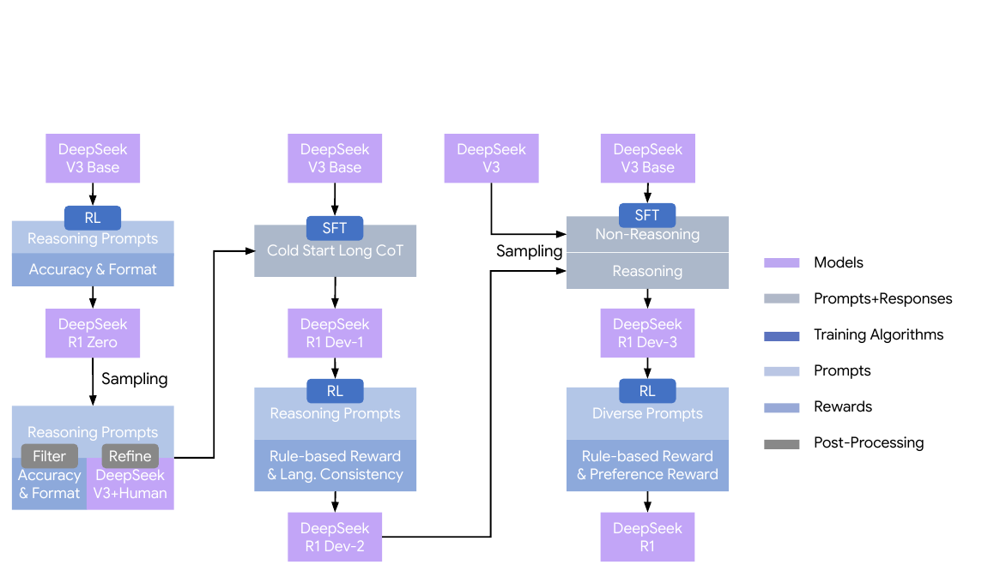
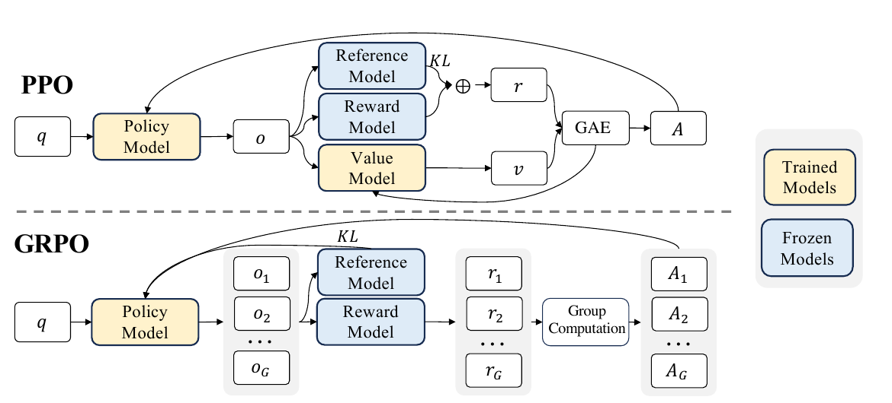
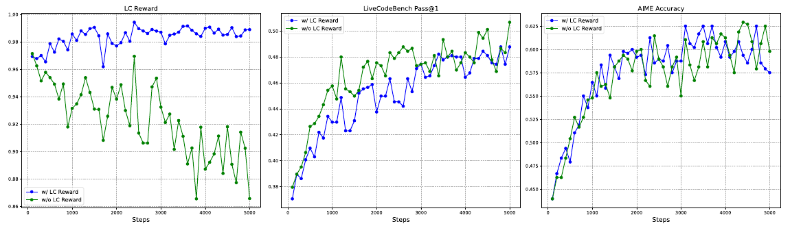
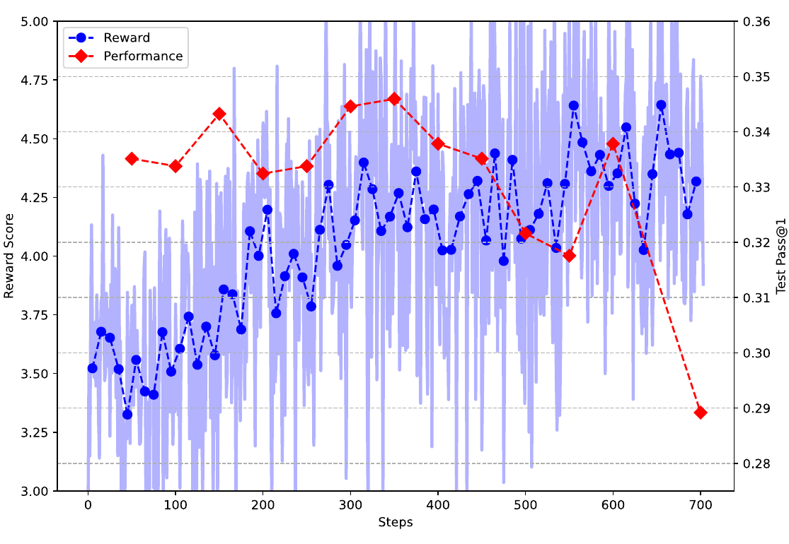
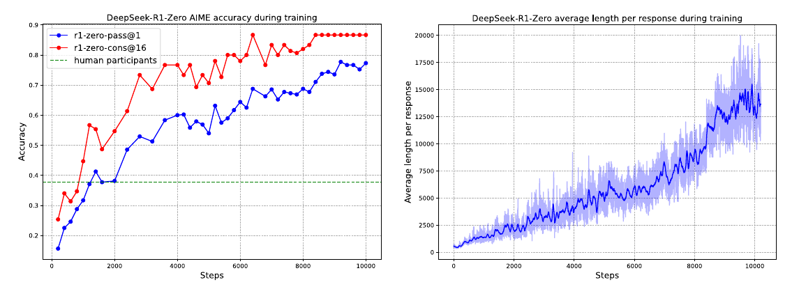
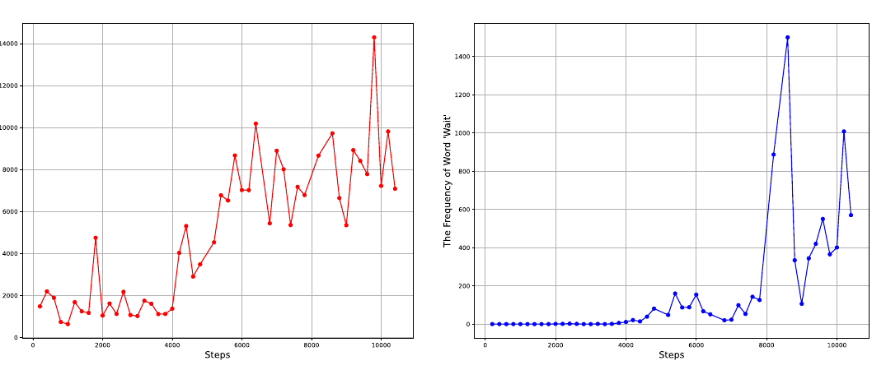
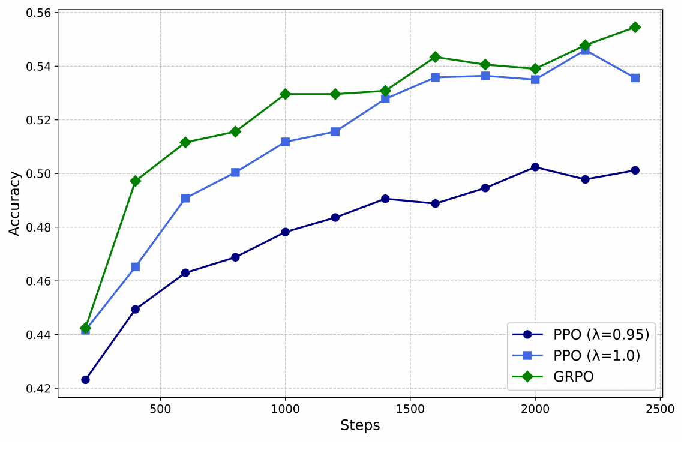

# DeepSeek-R1：从结果奖励到长链推理的训练路线

本文阅读 DeepSeek-AI 的 *DeepSeek-R1: Incentivizing Reasoning Capability in LLMs via Reinforcement Learning*（[arXiv:2501.12948v2，2026 年 1 月 4 日](https://arxiv.org/pdf/2501.12948v2)）。论文的主角是两种后训练路线：DeepSeek-R1-Zero 从预训练模型直接接受强化学习，DeepSeek-R1 再把这种推理能力与监督微调、通用任务奖励结合。本文按论文提出问题、设计优化算法与奖励、观察训练结果的顺序展开；图表和数值来自原文，未重新训练或评测模型。

## 论文的训练问题与主要主张

论文要解决的是：**能否不先给模型大量人工写好的推理过程，仅凭可核对的最终结果和强化学习，从预训练模型中激励出更有效的长链推理？** 传统后训练通常先做监督微调（supervised fine-tuning，SFT），让模型模仿“题目—示范解答”；再做强化学习（reinforcement learning，RL），依据奖励调整回答。作者认为，人工推理轨迹的制作难以扩展，示范还可能省略试错、验证与回溯，使模型被示范者的表达和解题习惯约束。论文称这种顾虑为 *cognitive biases*，但未给出它的操作性定义，也未单独量化偏差大小；这是实验动机，而非已经证明的因果结论。[论文，§1、附录 A.2](https://arxiv.org/pdf/2501.12948v2#page=2)

作者的第一项回答是 R1-Zero：仅约束“先给推理、再给答案”的输出结构，用**组相对策略优化**（Group Relative Policy Optimization，GRPO）和可验证题目的规则奖励做大规模 RL。训练中，模型在数学、代码等任务上的表现提高，回答逐渐变长，还出现检查和改写既有步骤的文本。第二项回答是最终版 R1：R1-Zero 可读性与通用任务表现不足，于是作者重新加入少量冷启动 SFT、更多筛选后的 SFT，以及针对通用任务的奖励模型。两者回答的是相连但不同的问题：**可验证推理能否靠 RL 激励；这种能力怎样变成可用的通用助手。**[论文，§2–3](https://arxiv.org/pdf/2501.12948v2#page=6)

## R1-Zero 与 R1 的两条训练路线

论文图 2 把两条路线和中间检查点放在一张图里。左侧从 DeepSeek-V3-Base 经推理 RL 得到 R1-Zero；中间从 R1-Zero 采样、筛选和修整一小批长思维链（chain of thought，CoT），用它对 V3-Base 做冷启动 SFT 得到 Dev-1，再经推理 RL 得到 Dev-2；右侧把推理与非推理数据合并做第二次 SFT 得到 Dev-3，最后经混合任务 RL 得到 R1。**GRPO 贯穿需要 RL 的阶段；奖励来源随任务和阶段变化。**[论文，图 2、§3](https://arxiv.org/pdf/2501.12948v2#page=6)

*原文图 2：左列的 R1-Zero 提供可筛选的推理轨迹；中列的冷启动 SFT 和第一阶段 RL 产生 Dev-2；右列把推理与非推理样本纳入第二次 SFT，并在最终 RL 阶段引入通用偏好奖励。箭头是模型或数据的流向；“Filter/Refine”表示筛选与修整，不是新的优化算法。截取自[论文图 2](https://arxiv.org/pdf/2501.12948v2#page=6)。*

这张图也解释了论文中“跳过 SFT”与“后来又做 SFT”看似矛盾的说法：**跳过前置 SFT 是 R1-Zero 的研究实验，最终 R1 没有坚持纯 RL。** 冷启动数据只有数千条，主要改进可读性和语言一致性；Dev-2 后的拒绝采样保留判为正确的推理回答，形成约 60 万条推理 SFT 样本，再与约 20 万条写作、问答、翻译等非推理样本合并。某些不能直接按规则核对的推理样本，会在这次**离线数据筛选**中让 DeepSeek-V3 对照标准答案判定；这与把神经奖励模型放进推理 RL 循环是两个环节。[论文，§3、附录 B.3.2–B.3.3](https://arxiv.org/pdf/2501.12948v2#page=26)

## GRPO：把同题回答的奖励变成策略更新

### 策略模型、同题采样与期望

论文 §2.1 先规定：对一道问题 $q$，从旧策略 $\pi_{\theta_{\mathrm{old}}}$ 采样一组回答 $\{o_1,\ldots,o_G\}$，再优化新策略 $\pi_\theta$。**策略模型就是正在生成回答的语言模型**；每一步根据题目与已有前缀选择下一个 token。若把一条完整回答写成 $o=(x_1,\ldots,x_T)$，其概率由各步条件概率相乘得到：$\pi_\theta(o\mid q)=\prod_{t=1}^{T}\pi_\theta(x_t\mid q,x_{<t})$。这里的 $x_t$ 是回答内第 $t$ 个 token，$o_i$ 是一组中第 $i$ 条完整回答；它们属于不同层级。策略模型不是另一个专门负责“制定策略”的模型。$\theta_{\mathrm{old}}$ 是生成这批样本时的参数快照，$\theta$ 是正在更新的参数；后文的参考模型 $\pi_{\mathrm{ref}}$ 则用于限制策略偏移，三者作用不同。[论文，§2.1](https://arxiv.org/pdf/2501.12948v2#page=3)

论文的 GRPO 目标式（1）如下。为保留原文的结构，这里先完整列出；$A_i$ 的计算、裁剪与 KL 项在后面依次解释。[论文，§2.1，式（1）](https://arxiv.org/pdf/2501.12948v2#page=3)

$$
\begin{aligned}
J_{\mathrm{GRPO}}(\theta)
={}&\mathbb E_{\substack{q\sim P(Q)\\
\{o_i\}_{i=1}^{G}\sim\pi_{\theta_{\mathrm{old}}}(O\mid q)}}
\Bigg[
\frac1G\sum_{i=1}^{G}
\Bigg(
\min\!\Bigg(
\frac{\pi_\theta(o_i\mid q)}
     {\pi_{\theta_{\mathrm{old}}}(o_i\mid q)}A_i,\;
\operatorname{clip}\!\left(
\frac{\pi_\theta(o_i\mid q)}
     {\pi_{\theta_{\mathrm{old}}}(o_i\mid q)},
1-\varepsilon,1+\varepsilon\right)A_i
\Bigg)
-\beta D_{\mathrm{KL}}(\pi_\theta\Vert\pi_{\mathrm{ref}})
\Bigg)
\Bigg].
\end{aligned}\tag{1}
$$

式（1）的外层期望按**先抽题、再在这道题下抽回答**的顺序阅读：$q\sim P(Q)$ 从训练题分布取一道题；$\{o_i\}_{i=1}^{G}\sim\pi_{\theta_{\mathrm{old}}}(O\mid q)$ 用冻结的旧策略针对该题采样 $G$ 份完整回答。大写 $O$ 表示“可能的回答”这个随机变量，小写 $o_i$ 表示一次实际生成的回答。逗号表示这两个随机变量组成的联合采样，后一项依赖前一项给定的 $q$。等价的分层写法是 $\mathbb E_{q\sim P(Q)}[\mathbb E_{\{o_i\}\sim\pi_{\theta_{\mathrm{old}}}(\cdot\mid q)}[\text{方括号内目标}]]$。实际训练用有限批次估计这个平均；R1-Zero 每道题采样 $G=16$ 份，每步使用 32 道不同题，因此一批有 512 份回答。[论文，§2.1](https://arxiv.org/pdf/2501.12948v2#page=3)

式（1）中每份回答先得到**奖励 $r_i$**，再由奖励算出优势 $A_i$；概率比与裁剪决定怎样用这个优势改变当前模型，KL 项限制与参考模型的距离。四部分各有职责：旧策略负责采样，奖励器判断回答质量，组内优势把质量变成相对权重，当前策略才是接受梯度更新的模型。$\pi_{\mathrm{ref}}$ 是 KL 的参照，并不负责从题目采样。

*原文图 3：上半部从回答、奖励和价值预测经 GAE 得到优势 $A$；下半部的 $o_1,\ldots,o_G$ 是同题回答，$r_1,\ldots,r_G$ 经 Group Computation 变为 $A_1,\ldots,A_G$。图中 “Reward Model” 是抽象评分模块；R1-Zero 推理任务的实际评分由规则完成。截取自[论文图 3](https://arxiv.org/pdf/2501.12948v2#page=15)。*

**图 3 的 PPO 与 GRPO 差在哪里？** 近端策略优化（Proximal Policy Optimization，PPO）和 GRPO 都需要一个能给回答打分的奖励来源，也都用新旧策略的概率比与裁剪来限制更新。差异主要发生在**奖励变成优势**的中间环节。“优势”是某次输出相对一个基准的好坏；正优势鼓励当前选择，负优势抑制它。PPO 的价值模型 $V_\phi(s_t)$ 读取“题目加已经生成的前缀”这个状态 $s_t$，估计从此前缀继续生成预期还能得到多少回报，作为比较基准。例如一个前缀的预测回报是 $0.6$、最终得到 $1$，那么结果比预测高 $0.4$；这是理解优势的简化算例，不是 GAE 的精确计算。在通常只有最终答案奖励的场景中，价值模型要在答案尚未写完时预测最终得分。实际 PPO 用广义优势估计（generalized advantage estimation，GAE）组合各位置的奖励和价值预测误差；GAE 的 $\lambda$ 控制跨位置累积的权重，因此又引入一个超参数。[论文，附录 A.3](https://arxiv.org/pdf/2501.12948v2#page=15)

GRPO 直接对**同一道题的多份完整回答**评分，用这组奖励的均值和标准差给每份回答计算优势，不训练 $V_\phi$。例如同题四份答案有两份正确、两份错误，GRPO 可以直接比较它们；PPO 的价值模型则必须根据各条回答的中间前缀估计后续回报。长 CoT 可能在后段纠正甚至推翻前面的推理，作者因此认为前缀预测尤其困难。省去价值模型减少了通常与策略模型同量级的一份模型及相应显存、计算开销。**GRPO 没有省去奖励器**：图中“Reward Model”代表提供分数的模块，R1-Zero 推理任务用规则实现它。PPO 也可以对同题采样多份回答；图的关键区别是优势来源，而非“能否采样多份”。[论文，附录 A.3、图 3](https://arxiv.org/pdf/2501.12948v2#page=15)

| 对照环节 | 论文比较的 PPO 路线 | GRPO 路线 |
| --- | --- | --- |
| 奖励由谁提供 | 外部评分模块，可采用任务对应的评分方式 | 仍需外部评分；R1-Zero 推理任务用规则奖励 |
| 优势怎样得到 | 价值模型预测前缀后续回报，GAE 结合预测差异 | 同题多份回答的奖励减组均值、除组标准差 |
| 额外训练模型 | 需要价值模型 | 不需要价值模型 |
| 控制策略更新 | 裁剪概率比；论文比较的配置将逐 token KL 加进奖励 | 裁剪概率比；KL 惩罚直接放进目标 |

### 组内优势与具体算例

论文式（3）把回答 $o_i$ 的奖励与同组均值比较，再除以这组奖励的标准差：

$$
A_i=\frac{r_i-\bar r}{s_r},\qquad
\bar r=\frac1G\sum_{j=1}^{G}r_j,\qquad
s_r=\operatorname{std}(r_1,\ldots,r_G). \tag{3}
$$

减去 $\bar r$ 回答“这份解答比同题其他解答好还是差”；除以 $s_r$ 使分数表示相对差异的大小。**优势不是验证器的新评分，而是由原奖励算出的更新权重。** 后面裁剪演算统一使用一个解释性小组：$G=4$，四份回答的正确性奖励为 $[1,1,0,0]$。组均值 $\bar r=0.5$，总体标准差 $s_r=0.5$；因此两份正确回答的优势各为 $(1-0.5)/0.5=+1$，两份错误回答各为 $(0-0.5)/0.5=-1$。这是为了算清公式而构造的小组；论文实际每题采样 16 份回答。[论文，§2.1，式（3）](https://arxiv.org/pdf/2501.12948v2#page=3)

这里有两个会影响理解的边界。第一，若同题回答的奖励全相同，论文写出的 $s_r$ 为零，式（3）不能直接计算；原文没有交代实现怎样处理这一组，因此不能把某种平滑常数或跳过规则说成论文事实。第二，组内比较只告诉模型哪些**已采出的**回答更好；如果题目太难、样本全错，正确性奖励这一项就没有组内差异，格式奖励仍可能区分不同回答。这说明为何作者在结论中同时强调困难但可验证的题目、可靠验证器和足够计算资源。[论文，§2.1、§6](https://arxiv.org/pdf/2501.12948v2#page=10)

### 概率比、裁剪与 KL 约束

有了优势，回到完整目标式（1）。令 $\rho_i=\pi_\theta(o_i\mid q)/\pi_{\theta_{\mathrm{old}}}(o_i\mid q)$：$\rho_i=1$ 表示新旧策略给这份回答相同概率，$\rho_i>1$ 表示当前策略提高了它的概率，$\rho_i<1$ 表示降低了概率。式（1）的 $\min$ 只比较两个量：未经裁剪的 $\rho_iA_i$，以及将 $\rho_i$ 限在 $[1-\varepsilon,1+\varepsilon]$ 后乘 $A_i$ 的结果。$\beta D_{\mathrm{KL}}$ 在 $\min$ **之外**，是另一个限制策略偏移的惩罚项。[论文，§2.1，式（1）](https://arxiv.org/pdf/2501.12948v2#page=3)

沿用上一节四份回答的解释性小组，正确回答的 $A_i=+1$，错误回答的 $A_i=-1$。仅为演算，取 $\varepsilon=0.2$，于是裁剪区间是 $[1-0.2,1+0.2]=[0.8,1.2]$。先把 $\rho_i$ 夹在区间内，乘该回答的 $A_i$，再与未经裁剪的乘积取较小值：

| 回答 | 优势 $A_i$ | 新旧概率比 $\rho_i$ | 未裁剪的 $\rho_iA_i$ | 裁剪后再乘 $A_i$ | $\min$ 的结果 |
| --- | ---: | ---: | ---: | ---: | ---: |
| 正确回答 | $+1$ | $1.0$ | $1.0$ | $1.0$ | $1.0$ |
| 正确回答 | $+1$ | $1.5$ | $1.5$ | $1.2$ | $1.2$ |
| 错误回答 | $-1$ | $1.0$ | $-1.0$ | $-1.0$ | $-1.0$ |
| 错误回答 | $-1$ | $0.5$ | $-0.5$ | $-0.8$ | $-0.8$ |

表中 $1.2$ 来自刚设定的裁剪上界 $1+\varepsilon$，不是训练中观察到的分数。对正确回答，若新策略已经把其概率提高到旧策略的 $1.5$ 倍，$\min$ 只记上界对应的 $1.2$。当 $\rho_i$ 继续高于 $1.2$，被选中的策略项始终是常数 $1.2$，所以它对 $\rho_i$ 的导数为零；链式法则下，它对模型参数也不再提供梯度。对错误回答，若概率已压到旧策略的一半，$\min$ 只记下界对应的 $-0.8$，继续压低也不再从**这一条样本的裁剪项**获得收益。其他样本和 KL 惩罚仍可提供梯度，不能说整个模型的梯度为零。[论文，§2.1，式（1）](https://arxiv.org/pdf/2501.12948v2#page=3)

式（1）还有与裁剪分开的参考约束。论文式（2）对采样回答使用以下 KL 估计，其中 $\pi_{\mathrm{ref}}$ 是参考策略，$\beta$ 决定偏离参考策略的代价；两策略给这条回答相同概率时，$u_i=1$，这一项为零。[论文，§2.1，式（2）](https://arxiv.org/pdf/2501.12948v2#page=3)

$$
D_{\mathrm{KL}}(\pi_\theta\Vert\pi_{\mathrm{ref}})
=u_i-\log u_i-1,\qquad
u_i=\frac{\pi_{\mathrm{ref}}(o_i\mid q)}{\pi_\theta(o_i\mid q)}.
\tag{2}
$$

**两种算法怎样处理 KL，也是论文比较的一部分。** 作者所比较的 PPO 实现把逐 token KL 惩罚加入逐步奖励，最后累计回报；回答越长，累计惩罚可能越大。GRPO 将 KL 估计直接作为目标中的惩罚项。附录图 4 另比较了优势估计的代价：PPO 的 GAE 系数 $\lambda=0.95$ 时在该小模型实验中明显落后 GRPO，调至 $\lambda=1.0$ 后接近 GRPO。因而该实验支持的是**在报告条件下，GRPO 少一份价值模型和一个需要调的 GAE 参数**，并非 PPO 在任何设置下都较差。[论文，附录 A.3、图 4](https://arxiv.org/pdf/2501.12948v2#page=16)

以上 $0.2$ 仅供演算裁剪；论文在 R1 第一阶段 RL 的配置中另写 $\varepsilon=10$。作者指出裁剪过小会让许多 token 的梯度截断、过大可能不稳定；不能把教学算例的范围当成论文的实际超参数。[论文，§3.2.1](https://arxiv.org/pdf/2501.12948v2#page=7)

## 奖励设计：不同任务使用不同裁判

### R1-Zero 的规则奖励

论文 §2.2 紧接 GRPO 讨论奖励来源，这一节决定前面 $r_i$ 到底从哪里来。R1-Zero 只在**推理任务**上使用可程序化核对的结果：数学题匹配指定格式中的答案，代码题用编译或测试用例检查；格式奖励要求按表 1 的 &lt;think&gt;…&lt;/think&gt; 与 &lt;answer&gt;…&lt;/answer&gt; 标签区分推理和答案。原文式（4）把准确性奖励与格式奖励等权相加：

$$
R_{\mathrm{rule}}=R_{\mathrm{acc}}+R_{\mathrm{format}}.
\tag{4}
$$

**规则奖励**是预先写好的判定程序：给定题目、模型回答和可核对的目标，程序按固定规则返回分数，没有一套需要从偏好样本中学出来的评分参数。数学题可抽取最终答案并与标准答案比对；代码题可编译、运行测试；格式检查器只看标签位置。假设两份数学回答都把推理放进规定标签，但一份最终答案正确、一份错误，二者的格式奖励可以相同，正确性奖励则不同。GRPO 接收这些分数，计算组内优势，再更新**生成回答的策略模型**。[论文，§2.2、表 1、附录 B.3.1](https://arxiv.org/pdf/2501.12948v2#page=4)

**神经网络奖励**则让另一个经过训练的模型承担评分。例如 R1 的有用性奖励模型先用成对回答的偏好数据训练，再对回答的有用程度输出标量；安全奖励模型从安全/不安全样本中学习判断。它能给缺少唯一标准答案的写作或开放问答提供反馈，但分数是对目标质量的**学习近似**：若评分模型存在偏好或漏洞，策略可能学会提高评分而不提高真实质量。两类方法最后都能产生 GRPO 所需的 $r_i$，差别在于**评分依据是固定可检查的规则，还是从数据中学出的模型**。[论文，§2.2、§3.1、附录 B.5](https://arxiv.org/pdf/2501.12948v2#page=7)

这里有些读者会疑惑：**“不用奖励模型”，强化学习靠什么更新？** 论文实际限定的是避免把**神经**奖励模型用于 “to reasoning tasks”；规则评分一直存在，作者在结论中甚至称它为 *rule-based reward model*。因此“R1-Zero 不用神经奖励模型”与“R1-Zero 的 RL 需要奖励”完全相容。GRPO 是使用奖励的优化算法，式（4）是 R1-Zero 的奖励来源；后文 R1 的通用任务又采用神经奖励模型。[论文，§2.2、§3.1、§6](https://arxiv.org/pdf/2501.12948v2#page=4)

STEM 通常指科学（Science）、技术（Technology）、工程（Engineering）与数学（Mathematics）。论文附录表 4 的 STEM 是训练数据中的一个更窄的类别：约 2.2 万道主要涉及物理、化学、生物的选择题，数学和代码另列。选择题可用正确选项给二值奖励；数学证明、开放式写作没有同样简单可靠的结果检查。**规则奖励可用到哪里，决定了“纯 RL”实验能覆盖哪里。** 作者拒绝在推理 RL 中使用结果型或过程型神经奖励模型，理由是长时间训练容易使策略找到模型评分的漏洞，还需重训奖励模型；但规则验证器也依赖答案、测试用例与解析器的正确性，并非天然不会被不完整测试利用。[论文，§2.2、附录 B.3.1、表 4](https://arxiv.org/pdf/2501.12948v2#page=19)

### R1 的语言一致性奖励

论文先报告 **R1-Zero** 的单条 CoT 有时混用英语和中文，随后在 R1 的第一阶段 RL 中加入语言一致性奖励。附录 A.1 说 V3-Base 的预训练文本以中英文为主，认为这**可能**是 R1-Zero 缺少语言一致性奖励时混语的原因；第 3.2.1 节把新奖励定义为 CoT 中目标语言词数占总词数的比例，并把它直接加到最终奖励。[论文，§1、§3.2.1、附录 A.1](https://arxiv.org/pdf/2501.12948v2#page=7)

$$
R_{\mathrm{language}}=
\frac{\operatorname{Num}(\text{目标语言词})}
     {\operatorname{Num}(\text{CoT 全部词})}.
\tag{7}
$$

**为什么 R1 的混语看上去比普通聊天模型明显？** 需要先校正对象：论文的突出例子是未做前置 SFT 的 **R1-Zero**；最终版 R1 用冷启动数据和语言奖励缓解中英混用，但作者仍报告它面对中英以外语言时可能以英文推理或回答。论文没有把 R1 与普通聊天模型做混语频率的受控对照。依据已报告的训练目标可以作一项有限推断：R1-Zero 的正确性与格式奖励不要求全程单语，长 CoT 又给语言切换更多出现位置，因此能拿高分的混语轨迹不会因混语本身被扣分。普通聊天助手若接受单语示范或语言偏好训练，行为可能不同；这不是本文直接测得的比较。[论文，§1、§3.2.1、§6](https://arxiv.org/pdf/2501.12948v2#page=10)

*原文图 7：左图中添加语言奖励的蓝线保持较高语言一致性，未添加的绿线随训练下降；中图 LiveCodeBench 的蓝线略低，右图 AIME 两条曲线接近。这个消融使用 DeepSeek-R1-Distill-Qwen-7B，不能直接当作完整 R1 的同配置实验。截取自[论文附录 B.6，图 7](https://arxiv.org/pdf/2501.12948v2#page=37)。*

图 7 支持作者的具体取舍：语言奖励改善可读性，在这个小模型消融里数学成绩大体相近、代码成绩略降。图不能证明“混语本身提升了推理”；也不能用它断言模型内部先用哪种语言“思考”。论文只检查可见 token 序列的语言比例与任务得分。[论文，附录 B.6](https://arxiv.org/pdf/2501.12948v2#page=37)

### R1 的有用性与安全奖励模型

这里有些读者会疑惑：**前文说推理任务不用神经奖励模型，为什么 §3.1 又训练有用性奖励模型？** 原文的两个限定在相邻章节里：§2.2 排除神经奖励模型的对象是 *推理任务*；§3.1 开头则说 “For general data, we resort to reward models”。写作、开放式问答等通用任务缺少确定答案，R1 为此训练**有用性**和**安全**两种神经奖励模型。第二阶段 RL 按问题类型分流：推理题继续用规则奖励，通用题使用相应偏好模型与格式奖励，语言一致性奖励可加到两类问题上；一条通用问题归入有用性或安全数据中的一类，并非每次同时取得两种模型分数。[论文，§2.2、§3.1–3.2.2](https://arxiv.org/pdf/2501.12948v2#page=8)

有用性奖励模型的**训练数据**还涉及 DeepSeek-V3。论文写每个偏好对包含一个问题和 A、B 两份候选回答，接着明确说 “we query DeepSeek-V3 four times”：让 V3 **评判同一对回答四次**，每次随机交换 A/B 位置以减轻位置偏差，平均判断后筛出差异足够大的约 6.6 万对，用这些偏好对训练带标量奖励头的模型。附录 B.2 的 Arena-Hard 提示让 V3 比较两名助手的回答并输出偏好标签，因此四次查询明确属于**评判**。至于 A、B 候选到底用何种温度、是否由相同模型独立采样，正文没有给出足够信息；R1 第二阶段 RL rollout 的温度 $0.7$ 不能倒推成这批偏好对的生成温度。[论文，§3.1](https://arxiv.org/pdf/2501.12948v2#page=7)、[附录 B.2](https://arxiv.org/pdf/2501.12948v2#page=18)

安全奖励模型另用约 10.6 万条按安全准则标注的样本，学习对单条回答作安全或不安全的点式判断。作者把通用指令数据与模型偏好奖励限制在最终 RL 的 **1,700 步中的最后 400 步**，因为更长时间优化模型给出的分数可能导致奖励攻击：模型学会让裁判给高分，外部任务质量却下降。[论文，§3.1–3.2.2](https://arxiv.org/pdf/2501.12948v2#page=8)

*原文图 6：横轴为训练步数，蓝色表示有用性奖励模型给分，红色表示 Codeforces 测试 Pass@1。后段两者背离，展示作者在**有用性神经奖励模型**上观察到的奖励攻击风险；不是数学题规则奖励失效的实验。截取自[论文附录 B.5，图 6](https://arxiv.org/pdf/2501.12948v2#page=36)。*

图 6 回答了“为何不把神经模型奖励直接扩大到所有推理题”：若训练目标只是让一个可被查询的评判模型加分，策略可能适应该评判模型的偏差。图中 Codeforces 只是用于观察外部表现的测试，不能据此断言所有神经奖励模型必然产生相同程度的下降；规则验证器若覆盖不足，也仍可能被利用。[论文，附录 B.5、§6](https://arxiv.org/pdf/2501.12948v2#page=36)

## 实验如何支持这些主张

论文图 1 同时画出 R1-Zero 训练中的 AIME 2024 准确率与平均回答长度。左图蓝线是单次回答的 Pass@1，从初期 **15.6%** 升至 **77.9%**；红线是同题 16 条回答多数表决的 Cons@16，最终约 **86.7%**，两种指标不能混用。右图回答长度总体上升，第 8,200 步后最大允许长度从 32,768 提到 65,536 token，也影响后段长度曲线。图支持“准确率与输出长度在这次训练中一起增长”，不能单凭相关曲线证明“越长必然越正确”。[论文，§2.1–2.3、图 1](https://arxiv.org/pdf/2501.12948v2#page=4)

*原文图 1：左侧分别是 Pass@1、Cons@16 和人类参赛者平均线；右侧是训练集每条回答的平均长度。横轴均为策略更新步数。截取自[论文图 1](https://arxiv.org/pdf/2501.12948v2#page=4)。*

论文表 2 展示一条中途以 “Wait, wait” 重新检查前面推导的回答，并用 *using an anthropomorphic tone* 描述它的语气。**为什么模型会说“这是一个 aha moment”？** 这是一段生成文本，不是模型对自身认知状态的测量；作者真正可核对的观察是输出中出现回看、改写，以及附录图 9 中反思词和 “wait” 使用频率随训练增加。它们说明某类文本轨迹变多，但没有隔离实验表明这个词本身导致答案正确。[论文，§2.3、表 2、附录 C.2](https://arxiv.org/pdf/2501.12948v2#page=39)

*原文图 9：左侧统计代表性反思词，右侧单独统计 “wait”；两项后期都升高，但纵轴是词频，不是纠错成功率。截取自[论文附录 C.2，图 9](https://arxiv.org/pdf/2501.12948v2#page=39)。*

R1 的阶段结果则能检验“加回 SFT 与通用奖励是为了什么”。下表选自论文表 3；AIME 2024 和 LiveCodeBench 是 Pass@1，IF-Eval 是严格提示遵循率，单位均为百分比。LiveCodeBench 使用 CoT 格式、题目收集于 2024 年 8 月至 2025 年 1 月。原文 Pass@1 通过多次采样取平均，AIME 每题 64 条、LiveCodeBench 每题 8 条，与 GRPO 训练时每题 16 条是不同配置。[论文，表 3](https://arxiv.org/pdf/2501.12948v2#page=9)、[附录 D.1](https://arxiv.org/pdf/2501.12948v2#page=40)

| 模型阶段 | AIME 2024 | LiveCodeBench | IF-Eval |
| --- | ---: | ---: | ---: |
| R1-Zero | 77.9 | 50.0 | 46.6 |
| Dev-1：冷启动 SFT 后 | 59.0 | 57.5 | 71.7 |
| Dev-2：第一阶段 RL 后 | 74.0 | 63.5 | 72.0 |
| Dev-3：第二次 SFT 后 | 78.1 | 64.6 | 78.1 |
| R1：最终 RL 后 | 79.8 | 65.9 | 83.3 |

Dev-1 比 R1-Zero 更遵循指令，但 AIME 降低；随后的推理 RL 恢复部分数学能力并提升代码成绩；后续 SFT 与混合任务 RL 继续提高提示遵循率。这与各阶段目标相符，但每次阶段切换也改变了数据与训练方式，不能把某一列的变化只归于单独一种奖励。作者没有用这张表独立量化“人工示范的认知偏差”。[论文，§4、表 3](https://arxiv.org/pdf/2501.12948v2#page=9)

*原文图 4：实验对象为 DeepSeekCoder-V2-Lite；GRPO 绿色曲线高于 PPO 的 $\lambda=0.95$ 曲线，PPO 调至 $\lambda=1.0$ 后接近 GRPO。此图验证特定模型、任务与配置下的算法对比，不是 R1 主模型的直接消融。截取自[论文附录 A.3，图 4](https://arxiv.org/pdf/2501.12948v2#page=16)。*

## 局限与结论

这篇论文最清晰的证据链是：**预训练基座能生成候选解答 → 可验证结果与格式提供奖励 → GRPO 强化同题较好的回答 → R1-Zero 在一组推理基准上进步**。最终 R1 说明产品化还需要修正语言、可读性和通用任务能力，因而再次使用 SFT 和神经偏好奖励。论文的纯 RL 结论主要适用于可可靠核对结果的任务；开放式任务的奖励模型可能被利用，语言控制也带来取舍。[论文，§2–4、§6](https://arxiv.org/pdf/2501.12948v2#page=10)

几项边界直接影响结论的外推：论文没有报告 R1-Zero 与普通聊天模型的混语受控比较；式（3）未交代组内奖励方差为零时的实现；有用性偏好对的候选采样与标签到筛选阈值的映射不足以独立复现；反思词频只能表明文本行为变化。图 6 又说明神经评判分数与外部质量可能背离。报告中的数值均为作者实验，本文没有复现训练或独立验证这些因果解释。[论文，§2.1、§3.1、附录 B.5–B.6、C.2](https://arxiv.org/pdf/2501.12948v2#page=36)

## 延伸问答

**问：大模型生成时怎样选择输出语言？不同语言要分别训练一套模型吗？**

答：多语言自回归模型通常用同一套模型参数和分词器处理不同语言的数据，不需要分别训练“中文模型”和“英文模型”。训练时，各语言的文本都变成 token 序列，模型在给定上下文 $x_{<t}$ 时预测下一个 token 的分布 $P_\theta(x_t\mid x_{<t})$。生成时，提示语言、系统要求和已经生成的词都会改变这个分布：中文提示通常提高中文 token 的概率；若前面已经连续生成英文，后续英文也可能更容易出现。数学符号、代码和数字又能出现在多种语言的语境里，所以两种语言并没有一条模型必须遵守的硬边界。

预训练决定模型接触过哪些语言和任务；后训练中的示范回答与奖励进一步影响它是否跟随用户语言、是否保持整段回答一致。R1 论文只报告 V3-Base 预训练数据主要是中英文、R1-Zero 的混语现象，以及引入语言一致性奖励后的变化，**没有逐 token 测量模型为何选择某种语言**。上述生成机制是理解现象的通用模型，不是论文对混语原因的受控证明。[论文，附录 A.1](https://arxiv.org/pdf/2501.12948v2#page=13)、[附录 B.6](https://arxiv.org/pdf/2501.12948v2#page=37)

**问：词表越大，同样文本就一定需要更少 token 吗？**

答：这是两个不同量。词表大小 $V$ 是模型可选择的 token ID **有多少种**；固定一段文本编码后得到的长度 $N$ 是这段文本**实际被切成多少个 token**。例如作为解释性构造，某两个汉字可以在分词器甲中各占一个 token，在分词器乙中合为一个 token；同一文本的 $N$ 因分词规则改变而从 2 变成 1。即使乙的总词表较大，如果新增条目都用于其他语言，这两个汉字仍可能被切成 2 个 token。因此“$V$ 较大”只提供更充分合并的可能，不能推出某种语言一定用更少 token。

两项成本也不同：$V$ 增大通常增加输入嵌入和输出类别的规模，输出层每个生成位置要处理更多候选；若同一文本的 $N$ 下降，模型需要处理的位置减少，上下文窗口也能容纳更多原文。实际训练和推理速度取决于两者、模型结构与实现，不能只看词表大小。比较分词器时，应拿**同一段文本**分别编码，实际统计 $N$；比较语言能力还要看相应语言的训练数据，而非仅看编码长度。DeepSeek-R1 论文没有做词表规模与压缩率实验。

**问：模型能用中文回答，是否证明词表有完整中文词条？遇到生僻语言会怎样？**

答：能输出中文只说明分词器**可以表示中文**，不证明它为每个汉字或词都保留了独立条目。有些分词器能把未合并的文字继续拆成更小的字符或字节片段；具体能拆到哪一级取决于该模型的分词器。可编码也不等于会准确使用：若某种语言训练样本少，模型可能理解不足；若编码又很零碎，同样内容会占用更多 token，增加长文本处理成本。这两个问题需要分别检查，不能把词表覆盖率当成语言能力的替代指标。

对很少见的语言，模型可能切换成更熟悉的语言、输出不流畅的句子、误解问题，或直接说明能力有限。它会选择哪一种行为，还受后训练示范和系统提示影响；并不存在“语言稀有就一定拒答”的统一规则。论文只报告最终 R1 在中英之外的语言上可能以英文推理或回答，没有给出按语言划分的词表和能力对照。[论文，§6](https://arxiv.org/pdf/2501.12948v2#page=10)

**问：如果模型被放进 Agent，能否自动调用翻译工具处理生僻语言？**

答：可以设计一条“识别输入语言 → 必要时译成模型更熟悉的语言 → 处理问题 → 把结果译回用户语言”的工具链；但前提是应用提供翻译工具、允许调用，并让模型或外部程序识别何时需要翻译。模型能生成某种语言，不代表它知道自己该调用工具；翻译过程也可能丢失专有名词、语气或关键条件，需要核对结果。R1 论文把工具增强推理列为未来方向，**没有验证 R1 会自主调用翻译服务**。[论文，§6](https://arxiv.org/pdf/2501.12948v2#page=11)
