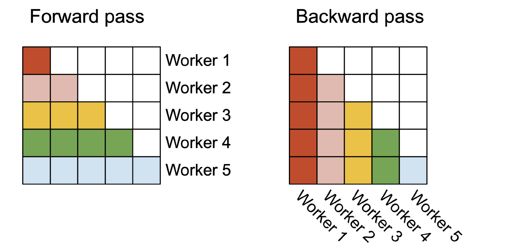
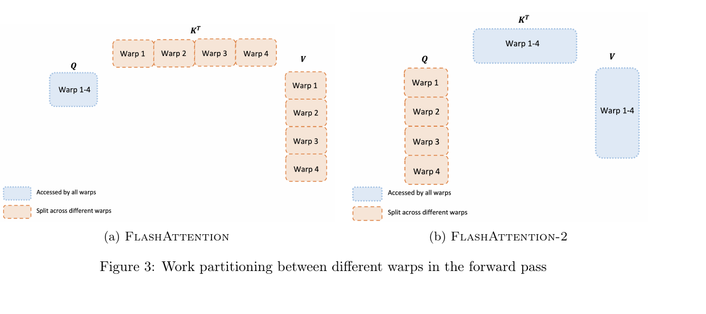
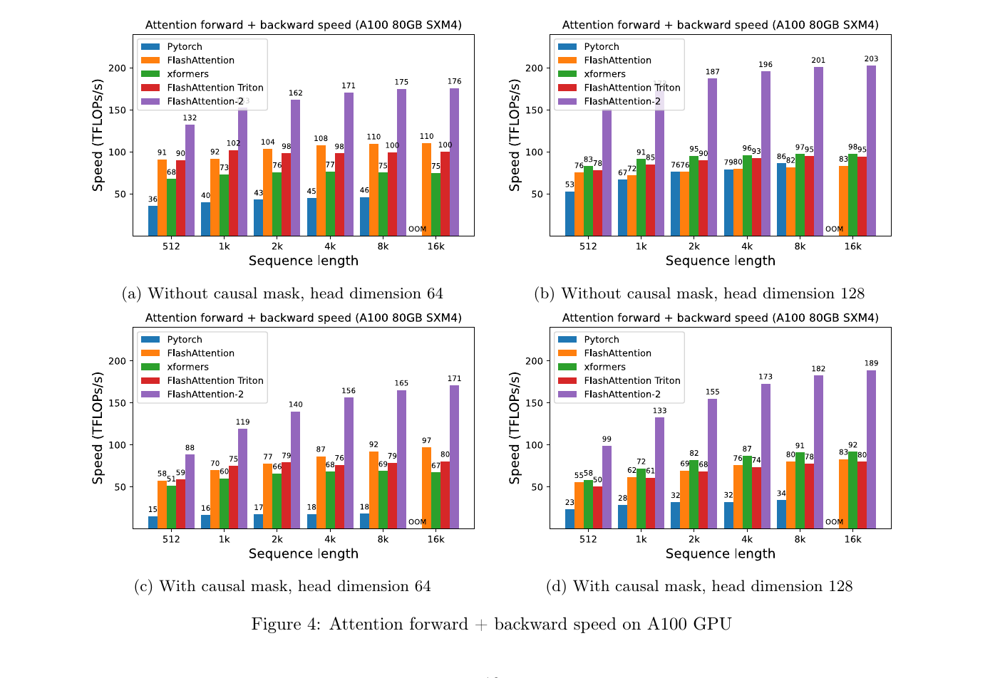

# FlashAttention-2：在线 Softmax、序列并行与 Warp 工作划分

本文精读 Tri Dao 的 *FlashAttention-2: Faster Attention with Better Parallelism and Work Partitioning*（arXiv:2307.08691v1，2023）。重点解释前向归一化的改写、序列维度的线程块并行、反向梯度的共享累加，以及 Warp 间工作划分如何影响性能。读者需要了解矩阵乘法与 Transformer 中 token 的含义；文中的数值算例是解释性构造，性能数字均为[论文原文](https://arxiv.org/pdf/2307.08691v1)的报告结果，未重新运行 GPU 测试。

## 主要工作

FlashAttention-2（下文简称 FA2）延续 FlashAttention 的分块精确注意力：对给定缩放和掩码，仍计算 $O=\operatorname{softmax}(QK^{\mathsf T})V$，不通过删去允许的查询—键配对来近似结果。它把优化重点从避免完整注意力矩阵的显存读写，进一步推进到三个执行层面：减少 Softmax 循环中的非矩阵乘法操作；沿查询行块或键列块增加线程块并行；改变线程块内部的 Warp 分工，减少共享内存通信。[论文，摘要、§3](https://arxiv.org/pdf/2307.08691v1#page=1)

论文在 A100 80 GB SXM4 上报告，FA2 的注意力算子在所测设置中比原版 FlashAttention 快约 1.7–3.0 倍，最高达到 230 TFLOPs/s；使用 8 张 A100 训练 GPT 风格模型时，表 1 的最高值为每卡 225 TFLOPs/s。这里的 TFLOPs/s 是按论文给定的 FLOP 计数方式除以运行时间，注意力算子和完整训练的统计范围不同。[论文，§4、图 4–6、表 1](https://arxiv.org/pdf/2307.08691v1#page=10)

## 研究背景

对一个注意力头，$Q,K,V\in\mathbb R^{N\times d}$ 分别是查询、键和值，$N$ 是序列长度，$d$ 是头维度。第 $i$ 行查询与第 $j$ 行键形成分数 $s_{ij}=q_i k_j^{\mathsf T}$；第 $i$ 行对所有允许的 $j$ 做 Softmax，再用权重加权对应的 $v_j$。论文为突出分块机制，在算法 1–2 中省略通常使用的 $1/\sqrt d$ 缩放；实际应用可将缩放并入分数。标准实现把 $N\times N$ 的分数矩阵 $S$ 和概率矩阵 $P$ 写到高带宽显存（HBM），训练反向还要读取 $P$。[论文，§2.2](https://arxiv.org/pdf/2307.08691v1#page=3)

原版 FlashAttention 把 $Q,K,V$ 切成矩阵块，在 GPU 片上存储（论文统称 SRAM）中计算局部分数与概率，并用在线 Softmax 合并各块。这样无需在 HBM 保存完整 $S,P$；反向传播再由保留的输入和行统计量重算局部概率。它仍需处理稠密注意力的所有允许位置，计算量随 $N^2d$ 增长。论文背景提到的近似注意力是另一类通过稀疏、低秩或核函数等改变注意力计算的方法；本文没有给这些方法与 FA2 的统一精度或速度实验。[论文，§1、§2.3](https://arxiv.org/pdf/2307.08691v1#page=2)

GPU 的线程组成线程块，线程块调度到流多处理器（SM）执行；线程块内部每 32 个线程组成一个 Warp。Warp 之间通常借助共享内存交换数据。A100 有 108 个 SM；论文给出的半精度矩阵乘法理论吞吐为 312 TFLOPs/s，而非矩阵乘法的 FP32 吞吐为 19.5 TFLOPs/s。两者的理论峰值比约为 16，并不表示每个逐元素操作的实际延迟必然恰好是矩阵乘法的 16 倍，却说明减少这些操作有性能价值。[论文，§2.1、§3.1](https://arxiv.org/pdf/2307.08691v1#page=3)

## 问题定义

在长序列且批量或头数较小时，原版 FlashAttention 主要按批量数乘头数分配线程块：一个注意力头对应一个线程块。如果同时可调度的块少于 SM 数，部分 SM 没有工作。另一个成本发生在线程块内部：原版前向把键和值分给不同 Warp，计算局部输出后要跨 Warp 汇总，产生共享内存读写和同步。FA2 要在保持同一注意力定义的前提下，同时降低这两类执行开销。[论文，§3.2–3.3](https://arxiv.org/pdf/2307.08691v1#page=8)

需要区分两种“块”：$B_r\times B_c$ 是注意力分数矩阵的一块，即**矩阵分块**，其行来自 $B_r$ 个查询、列来自 $B_c$ 个键；**线程块**是 GPU 的调度单位。FA2 前向的一个线程块负责一个查询行块，并在内部依次遍历多个键列块，所以“一个线程块处理一个矩阵块”不足以描述整个算法。调大 $B_r,B_c$ 会改变一个线程块持有的数据和迭代次数，但并不直接等同于增加线程块的线程数。[论文，算法 1、§3.2–3.3](https://arxiv.org/pdf/2307.08691v1#page=6)

## 方法原理

### 在线 Softmax 的状态更新

设某个查询行已处理一批键。在线 Softmax 用 $m$ 记录这些分数的最大值，用 $\ell=\sum_j e^{s_j-m}$ 记录以 $m$ 为基准的指数和，用 $u=\sum_j e^{s_j-m}v_j$ 记录**尚未归一化的加权和**。输出是 $o=u/\ell$。处理新列块后，旧分数和新分数必须改用同一个最大值作指数基准，才能相加。令新最大值为 $m'$，新列块分数和值为 $S_b,V_b$，则按行执行：[论文，§3.1.1、算法 1 第 8–13 行](https://arxiv.org/pdf/2307.08691v1#page=6)

$$
\begin{aligned}
m'&=\max(m,\operatorname{rowmax}(S_b)),\\
\ell'&=e^{m-m'}\ell+\operatorname{rowsum}\!\left(e^{S_b-m'}\right),\\
u'&=e^{m-m'}u+e^{S_b-m'}V_b,\\
o&=u_{\mathrm{final}}/\ell_{\mathrm{final}}.
\end{aligned}\tag{1}
$$

这里 $e^{m-m'}$ 是逐行缩放因子：若新块出现更大的分数，旧块指数必须缩小到新基准；若最大值不变，因子就是 1。原版 FlashAttention 在各列块迭代中维护已归一化输出，每次更新都要重新用 $\ell'$ 缩放输出两项。FA2 保留 $u$，只在列块循环结束后除一次 $\ell$，减少循环内对 $B_r\times d$ 输出块的逐元素归一化。$\ell$ 仍在每次迭代中更新，因为它既用于最终输出，也用于形成反向所需的行统计量。[论文，§2.3.1、§3.1.1](https://arxiv.org/pdf/2307.08691v1#page=5)

一个**解释性构造**可核对式 (1)。取某行三个分数 $[1,2,5]$，对应标量值 $[1,2,3]$，把前两个键放在第一块、第三个键放在第二块。第一块得到 $m_1=2$、$\ell_1=e^{-1}+1\approx1.367879$、$u_1=e^{-1}+2\approx2.367879$。第二块把最大值提高到 $m_2=5$，故旧状态乘 $e^{-3}$：$\ell_2=e^{-3}\ell_1+1\approx1.068103$，$u_2=e^{-3}u_1+3\approx3.117890$，最终 $o=u_2/\ell_2\approx2.919092$。直接对 $[1,2,5]$ 做一次 Softmax 再加权也得到同一结果；这个数值例子解释代数等价，不代表有限精度下逐位相同。

前向结束后，FA2 为每行保存 **logsumexp**：$L=m+\log\ell=\log\sum_j e^{s_j}$。反向重算局部概率时，$p_{ij}=e^{s_{ij}-L_i}$，因此只需读取一个长度为 $N$ 的 $L$ 向量，不需分别保存 $m$ 和 $\ell$。沿上例，$L=5+\log(1.068103)\approx5.065884$，于是第三个位置的概率是 $e^{5-L}\approx0.9362$；它与 $1/\ell_2$ 相等。[论文，§3.1.1–3.1.2、算法 2 第 11 行](https://arxiv.org/pdf/2307.08691v1#page=7)

### 因果掩码与序列位置

自回归训练在一个已知序列上同时计算多个位置，但位置 $i$ 的输出只能使用位置 $1$ 到 $i$ 的键和值。因果掩码把 $j>i$ 的分数设为 $-\infty$，使 $e^{s_{ij}}=0$；训练时位置 $i$ 的表示用于预测后续 token，不会从后续输入位置取得信息。以三个位置的分数均为 0、值分别为 $[10,20,30]$ 的解释性构造为例，三行被允许的列依次是 $[1]$、$[1,2]$、$[1,2,3]$，输出依次是 $10$、$15$、$20$。生成时尚未产生的 token 没有输入表示，必须随生成步骤逐个扩展前缀；一次对已知前缀的多行查询计算则仍可按行并行。[论文，§3.1.1 因果掩码](https://arxiv.org/pdf/2307.08691v1#page=6)

在矩阵分块中，位于因果对角线右上方、所有列索引都大于行索引的块可直接跳过；完全位于对角线左下方的块无需逐元素施加掩码；穿过对角线的块在片上对具体位置设 $-\infty$。论文报告，相比同一算法的无因果掩码注意力，这种跳块使因果注意力约快 1.7–1.8 倍。这个对照来自减少允许位置数量，不是与原版 FlashAttention 的加速比。[论文，§3.1.1](https://arxiv.org/pdf/2307.08691v1#page=6)

### 线程块的序列并行

算法 1 的外循环遍历查询行块 $Q_i$，内循环遍历全部键和值列块 $K_j,V_j$。一个行块的输出 $O_i$ 只依赖自身的查询和所有键/值列块；不同 $i$ 的 $O_i$ 彼此不需要合并。因此，前向可以把不同查询行块交给不同线程块，各自运行完整的列块循环，最终独占写入对应的 $O_i,L_i$。若批量数为 $B$、头数为 $H$，可调度工作大致由原版的 $BH$ 增为 $BH\lceil N/B_r\rceil$ 个前向行块任务；实际并发仍受设备资源和内核调度限制。[论文，§3.2、算法 1](https://arxiv.org/pdf/2307.08691v1#page=8)

*图 1（原文图 2）：左图的每种颜色占一块查询行，表示一个前向 worker（线程块）沿允许的列完成该行块输出；右图的颜色按键列分配反向 worker。白格是因果掩码排除的区域。截取自[Dao，2023，图 2](https://arxiv.org/pdf/2307.08691v1#page=8)。*

图 1 左侧每一条有色横带由一个 worker 负责，因此同一行块的所有列贡献始终归到一个线程块；横带之间没有共享输出。右侧则把有色竖带分给不同 worker，反向需要沿查询行扫描并计算各列对应的梯度。这个并行维度由**一次注意力调用中同时存在多少查询行**决定：训练整段序列和推理的 prompt 预填充通常有多行可分；单 token 生成解码通常只有一行新查询，可用的前向行块并行很少。它与训练是否提供目标标签不是同一个问题。[论文，§3.2、图 2](https://arxiv.org/pdf/2307.08691v1#page=8)

### 反向梯度的列块归约

反向首先由输出 $O$ 与输出梯度 $dO$ 计算每行的 $D_i=\sum_k dO_{ik}O_{ik}$，然后对当前行块 $i$、列块 $j$ 重算 $S_{ij}=Q_iK_j^{\mathsf T}$ 和 $P_{ij}=e^{S_{ij}-L_i}$。局部梯度满足 $dP_{ij}=dO_iV_j^{\mathsf T}$、$dS_{ij}=P_{ij}\circ(dP_{ij}-D_i)$，其中 $\circ$ 是逐元素乘法，$D_i$ 按列广播。这避免保存完整 $P$，但反向要多做局部分数重算。[论文，§3.1.2、算法 2 第 4–14 行](https://arxiv.org/pdf/2307.08691v1#page=7)

$$
\begin{aligned}
dV_j&=\sum_i P_{ij}^{\mathsf T}dO_i,\\
dK_j&=\sum_i dS_{ij}^{\mathsf T}Q_i,\\
dQ_i&=\sum_j dS_{ij}K_j.
\end{aligned}\tag{2}
$$

算法 2 的外循环按列块 $j$ 分配线程块。固定 $j$ 后，一个线程块遍历全部行块 $i$，即可在片上把 $dK_j,dV_j$ 求和完成；每个 $dQ_i$ 却要对**所有**列块 $j$ 求和，不同线程块会写同一目标。以两个行块、两个列块的解释性结构为例，$dQ_1=dS_{11}K_1+dS_{12}K_2$，两项由不同列块 worker 产生；$dK_1=dS_{11}^{\mathsf T}Q_1+dS_{21}^{\mathsf T}Q_2$，两项都由第一个 worker 产生。因而算法 2 第 15 行需要从 HBM 取 $dQ_i$、加入本列贡献并写回；实际并行时，论文说明用原子加避免不同线程块的读改写冲突。图 1 右侧不同颜色的竖带落在相同行上，正对应这一共享写入。[论文，算法 2 第 12–18 行、§3.2](https://arxiv.org/pdf/2307.08691v1#page=8)

### Warp 工作划分与矩阵块大小

线程块并行数增加后，线程块内部仍可能浪费时间。原版 FlashAttention 的前向把 $K,V$ 按列分给多个 Warp，让各 Warp 计算同一批查询的部分输出；这些部分输出对应相同的查询行，必须先写共享内存、同步再相加。FA2 改为把 $Q$ 的行分给不同 Warp，让它们共同访问 $K,V$：每个 Warp 产出不同查询行的输出份额，前向无需跨 Warp 汇总这些份额。这里“共同访问”表示逻辑上的数据共享，并不指定唯一的寄存器或共享内存实现。反向仍有依赖与同步，论文没有声称完全消除反向 Warp 通信。[论文，§3.3、图 3](https://arxiv.org/pdf/2307.08691v1#page=9)

*图 2（原文图 3）：橙色虚线表示在四个 Warp 之间切分的数据，蓝色表示所有 Warp 可访问的数据；左侧按 $K,V$ 切分，右侧按 $Q$ 切分。截取自[Dao，2023，图 3](https://arxiv.org/pdf/2307.08691v1#page=9)。*

图 2 左侧每个 Warp 看到完整 $Q$，只拿到部分 $K,V$，所以它的 $PV$ 只是相同输出行的一部分；右侧每个 Warp 看到不同的 $Q$ 行，却可访问全部相关 $K,V$，因此对应输出行由本 Warp 完成。论文通常使用每线程块 4 或 8 个 Warp，并在 $B_r,B_c\in\{64,128\}$ 的四种矩阵分块组合中按头维度和共享内存容量手动选择。增大矩阵块可减少某些重复加载与通信，但同时增加累加器寄存器和共享内存占用；寄存器溢出会减速，超出共享内存容量则无法运行。论文将此作为调参与性能观察，没有给出任意设备、任意块大小下单调加速的定理。[论文，§3.3](https://arxiv.org/pdf/2307.08691v1#page=9)

## 实验与证据

*图 3（原文图 4）：横轴是序列长度，纵轴是按论文 FLOP 公式换算的前向加反向吞吐；四个子图依次改变因果掩码与头维度。紫色为 FA2，橙色为原版 FlashAttention，其他颜色为 PyTorch、xformers 和 Triton 实现。截取自[Dao，2023，图 4](https://arxiv.org/pdf/2307.08691v1#page=10)。*

图 3 在 A100 80 GB SXM4 上测量。作者令总 token 数固定为 16K，序列长度从 512 增至 16K 时相应减小批量，隐藏维度固定 2048，头维度为 64 或 128。在左上角无因果、$d=64$ 的子图中，16K 时紫色 FA2 为 176 TFLOPs/s、橙色原版为 110 TFLOPs/s；右下角有因果、$d=128$ 的 16K 设置中分别是 189 和 83 TFLOPs/s。比较必须在同一子图、同一长度下进行，因为因果掩码会改变实际计算位置数，头维度也改变形状。图中的 OOM 表示该实现于相应设置显存不足，并不代表吞吐为零。[论文，§4.1、图 4](https://arxiv.org/pdf/2307.08691v1#page=10)

论文计算无因果前向 FLOP 的口径是 $4N^2dH$；因果设置约除以 2；反向按前向的 2.5 倍估算。图 4–6 的 TFLOPs/s 因此是**估计运算量除以实测时间**，既反映运行时间，也受 FLOP 口径影响。作者报告在这些注意力基准设置中，FA2 相对原版约快 1.7–3.0 倍，相对 PyTorch 标准实现约快 3–10 倍；前向最高 230 TFLOPs/s。图 3 展示的是其中的前向加反向汇总，230 TFLOPs/s 则来自单独前向的图 5。[论文，§4.1、图 4–6](https://arxiv.org/pdf/2307.08691v1#page=11)

端到端训练的表 1 使用 8 张 A100 80 GB SXM GPU、GPT 风格 1.3B 与 2.7B 参数模型，以及 2K、8K 上下文。每卡训练吞吐如下，单位均为 TFLOPs/s/GPU：[论文，§4.2、表 1](https://arxiv.org/pdf/2307.08691v1#page=12)

| 模型与上下文 | 无 FlashAttention | 原版 FlashAttention | FA2 |
| --- | ---: | ---: | ---: |
| GPT3-1.3B，2K | 142 | 189 | 196 |
| GPT3-1.3B，8K | 72 | 170 | 220 |
| GPT3-2.7B，2K | 149 | 189 | 205 |
| GPT3-2.7B，8K | 80 | 175 | 225 |

例如 2.7B、8K 一行的 225/175 约为 1.29，225/80 约为 2.81，分别对应比原版和无 FlashAttention 基线的吞吐比。这是完整模型训练的结果，故与注意力算子的 1.7–3.0 倍区间不同。论文的训练 FLOP 公式沿用 Megatron-LM 的计数方式，其中注意力项没有因因果掩码减半；它与 §4.1 注意力微基准的 FLOP 口径不同，不能直接把两组 TFLOPs/s 当作同一指标相减。[论文，§4.2](https://arxiv.org/pdf/2307.08691v1#page=11)

## 局限性

FA2 保持允许位置上的稠密精确注意力，前向主计算仍为 $O(N^2d)$ FLOPs。论文算法 1 在输入和输出之外只保存长度为 $N$ 的 logsumexp $L$，即 $O(N)$ 额外状态；这不包含输入输出本身，也不表示完整训练的显存只需 $O(N)$。更长上下文依旧增加计算与 $Q,K,V$ 读写，性能取决于形状、设备和矩阵块设置。[论文，§3.1.1、算法 1](https://arxiv.org/pdf/2307.08691v1#page=7)

本文依据 2023 年论文 v1 的算法和 A100 实验。论文将 H100 专用指令、更广设备支持、FP8 与自动块大小调优列为后续方向；这些是当时的研究范围，不构成本文对后续实现性能的验证。论文报告的“无近似”指注意力数学定义不因分块而改变，有限精度与不同归约顺序仍可能产生数值差异。[论文，§5](https://arxiv.org/pdf/2307.08691v1#page=12)

## 结论

FA2 的前向把行最大值、指数和与未归一化输出留在片上，跨键列块更新，最后一次归一化；反向只需保存行 logsumexp，并通过重算局部概率求梯度。行块独立使前向能够沿序列增加线程块任务，列块分工使反向的 $dK,dV$ 留在各自线程块而 $dQ$ 需要跨块原子累加；按查询行分给 Warp 则减少前向的共享内存汇总。这三层改动共同解释了论文在指定 A100 测试中相对于原版 FlashAttention 的提速，而不是改变注意力的渐近计算量。
