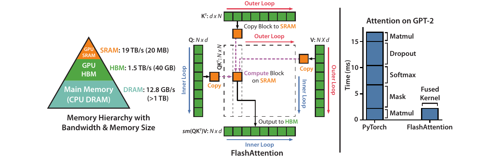

# FlashAttention：以分块和在线 Softmax 减少精确注意力的显存访问

本文精读 Dao 等人的 *FlashAttention: Fast and Memory-Efficient Exact Attention with IO-Awareness*（arXiv v2，2022），重点解释注意力矩阵为何造成显存读写、分块后如何保持 Softmax 的完整归一化、反向传播为何重算，以及论文的复杂度与实验分别支持什么结论。读者只需了解矩阵乘法和 Transformer 中 token 的基本含义。文中图表与数字均来自[论文原文](https://arxiv.org/pdf/2205.14135v2)，没有重新运行 GPU 基准测试。

## 主要工作

FlashAttention 是一种 **IO 感知的精确注意力算法**：它仍计算给定掩码及缩放规则下的 `softmax(QKᵀ)V`，但把查询、键和值分块，在 GPU 片上存储中生成并消费局部注意力分数，不把完整的 `N×N` 分数矩阵与概率矩阵写入高带宽显存（HBM）。片上存储容量小，无法容纳所有键时，算法以每行的最大值、指数和及部分输出为状态，逐块完成同一个 Softmax。训练时再根据输入和这些状态重算局部概率，避免为反向传播保存二次方大小的矩阵。[论文，§1、§3.1、算法 1、附录 B](https://arxiv.org/pdf/2205.14135v2#page=2)

论文给出前向算法的片外访问量 `Θ(N²d²/M)`：`N` 是序列长度，`d` 是单头维度，`M` 是以元素数计的片上存储容量；作为对照，文中的标准实现需要 `Θ(Nd+N²)` 次访问。这改变的是**数据搬运量与中间结果占用**，稠密精确注意力的主要矩阵乘法仍要处理 `N²` 对查询和键。论文在特定 A100、模型及基线条件下报告 BERT-large 端到端训练时间由 20.0 分钟降到 17.4 分钟，GPT-2 medium 由 Hugging Face 基线的 21.0 天降到 6.9 天。两个结果属于不同实验，不是一个通用加速系数。[论文，定理 1–2、表 1–2](https://arxiv.org/pdf/2205.14135v2#page=6)

## 研究背景

自注意力把长度为 `N` 的 token 表示 `X` 分别投影为查询 `Q=XW_Q`、键 `K=XW_K` 和值 `V=XW_V`。对一个注意力头，三者可记为 `N×d` 矩阵；它们的第 `j` 行都对应第 `j` 个输入位置，但承担不同的计算角色。第 `i` 个查询 `q_i` 与每个键 `k_j` 做点积，得到位置 `i` 对位置 `j` 的分数；沿 `j` 归一化之后，使用同一位置的值 `v_j` 作加权求和。因此，**键和值按位置配对**，而输出按查询位置排列。点积是可学习投影产生的打分方式，其有用的匹配关系由训练决定。[论文，§2.2](https://arxiv.org/pdf/2205.14135v2#page=4)

令 `s_ij = τ q_i·k_j`，其中 `τ` 是注意力缩放因子；可见位置的 `s_ij` 保留，掩码排除的位置取 `−∞`。于是第 `i` 行的输出为：

```formula
p_ij = exp(s_ij) / Σ_k exp(s_ik)
o_i = Σ_j p_ij v_j
```

矩阵形式为 `S=τQKᵀ`、`P=softmax(S)`、`O=PV`，Softmax 按行计算。论文算法 1 为突出分块，把 `τ` 暂时省入分数定义；附录 B 的完整反向算法显式写出缩放、掩码和 Dropout。`P` 的列 `j` 与 `V` 的行 `j` 对齐，保证某个键得到的权重用于同位置的值。[论文，§2.2、算法 1、附录 B.4](https://arxiv.org/pdf/2205.14135v2#page=4)

GPU 的 HBM 容量大，片上静态随机存取存储器（SRAM，包括共享内存等可用于局部计算的片上资源）容量小但带宽高。论文以 A100 为例，列出 HBM 带宽约 1.5–2.0 TB/s、每个流多处理器 192 KB 片上 SRAM。这里的 **IO** 是 HBM 与片上存储之间的数据读写；**FLOP** 是浮点计算次数。减少 FLOP 不能单独保证运行时间下降：分数归一化、掩码和 Dropout 涉及对中间数据的读取、写回与再次读取，额外的索引和数据重排也可能形成开销。近似注意力通过稀疏、低秩等方式减少计算，是否快于高度优化的稠密实现仍需实测。[论文，§1、§2.1、图 1](https://arxiv.org/pdf/2205.14135v2#page=2)

## 问题定义

论文的标准实现先算 `S=QKᵀ` 并把 `S` 写入 HBM，接着读 `S` 求 `P=softmax(S)` 并写回 `P`，最后再读 `P` 与 `V` 求 `O=PV`。`S`、`P` 都有 `N²` 个元素；训练反向传播还要使用中间概率。因而这个实现除输入和输出外，需要随序列长度平方增长的中间存储和显存访问。多头和批量处理会把这些成本乘上相应的头数与批量数。[论文，§2.2、算法 0](https://arxiv.org/pdf/2205.14135v2#page=4)

FlashAttention 要同时满足两项约束：前向不能预先看到一整行 `S`，却要得到对整行归一化后的精确输出；反向不能保存整张 `P`，却要能计算 `Q、K、V` 的梯度。**精确**在此指算法不因跳过注意力位置而改变所定义的稠密注意力运算；有限精度计算、归约次序与具体内核仍可能造成数值差异。论文另设的块稀疏扩展会跳过指定块，计算的是由稀疏掩码定义的注意力，不能与稠密精确版本的语义混同。[论文，§3.1、§3.3、附录 B](https://arxiv.org/pdf/2205.14135v2#page=4)

## 方法原理

### 分块布局与循环顺序

算法 1 将 `Q` 按行切为 `B_r×d` 的块，将 `K、V` 按相同位置切为 `B_c×d` 的块。对一对块，只在片上形成 `B_r×B_c` 的局部分数 `S_ij=Q_iK_jᵀ`；当前块的指数权重立刻用于 `P̃_ijV_j`，随后可以释放局部分数。论文给出示意块大小 `B_c=⌊M/(4d)⌋`、`B_r=min(⌊M/(4d)⌋,d)`，以容纳输入块、局部分数和行状态；具体内核的取值还受硬件资源与性能权衡影响。[论文，§3.1、算法 1](https://arxiv.org/pdf/2205.14135v2#page=5)



*图 1：左侧是内存层次；中间的红色外循环依次装入键/值块，蓝色内循环处理查询块，虚线框是仅在片上存在的局部分数；右侧给出论文的 GPT-2 注意力实现时间对照。截取自[Dao 等，2022，原文图 1](https://arxiv.org/pdf/2205.14135v2#page=2)。*

沿图 1 中间的箭头看，外循环先将某个 `K_j、V_j` 从 HBM 搬到片上，内循环让它们依次与所有 `Q_i` 配对；每个 `Q_i` 的输出及行统计量更新后写回，等待下一个键/值块。`K_j` 和 `V_j` 同时装入是因为注意力权重必须乘对应位置的 `V_j`。**键/值在外层是本算法的数据复用安排，并非注意力语义强制的唯一循环顺序**：这样每个键/值块可跨多个查询块复用，代价是查询、部分输出与统计量随外循环多次读写。图右的柱形图只比较该图对应的 GPT-2 注意力计算时间，不代表整模型训练加速比。[论文，图 1、算法 1 第 5–13 行](https://arxiv.org/pdf/2205.14135v2#page=2)

### 在线 Softmax 与精确输出

普通 Softmax 对一行分数 `x` 可稳定地写成 `m=max(x)`、`l=Σ_j exp(x_j−m)`、`p_j=exp(x_j−m)/l`。减去最大值不改变分子与分母的比值，并使每个指数的自变量不大于 0，降低上溢风险。分块时完整的 `m` 和 `l` 尚不可知，因此算法对每一行保存已处理键的最大值 `m_old`、指数和 `l_old` 与**已经归一化的部分输出** `O_old`；新块分别产生局部最大值 `m̃`、未归一化指数向量 `P̃=exp(S_block−m̃)` 和局部和 `l̃`。[论文，§3.1、算法 1 第 9–12 行](https://arxiv.org/pdf/2205.14135v2#page=4)

合并时，先取 `m_new=max(m_old,m̃)`。旧块与新块的指数都要改用这个共同基准，再相加：

```formula
l_new = exp(m_old−m_new) · l_old + exp(m̃−m_new) · l̃
O_new = [exp(m_old−m_new) · l_old · O_old
         + exp(m̃−m_new) · (P̃ V_block)] / l_new
```

`l_old·O_old` 把已归一化的旧输出还原为旧基准下的未归一化加权和。新块的 `P̃ V_block` 本身已经是未归一化加权和，**无需再乘一次 `l̃`**。这两个量分别按最大值变化缩放后相加，最后除以共同的 `l_new`；数学上等于一次对全部已处理键计算 Softmax。[论文，§3.1、算法 1 第 10–12 行](https://arxiv.org/pdf/2205.14135v2#page=5)

一个**解释性构造**可以核对数值。设某一行的四个分数为 `[1,2,3,0]`，对应的标量值为 `[10,20,30,40]`，每块含两个键。第一块的 `m₁=2`、`l₁=e⁻¹+1≈1.3679`、未归一化加权和 `u₁=10e⁻¹+20≈23.6788`，所以部分输出 `O₁=u₁/l₁≈17.3106`。第二块的 `m̃₂=3`、`l̃₂=1+e⁻³≈1.0498`、`ũ₂=30+40e⁻³≈31.9915`。统一到最大值 3 后，`l_new=e⁻¹l₁+l̃₂≈1.5530`、`u_new=e⁻¹u₁+ũ₂≈40.7024`，得到 `O_new≈26.2089`。直接对四个分数一次求 Softmax，也得到 `(10e⁻²+20e⁻¹+30+40e⁻³)/(e⁻²+e⁻¹+1+e⁻³)≈26.2089`。这个算例用于解释公式，不是论文的输入或测量。[论文，§3.1](https://arxiv.org/pdf/2205.14135v2#page=4)

掩码可以在局部分数形成后、Softmax 之前施加：不允许的键位置设为 `−∞`，其指数贡献为零。Dropout 则作用于概率与值的乘积，并须在反向重算时重现同一随机掩码；论文附录的实现保存伪随机数生成器状态以满足这一点。分块不会让不同键位置脱离同一行的归一化，只改变生成概率和消费概率的时机。[论文，附录 B.3–B.4](https://arxiv.org/pdf/2205.14135v2#page=20)

### 反向重算与存储代价

标准反向传播使用正向得到的 `P` 求梯度；若保存整张 `P`，二次方存储又会回来。FlashAttention 前向保留 `Q、K、V`、输出 `O` 以及每行 `m、l`。反向处理一对查询与键/值块时，重新计算该块分数和 `P_ij=exp(S_ij−m_i)/l_i`，再结合输出梯度 `dO_i` 求局部的 `dQ_i、dK_j、dV_j`，从始至终只让局部 `B_r×B_c` 概率块待在片上。使用 Dropout 时，还要根据正向的随机状态重现该块掩码。[论文，§3.1、附录 B.2–B.4、算法 4](https://arxiv.org/pdf/2205.14135v2#page=20)

以没有 Dropout 的一行为例，设 `g_i=dO_i`，则 `dV_j` 汇入 `p_ij g_i`；`dP_ij=g_i·v_j`；Softmax 的行归约项可由 `D_i=g_i·o_i` 得到，于是 `dS_ij=p_ij(dP_ij−D_i)`，再把 `dS` 经两次矩阵乘法传给 `Q、K`。这些量只依赖当前块与保留的行统计量，所以不需要从 HBM 读取整张概率矩阵。重算增加浮点操作，但它换掉了大量 HBM 读写；是否更快由设备与负载的计算/搬运平衡决定。[论文，附录 B.2、算法 4](https://arxiv.org/pdf/2205.14135v2#page=19)

### IO 复杂度与适用条件

以论文算法 1 的循环计算，`K、V` 各块在外循环装入；约有 `T_c≈N/B_c≈Nd/M` 个键/值块。对每个外循环，`Q`、部分输出和行统计量合计需要 `Θ(Nd)` 量级的 HBM 访问，于是主项为 `Θ(T_c·Nd)=Θ(N²d²/M)`。这里数的是**元素访问次数**，不是字节；换算为字节还需考虑数据类型，不能直接把 `M` 代成以 KB 计的 SRAM 容量。论文定理 2 的形式适用于 `d≤M≤Nd` 的模型区间；当 `M` 足以容纳更大块时，重复扫描次数随之减少。[论文，§3.2、定理 2](https://arxiv.org/pdf/2205.14135v2#page=6)

定理 1 给出的额外存储为 `O(N)`，指**在输入 `Q、K、V` 和输出 `O` 之外**的行最大值、行和等状态；输入输出自身仍有 `O(Nd)` 个元素。反向的梯度张量也各占 `O(Nd)`。因此，对固定头维度 `d`，注意力相关的中间存储随 `N` 线性增长，而不是整个 Transformer 的所有显存占用都成为 `O(N)`。[论文，定理 1、附录 B.4](https://arxiv.org/pdf/2205.14135v2#page=5)

论文命题 3 的下界有明确量词：**不存在一种算法在该区间的所有 `M` 上都达到 `o(N²d²/M)` 次片外访问**。证明取 `M=Θ(Nd)` 时至少必须读入或写出 `Ω(Nd)` 个元素。这一论证不能单独推出“对每一个固定的 `M`，FlashAttention 都达到逐点最优下界”；论文也把更细的参数化下界列为后续工作。此区分影响对“IO 最优”的理解。[论文，§3.2、命题 3](https://arxiv.org/pdf/2205.14135v2#page=6)

## 实验与证据

### 片外读写与注意力耗时


*图 2：左表比较计算量、HBM 读写量与正反向耗时；中图比较块大小对前向 HBM 访问和运行时间的影响；右图比较块稀疏比例与正反向运行时间。截取自[Dao 等，2022，原文图 2](https://arxiv.org/pdf/2205.14135v2#page=6)。*

图 2 左表的条件是 A100 上的 GPT-2 medium 注意力，序列长度 1024、头维度 64、16 个头、批量 64，计入前向与反向。标准实现与 FlashAttention 分别为 **66.6 与 75.2 GFLOPs**、**40.3 与 4.4 GB HBM 读写**、**41.7 与 7.3 ms**。同一设置下，FlashAttention 计算量增加约 13%，HBM 读写量却约为原来的九分之一，耗时约为原来的六分之一；该对照支持论文提出的 IO 瓶颈解释，但不意味着任何设备与长度上都必然更快。图中间随块大小增大，HBM 访问和耗时先下降；当片上容量、计算或其他成本成为限制时，继续增大块不能无限加速。[论文，§3.2、图 2](https://arxiv.org/pdf/2205.14135v2#page=6)


*图 3：左图横轴为序列长度、纵轴为前向加反向耗时；右图横轴为序列长度、纵轴为注意力相关内存占用。截取自[Dao 等，2022，原文图 3](https://arxiv.org/pdf/2205.14135v2#page=9)。*

图 3 左侧的黑色点线是稠密 FlashAttention，蓝色和橙色分别是 PyTorch 与 Megatron 注意力；绿色虚线为块稀疏扩展。短序列时，黑线在几条近似或稀疏方法的曲线之下，尽管稠密方法的渐近计算量更高；约在 512–1024 token 的区间，一些近似曲线开始与它交叉。右侧黑色点线随长度近似线性增长，而若干需要二次方中间矩阵的实现更早耗尽这次测试的 40 GB A100 显存。图示只覆盖这里的实现、设备与批量条件，也只量“注意力相关内存”，不能据此推断完整训练的总显存曲线。[论文，§4.3、图 3](https://arxiv.org/pdf/2205.14135v2#page=9)

### 训练时间、长上下文与模型指标

| 实验与指标 | 基线 | FlashAttention 结果 | 解释范围 |
| --- | --- | --- | --- |
| BERT-large 达到 72.0% 掩码语言模型目标准确率；8×A100，10 次平均训练时间 | NVIDIA MLPerf 1.1：20.0 ± 1.5 分钟 | 17.4 ± 1.4 分钟 | 同一初始化与目标下，时间缩短约 13%；论文以训练速度快约 15% 表述。 |
| GPT-2 medium，OpenWebText 困惑度与训练时间；8×A100 | Hugging Face：14.2、21.0 天；Megatron-LM：14.3、11.5 天 | 14.3、6.9 天 | 注意力实现加速了端到端训练；此处没有因更换注意力实现而改善困惑度。 |
| GPT-2 small，OpenWebText 上下文长度与困惑度；8×A100 | Megatron-LM，1K：18.2、4.7 天 | FlashAttention，4K：17.5、3.6 天 | 上下文从 1K 增至 4K 与困惑度下降同时发生，不能把 0.7 的改善归于固定计算规则下的内核替换。 |

表中数字来自论文[表 1](https://arxiv.org/pdf/2205.14135v2#page=7)及[表 2、表 4](https://arxiv.org/pdf/2205.14135v2#page=8)。**困惑度**（perplexity，PPL）是对真实后续 token 的平均负对数概率取指数；若评估集有 `L` 个预测位置，则 `PPL=exp(−(1/L)Σ_t log p(w_t|w_<t))`。在同一数据和评估方式下，数值越低表示模型对真实 token 分配的概率整体越高。生成采样时的温度是另一项设置；简单降低温度会重新分配各 token 的概率，却不保证每个真实 token 的概率都上升，因此不能把调温当作表 4 困惑度改善的解释。表 2 中同为 1K 上下文的不同实现困惑度接近，表 4 的 4K 结果则伴随可使用的上下文增加。[论文，§4.1–4.2、表 2、表 4](https://arxiv.org/pdf/2205.14135v2#page=8)

论文的长文档分类进一步显示上下文长度与任务指标的关系：MIMIC-III 的 micro-F1 从长度 512 的 52.8 升到长度 16K 的 57.1；ECtHR 从长度 512 的 72.2 升到长度 8K 的 80.7。Path-X（16K）中稠密 FlashAttention 达到 **61.4% 准确率**；Path-256（64K）中块稀疏版本达到 **63.1%**。这些是模型、数据与训练设置下的任务结果，既包含更长上下文带来的信息，也包含具体训练方案，不能等同于算子单独提升了模型质量。[论文，§4.2、表 5–6](https://arxiv.org/pdf/2205.14135v2#page=9)

## 局限性

稠密 FlashAttention 减少片外读写与中间存储，却仍计算所有允许的查询–键配对，时间主项仍随序列长度平方增长。真正跳过配对的块稀疏 FlashAttention 需要预先给定稀疏掩码；若非零块比例为 `s`，论文给出 `Θ(Nd+N²d²s/M)` 的访问量。它的输出精确对应**该稀疏掩码定义的注意力**，与不加稀疏掩码的稠密注意力不同。[论文，§3.3、命题 4](https://arxiv.org/pdf/2205.14135v2#page=6)

片上容量、线程资源与块大小限制了可直接应用的分块形状；论文图 2 已展示访问下降后运行时间受其他因素制约。作者还指出，针对新的注意力变体编写 CUDA 内核需要较多工程工作，实现在不同 GPU 架构之间可能需要调整；单 GPU 的 HBM–SRAM IO 分析也没有计入多 GPU 通信。本文依据论文中的 A100 实验判断其结果，没有复现其他设备、框架版本或推理服务负载的性能。[论文，§3.2、§5](https://arxiv.org/pdf/2205.14135v2#page=10)

## 结论

FlashAttention 把注意力的性能问题从“只减少算术运算”扩展为“同时安排片上计算与 HBM 读写”：分块只临时生成局部分数，在线 Softmax 用最大值、指数和与部分输出维持整行归一化，反向重算局部概率而不保存整张矩阵。论文的定理给出所述内存模型下的访问量，A100 实验展示计算量可略增而注意力耗时下降；端到端训练和长上下文任务结果则说明这种算子优化在特定模型与负载中能转化为实际收益。评估其他场景时，仍需分别核对序列长度、头维度、片上容量、掩码、数值精度和对照实现。
