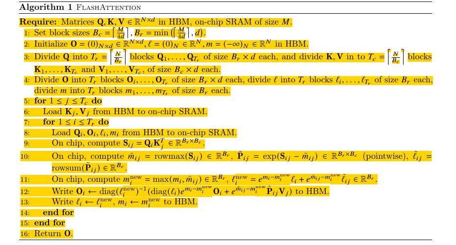
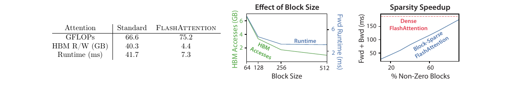
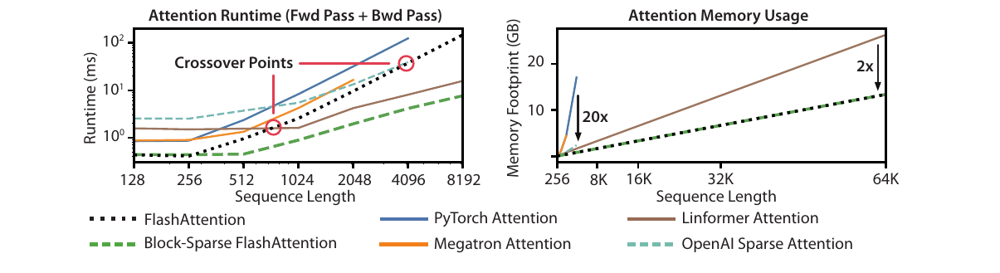

# FlashAttention：以分块和在线 Softmax 减少精确注意力的显存访问

本文精读 Dao 等人的 *FlashAttention: Fast and Memory-Efficient Exact Attention with IO-Awareness*（arXiv v2，2022），重点解释注意力矩阵为何造成显存读写、分块后如何保持 Softmax 的完整归一化、反向传播为何重算，以及论文的复杂度与实验分别支持什么结论。读者只需了解矩阵乘法和 Transformer 中 token 的基本含义。文中图表与数字均来自[论文原文](https://arxiv.org/pdf/2205.14135v2)，没有重新运行 GPU 基准测试。

## 主要工作

FlashAttention 是一种 **IO 感知的精确注意力算法**：它仍计算给定掩码及缩放规则下的 $\operatorname{softmax}(QK^{\mathsf T})V$，但把查询、键和值分块，在 GPU 片上存储中生成并消费局部注意力分数，不把完整的 $N\times N$ 分数矩阵与概率矩阵写入高带宽显存（HBM）。片上存储容量小，无法容纳所有键时，算法以每行的最大值、指数和及部分输出为状态，逐块完成同一个 Softmax。训练时再根据输入和这些状态重算局部概率，避免为反向传播保存二次方大小的矩阵。[论文，§1、§3.1、算法 1、附录 B](https://arxiv.org/pdf/2205.14135v2#page=2)

论文给出前向算法的片外访问量 $\Theta (N^{2}d^{2}/M)$：$N$ 是序列长度，$d$ 是单头维度，$M$ 是以元素数计的片上存储容量；作为对照，文中的标准实现需要 $\Theta (Nd+N^{2})$ 次访问。这改变的是**数据搬运量与中间结果占用**，稠密精确注意力的主要矩阵乘法仍要处理 $N^{2}$ 对查询和键。论文在特定 A100、模型及基线条件下报告 BERT-large 端到端训练时间由 20.0 分钟降到 17.4 分钟，GPT-2 medium 由 Hugging Face 基线的 21.0 天降到 6.9 天。两个结果属于不同实验，不是一个通用加速系数。[论文，§3.1–3.2、表 1–2](https://arxiv.org/pdf/2205.14135v2#page=6)

## 研究背景

自注意力把长度为 $N$ 的 token 表示 $X$ 分别投影为查询 $Q=XW_{Q}$、键 $K=XW_{K}$ 和值 $V=XW_{V}$。对一个注意力头，三者可记为 $N\times d$ 矩阵；它们的第 $j$ 行都对应第 $j$ 个输入位置，但承担不同的计算角色。第 $i$ 个查询 $q_{i}$ 与每个键 $k_{j}$ 做点积，得到位置 $i$ 对位置 $j$ 的分数；沿 $j$ 归一化之后，使用同一位置的值 $v_{j}$ 作加权求和。因此，**键和值按位置配对**，而输出按查询位置排列。点积是可学习投影产生的打分方式，其有用的匹配关系由训练决定。[论文，§2.2](https://arxiv.org/pdf/2205.14135v2#page=4)

令 $s_{ij} = \tau  q_{i}\cdot k_{j}$，其中 $\tau$ 是注意力缩放因子；可见位置的 $s_{ij}$ 保留，掩码排除的位置取 $-\infty$。于是第 $i$ 行的输出为：

$$
\begin{aligned}
p_{ij} &= \frac{\exp(s_{ij})}{\sum_k \exp(s_{ik})}, \\
o_i &= \sum_j p_{ij}v_j
\end{aligned} \tag{1}
$$

矩阵形式为 $S=\tau QK^{\mathsf T}$、$P=\operatorname{softmax}(S)$、$O=PV$，Softmax 按行计算。论文算法 1 为突出分块，把 $\tau$ 暂时省入分数定义；附录 B 的完整反向算法显式写出缩放、掩码和 Dropout。$P$ 的列 $j$ 与 $V$ 的行 $j$ 对齐，保证某个键得到的权重用于同位置的值。[论文，§2.2、算法 1、附录 B.4](https://arxiv.org/pdf/2205.14135v2#page=4)

GPU 的高带宽显存（HBM）容量大，片上静态随机存取存储器（SRAM，包括共享内存等用于局部计算的片上资源）容量小、带宽高。论文以 A100 为例：HBM 容量为 40–80 GB，带宽约 1.5–2.0 TB/s；每个流多处理器有 192 KB 片上 SRAM，片上带宽估计约 19 TB/s。这里的 **IO** 指 HBM 与片上存储之间的数据读写。判断运算是否受显存带宽限制，还要看**算术强度**：每读写一个字节所完成的运算量。如果搬运数据期间不足以让计算单元持续工作，运行时间就主要由数据搬运决定。[论文，§2.1、图 1](https://arxiv.org/pdf/2205.14135v2#page=3)

标准注意力中的两次矩阵乘法可以具有较高的算术强度；夹在两次乘法之间的 Softmax 则要读取 $N\times N$ 的分数矩阵 $S$，对每行求指数、归约并归一化，再写出同样大小的概率矩阵 $P$。这类逐元素和归约操作对每次数据读写所做的计算较少，因此更容易受 HBM 带宽限制。论文以 GPT-2 的 $N=1024$、$d=64$ 为例：$S$ 或 $P$ 各有 1,048,576 个元素，而单个 $Q$ 矩阵有 65,536 个元素。标准实现需要让这两张较大的中间矩阵在各阶段进出 HBM。因此，论文将注意力中的**部分或多数操作**归为内存受限；两次矩阵乘法仍可能受算力限制。论文图 2 中计算量增加、HBM 读写减少而运行时间下降的对照，也支持这一分析。[论文，§2.1–2.2](https://arxiv.org/pdf/2205.14135v2#page=4)、[图 2](https://arxiv.org/pdf/2205.14135v2#page=6)

## 问题定义

论文的标准实现先算 $S=QK^{\mathsf T}$ 并把 $S$ 写入 HBM，接着读 $S$ 求 $P=\operatorname{softmax}(S)$ 并写回 $P$，最后再读 $P$ 与 $V$ 求 $O=PV$。$S$、$P$ 都有 $N^{2}$ 个元素；训练反向传播还要使用中间概率。因而这个实现除输入和输出外，需要随序列长度平方增长的中间存储和显存访问。多头和批量处理会把这些成本乘上相应的头数与批量数。[论文，§2.2、算法 0](https://arxiv.org/pdf/2205.14135v2#page=4)

FlashAttention 要同时满足两项约束：前向不能预先看到一整行 $S$，却要得到对整行归一化后的精确输出；反向不能保存整张 $P$，却要能计算 $Q,\;K,\;V$ 的梯度。**精确**在此指算法不因跳过注意力位置而改变所定义的稠密注意力运算；有限精度计算、归约次序与具体内核仍可能造成数值差异。论文另设的块稀疏扩展会跳过指定块，计算的是由稀疏掩码定义的注意力，不能与稠密精确版本的语义混同。[论文，§3.1、§3.3、附录 B](https://arxiv.org/pdf/2205.14135v2#page=4)

## 方法原理

### FlashAttention 算法

| 符号 | 定义与尺寸 |
| --- | --- |
| $N$ | 序列长度，即查询、键和值各有多少个 token 位置。 |
| $d$ | 一个注意力头的向量维度；每个查询、键和值向量都有 $d$ 个元素。 |
| $M$ | 可用于分块计算的片上 SRAM 容量，以**标量元素个数**计；它是容量参数，不是矩阵。 |
| $Q,K,V$ | HBM 中的三个输入矩阵，均为 $N\times d$；第 $t$ 行分别是位置 $t$ 的查询 $q_t$、键 $k_t$ 和值 $v_t$。 |
| $O$ | HBM 中的 $N\times d$ 输出矩阵；初始化为零，循环中保存各查询行的部分输出，结束时是完整注意力输出。 |
| $m,\ell$ | HBM 中两个长度均为 $N$ 的行状态向量；$m$ 保存每行已处理分数的最大值，$\ell$ 保存相对于该最大值的指数和；初始值分别为 $-\infty$ 和 $0$。 |
| $B_r,B_c$ | 一个查询块和一个键/值块各包含的行数；前者每行对应一个独立查询，后者每行对应一对位置相同的键和值。 |
| $T_r,T_c$ | 查询块数与键/值块数；$i\in\{1,\ldots,T_r\}$ 是查询块编号，$j\in\{1,\ldots,T_c\}$ 是键/值块编号。 |
| $Q_i,\;O_i$ | 第 $i$ 个查询块及其当前部分输出，尺寸均为 $B_r\times d$。 |
| $K_j,\;V_j$ | 第 $j$ 个键块和值块，尺寸均为 $B_c\times d$；同一局部行指向同一 token 位置。 |
| $m_i,\;\ell_i$ | 第 $i$ 个查询块中各行**已处理键**的分数最大值与指数和，均为长度 $B_r$ 的向量。 |
| $S_{ij},\;\widetilde P_{ij}$ | 当前查询块与键块生成的分数矩阵，以及相对于当前块最大值计算的未归一化指数矩阵，尺寸均为 $B_r\times B_c$。 |
| $\widetilde m_{ij},\;\widetilde\ell_{ij}$ | 当前分数块每行的最大值及指数和，均为长度 $B_r$ 的向量；波浪号表示它们只针对当前键块。 |

*原文算法 1：黄色标记区域依次给出块大小与初始化、第 5–8 行的双层循环、第 9–10 行的局部分数和统计量、第 11–13 行的状态合并与写回。截取自[Dao 等，2022，原文算法 1](https://arxiv.org/pdf/2205.14135v2#page=5)。*

以下按原文算法 1 的执行顺序展开。

1. **确定块大小并划分输入（第 1、3–4 行）。** 算法取 $B_c=\lceil M/(4d)\rceil$、$B_r=\min(\lceil M/(4d)\rceil,d)$，从而得到 $T_c=\lceil N/B_c\rceil$ 个键/值块和 $T_r=\lceil N/B_r\rceil$ 个查询块。$Q,O,m,\ell$ 都按查询行划成相同的 $T_r$ 块，$K,V$ 按键的位置划成相同的 $T_c$ 块；不足一个整块的尾部仅处理有效位置。分母中的 $4$ 是论文在算法 1 中自行选取的常数，原文没有给出它的特殊推导，也没有证明它是唯一或最优取值。[论文，算法 1 第 1、3–4 行](https://arxiv.org/pdf/2205.14135v2#page=5)

2. **初始化行状态（第 2 行）。** 在 HBM 中把 $O$ 初始化为零矩阵，把每行的 $\ell$ 初始化为 $0$、$m$ 初始化为 $-\infty$。这表示尚未见到任何键：当前没有指数贡献，也没有可用的最大分数。初始化的 $O=0$ 与 $\ell=0$ 使第一块的旧输出贡献为零。[论文，算法 1 第 2 行](https://arxiv.org/pdf/2205.14135v2#page=5)

3. **装入一个键/值块（第 5–6 行）。** 外循环按 $j=1,\ldots,T_c$ 遍历，从 HBM 将 $K_j,V_j$ 装入片上 SRAM。整个内循环处理所有查询块期间复用这对键和值。[论文，算法 1 第 5–6 行](https://arxiv.org/pdf/2205.14135v2#page=5)

4. **装入一个查询块及其旧状态（第 7–8 行）。** 对当前 $j$，内循环按 $i=1,\ldots,T_r$ 遍历；每次读入 $Q_i,O_i,m_i,\ell_i$。$O_i,m_i,\ell_i$ 包含此前 $j-1$ 个键/值块留下的状态，因此后续更新必须以它们为起点。[论文，算法 1 第 7–8 行](https://arxiv.org/pdf/2205.14135v2#page=5)

5. **计算当前分数块（第 9 行）。** 片上矩阵乘法生成 $S_{ij}=Q_iK_j^{\mathsf T}\in\mathbb{R}^{B_r\times B_c}$。其中第 $a$ 行、第 $b$ 列是查询块中第 $a$ 个查询与键块中第 $b$ 个键的点积；$a$ 和 $b$ 分别是块内查询、键的行号。该分数块随后在片上消费，不写成 HBM 中的完整 $N\times N$ 矩阵。[论文，算法 1 第 9 行](https://arxiv.org/pdf/2205.14135v2#page=5)

6. **计算当前块的局部 Softmax 统计量（第 10 行）。** 令 $\operatorname{rowmax}$ 表示按行取最大值，$\operatorname{rowsum}$ 表示按行求和。先算 $\widetilde m_{ij}=\operatorname{rowmax}(S_{ij})$。原文的 $\widetilde P_{ij}=\exp(S_{ij}-\widetilde m_{ij})$ 是简写：对块内第 $a$ 行、第 $b$ 列，实际计算的是 $\widetilde P_{ij}[a,b]=\exp(S_{ij}[a,b]-\widetilde m_{ij}[a])$。若 $S_{ij}$ 的两行是 $[1,3]$ 和 $[4,0]$，则 $\widetilde m_{ij}=[3,4]$；第一行的两个分数都减 $3$，第二行的两个分数都减 $4$，得到 $[-2,0]$ 和 $[0,-4]$。这样每个指数的自变量都不大于零。最后求 $\widetilde\ell_{ij}=\operatorname{rowsum}(\widetilde P_{ij})$；$\widetilde P_{ij}$ 尚未除以整行所有键的分母，因此不是最终注意力概率。[论文，§3.1、算法 1 第 10 行](https://arxiv.org/pdf/2205.14135v2#page=5)

7. **合并最大值与分母（第 11 行）。** 逐行令 $m_i^{\mathrm{new}}=\max(m_i,\widetilde m_{ij})$。旧状态以 $m_i$ 为指数基准，新块以 $\widetilde m_{ij}$ 为基准；定义旧、新两部分的换基系数 $\alpha=\exp(m_i-m_i^{\mathrm{new}})$ 和 $\beta=\exp(\widetilde m_{ij}-m_i^{\mathrm{new}})$。对任一旧分数 $s$，恒有 $e^{s-m_i^{\mathrm{new}}}=e^{s-m_i}\alpha$；新块同理乘 $\beta$。因此新分母是 $\ell_i^{\mathrm{new}}=\alpha\ell_i+\beta\widetilde\ell_{ij}$，即两部分先换到同一个最大值基准，再把指数和相加。[论文，§3.1、算法 1 第 11 行](https://arxiv.org/pdf/2205.14135v2#page=5)

8. **合并加权和并归一化输出（第 12 行）。** 对一行，定义旧的未归一化加权和 $u_{\mathrm{old}}=\ell_{\mathrm{old}}o_{\mathrm{old}}$；当前块的未归一化加权和则是该行的 $\widetilde P_{ij}V_j$。它们也必须分别乘 $\alpha$ 和 $\beta$，得到 $u_{\mathrm{new}}=\alpha u_{\mathrm{old}}+\beta\widetilde P_{ij}V_j$，最后以新分母求 $o_{\mathrm{new}}=u_{\mathrm{new}}/\ell_{\mathrm{new}}$。新块已经形成未归一化加权和，不能再额外乘一次 $\widetilde\ell_{ij}$。[论文，§3.1、算法 1 第 12 行](https://arxiv.org/pdf/2205.14135v2#page=5)

9. **写回并继续循环（第 12–16 行）。** 将新 $O_i,\ell_i,m_i$ 写回 HBM，继续处理下一个查询块；当前 $K_j,V_j$ 与全部查询块配对后，外循环才装入下一对键/值块。处理完 $T_c$ 个键/值块后，每行状态覆盖全部 $N$ 个键，返回的 $O$ 就是完整的 $\operatorname{softmax}(QK^{\mathsf T})V$。[论文，算法 1 第 12–16 行](https://arxiv.org/pdf/2205.14135v2#page=5)

### 反向重算与存储代价

训练反向传播面临一个问题：前向为了节省显存，没有把整张注意力概率矩阵 $P=\operatorname{softmax}(QK^{\mathsf T})$ 存入 HBM；反向却要从输出梯度 $dO$（损失函数对 $O$ 的导数）计算输入梯度 $dQ,dK,dV$。以下梯度关系以不含 Dropout 的注意力为例。因为 $O=PV$，值的梯度为 $dV=P^{\mathsf T}dO$，需要各位置的概率权重 $P$；计算 $dQ,dK$ 时，梯度也要经过 Softmax 和分数矩阵 $S=QK^{\mathsf T}$。如果前向为此保留 $N\times N$ 的 $P$，前向省掉的二次方中间存储就会重新出现。[论文，§3.1、附录 B.4](https://arxiv.org/pdf/2205.14135v2#page=20)

FlashAttention 的办法是在反向传播**需要某一块概率时才重算这一块**。前向已经留下输入 $Q,K,V$、输出 $O$，以及每个查询行处理完全部键后的最大值 $m$ 和指数和 $\ell$。反向取出一对查询块与键/值块，先在片上重算 $S_{ij}=Q_iK_j^{\mathsf T}$，再对块内第 $a$ 行、第 $b$ 列恢复概率：

$$
P_{ij}[a,b]
=\frac{\exp\!\left(S_{ij}[a,b]-m_i[a]\right)}{\ell_i[a]}.
$$

这里必须使用前向最终保存的 $m_i[a],\ell_i[a]$：它们覆盖**整行所有键**，所以恢复出的 $P_{ij}[a,b]$ 是完整 Softmax 在该位置的概率，而不是只在当前键块内部归一化的权重。[论文，§3.1、附录 B.4、算法 4 第 10–13 行](https://arxiv.org/pdf/2205.14135v2#page=21)

得到当前 $P_{ij}$ 后，反向计算先结合 $dO_i,V_j$ 求当前块对 $dV_j$ 和概率梯度的贡献，再沿 Softmax 和 $S_{ij}=Q_iK_j^{\mathsf T}$ 求 $dQ_i,dK_j$；转到下一对块前即可释放这块概率。

Softmax 反向还需汇总同一查询行的概率梯度。对查询行 $r$ 和键位置 $t$，记 $dP_{rt}$ 为损失函数对概率 $p_{rt}$ 的导数。由 $o_r=\sum_t p_{rt}v_t$ 可得 $dP_{rt}=dO_r\cdot v_t$，因而所需的合计项满足 $\sum_t p_{rt}dP_{rt}=dO_r\cdot o_r$。右侧只用前向输出 $o_r$ 和输出梯度 $dO_r$，无需先拼出整行 $P$。

这种做法增加了重算分数和指数的计算，却省掉保存、再从 HBM 读取整张 $P$ 的开销；论文图 2 的正反向计时展示了其报告的实际效果。[论文，附录 B.4、算法 4 第 16–24 行、图 2](https://arxiv.org/pdf/2205.14135v2#page=21)

### IO 复杂度与适用条件

下面分别统计普通实现和 FlashAttention 的**单个注意力头前向计算**。每从 HBM 读取或向 HBM 写回一个标量元素，计一次访问；$Q,K,V,O$ 各有 $Nd$ 个元素，完整分数矩阵 $S$ 和概率矩阵 $P$ 各有 $N^2$ 个元素。先按论文算法中的步骤计数，再讨论块大小 $M$ 对结果的影响。[论文，§2.2、§3.2、附录 C](https://arxiv.org/pdf/2205.14135v2#page=23)

**普通实现。** 论文算法 0 分三次处理，前一阶段的完整中间矩阵写回 HBM，后一阶段再读入。为给出可核对的计数，下表先乐观地假设每个阶段列出的输入元素只从 HBM 读取一次：

| 阶段 | 从 HBM 读取 | 向 HBM 写回 | 该阶段访问次数 |
| --- | --- | --- | --- |
| $S=QK^{\mathsf T}$ | $Q,K$：$2Nd$ | $S$：$N^2$ | $2Nd+N^2$ |
| $P=\operatorname{softmax}(S)$ | $S$：$N^2$ | $P$：$N^2$ | $2N^2$ |
| $O=PV$ | $P$：$N^2$，$V$：$Nd$ | $O$：$Nd$ | $N^2+2Nd$ |

三行相加得 $A_{\mathrm{standard}}=4Nd+4N^2=\Theta(Nd+N^2)$。其中 $S$ 和 $P$ 的写回、再次读入已经贡献 $4N^2$ 次；序列长度增大时，这正是标准实现的二次方 HBM 访问来源。[论文，算法 0、§3.2、附录 C](https://arxiv.org/pdf/2205.14135v2#page=23)

**FlashAttention。** 论文算法 1 在片上生成并消费当前的 $S_{ij}$ 与 $\widetilde P_{ij}$，不把完整的 $S,P$ 写入 HBM。其访问量来自以下操作：

1. 初始化 $O,m,\ell$，分别写入 $Nd,N,N$ 个元素，合计 $Nd+2N$ 次。
2. 外循环遍历全部键/值块；每个 $K_j,V_j$ 只装入一次，合计读取 $2Nd$ 个元素。
3. 每处理一个键/值块，内循环都遍历所有查询块。$Q$ 合计读 $Nd$ 个元素，部分输出 $O$ 合计读、写各 $Nd$ 个元素；$m,\ell$ 各读、写 $N$ 个元素。因此每轮外循环计 $3Nd+4N$ 次。
4. 键块每块有 $B_c=\lceil M/(4d)\rceil$ 行，外循环共有 $T_c=\lceil N/B_c\rceil$ 轮。把前三项相加，按上述简化计数为

$$
A_{\mathrm{Flash}}
=(Nd+2N)+2Nd+T_c(3Nd+4N)
=3Nd+2N+T_c(3Nd+4N). \tag{2}
$$

在论文分析的 $d\le M\le Nd$ 范围内，忽略取整与固定常数，$B_c=\Theta(M/d)$、$T_c=\Theta(Nd/M)$；又因 $d\ge1$，每轮的 $3Nd+4N=\Theta(Nd)$。代入式 (2) 得 $A_{\mathrm{Flash}}=\Theta(Nd+N^2d^2/M)=\Theta(N^2d^2/M)$，最后一步利用了 $M\le Nd$，使 $N^2d^2/M\ge Nd$。[论文，算法 1、§3.2、附录 C](https://arxiv.org/pdf/2205.14135v2#page=24)

**数值比较。** 取一个用于计算的单头配置 $N=1024,d=64,M=65536$ 个标量元素，则 $Nd=65536$、$N^2=1048576$、$B_c=256$、$T_c=4$。上面两套**同一读写假设**给出：

| 实现 | 代入后的元素访问次数 |
| --- | ---: |
| 普通实现 | $4(65536)+4(1048576)=4456448$ |
| FlashAttention | $3(65536)+2(1024)+4[3(65536)+4(1024)]=1001472$ |

在这个简化计数下，普通实现的访问次数约为 FlashAttention 的 **4.45 倍**。原因可从两种公式直接看出：普通实现反复搬运 $N^2$ 个分数和概率，FlashAttention 改为反复读写 $Nd$ 个查询、部分输出及长度为 $N$ 的行状态。在 $N\gg d$ 时，两种渐近公式的主项分别是 $N^2$ 和 $N^2d^2/M$，主项之比随 $M/d^2$ 增大。本例 $M/d^2=16$，而完整计数得到 4.45 倍，因为算法的 $B_c$ 还含有分母 $4$，每轮也有多次读写；渐近主项之比不能当作精确倍数。论文图 2 报告的是另一实验条件下的 HBM 字节数，也不能与此处的教学计数混用。[论文，§3.2、图 2](https://arxiv.org/pdf/2205.14135v2#page=6)

### FlashAttention 算法的计算示例

下面是一个简单的示例。本文取 $N=4,d=1,M=8$ 个元素，令一个注意力头的完整输入为

$$
Q=\begin{bmatrix}1\\0\\0\\0\end{bmatrix},\qquad
K=\begin{bmatrix}1\\2\\3\\0\end{bmatrix},\qquad
V=\begin{bmatrix}10\\20\\30\\40\end{bmatrix}.
$$

**第 1 步：分块与初始化。** 按算法 1，$B_c=\lceil8/(4\cdot1)\rceil=2$、$B_r=\min(2,1)=1$，所以 $T_c=2$、$T_r=4$。四个查询块各含一行：$Q_1=[1]$，$Q_2=Q_3=Q_4=[0]$。两个键/值块是 $K_1=[1,2]^{\mathsf T},V_1=[10,20]^{\mathsf T}$ 和 $K_2=[3,0]^{\mathsf T},V_2=[30,40]^{\mathsf T}$。在 HBM 中将 $O=[0,0,0,0]^{\mathsf T}$、$m=[-\infty,-\infty,-\infty,-\infty]^{\mathsf T}$、$\ell=[0,0,0,0]^{\mathsf T}$。因为 $d=1$，下表每行的 $O_i$ 都是一个标量。

**第 2 步：外循环 $j=1$。** 将 $K_1,V_1$ 从 HBM 装入片上；随后内循环按 $i=1,2,3,4$ 依次读入 $Q_i,O_i,m_i,\ell_i$，计算局部分数和统计量，并写回更新后的行状态。$i=1$ 时，$S_{11}=[1,2]$，局部最大值为 $2$，所以 $\widetilde P_{11}=[e^{-1},1]$，$\widetilde\ell_{11}=1+e^{-1}\approx1.3679$。旧状态的 $\ell_1=0$，输出只来自当前块：$O_1=(10e^{-1}+20)/(1+e^{-1})\approx17.3106$。其余查询均为零，对当前两个键的分数都是 $[0,0]$，所以各得到 $(10+20)/2=15$。四次内循环的结果逐行列出：

| $i$ | $S_{i1}$ | $\widetilde m_{i1}$ | $\widetilde P_{i1}$ | $\widetilde\ell_{i1}$ | 写回的 $(m_i,\ell_i,O_i)$ |
| --- | --- | --- | --- | --- | --- |
| 1 | $[1,2]$ | $2$ | $[e^{-1},1]$ | $1+e^{-1}\approx1.3679$ | $(2,1.3679,17.3106)$ |
| 2 | $[0,0]$ | $0$ | $[1,1]$ | $2$ | $(0,2,15)$ |
| 3 | $[0,0]$ | $0$ | $[1,1]$ | $2$ | $(0,2,15)$ |
| 4 | $[0,0]$ | $0$ | $[1,1]$ | $2$ | $(0,2,15)$ |

完成这轮外循环后，HBM 中保存 $m=[2,0,0,0]^{\mathsf T}$、$\ell\approx[1.3679,2,2,2]^{\mathsf T}$ 和 $O\approx[17.3106,15,15,15]^{\mathsf T}$。此时每行输出只针对前两个键归一化。

**第 3 步：外循环 $j=2$。** 装入 $K_2,V_2$，再按 $i=1,2,3,4$ 读回刚才写入的 $Q_i,O_i,m_i,\ell_i$ 并更新。对第一个查询，$S_{12}=[3,0]$、$\widetilde m_{12}=3$、$\widetilde P_{12}=[1,e^{-3}]$、$\widetilde\ell_{12}=1+e^{-3}\approx1.0498$。新最大值为 $3$，因此旧块的缩放系数为 $\alpha=e^{2-3}=e^{-1}$，新块的系数为 $\beta=1$。新分母为 $\ell_1=e^{-1}(1+e^{-1})+(1+e^{-3})\approx1.5530$；新分子为 $e^{-1}(10e^{-1}+20)+(30+40e^{-3})\approx40.7024$，故 $O_1\approx26.2089$。对 $i=2,3,4$，旧、新两块的最大值均为 $0$，所以 $\alpha=\beta=1$；旧分子是 $2\cdot15=30$，新分子贡献为 $30+40=70$，总分母为 $2+2=4$，各得到 $O_i=(30+70)/4=25$。

| $i$ | $S_{i2}$ | $\widetilde m_{i2}$ | $\widetilde P_{i2}$ | $\widetilde\ell_{i2}$ | 写回的 $(m_i,\ell_i,O_i)$ |
| --- | --- | --- | --- | --- | --- |
| 1 | $[3,0]$ | $3$ | $[1,e^{-3}]$ | $1+e^{-3}\approx1.0498$ | $(3,1.5530,26.2089)$ |
| 2 | $[0,0]$ | $0$ | $[1,1]$ | $2$ | $(0,4,25)$ |
| 3 | $[0,0]$ | $0$ | $[1,1]$ | $2$ | $(0,4,25)$ |
| 4 | $[0,0]$ | $0$ | $[1,1]$ | $2$ | $(0,4,25)$ |

**第 4 步：结束并核对。** 两个键/值块都已处理，算法返回 HBM 中的 $O\approx[26.2089,25,25,25]^{\mathsf T}$。直接计算完整矩阵时，第一个查询的四个分数为 $[1,2,3,0]$，所以

$$
O_1=\frac{10e^{-2}+20e^{-1}+30+40e^{-3}}
           {e^{-2}+e^{-1}+1+e^{-3}}
    \approx26.2089.
$$

其余查询的四个分数全为零，四个值各占 $1/4$ 权重，输出均为 $25$。这与逐块更新的四行结果一致。[论文，§3.1、算法 1](https://arxiv.org/pdf/2205.14135v2#page=5)

## 实验与证据

### 片外读写与注意力耗时

*图 2：左表比较计算量、HBM 读写量与正反向耗时；中图比较块大小对前向 HBM 访问和运行时间的影响；右图比较块稀疏比例与正反向运行时间。截取自[Dao 等，2022，原文图 2](https://arxiv.org/pdf/2205.14135v2#page=6)。*

图 2 左表的条件是 A100 上的 GPT-2 medium 注意力，序列长度 1024、头维度 64、16 个头、批量 64，计入前向与反向。标准实现与 FlashAttention 分别为 **66.6 与 75.2 GFLOPs**、**40.3 与 4.4 GB HBM 读写**、**41.7 与 7.3 ms**。同一设置下，FlashAttention 计算量增加约 13%，HBM 读写量却约为原来的九分之一，耗时约为原来的六分之一。图中间随块大小增大，HBM 访问和耗时先下降；当片上容量、计算或其他成本成为限制时，继续增大块不能无限加速。[论文，§3.2、图 2](https://arxiv.org/pdf/2205.14135v2#page=6)

*图 3：左图横轴为序列长度、纵轴为前向加反向耗时；右图横轴为序列长度、纵轴为注意力相关内存占用。截取自[Dao 等，2022，原文图 3](https://arxiv.org/pdf/2205.14135v2#page=9)。*

图 3 左侧的黑色点线是稠密 FlashAttention，蓝色和橙色分别是 PyTorch 与 Megatron 注意力，绿色虚线是块稀疏扩展。短序列时，稠密 FlashAttention 仍比图中一些近似或稀疏实现更快：它省掉完整注意力矩阵的 HBM 读写，同时保留分块矩阵乘法；近似方法虽然减少配对数量，实际运行还要支付各自实现的开销。随着序列变长，稠密 FlashAttention 仍须计算随 $N^2$ 增长的查询–键配对，部分近似方法较少计算的优势逐渐体现，曲线约在 512–1024 token 处交叉。交叉点表明减少 IO 能改变实际性能的比较结果，却不改变稠密注意力的二次计算量。[论文，§4.3、图 3](https://arxiv.org/pdf/2205.14135v2#page=9)

图 3 右侧的黑色点线随序列长度近似线性增长，因为 FlashAttention 不保留完整的 $N\times N$ 分数和概率矩阵。需要保存这些矩阵的精确注意力基线，其内存需求随 $N^2$ 增长，在这次 40 GB A100 测试中更早耗尽显存。两种增长方式的差别使 FlashAttention 能在同一显存容量下处理更长的序列；论文表 4–6 对长上下文模型的实验正是在这种可运行范围扩大的基础上进行的。[论文，§4.2–4.3、图 3、表 4–6](https://arxiv.org/pdf/2205.14135v2#page=9)

### 训练时间、长上下文与模型指标

| 实验与指标 | 基线 | FlashAttention 结果 | 解释范围 |
| --- | --- | --- | --- |
| BERT-large 达到 72.0% 掩码语言模型目标准确率；8×A100，10 次平均训练时间 | NVIDIA MLPerf 1.1：20.0 ± 1.5 分钟 | 17.4 ± 1.4 分钟 | 同一初始化与目标下，时间缩短约 13%；论文以训练速度快约 15% 表述。 |
| GPT-2 medium，OpenWebText 困惑度与训练时间；8×A100 | Hugging Face：14.2、21.0 天；Megatron-LM：14.3、11.5 天 | 14.3、6.9 天 | 注意力实现加速了端到端训练；此处没有因更换注意力实现而改善困惑度。 |
| GPT-2 small，OpenWebText 上下文长度与困惑度；8×A100 | Megatron-LM，1K：18.2、4.7 天 | FlashAttention，4K：17.5、3.6 天 | 上下文从 1K 增至 4K 与困惑度下降同时发生，不能把 0.7 的改善归于固定计算规则下的内核替换。 |

表中数字来自论文[表 1](https://arxiv.org/pdf/2205.14135v2#page=7)及[表 2、表 4](https://arxiv.org/pdf/2205.14135v2#page=8)。**困惑度**（perplexity，PPL）衡量模型对一段固定验证文本中真实后续 token 的预测。设验证文本有 $L$ 个预测位置；在位置 $t$，把真实前缀 $w_{<t}$ 输入模型，得到未归一化分数（logits）$z_t$，再直接计算概率分布 $p_t=\operatorname{softmax}(z_t)$。若真实后续 token 是 $w_t$，困惑度为

$$
\mathrm{PPL}=\exp\!\left(-\frac{1}{L}\sum_t\log p_t(w_t)\right) \tag{3}
$$

论文的长文档分类进一步显示上下文长度与任务指标的关系：MIMIC-III 的 micro-F1 从长度 512 的 52.8 升到长度 16K 的 57.1；ECtHR 从长度 512 的 72.2 升到长度 8K 的 80.7。Path-X（16K）中稠密 FlashAttention 达到 **61.4% 准确率**；Path-256（64K）中块稀疏版本达到 **63.1%**。这些是模型、数据与训练设置下的任务结果，既包含更长上下文带来的信息，也包含具体训练方案，不能等同于算子单独提升了模型质量。[论文，§4.2、表 5–6](https://arxiv.org/pdf/2205.14135v2#page=9)

## 局限性

稠密 FlashAttention 减少片外读写与中间存储，却仍计算所有允许的查询–键配对，时间主项仍随序列长度平方增长。真正跳过配对的块稀疏 FlashAttention 需要预先给定稀疏掩码；若非零块比例为 $s$，论文给出 $\Theta (Nd+N^{2}d^{2}s/M)$ 的访问量。它的输出精确对应**该稀疏掩码定义的注意力**，与不加稀疏掩码的稠密注意力不同。[论文，§3.3](https://arxiv.org/pdf/2205.14135v2#page=6)

片上容量、线程资源与块大小限制了可直接应用的分块形状；论文图 2 已展示访问下降后运行时间受其他因素制约。作者还指出，针对新的注意力变体编写 CUDA 内核需要较多工程工作，实现在不同 GPU 架构之间可能需要调整；单 GPU 的 HBM–SRAM IO 分析也没有计入多 GPU 通信。本文依据论文中的 A100 实验判断其结果，没有复现其他设备、框架版本或推理服务负载的性能。[论文，§3.2、§5](https://arxiv.org/pdf/2205.14135v2#page=10)

## 结论

FlashAttention 把注意力的性能问题从“只减少算术运算”扩展为“同时安排片上计算与 HBM 读写”：分块只临时生成局部分数，在线 Softmax 用最大值、指数和与部分输出维持整行归一化，反向重算局部概率而不保存整张矩阵。论文的 IO 分析给出所述内存模型下的访问量，A100 实验展示计算量可略增而注意力耗时下降；端到端训练和长上下文任务结果则说明这种算子优化在特定模型与负载中能转化为实际收益。评估其他场景时，仍需分别核对序列长度、头维度、片上容量、掩码、数值精度和对照实现。

## 阅读答疑

### 为什么 K/V 块位于外循环，Q 块位于内循环？

算法 1 的外循环每次把一对 $K_j,V_j$ 装入片上，内循环让它们与所有 $Q_i$ 配对；这样同一对键和值只需从 HBM 装入一次。$K_j$ 与 $V_j$ 必须覆盖相同的 token 位置，因为由 $K_j$ 得到的注意力权重，要乘同位置的 $V_j$。**按位置配对只要求 K/V 使用同一个块编号 $j$，并不决定循环的内外顺序。**[论文图 1](https://arxiv.org/pdf/2205.14135v2#page=2)、[算法 1 第 5–12 行](https://arxiv.org/pdf/2205.14135v2#page=5)

把 K/V 放在外层是论文选用的数据复用方式：它让 $K,V$ 各读取一遍，而让 $Q,O,m,\ell$ 随 $T_c=\lceil N/B_c\rceil$ 个键/值块重复读写。作为对照，若把一个查询块及其输出状态留在片上、在内层遍历全部键/值块，那么每个查询块都要重新读取 $K,V$，共约 $T_r=\lceil N/B_r\rceil$ 轮。算法 1 取 $B_r\le B_c$，所以 $T_r\ge T_c$；前文 $N=4$ 的示例中，两个键/值块使原顺序扫描查询状态两轮，四个查询块则会使对调后的顺序扫描 K/V 四轮。前文的 IO 推导统计的正是算法 1 选用的循环顺序。[论文，§3.1–3.2、算法 1](https://arxiv.org/pdf/2205.14135v2#page=6)

### 为什么要计算 $m$、$\ell$ 和 $O$ 这些行状态？

普通实现先把完整的 $N\times N$ 分数矩阵 $S$ 写到 HBM；计算 Softmax 时可以读取某一查询对应的整行分数，一次得到行最大值、指数和及所有概率。它也可以为数值稳定性计算行最大值，区别在于无需**跨键块持续保存并更新**这个值。FlashAttention 不保存整行 $S$，当前只能看到一个分数块，后续键的分数和最终 Softmax 分母尚未知，因此必须为每行留下足以合并下一块的状态。[论文，§2.2、§3.1](https://arxiv.org/pdf/2205.14135v2#page=4)

$m$ 记录已处理分数的最大值，供新块到来时把旧、新指数换到共同基准；$\ell$ 记录这个基准下的指数和，供归一化；$O$ 保存对已处理键归一化后的部分输出。以前文计算示例为例，先处理分数 $[1,2]$ 时基准最大值是 $2$，再处理 $[3,0]$ 时最大值升到 $3$。旧块的指数和，以及从 $\ell O$ 还原出的未归一化加权和，都要乘 $e^{2-3}=e^{-1}$ 才能与新块相加。缺少 $m$ 就无法求这个换基系数，缺少 $\ell$ 就无法求共同分母，缺少部分输出就会丢失已处理值向量的加权贡献。最终的 $m,\ell$ 还使反向传播可以按块恢复完整 Softmax 的概率。[论文算法 1 第 10–13 行](https://arxiv.org/pdf/2205.14135v2#page=5)、[附录 B.4](https://arxiv.org/pdf/2205.14135v2#page=20)
