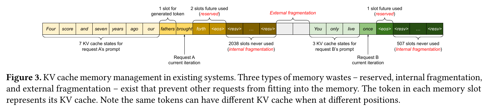
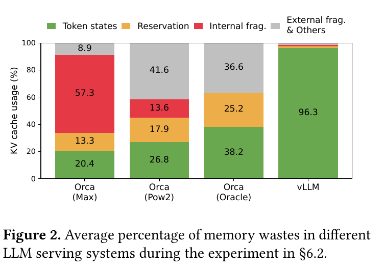
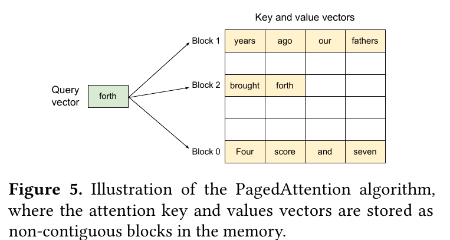
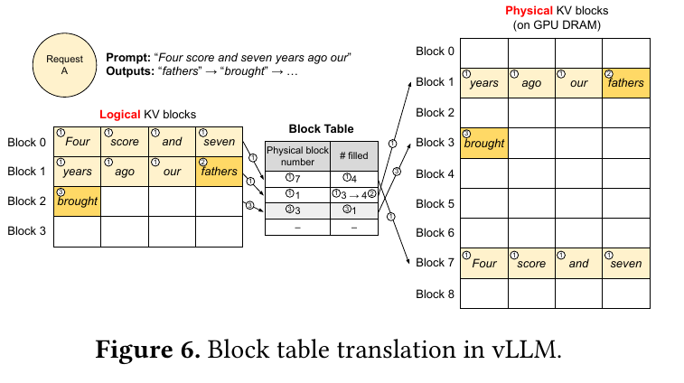
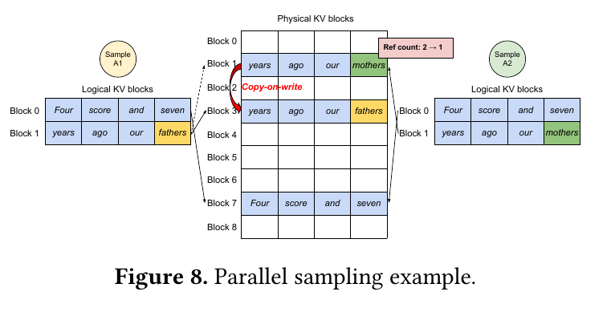
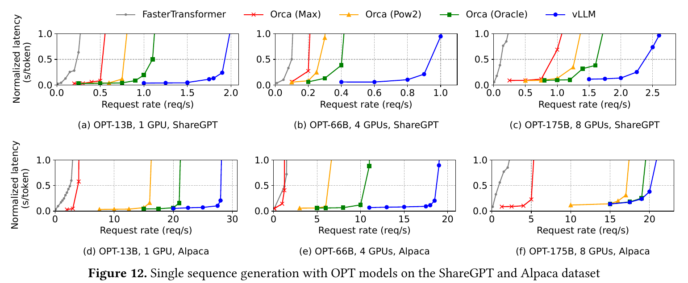
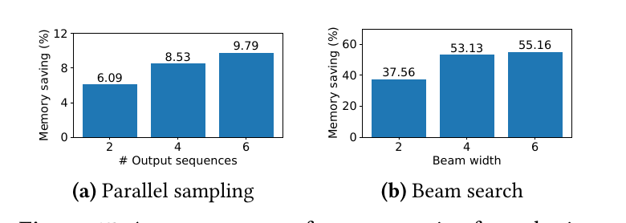
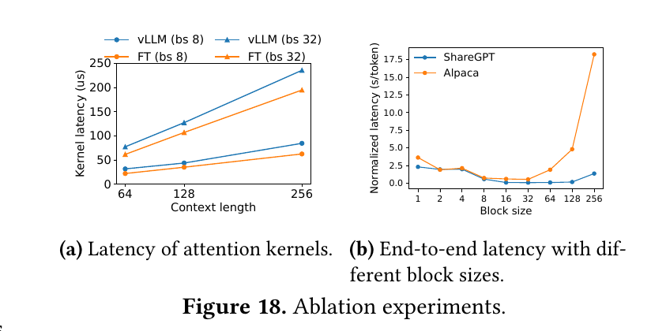

# PagedAttention 与 vLLM：大语言模型服务的 KV 缓存管理

本文精读 Kwon 等人在 SOSP 2023 发表的 *Efficient Memory Management for Large Language Model Serving with PagedAttention*。阅读重点是键值缓存（key-value cache，KV 缓存）为什么限制在线服务的批量规模，PagedAttention 如何在非连续显存上计算注意力，以及 vLLM 怎样管理、共享和回收缓存。文中的实验数字均来自[论文英文原文 v1](https://arxiv.org/pdf/2309.06180v1)；本文没有复现其性能测试。

## 主要工作

论文研究的对象是**在线大语言模型服务**：多个请求陆续到达，每条请求的提示长度、生成长度和结束时间不同，系统需要持续把可执行的请求放进 GPU 批次。作者指出，逐 token 生成时需要保留的 KV 缓存既大又会动态增长；若为每条请求预留一整段最大长度的连续空间，大量显存不能存放当前有效的 token 状态，能够同时处理的请求数便受到限制。[论文，§1、§3](https://arxiv.org/pdf/2309.06180v1#page=2)

**PagedAttention** 是允许注意力内核读取非连续 KV 块的算法；**vLLM** 是使用该算法的服务系统。vLLM 让请求的逻辑 KV 块按 token 顺序排列，而物理 KV 块按需从显存池分配，用块表记录两者的对应关系。这样，每条序列的未用空间至多落在最后一个块内；多个序列还能引用同一物理块，在写入共享块时再复制。[论文，§4.1–4.4](https://arxiv.org/pdf/2309.06180v1#page=5)

论文在其模型、硬件、工作负载和基线配置下报告：vLLM 与 FasterTransformer、Orca 相比，在相近延迟水平上通常使服务吞吐量提高 **2–4 倍**。这一数字是系统实验的概括，包含显存管理、批处理、共享和实现开销的综合效果；不同负载的幅度并不相同。[论文，摘要、§6](https://arxiv.org/pdf/2309.06180v1#page=1)

## 研究背景

自回归 Transformer 按顺序生成 token。给定提示 `x₁…xₙ`，模型先执行**预填充**（prefill），为提示中的位置计算各层注意力所需的键向量 K、值向量 V，并生成首个输出；之后的**解码**（decode）每轮处理新位置，利用前面位置的 K、V 产生下一个 token。KV 缓存就是保存在显存中、供后续解码读取的这些历史向量。对于一个注意力头，当前位置 `i` 的核心计算可写成 `oᵢ = softmax(qᵢ K₁:ᵢᵀ / √d) V₁:ᵢ`：`qᵢ` 是当前位置的查询向量，`K₁:ᵢ`、`V₁:ᵢ` 是截至当前位置的键和值，`d` 是该头的维度。因果注意力使过去位置的状态在后续生成时保持可复用。[论文，§2.1–2.2](https://arxiv.org/pdf/2309.06180v1#page=3)

在通常每轮只推进一个新位置的解码中，当前注意力查询是一行向量，历史 KV 则随序列长度增长。缓存避免为历史位置重新执行整段前向计算，但**本轮仍要读取并处理相关历史 KV**，所以注意力的历史读取会随上下文长度增加。KV 的体量还要乘上层数和头数。论文以 OPT-13B 为例：每个 token 的 KV 占 `2 × 5120 × 40 × 2 = 819,200` 字节，约 800 KiB；长度 2048 的序列需要约 1.56 GiB KV 缓存。[论文，§3](https://arxiv.org/pdf/2309.06180v1#page=4)

把多个请求放在同一轮 GPU 批次中，可以让一次模型执行处理多个当前位置，摊薄模型权重读取和调度等成本。Orca 等已有系统使用**迭代级调度**：每轮结束后移走完成的请求，再加入等待中的请求，避免等整批请求全部结束。批次仍必须容纳所有活跃序列的 KV 缓存；显存占用越高，可同时推进的请求就越少。论文的重点因此从“何时把请求放入批次”转向“怎样为批次中的动态 KV 分配显存”。[论文，§2.2–3、§9](https://arxiv.org/pdf/2309.06180v1#page=3)

## 问题定义

既有连续分配方案为一条请求预先申请足以容纳最大序列长度的 KV 空间，而实际输出长度到请求结束时才确定。图 3 将显存占用拆成三类：**未来 token 的预留槽位**目前未写入，但请求若继续生成可能使用；**内部碎片**是请求最终结束后仍空置的已分配槽位；**外部碎片**是可用空间被分割后无法满足新的连续分配要求的空隙。前两者出现在请求占用的连续空间内部，外部碎片由分配器和不同大小空间的交错分配、释放产生。预留槽位会暂时挡住其他请求，内部与外部碎片则不能存放有效 KV。[论文，图 3、§3.1](https://arxiv.org/pdf/2309.06180v1#page=4)

*图 3：既有连续分配方案中的三种未用于当前 token 状态的空间。截取自[Kwon 等，2023，原文图 3](https://arxiv.org/pdf/2309.06180v1#page=4)。*

沿图 3 从左向右看，请求 A 的最大长度是 2048，提示有 7 个 token，图示时另有少量生成位置和未来预留位置；直到请求结束都没有使用的 2038 个槽位成为内部碎片。请求 B 的最大长度是 512，图中同样保留了 507 个最终未用槽位。两条请求之间灰色空隙表示外部碎片，它无法并入任何一条已分配的连续 KV 空间。图中的数字属于这个示例，不能直接当作所有请求的平均长度或浪费比例。[论文，图 3、§3.1](https://arxiv.org/pdf/2309.06180v1#page=4)

*图 2：论文 §6.2 实验中的平均 KV 缓存占用构成；绿色是实际 token 状态，橙色是预留，红色是内部碎片，灰色含外部碎片及其他占用。截取自[Kwon 等，2023，原文图 2](https://arxiv.org/pdf/2309.06180v1#page=2)。*

图 2 给出此问题的量级：在三种 Orca 分配假设下，真正存放 token 状态的绿色部分分别是 **20.4%、26.8%、38.2%**；vLLM 一栏为 **96.3%**。`Orca (Max)` 预留模型最大长度，`Orca (Pow2)` 把输出空间向上取整到 2 的幂，`Orca (Oracle)` 假设事先知道真实输出长度，因此后者是不可在实际服务中直接取得的有利基线。灰色部分还包含“其他”占用，并非纯外部碎片。图 2 测的是该实验中 KV 缓存空间的构成比例，并非 GPU 总显存使用率。[论文，图 2、§6.1](https://arxiv.org/pdf/2309.06180v1#page=10)

问题的另一面是**共享**。一条请求若要并行采样多个答案，所有候选的提示 KV 相同；束搜索（beam search）中的候选还可能在若干生成位置共享前缀。若为每个候选单独存一份完整连续缓存，就会重复占用显存，并在候选切换时复制大量数据。论文要求同一套管理机制既能按需增长，也能随着候选分叉改变共享关系。[论文，§3、§4.4](https://arxiv.org/pdf/2309.06180v1#page=4)

## 方法原理

### PagedAttention 的分块计算

设每个 KV 块容纳 `B` 个 token。序列的第 `j` 个逻辑块包含位置 `(j−1)B+1` 到 `jB` 的 K、V；最后一块只计算和读取实际存在的位置。PagedAttention 沿逻辑块顺序访问全部有效 K、V，依次求当前位置查询对历史位置的注意力，再聚合对应 V。与连续布局的注意力相比，数学上的注意力对象仍是同一段历史 token；改变的是内核从哪些物理地址读取各块。它需要根据块表找到地址，并在各块上完成可正确合并的 softmax 归一化。[论文，§4.1、式 (4)](https://arxiv.org/pdf/2309.06180v1#page=5)

*图 5：查询 `forth` 对应的向量访问三个存放位置不连续的 KV 块。截取自[Kwon 等，2023，原文图 5](https://arxiv.org/pdf/2309.06180v1#page=5)。*

图 5 中，逻辑顺序是 `Block 0 → Block 1 → Block 2`，对应文本从 `Four score and seven` 延伸到 `brought forth`；图画出的物理摆放顺序却是 `Block 1 → Block 2 → Block 0`。箭头从当前查询指向各物理块，表示内核会分别读取它们，得到对整段历史的注意力分数与输出。块号恢复的是 **token 位置顺序**，无需根据句子语义去寻找所谓“连续内容”。论文并未声称 KV 计算只访问一个块；上下文越长，读过的有效 KV 越多。[论文，图 5、§4.1](https://arxiv.org/pdf/2309.06180v1#page=5)

### 逻辑块、物理块与按需分配

vLLM 为每条序列维护**块表**：第 `j` 个逻辑块映射到哪个物理 KV 块，以及该块已有多少个有效位置。GPU 内存池被划成等大小的物理块，逻辑上相邻的块可映射到任意空闲物理块。系统只为已经需要的 token 分配块；前面的块填满后才申请下一块。对一条尚未共享的序列，若长度为 `L`，占用块数为 `⌈L/B⌉`，末块的空槽位数为 `⌈L/B⌉B − L`，范围是 `0` 到 `B−1`。这就是论文“每条请求的浪费限于一个块内”的具体含义，并不意味着浪费严格为零。[论文，§4.2–4.3](https://arxiv.org/pdf/2309.06180v1#page=5)

*图 6：块表记录逻辑块到物理块的编号及有效槽位数，图中圈号表示连续解码时的状态变化。截取自[Kwon 等，2023，原文图 6](https://arxiv.org/pdf/2309.06180v1#page=6)。*

图 6 的块大小是 **4 个 token**，用于解释流程，而非论文实现的默认配置。最初 7 个提示 token 填满逻辑块 0，并占用逻辑块 1 的 3 个位置；块表把它们映射到物理块 7 和 1。下一轮生成的位置可以写入逻辑块 1 剩余的第 4 个槽位，有效位置计数由 3 变为 4；再下一轮需要逻辑块 2，于是从空闲池取得物理块 3 并增加映射。物理编号 `7、1、3` 不连续，但逻辑顺序始终是 `0、1、2`。[论文，图 6、§4.3](https://arxiv.org/pdf/2309.06180v1#page=6)

例如解释性构造：块大小为 4，长度为 10 的序列占用 `4 + 4 + 2` 个有效位置，末块余下 2 个槽位；若请求最终停在这里，这 2 个槽位就是内部碎片。这个算例只说明上限，不是论文实验中的请求。大小统一且内核能够按块表读取，使分配器不必找一整段连续的请求空间，从而消除论文所讨论的变长连续分配造成的外部碎片。块大小也构成权衡：块过小会增加管理和内核开销，块过大则增加末块空位。[论文，§4.2–4.3、§7.2](https://arxiv.org/pdf/2309.06180v1#page=6)

### 引用计数、写时复制与共享前缀

并行采样时，多个候选可以把提示部分的逻辑块映射到同一批物理块。每个物理块有**引用计数**，记录当前有多少逻辑块引用它。多个候选只读取共享前缀时不需要复制；某候选准备向引用计数大于 1 的末块写入新 KV 时，系统先分配新物理块并复制旧块内容，再让该候选写入新块。这是**写时复制**（copy-on-write）：只有写入会破坏共享数据时才支付复制成本。[论文，§4.4、图 8](https://arxiv.org/pdf/2309.06180v1#page=7)

*图 8：并行采样的两个候选初始共享物理块 7、1；其中一个候选写入共享末块时复制到物理块 3。截取自[Kwon 等，2023，原文图 8](https://arxiv.org/pdf/2309.06180v1#page=7)。*

沿图 8 的箭头看，`A1` 与 `A2` 的逻辑块 0 都指向物理块 7，逻辑块 1 都指向物理块 1，两个物理块的引用计数均为 2。`A1` 要在逻辑块 1 中写入不同的后续 KV，于是该块被复制到物理块 3，原物理块 1 的计数降为 1；`A2` 随后可直接写原物理块 1。逻辑块 0 始终共享。束搜索同样靠引用计数保留共同祖先块，在候选淘汰后释放计数归零的块；它还可能共享部分已生成前缀，不限于最初提示。[论文，§4.4、图 8–9](https://arxiv.org/pdf/2309.06180v1#page=7)

跨**不同请求**的共享在论文中有明确方式：服务提供者预先定义并计算公共提示前缀，把其 KV 固定在物理块中；带有该前缀的新请求将自己的前缀逻辑块映射到这些物理块，只计算个性化后缀。论文图 10 的翻译示例就是共享相同指令和少样本示例。这里复用的条件是模型实际接收的**同一起始 token 前缀**及其对应计算条件相同；仅有相同词语出现在后面、或两段话意思相近，不能保证 KV 相同，因为一个位置的隐藏状态会受其前文影响。[论文，§2.2、§4.4、图 10](https://arxiv.org/pdf/2309.06180v1#page=8)

**2023 年论文在跨请求共享一节描述的是服务提供者预先指定、预计算的共享前缀**。分析本文实验时，应以这种前缀供给方式为条件；该节没有给出对任意到达请求自动搜索已缓存前缀的实现。[论文，§4.4](https://arxiv.org/pdf/2309.06180v1#page=8)

### 迭代调度、抢占与分布式执行

生成长度事先未知，即使块按需分配，活跃请求的 KV 仍可能耗尽空闲物理块。论文中的 vLLM 按**先来先服务**（first-come-first-served，FCFS）安排请求，资源不足时优先抢占较晚到达的请求。它以一条序列的全部 KV 块为单位换出，而不是单独驱逐其中一个块，因为该序列继续生成时需要整段历史。属于同一请求的并行候选作为一组一起抢占，以保持组内共享关系。[论文，§4.5](https://arxiv.org/pdf/2309.06180v1#page=8)

被抢占的序列有两种恢复方式。**交换**把其 GPU KV 块复制到 CPU 内存，恢复时再传回；**重计算**保存已有 token 序列，恢复时把它作为新提示重新执行预填充，重建 KV。两者权衡的是 CPU–GPU 传输量与 GPU 重算量。对于多 GPU 张量并行，论文使用一个集中式调度器协调块号映射，各 GPU 工作节点保存自己负责的注意力头的 KV 分片；每轮开始时接收本轮 token 与块表，随后执行模型计算。[论文，§4.5–4.6](https://arxiv.org/pdf/2309.06180v1#page=8)

## 实验与证据

### 工作负载、基线与吞吐指标

论文使用 OPT-13B、66B、175B 和 LLaMA-13B，在 Google Cloud A2 的 NVIDIA A100 上测试；OPT-13B 对应单张 40 GB A100，66B 对应 4 张 A100，175B 对应 8 张 80 GB A100。ShareGPT 与 Alpaca 文本用于合成提示和输出长度，请求到达时间由泊松分布生成；两组数据的平均长度不同，ShareGPT 的提示和输出更长。主要图中的横轴是**请求到达率**（req/s），纵轴是**归一化延迟**，即每条请求端到端延迟除以其输出 token 数后再取平均。随着到达率升高，某条曲线延迟急剧上升，表示相应系统接近不能稳定消化请求的负载；在相近延迟水平下能维持更高到达率，才支持论文的吞吐比较。[论文，表 1、§6.1](https://arxiv.org/pdf/2309.06180v1#page=10)

*图 12：单序列采样的六组结果；上排 ShareGPT，下排 Alpaca，三列依次是 OPT-13B、66B、175B。截取自[Kwon 等，2023，原文图 12](https://arxiv.org/pdf/2309.06180v1#page=10)。*

图 12 须**逐子图**比较：每格的模型、GPU 数量与工作负载已固定，横轴量程却不同。蓝色 vLLM 曲线通常比橙色/绿色 Orca 曲线在更高请求率处才出现延迟陡升，说明相近延迟下可承担更多请求。上排 ShareGPT 中，论文报告 vLLM 相比 `Orca (Oracle)` 能维持 **1.7–2.7 倍**的请求率，相比 `Orca (Max)` 为 **2.7–8 倍**；这些范围对应上排负载，下排应按各模型的曲线另读。下排 OPT-175B 的 vLLM 与 Oracle/Pow2 差距较小：该配置有较大的可用 KV 显存，而 Alpaca 序列较短，基线也能容纳较大批次，系统更容易转为计算受限。[论文，§6.2、图 12](https://arxiv.org/pdf/2309.06180v1#page=10)

对 OPT-13B 的另一项直接证据是图 13：ShareGPT 在 2 req/s 时，vLLM 平均同时处理 30.42 条请求，`Orca (Oracle)` 为 13.62，`Orca (Max)` 为 7.00。它把“减少显存占用”与“更大执行批次”连起来。FasterTransformer 的相应结果还受调度机制影响：论文为它另配动态批处理调度器，但它没有 Orca 的迭代级调度，故两者性能差异同时包含调度差异。[论文，§6.1–6.2、图 13](https://arxiv.org/pdf/2309.06180v1#page=10)

### 共享收益与块大小代价

并行采样和束搜索为“共享减少显存”提供了单独证据。图 15 在 OPT-13B、Alpaca 负载下，用“共享后省掉的块数 / 不共享时总块数”度量节省率：并行输出 2、4、6 条时分别节省约 **6.09%、8.53%、9.79%**；束宽 2、4、6 时分别约 **37.56%、53.13%、55.16%**。束搜索能共享更长的候选前缀，所以在这组实验里节省比例更大；这些百分比衡量的是 KV 块，不是整体 GPU 显存或系统吞吐。[论文，§6.3、图 15](https://arxiv.org/pdf/2309.06180v1#page=11)

*图 15：左图横轴为输出序列数，右图横轴为束宽；纵轴均为共享带来的 KV 块节省率。截取自[Kwon 等，2023，原文图 15](https://arxiv.org/pdf/2309.06180v1#page=11)。*

论文还用预定义共享前缀的翻译负载检验跨请求复用：相对 `Orca (Oracle)`，共享 80-token 的单示例前缀时吞吐量为 **1.67 倍**，共享 341-token 的五示例前缀时为 **3.58 倍**。共享部分越长，可省去的提示计算与 KV 空间越多；具体倍数仍受负载和基线影响。聊天机器人实验**没有在不同对话轮次间长期保留 KV**，因为这会占用其他请求可用的显存；它报告的是该负载下分页管理的收益，未测试自动跨轮缓存。[论文，§6.4–6.5、图 16–17](https://arxiv.org/pdf/2309.06180v1#page=12)

*图 18：(a) 注意力内核微基准，(b) 固定请求率下不同块大小的端到端归一化延迟。截取自[Kwon 等，2023，原文图 18](https://arxiv.org/pdf/2309.06180v1#page=12)。*

图 18(a) 的横轴是上下文长度，纵轴是单个注意力内核延迟；PagedAttention 的块表访问、分支和变长处理，使论文测得的内核延迟比其 FasterTransformer 对照高 **20–26%**。图 18(b) 则显示端到端最优块大小依工作负载而异：ShareGPT 在 16–128 范围表现较好，较短的 Alpaca 序列在块很大时明显恶化。论文实现因而选 **16 token 为默认块大小**，这是 2023 年该实现与实验中的配置，不是分页算法的固定常数。图 19 进一步比较恢复方式：小块下大量小数据传输使交换效率差，重计算更有利；中等块大小时两者接近。[论文，§7.1–7.3、图 18–19](https://arxiv.org/pdf/2309.06180v1#page=12)

## 局限性

PagedAttention 在数学上仍执行历史 KV 上的注意力，节省的是缓存空间、可共享的重复存储以及由此获得的批处理机会。块表间接寻址和非连续读取有成本；若显存容量不限制批次，或者序列很短、模型计算已是主要瓶颈，省显存就未必提高吞吐。论文中 OPT-175B 加 Alpaca 的对照和图 18 的内核开销都展示了这一边界。[论文，§6.2、§7.1、§8](https://arxiv.org/pdf/2309.06180v1#page=11)

共享也有条件。并行采样和束搜索产生自然相同的前缀，论文的跨请求复用则要求服务提供者事先指定公共前缀；候选在前缀后的上下文不同，相应 KV 要分开存。复制共享末块、维护引用计数、抢占后交换或重算，都会增加额外工作。论文测得的系统级收益表明这些成本在所测负载中被显存利用率收益覆盖，并没有证明任意模型、任意提示或任意请求率下都会更快。[论文，§4.4–4.5、§6–7](https://arxiv.org/pdf/2309.06180v1#page=7)

论文 §8 将适用性归结为两个条件：工作集大小需要动态分配，且性能受到显存容量限制。`DNN` 是深度神经网络的统称，Transformer 也属于其中；论文举通常张量形状较静态的训练任务和主要受计算能力限制的非 LLM 推理作为**其他工作负载示例**，并未断言分页只能用于 Transformer，或所有非 LLM 模型都不受显存影响。在不满足上述条件的负载中，额外映射与非连续访问可能使性能下降。[论文，§8](https://arxiv.org/pdf/2309.06180v1#page=13)

## 结论

论文把大模型服务的一个关键约束具体化为 KV 缓存的分配方式：动态增长的序列若占据最大长度的连续显存，会把可容纳的并发请求数压低。PagedAttention 使注意力能按逻辑顺序访问分散的 KV 块；vLLM 在此基础上按需分配物理块、复用共享前缀、对共享末块写时复制，并在显存不足时抢占和恢复序列。其收益链条是**减少无效或重复的 KV 占用 → 容纳更大的执行批次 → 在所测负载下维持更高请求率**。块表和非连续访问的成本、共享前缀的成立条件，以及负载是否真正受显存限制，共同决定这条链条能否带来端到端收益。
