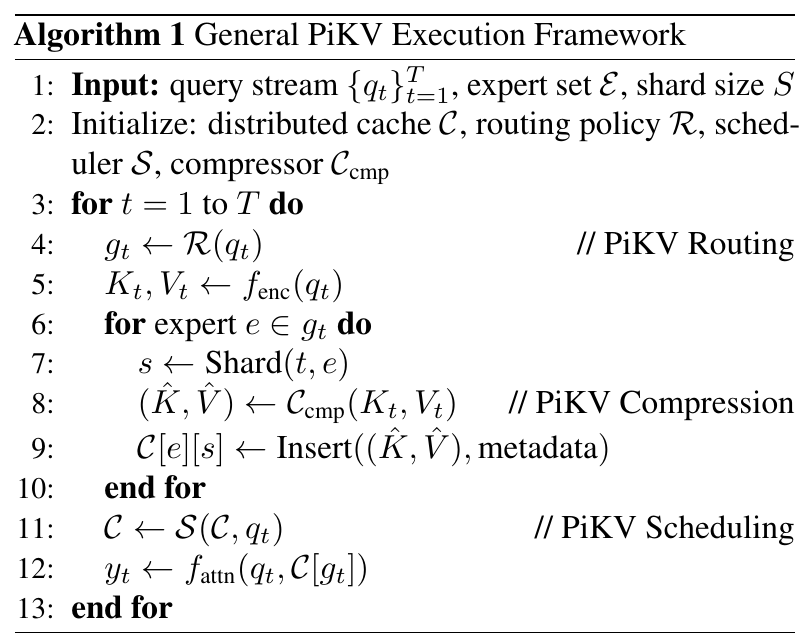
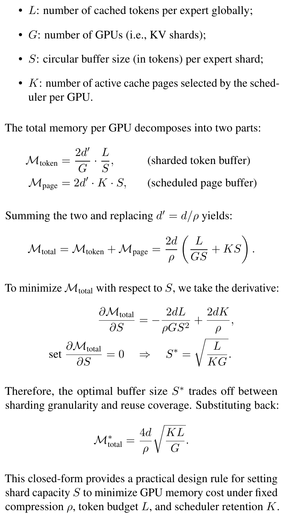
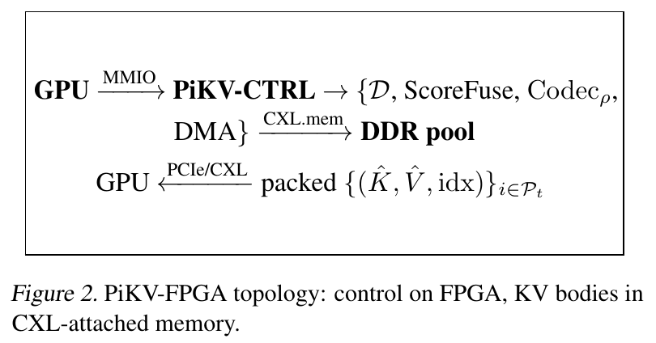

# PiKV：面向 MoE 的 KV 分片、稀疏访问与缓存调度

本文阅读 Dong Liu 等人的 *PiKV: KV Cache Management System for MoE Architecture*，以 [arXiv:2508.06526v3，2026 年 5 月 19 日](https://arxiv.org/pdf/2508.06526v3) 的英文原文为依据。arXiv 条目使用的标题是 *PiKV: KV Cache Management System for Mixture of Experts*。文章重点是四个模块怎样共同决定注意力可访问的 KV，以及论文的内存、流量和耗时分析在哪些条件下成立。原图、算法和公式来自该版本；数值小例子均为解释性构造，没有重新运行 PiKV 的模型或硬件实验。项目与发表信息核对于 2026 年 10 月 26 日。

## 论文的问题与主要工作

混合专家模型（Mixture of Experts，MoE）让每个 token 只经过少量前馈专家，可以减少专家计算。然而，生成新 token 时，注意力仍可能需要读取很长的历史键值缓存（Key–Value cache，KV cache）。**专家计算变少，并不自动意味着历史 KV 的读取量也变少。** PiKV 围绕这个差异提出一个系统框架：按专家和 token 组织分布式缓存，让路由选择影响 KV 访问范围，再结合压缩和页调度，控制存储量与搬运量。[论文，§1–3](https://arxiv.org/pdf/2508.06526v3#page=1)

作者在 §3 将框架分为四部分：

| 模块 | 它解决的问题 | 直接产生的结果 |
| --- | --- | --- |
| 专家分片存储 | KV 按什么规则组织、放在哪里 | 专家与分片索引，以及分片到设备的放置关系 |
| PiKV Routing | 当前查询访问哪些专家对应的缓存 | 包含 $k$ 个专家的集合 $g_t$ |
| PiKV Compression | 缓存使用什么表示、每条占多大空间 | 压缩后的键值 $(\hat K,\hat V)$ |
| PiKV Scheduling | 有限容量下哪些 KV 页保留或加载 | 更新后的缓存及本步可访问页 |

论文另给出可选的 FPGA 硬件映射：GPU 保留编码和注意力计算，FPGA 接管部分元数据处理、编解码与搬运控制。它是框架的扩展，阅读主线仍是前四部分如何协作。

**这份 PDF 的主要内容是架构、策略选项和解析公式。** 引言声称验证了效率，但正文从 §3 方法直接进入 §4 结论，没有给出可核对的端到端性能实验章节。因而本文把“作者提出的设计”“在假设下成立的推导”和“尚缺的实验证据”分别说明；$E/k$ 等比值不能直接写成实测加速倍数。[论文，§1、§4](https://arxiv.org/pdf/2508.06526v3#page=6)

## 研究背景：KV 访问与 MoE 计算的区别

### 历史 KV 的存储与读取

自回归生成中，一个新位置的查询向量 $q_t$ 要与历史键向量比较，再对历史值向量加权。以单层、单头为例，将截至当前位置的键和值排成矩阵 $K_{\le t}$、$V_{\le t}$，注意力可写为：

$$
y_t=\operatorname{softmax}\left(\frac{q_tK_{\le t}^{\mathsf T}}{\sqrt{d_h}}\right)V_{\le t}.
$$

这里 $d_h$ 是头维度。KV 缓存保存之前已经算出的键和值，避免每生成一个新 token 都重新计算整个前缀。**缓存省去的是历史 K/V 的重复生成；注意力仍需读取参与本步计算的历史 K/V。** 上下文越长，需要存储和读取的历史数据通常越多。

用一个普通注意力模型的容量账建立基本尺度：若批内有 $B$ 条等长序列，长度为 $L$，有 $N_\ell$ 层、$H_{\rm KV}$ 个 KV 头，每头宽度 $d_h$，每元素 $b$ 字节，则忽略分配开销和副本时，KV 数据占用为

$$
M_{\rm KV}=2B L N_\ell H_{\rm KV}d_h b.
$$

系数 2 来自 K 和 V 两份向量。这是按张量形状直接计数的背景公式，未计 PiKV 的特殊布局。它后面需要回答两类不同问题：**容量**统计某时刻存了多少字节；**流量**统计一段执行过程中读写了多少字节。同一份 KV 可以常驻不动，却在多个生成步骤中被反复读取。

### 前馈专家与注意力缓存

以 Mixtral 为例，MoE 替换的是 Transformer 的前馈模块：每层有 8 个前馈专家，每个 token 选择其中 2 个计算并加权合并。注意力有自己的投影和 KV 头。专家数与 KV 头数是不同的结构参数。[Mixtral，§2、图 1](https://arxiv.org/html/2401.04088v1#S2)

因此，**普通 MoE 并不因为有 $E$ 个前馈专家，就天然为每个历史 token 保存 $E$ 套独立 KV。** 上述容量公式没有一个必然出现的专家数乘子。PiKV 所写的按专家组织的 $C[e][s]$ 是需要解释的系统设计；它与已有模型共享注意力的连接，不能靠“MoE 本来如此”略过。

PiKV §3 的 C1 原文是：

> “Only a small set of experts and KV pages are relevant per query.”

这句话给出了论文所谓 **sparsity-aware serving，利用稀疏性的服务设计**：对当前查询，只选少数专家和 KV 页。这里的稀疏性发生在**访问集合**上，即许多候选对象本步不参与；无需假设 KV 向量内部有大量零。专家选择和历史页选择又是两个层次：前者限定专家集合，后者在容量与读取预算下控制页集合。[论文，§3](https://arxiv.org/pdf/2508.06526v3#page=3)

## 总体流程：一次查询如何经过四个模块

*原文图 1，截取自[论文第 1 页](https://arxiv.org/pdf/2508.06526v3#page=1)。图中给出 Routing Layer、Compression Engine、Distributed KV Cache、Stream Scheduler，以及多 GPU 间的 NCCL/TCP 通信关系。*

沿图从上往下看，Routing Layer 负责选择；Compression Engine 改变写入的数据表示；Distributed KV Cache 连接 GPU 1 至 GPU 4 上的缓存；右侧 Stream Scheduler 参与缓存管理。NCCL 是 GPU 集合通信库，TCP 是网络传输协议，图里的标签表达跨设备数据交换的可能路径。图中两个框都标为 Compression Engine，正文没有说明二者各自独立的职责。理解执行先后关系，应以算法 1 为主要依据。

先定义算法里会反复出现的对象。$q_t$ 是当前输入的查询向量；$C$ 是整个分布式缓存；$\mathcal R$ 是路由函数；$\mathcal C_{\rm cmp}$ 是压缩器；$\mathcal S$ 是调度器。$g_t$ 是选中的专家集合。**$C[g_t]$ 表示从缓存中选取这些专家对应的内容**；它不是“缓存乘以门控值”。$C[e][s]$ 则表示专家 $e$ 下编号为 $s$ 的分片。

*原文算法 1，截取自[论文第 3 页](https://arxiv.org/pdf/2508.06526v3#page=3)。第 4 行产生 $g_t$，第 6–9 行据此写入，第 11 行更新缓存，第 12 行以 $C[g_t]$ 为注意力输入。*

一次迭代的依赖关系如下：

1. 第 4 行计算 $g_t\leftarrow\mathcal R(q_t)$，选出专家集合。
2. 第 5 行通过 $f_{\rm enc}$ 生成当前 token 的 $K_t,V_t$。
3. 对每个 $e\in g_t$，第 7 行确定分片，第 8 行压缩，第 9 行向 $C[e][s]$ 插入压缩后的 KV 和元数据。元数据是地址、使用次数等管理信息，与 K/V 数值本体不同。
4. 第 11 行执行 $C\leftarrow\mathcal S(C,q_t)$，按调度策略更新缓存。
5. 第 12 行执行 $y_t\leftarrow f_{\rm attn}(q_t,C[g_t])$，注意力使用选中专家下、经过调度的缓存。

这段伪代码解释了三个模块的合作关系：**路由限制访问范围，压缩改变存储表示，调度控制保留和加载。** 原文把实现描述为异步流水线，但算法只展示逻辑依赖，没有给出具体重叠时间线。

还有两个必须保留的接口问题。首先，伪代码在专家循环外只计算一次 $K_t,V_t$，再对多个专家执行插入；它没有表示“每个专家各自生成一套 K/V”。插入究竟复制数据还是共享引用、读取时如何处理重复条目，都没有展开。其次，算法没有展开 Transformer 的层循环，也没有解释 $f_{\rm enc}$ 与模型原有注意力、前馈门控的调用关系。它足以说明缓存管理的意图，却还不足以直接替换一个完整 MoE 模型的前向过程。

## 专家分片与路由：让选择决定访问范围

### 专家分片的地址组织

论文 §3.1 给出的放置规则是：

$$
s(t,e)=(t\bmod N_{\rm tok})\oplus(e\bmod N_{\rm exp}).
$$

$t$ 是 token 的位置或编号，$e$ 是专家编号，$\bmod$ 取余，$\oplus$ 是按位异或；$N_{\rm tok}$、$N_{\rm exp}$ 是式中用于两个方向分桶的参数。原文说分片会分配给 GPU，但没有完整定义这两个参数如何随 GPU 数取值，以及异或结果如何对应最终 GPU 地址。[论文，§3.1](https://arxiv.org/pdf/2508.06526v3#page=3)

例如，仅为演示算式，取两个模数均为 4：$t=5,e=2$ 时，$5\bmod4=1$、$2\bmod4=2$，二进制 $01\oplus10=11$，得到分片编号 3。只有再给定“分片 3 放在哪个设备”的映射，才能确定物理位置。**同一个专家可以有多个分片；分片与专家不是一一对应的同义词。**

每个分片维护容量为 $S$ 个 token 的环形缓冲区。环形缓冲区复用固定的一组槽位，写指针到尾部后回绕，从而避免持续扩大分配。论文据此给出常数时间的插入目标。不过，槽位占满后怎样与页淘汰、并发读和数据生命周期协调，并没有在算法中写出；不能仅凭“环形”就补出完整的覆盖协议。

这个哈希按位置和专家组织数据，**不负责判断两个请求是否有相同文本前缀**。同一位置、同一专家可以算出相同分片编号，而具体缓存条目还需要请求、层、位置等身份信息才能避免混淆；论文的简化公式未展开这些索引。

### 门控的分数、Top-k 与缓存集合

论文 §3.2 将路由写为

$$
\mathcal R:\mathbb R^d\longrightarrow\{0,1\}^{E},\qquad
\lVert g_t\rVert_0=k.
$$

$E$ 是专家总数，$k$ 是本次选中的数量；$\lVert g_t\rVert_0$ 统计掩码中非零项的个数。原文也把 $g_t$ 写成专家集合，两种写法表示同一选择：集合 $\{1,3\}$ 对应掩码 $[0,1,0,1]$，这里采用从 0 开始的专家编号。

**这里有些读者可能会疑惑：门控究竟控制哪一个数值，专家不是由 $q_t$ 算出来的吗？** 对带评分的路由，先由输入算出每个专家的分数，一共 $E$ 个；再取最高的 $k$ 个，产生离散选择。$k$ 是数量，不是与分数比较的阈值。若四个专家分数为 $[0.1,0.7,0.2,0.6]$，取 $k=2$，就得到 $g_t=\{1,3\}$。最终缓存访问范围是 $C[1]$ 和 $C[3]$。这是解释性算例，论文没有给出门控网络的具体权重或训练样本。

“通过查询打分”描述了一个选择规则，但不证明它选出的缓存恰好包含本步所有重要信息。这里无需引入“真正的专家”这样的标签：所有专家都是模型中的实际模块；需要验证的是**选择后是否保持了注意力结果与任务质量**。论文没有给出专家选择的标准答案，也没有报告这种质量验证。

一个与算法直接对应的例子是：历史 token $a$ 写入专家集合 $\{0,1\}$，历史 token $b$ 写入 $\{2,3\}$，当前查询只读 $\{0,1\}$。按算法字面的写入与读取路径，$b$ 的 KV 不在本步候选集合中。这个推断依赖没有额外共享缓存、回退读取等机制；这些机制原文未交代。它说明了访问选择可能影响结果，不能据此进一步断言后续生成永远无法补偿。

### 表 1 的路由选项与缓存反馈

*原文表 1，截取自[论文第 4 页](https://arxiv.org/pdf/2508.06526v3#page=4)。Mechanism 是选择方法，Penalty Term 是分数修正，Cost 是方法自身的复杂度；三者不是一组同类评价指标。*

| 选项 | 原文机制 | 应怎样理解 |
| --- | --- | --- |
| RB | 哈希或轮询 | 用预定规则选择，不要求学习一个查询评分网络 |
| RT | TopK softmax | 根据评分选择前 $k$ 个专家 |
| RLB | TopK + load balance | 加入 $-\alpha(\mu_e-\bar\mu)$，抑制负载高于平均值的专家 |
| RP | Cache-aware，PiKVRouter | 加入 $-\lambda\log(1+\mathrm{miss}_e)$，将缓存未命中统计纳入选择 |
| RE | Entropy-penalised LB | 列出 $-\beta H(p_e)$，但熵的对象与加入位置未充分定义 |
| RA | RL-adaptive gating | 使用强化学习自适应门控；表中仅以 learned 概括学习部分 |
| RH | Hierarchical coarse→fine | 分两阶段进行粗到细筛选 |

表 1 回答的是“同一选择接口可以采用哪些实现”，不是“七个指标要全部计算”。其中 RP 最直接体现缓存管理与路由的联系。为解释其效果，假定基础分数为 $s_e$，取

$$
\tilde s_e=s_e-\lambda\log(1+\mathrm{miss}_e).
$$

这是按表中惩罚项构造的演示，不是论文完整给出的评分器。若两个专家基础分分别为 0.8 和 0.7，未命中计数分别为 9 和 0，取 $\lambda=0.1$、自然对数，则修正后约为 0.570 和 0.700，排序会反转。**缓存状态由此可能影响下一次访问选择。** 未命中并不等于数据在整个系统中不存在，也可能意味着需要从更低层存储加载；论文未给出该计数的精确层级与统计窗口。

这个反馈有收益与代价两面：降低访问不利位置的机会，可能减少加载开销；改变原始选择，也需要检查是否损害质量。仅有惩罚项，无法确定这种交换是否划算。RE 行也不能仅凭名称断言“必然提高路由熵”：若同一个全局熵被作为相同常数减到所有专家分数上，排序甚至不会改变，必须知道其准确作用位置。

成本列同样需要按原文假设阅读。RT 的 $O(E\log k)$ 可以与遍历分数、维护 Top-k 的工作对应，但 RA 的训练代价、评分网络结构等没有列出。表中量级既不是微秒数，也不是已经测得的硬件速度，不能据此给七种方法作性能排名。

## 路由收益：计算量、读取流量与重用距离

### 注意力代价中的维度与专家数

原文在 §3.2 定义 $B$ 为批大小、$L$ 为序列长度、$h$ 为头宽度，并写出：

$$
C_{\rm dense}=BLhE,\qquad
C_{\rm sparse}=BLhk,\qquad
\frac{C_{\rm dense}}{C_{\rm sparse}}=\frac Ek.
$$

这里 $C_{\rm dense}$ 是计算代价，与算法中的缓存 $C$、压缩器 $\mathcal C$ 是不同对象。**维度已经通过 $h$ 乘进去了。** 对单步解码，一个查询与 $L$ 个长度为 $h$ 的键做点积，主要计算量与 $Lh$ 成正比；$B$ 个查询再乘 $B$。论文用 $E$ 与 $k$ 表示扫描全部专家缓存组和只扫描选中组的区别。[论文，第 3 页末](https://arxiv.org/pdf/2508.06526v3#page=3)

若计精确 FLOPs，还需包括点积乘加、值的加权求和、头数等。共同的乘法因子在比值中可以抵消；新增的路由、通信和调度耗时是额外项，不能通过“约分”消失。对整段 prefill，多个查询之间的注意力又有不同的计算规模，不能把单步 $BLh$ 直接当成整段注意力的全部成本。

$E/k$ 还依赖一个关键前提：两种方案对应的每个专家缓存组具有相同的 $Lh$ 访问规模。**它比较的是论文设定的全组扫描与选组扫描，不是任意 MoE 模型相对普通注意力的通用加速公式。** 若历史 token 原本已经被分散在不同专家组，每组长度、重复数据与合并方式都应重新计数。

例如，构造 $E=8,k=2$ 的比较，选组部分的工作量比值为 4。但若原本一次迭代耗时中只有 60% 属于这部分，其余 40% 不变，即便暂不计新增开销，总加速也只有

$$
\frac{1}{0.4+0.6/4}\approx1.82.
$$

这个例子说明局部工作量比值如何转换为总时间比值，没有使用 PiKV 的实测时间。

### 内存流量与缓存容量

原文接着写：

$$
M_{\rm dense}=2BLhE,\qquad
M_{\rm sparse}=2BLhk.
$$

标题将其称为 KV fetch 的 bytes。按维度逐项计数，这些式子首先得到 **K/V 元素数**；若每元素 $b$ 字节，读取字节数应再乘 $b$。例如 FP16/BF16 的 $b=2$，前面的系数 2 已经用于 K 和 V，不能同时再代表数据类型字节数。[论文，第 4 页左栏](https://arxiv.org/pdf/2508.06526v3#page=4)

**这里有些读者可能会疑惑：它不就是本次用到的 KV 大小，为什么叫流量？** 在“每份被访问的 KV 恰好从所统计的存储层读取一次”的假设下，两者的数值确实相同，但统计对象不同。设缓存中常驻 1 GiB，本步选取并读取其中 256 MiB：常驻容量仍为 1 GiB，本步读取量为 256 MiB。若接下来十步都重新读取这部分，总读取量为 2.5 GiB，而容量不必增长到 2.5 GiB。

硬件缓存命中、批内复用、跨设备副本都可能改变实际传输量，因此还要指明统计的是 HBM、片上缓存还是设备间链路。论文的简式没有展开这些层次。由“知道数据地址”到“数据可供计算”仍有搬运成本，这也解释了为什么只有哈希查找不足以解决长上下文访存问题。

### 重用距离不能直接给出命中率

原文的下一行是：

$$
RD_{\rm dense}=\frac LE,\qquad
RD_{\rm sparse}=\frac Lk
\quad\Longrightarrow\quad
\text{hit-rate}\approx\frac kE.
$$

先补定义。本文采用缓存分析中常见的重用距离定义：**两次相邻访问同一数据块之间，访问过多少个不同数据块**。例如访问序列 `A, B, C, B, A`，两次 A 之间虽有三次访问，但不同块只有 B 和 C，因此重用距离为 2。对等大小块、全相联、采用最近最少使用（Least Recently Used，LRU）替换的缓存，若能容纳 $m$ 块，该次重复访问在重用距离小于 $m$ 时命中。[Ding 与 Zhong，Reuse Distance Analysis](https://www.cs.rochester.edu/u/cding/Documents/Publications/TR741.pdf)

这个例子用容量 2 与 3 就能检查：容量 2 时，读取 C 后 A 已被逐出；容量 3 时，A 仍在缓存。因此命中率需要**访问序列、容量和替换规则**，不只需要专家数。

按 PiKV 写出的式子，$k<E$ 时确实有 $L/k>L/E$；但将两个距离相除只得到数值比 $k/E$，不会自动得到命中概率。该段没有定义这些距离怎样从访问序列计算，也没有给出容量与距离分布。因而“稀疏一定提高命中率”“稀疏一定降低命中率”“两种距离必定相抵不变”都不能由这一行确认。此处能保留的是作者想讨论局部性的意图，以及推导证据不足这一判断。

## 压缩表示：空间收益、重建误差与单步耗时

### 压缩映射与注意力接口

论文 §3.3 的定义是：

$$
\mathcal C(K,V)=(\hat K,\hat V)
\in\mathbb R^{d'}\times\mathbb R^{d'},\qquad
 d'<d,\qquad \rho=d/d'.
$$

输入是一对各有 $d$ 个数的向量，输出是一对各有 $d'$ 个数的向量。$\mathbb R^{d'}\times\mathbb R^{d'}$ 表示这两个向量组成的有序对，输出总共 $2d'$ 个数；这里的乘号不是把宽度变成 $d'^2$。$\rho=4$ 表示按这个定义，宽度变为原来的四分之一。

用一个简单投影说明“映射”的实际动作。设 $d=4,d'=2$，取一个仅保留前两维的矩阵 $P$，于是

$$
\hat K=PK,\qquad\hat V=PV.
$$

若 $K=(2,1,0.1,0.2)$，则 $\hat K=(2,1)$；一个补零重建器返回 $D(\hat K)=(2,1,0,0)$。这不是 PiKV 的默认实现，只用于说明输入、输出和信息丢失。原文用下面的相对误差衡量 K 的重建：

$$
\epsilon=\frac{\lVert K-D(\hat K)\rVert_2}{\lVert K\rVert_2}.
$$

该例的分子为 $\sqrt{0.05}$，分母为 $\sqrt{5.05}$，相对误差约为 9.95%。若查询很依赖被丢掉的后两维，键的点积仍可能明显变化；V 的误差也会影响加权结果。因此 K 的重建误差与最终回答质量是需要进一步联系的两个量。原文没有给出从该误差到任务质量的保证。[论文，§3.3](https://arxiv.org/pdf/2508.06526v3#page=4)

压缩还带来接口问题：原来的 $d$ 维查询无法直接与 $d'$ 维键做点积。系统需要重建 K/V、相应变换查询，或者使用专门的压缩域注意力计算。算法 1 把这些细节包含在未展开的 $f_{\rm attn}$ 中；重建器 $D$ 出现在误差定义里，具体调用没有写出。因此“缓存里写入压缩表示”有原文依据，“注意力直接使用更窄向量而无需适配”则没有。

### 表 2 的压缩选项与误差口径

*原文表 2，截取自[论文第 4 页](https://arxiv.org/pdf/2508.06526v3#page=4)。表头将中间列标为平方重建误差界，但各行使用的对象与度量并不统一。*

表 2 确实是一张压缩选项表，同时列出机制、误差表达式和复杂度。它没有报告在同一设备、数据与质量约束下的比较结果。

| PiKV 表中的名称 | 表中表达的压缩思路 | 需要保留的理解边界 |
| --- | --- | --- |
| CLo、CLo+ | 标作 LoRA、LoRA++ 的低秩表示 | 需说明降维与重建矩阵如何获得 |
| CPy | 标作 PyramidKV 的多层级表示 | 表中的投影公式不能直接代表原版 PyramidKV 的算法 |
| CCh | 标作 ChunkKV 的 block PCA | 主成分分析按低维子空间表示数据，但此处未展开分块与拟合过程 |
| CSVD | 截断奇异值分解（SVD） | 需要区分分解矩阵的代价与使用既有投影的代价 |
| CF | 标作 FastV 的截断 | 表里使用丢弃分量的平方和描述误差 |
| CDis | 离线蒸馏 | 使用教师与学生分布的 KL 散度，和向量重建误差不同 |
| CPr | 结构化剪枝 | 节省空间还取决于是否紧凑存储保留分量及索引 |

两处名称应结合原始论文理解。**LoRA 原本是对模型权重更新采用低秩参数化的微调方法**，不是现成的 KV 向量编码器。PiKV 表中借用其名称，仍需给出实际编码与解码方式。[LoRA 原论文](https://arxiv.org/abs/2106.09685) **PyramidKV 的核心是给不同层分配不同 KV 保留预算**，低层保留更多，高层保留更少；这与把每条 KV 的宽度从 $d$ 投影到 $d'$ 属于不同的压缩维度。[PyramidKV 原论文](https://arxiv.org/abs/2406.02069)

这一区分影响容量分析。减少 token 数、减少每 token 维度、降低每元素位宽，都能减少字节数，但它们对注意力算子的要求与误差来源不同。论文统一采用 $d'=d/\rho$ 描述时，并未证明表中所有策略都能落入同一个模型。

误差列也不能直接横向比较。正文的 $\epsilon$ 是归一化后的向量误差，表中奇异值尾部平方和、裁剪范数等通常还需明确对象及归一化；蒸馏行又使用分布差异。最佳截断 SVD 的尾部奇异值误差性质，需要指定矩阵与范数，不能自动转移给任意学习到的低秩投影。**因此这张表适合辨认候选方向，无法据此直接挑出“相同误差下最快”的方法。**

### 压缩比进入耗时模型的方式

原文标题 *Compression-Aware Latency* 在这里可译为“考虑压缩比的单步耗时”。其中 $\rho$ 是压缩比，$\beta$ 是 HBM 的字节带宽，$\gamma$ 被作者定义为以字节每秒计的 core throughput，$\eta\le2$ 被称为 decode factor。$\gamma$ 不是通常以 FLOP/s 表示的算术峰值；原文未说明怎样将编解码操作折算为这一吞吐，也未解释 $\eta$ 的具体来源。

论文式（1）—（4）如下：

$$
T_{\rm read}=\frac{2d'kB}{\beta}
=\frac{2dkB}{\rho\beta},\tag{1}
$$

$$
T_{\rm decode}=\frac{\eta d'kB}{\gamma}
=\frac{\eta dkB}{\rho\gamma},\tag{2}
$$

$$
T_{\rm step}=T_{\rm read}+T_{\rm decode}
=\frac{dkB}{\rho}\left(\frac2\beta+\frac\eta\gamma\right),\tag{3}
$$

$$
\operatorname{Speedup}(\rho_1\to\rho_2)
=\frac{T_{\rm step}(\rho_1)}{T_{\rm step}(\rho_2)}
=\frac{\rho_2}{\rho_1}.\tag{4}
$$

第一式采用“数据量除以带宽”的形式；第二式估计作者所称 decode 环节的处理时间。这里的 decode 没有被充分定义，不能把它直接改写为整个语言模型生成一步的全部计算。第三式假定两段时间相加；若在具体实现中部分重叠，还需相应调整时间模型。[论文，§3.3，式（1）—（4）](https://arxiv.org/pdf/2508.06526v3#page=4)

**这些式子的代数含义很简单：其他量不变时，压缩比翻倍，两项时间都减半。** 但要把它用于真实预测，至少还缺三个条件：$d'$ 是元素数，换算字节需要数据类型；此前读取式有历史长度 $L$，这里没有解释 $L$ 消失后的访问粒度；实际编解码可能需要恢复 $d$ 维输出，耗时未必与 $d'$ 成正比。

原文随后说，增大 $\rho$ 会降低两种时间，直到 $T_{\rm decode}\approx T_{\rm read}$，再出现收益平台。直接相除却得到：

$$
\frac{T_{\rm decode}}{T_{\rm read}}=\frac{\eta\beta}{2\gamma}.
$$

在作者把 $\eta,\beta,\gamma$ 视为固定量的模型中，该比例与 $\rho$ 无关。两项不会因为改变压缩比才逐渐相等，**所以“相等后进入平台”的解释不由这些式子推出**。一种可解释平台的补充模型是 $T_{\rm real}=T_0+A/\rho$：固定开销 $T_0$ 不随压缩缩小，最终限制整体收益。这是说明缺失因素的自拟模型，原文没有拟合或验证 $T_0$。

## 页调度：有限容量下的保留与加载

### 调度对象与前缀复用的区别

论文 §3.4 开头明确写道：

> “PiKV Scheduler implements dynamic retention of cached KV pages under bounded memory.”

调度对象是 **KV 页**，即成组管理的缓存条目；bounded memory 指容量预算有限。它需要决定哪些页保留、加载或被移出当前缓存层，而不是决定下一条用户请求何时进入批次。原文的 $M_{\rm page}=2d'KS$ 将一页按 $S$ 个 token 计费；与此同时 $S$ 又被定义为专家分片的环形缓冲容量，二者的准确映射没有进一步展开。[论文，§3.4](https://arxiv.org/pdf/2508.06526v3#page=4)

**这里有些读者可能会疑惑：KV 不是按哈希找到相同前缀就能复用吗，为什么还判断活跃 token？是否在寻找替代 KV？** 前缀复用解决的是“已有相同前缀的计算结果，能否少做一次 prefill”；PiKV 的页选择解决的是“这些历史 KV 即便已存在，本步是否全部读取、有限空间是否全部保留”。哈希找到地址后，数据仍需占空间并被搬运。两种机制可以同时存在。

| 行为 | 判断依据 | 主要目的 |
| --- | --- | --- |
| 前缀缓存复用 | 在兼容模型与配置下识别相同 token 前缀 | 避免重复计算已有前缀 |
| PiKV 分片放置 | token 编号与专家编号 | 组织物理存储与检索 |
| PiKV 页调度 | 注意力、访问时间、频次等特征 | 在预算内保留或加载有用页 |

vLLM 的自动前缀缓存把父块哈希、当前块 token 等信息纳入身份判断，它和 PiKV 的位置分片公式用途不同。[vLLM 自动前缀缓存设计](https://docs.vllm.ai/en/latest/design/prefix_caching/)

PiKV 伪代码没有“为一个缺失 KV 找一条语义相近 KV 作为替代”的步骤。压缩近似表示原来的向量，页选择限制参与计算的条目，两者也应分别理解。另外，“这一步不读”“从 GPU 驱逐到后备存储”“在所有存储层永久删除”后果不同：前者只减少访问，第二种释放 GPU 容量且可能回载，第三种丢失了缓存副本。原文未把这些状态转换完整定义，不能保证被淘汰页以后一定能够恢复。

### 表 3 的效用分数与自适应阈值

*原文表 3，截取自[论文第 4 页](https://arxiv.org/pdf/2508.06526v3#page=4)。$u_i$ 是页的效用分数；Adaptive 一列说明作者是否标注自适应阈值，不是效果优劣标记。*

论文把页 $i$ 的管理写成标量分数 $u_i$，使用注意力强度 $a_i$、访问新近性 $r_i$、频次 $f_i$、年龄 $t_i$ 等信息。表中各行承担同一个页选择接口，但使用不同信息：

| 选项 | 原文评分形式 | 含义与条件 |
| --- | --- | --- |
| SH2O | $u_i=a_i$ | 按注意力信号保留页；累计范围需另行规定 |
| SSL | $u_i=\mathbb I[t_i>\tau]$ | 按年龄作二值判断；结合保留方向后才有完整规则 |
| SQUEST | $u_i=\mathrm{MLP}_\theta([K_i,V_i])$ | 表中写作多层感知机评分，但未展示当前查询怎样输入 |
| SFlex | $u_i=\mathcal M_{\rm plan}(t_i)$ | 由预定计划决定分数，计划细节未展开 |
| SLRU | $u_i=-r_i$ | 若 $r_i$ 表示距上次访问的时间，越久未用分越低 |
| SLRU+ | $u_i=-r_i+\lambda f_i$ | 同时考虑访问间隔与频次 |
| SAdaKV | $u_i=\sum_j\alpha_j\phi_j(i)$ | 多特征加权，并按命中率反馈更新阈值 |
| SDuo | $u_i=\sum_\ell a_i^{(\ell)}$ | 汇总多个层的注意力；层数不要与历史长度 $L$ 混淆 |

MLP 是多层感知机，即用于从输入特征生成分数的小型神经网络；$\phi_j(i)$ 是页 $i$ 的第 $j$ 个特征，$\alpha_j$ 是该特征的权重。这些策略不要求全部同时运行，论文也未指定一套经对照实验证明最好的默认组合。

用自拟算例说明页评分：三页最近访问间隔 $r=[1,8,3]$，访问频次 $f=[1,20,2]$，取 SLRU+ 的 $\lambda=0.2$，则分数为 $[-0.8,-4,-2.6]$。若预算只允许两页，并采用“留分数最高两页”的实现，保留第 1、3 页。第 2 页历史频次高，但最近很久没用，权重不足以抵消间隔惩罚。这个例子展示排序，不意味着论文指定了此参数或 Top-2 实现。

表里的三个细节会影响实际解释。首先，若 $t_i$ 真表示“年龄”，且高分保留，SSL 的 $\mathbb I[t_i>\tau]$ 会偏向旧页；通常的最近窗口应保留较年轻页。原文没有把分数方向交代完整。其次，原版 Quest 用页内键的最小值和最大值，结合当前 Query 估计页重要性；PiKV 表中 MLP 的简写并不是原版 Quest 的完整算法。[Quest 原论文](https://arxiv.org/abs/2406.10774) 最后，表 3 的 $\theta$ 在 MLP 下标处像网络参数，在调度处又表示阈值，必须随上下文辨认。

SAdaKV 的阈值更新被写为

$$
\theta\leftarrow\theta+\gamma(\eta^*-\eta),
$$

其中本节的 $\eta$ 是实际命中率，$\eta^*$ 是目标命中率，$\gamma$ 起调节步长作用；它们与压缩耗时式中同名的解码因子和吞吐量不同。若沿用“高分保留、低于阈值淘汰”的解释，实际命中率不足时，上式会提高阈值、保留更少页。这个方向是否符合控制目标，需要额外的策略说明；原文没有提供，不能直接宣布该反馈一定能恢复目标命中率。

### 压缩、路由和调度的共同作用

三种操作在算法 1 中同时存在：先选专家并写入压缩表示，再更新缓存，最后访问 $C[g_t]$。压缩降低每条表示的空间；给定字节预算时，可能因此保留更多条目。路由改变会访问哪些组，也会改变页的使用统计。调度改变驻留状态，RP 又可能通过未命中计数改变下一次路由。**模块接口可以分开，实际收益和质量代价仍然相互影响。**

“有界”首先表示存在容量限制，而不是所有存储都与上下文长度无关。固定每页容量 $S$、活跃页数 $K$ 和宽度 $d'$ 时，活跃页缓冲的 $2d'KS$ 个元素确实有固定上界；若后台继续保存增长的历史，后台占用仍会增长。下面的总内存模型正需要检查这一层区别。

## 内存模型：两项存储与最优页大小的前提

### 原文的两项分解

论文先写单分片容量

$$
M_s=2d'S=\frac{2dS}{\rho},
$$

再于 §3.4 定义：$L$ 是每个专家在全局缓存的 token 数，$G$ 是 GPU 数，$S$ 是每专家分片的环形缓冲容量，$K$ 是每 GPU 选中的活跃页数。这里的标量 $K$ 表示页数，与键向量 $K_t$ 不同。它将每 GPU 内存分成：

$$
M_{\rm token}=\frac{2d'}G\frac LS,
\qquad
M_{\rm page}=2d'KS,
$$

$$
M_{\rm total}=\frac{2d}{\rho}\left(\frac{L}{GS}+KS\right).
$$

*原文 §3.4 的内存分析，截取自[论文第 5 页左栏](https://arxiv.org/pdf/2508.06526v3#page=5)。图中保留 $L,S,K$ 的定义与完整求导，便于核对下文的计数问题。*

按名称，$M_{\rm token}$ 试图描述分布式存储中的 token 缓冲，$M_{\rm page}$ 试图描述调度选出的页缓冲。第二项容易直接计数：$K$ 页，每页 $S$ 个 token，每个 token 有 $2d'$ 个 K/V 元素，所以是 $2d'KS$。换算字节时仍需乘 $b$。

**两项为何可以相加，原文交代得不够充分。** 如果活跃页另有一份暂存副本，基础存储和暂存区可以分别计费；如果“活跃”只是同一块数据的标记，相加会重复计算。论文没有给出这两块缓冲的完整所有权与复制路径，所以不能把“全部常驻 KV 加上独立 GPU 工作区”写成已经确认的实现事实。

### 平方根解的代数推导

暂时只接受论文写出的目标函数，对 $S>0$ 求导：

$$
\frac{\partial M_{\rm total}}{\partial S}
=\frac{2d}{\rho}\left(-\frac{L}{GS^2}+K\right)=0,
$$

得到

$$
S^*=\sqrt{\frac{L}{KG}}.
$$

二阶导数为 $4dL/(\rho GS^3)>0$，因此它是这个连续函数的极小点。在该点，$L/(GS^*)=KS^*=\sqrt{KL/G}$，代回得到

$$
M_{\rm total}^*=\frac{4d}{\rho}\sqrt{\frac{KL}{G}}.
$$

其数学结构是 $A/S+BS$：第一项随 $S$ 增大而下降，第二项随 $S$ 增大而上升，最小值在两项相等处。由于 $\rho$ 只是整体乘法因子，该函数的 $S^*$ 不依赖 $\rho$。实际容量还须取整数并满足对齐与可用范围；更关键的是，**求导正确并不保证被求导的函数正确描述存储**。

### 第一项的 token 计数问题

若每个分片确实装 $S$ 个 token，每专家共有 $L$ 个 token，均匀分到 $G$ 张 GPU，则每卡每专家约有 $L/(GS)$ 个分片。分片数乘以每分片的元素数应是

$$
\underbrace{\frac{L}{GS}}_{\text{每卡分片数}}
\underbrace{(2d'S)}_{\text{每分片元素数}}
=\frac{2d'L}{G}.
$$

$S$ 抵消了。论文却在第一项用分片数乘 $2d'$，等于按“每分片一个 token 的成本”计费。**在原文给出的 token 与分片定义下，$M_{\rm token}$ 少了一项页容量因子 $S$。** 此外，既然 $L$ 被定义为每专家长度，要得到全体专家的每卡总量，还需要说明专家分配和副本数，原式也没有完整给出。

用一个单专家的自拟算例检查：$L=1024,G=4,S=16,d'=8$，每元素 2 字节。每卡有 $1024/(4\times16)=16$ 个分片，每分片有 $16\times2\times8=256$ 个元素，占 512 字节。16 个分片总计 **8192 字节**。论文第一项却得到 $2\times8\times1024/(4\times16)=256$ 个元素，即 **512 字节**，相差恰好 16 倍。

若将第一项解释为“每页元数据”，$1/S$ 的依赖倒有可能成立，但需要独立的每页开销 $m$，而不是未经解释就用每 token 的 $2d'$。例如一个教学模型可以写为：

$$
M_{\rm example}
=\underbrace{\frac{2d'bL}{G}}_{\text{KV 数据}}
+\underbrace{m\frac{L}{GS}}_{\text{每页 }m\text{ 字节的元数据}}
+\underbrace{2d'bKS}_{\text{独立暂存页，若确有副本}}.
$$

这个模型只有在最后一项确为额外分配时才适用。它给出的连续最优值为 $\sqrt{mL/(2d'bKG)}$，与论文结果不再普遍相同。**这只是展示一个自洽存储账需要哪些信息，并非替作者补出的真实实现。** 在缺少这些信息时，原文的平方根解可以作为所给函数的数学结论，不能作为已经验证的配置规则直接使用。

## FPGA 扩展：GPU 计算与内存侧管理的分工

### 图 2 中的设备、命令与数据

论文 §3.5 的拓扑说明写道：

> “The host GPU runs $f_{\rm enc}$ and $f_{\rm attn}$”; “KV payloads live in disaggregated memory; the FPGA keeps only metadata, scores, and codec weights on chip.”

即 GPU 运行编码与注意力，KV 数据主体位于分离的内存中，FPGA 片上保留元数据、分数及编解码权重。[论文，§3.5](https://arxiv.org/pdf/2508.06526v3#page=5)

*原文图 2，截取自[论文第 5 页](https://arxiv.org/pdf/2508.06526v3#page=5)。上方箭头描述控制与内存访问，下方箭头描述打包 KV 向 GPU 返回。*

| 术语 | 本节需要的含义 |
| --- | --- |
| FPGA，现场可编程门阵列 | 可以配置逻辑电路和数据通路的芯片，用来实现专门的处理流水线 |
| SmartNIC，智能网卡 | 除传输外还具有处理能力的网卡形态；论文提出使用 FPGA SmartNIC |
| HBM，高带宽内存 | GPU 侧供计算使用的高带宽存储 |
| DDR 内存 | 图中用来容纳 KV 数据主体的扩展内存 |
| CXL，Compute Express Link | 用于处理器、设备与内存之间互连的技术；Type-3 指内存设备这一类 |
| MMIO，内存映射 I/O | 驱动通过映射地址读写设备寄存器或命令区域的方式 |
| DMA，直接内存访问 | 由硬件搬运数据，避免由处理器逐字节复制 |
| BRAM、URAM | FPGA 片上的存储资源，用于小型状态、表和权重等 |

CXL Type-3 是设备类别，不是独立于底层互连的另一种“网线”；具体板卡还需具备相应控制器与协议支持。[CXL 联盟的内存扩展介绍](https://computeexpresslink.org/blog/dram-resource-scalability-enabled-by-cxl-1071/)

沿图读数据流：GPU 一侧经 MMIO 向 PiKV-CTRL 发送控制信息；控制器调用地址查找、ScoreFuse 评分、Codec 编解码和 DMA 模块；相关模块访问 DDR 内存池，最后把选中的 $(\hat K,\hat V,\mathrm{idx})$ 打包返回 GPU。idx 标识条目位置，帮助后续组织计算。原文所称 32 B 命令队列是控制接口描述，**不表示一次 KV 传输只有 32 字节，也不足以证明控制开销可忽略**。

**这里有些读者可能会疑惑：大模型不是在 GPU 上运行吗，为什么再加入 FPGA？** 论文保留 GPU 的数值计算，把细粒度的地址查找、状态更新和部分编解码放到内存侧，目标是缓解 GPU 容量和管理开销。这是一种计算与数据管理分工。能否得到净收益，要比较节省的 GPU 工作与新增的传输、同步、FPGA 处理成本；需要 GPU 的计算结果还存在依赖，异步执行本身不保证全部开销都能隐藏。

### 硬件映射、估算与实测的区别

原文表 4 把软件策略映射到硬件引擎：Top-k 对应 ScoreFuse 和选择逻辑，低秩压缩对应矩阵向量运算，LRU 对应新近性排序。表 5 列出页表 $\Gamma:(t,e)\mapsto a$、负载和未命中计数等状态。**映射表说明建议怎样实现，不能等同于已经完成综合、仿真或上板测试的报告。**

原文给出的 FPGA 时间式，括号位置为：

$$
T_{\rm fpga}=T_{\rm route}
+k\left(T_\Gamma+K(T_{\rm ddr}+T_{\rm codec})\right).
$$

也就是每个选中专家承担一次查表及相应页的处理；**外面的 $k$ 同时乘到查表项和页处理项**。其附带估计是 $T_{\rm route}=\lceil E/16\rceil/f_{\rm fpga}$、$T_\Gamma=2/f_{\rm fpga}$。这些是工作量与周期模型，仍需确认 $K$ 究竟按每专家还是每 GPU 统计，因为前面的内存段把 $K$ 定义为每 GPU 活跃页数。[论文，第 5 页右栏](https://arxiv.org/pdf/2508.06526v3#page=5)

资源估算也可以直接核算。原文列出

$$
\mathrm{BRAM}_{\Gamma}=ES(32+48),\qquad
\mathrm{BRAM}_{\rm meta}=kKS(16+16+16),
$$

括号中的位宽以 bit 计。取文中参数 $E=64,S=256,k=4,K=16$，第一项为 1,310,720 bit，即 **160 KiB**；第二项为 786,432 bit，即 **96 KiB**。论文写的是约 176 KB 和 48 KB，与按式直接得到的 163.84 KB 和 98.304 KB 不一致。尤其第二项不能用 KB/KiB 的单位换算解释。这里检验的是公式算术，尚未计硬件存储块的分配粒度、对齐和实现开销。

因此，对“是否把算法部署到 FPGA 上做模拟测试”的准确回答是：**这份 PDF 提供了可选硬件方案和解析估算，没有提供足以判断仿真或板卡性能的实验记录。** 同时，截至核对日期，项目 README 已经列出 FPGA RTL、C 主机接口、软件仿真和 Vivado 构建入口。不能从 PDF 缺少实验推断项目完全没有代码；这些代码是否产生了可信的端到端板卡结果，需要另行审计与运行。本文只核对了仓库说明，没有完成这种硬件复现。[PiKV 项目 README](https://github.com/NoakLiu/PiKV/blob/main/README.md)

## 实验证据、创新范围与结论

原文引言的第三项贡献声称验证了效率，结论则将 PiKV 描述为持续发展的项目。对这两个表述，应该按具体材料分别评价。

| 要判断的主张 | 这份 PDF 提供的材料 | 尚需什么证据 |
| --- | --- | --- |
| 访问范围可随专家选择缩小 | 算法 1 的 $C[g_t]$ 和专家分片设计 | 与真实 MoE 注意力连接的实现及正确性比较 |
| 路由减少计算和搬运 | $E/k$ 的代价比值 | 同模型、同质量条件下的端到端时间与读取字节数 |
| 压缩改善容量与速度 | 压缩接口、策略表、$1/\rho$ 模型 | 不同预算下的质量、编解码成本和实际显存占用 |
| 页调度能有效使用预算 | 效用分数和阈值更新式 | 访问轨迹、驻留策略、命中率及模块消融 |
| FPGA 能减轻 GPU 管理开销 | 拓扑、引擎映射和资源公式 | 综合报告、时钟、传输测量与板卡端到端结果 |

这里“没有提供”限定于阅读的 v3 PDF。当前仓库 README 确实出现 2.2× 推理加速、65% 内存减少等项目声明，并列出实验入口；不过，README 摘要数字与论文内可复核实验不是同一层证据，本文没有独立运行其测试，因而不把这些数字作为本文确认的性能结论。[PiKV 项目 README](https://github.com/NoakLiu/PiKV/blob/main/README.md)

**这篇文章的创新应怎样评价？** 作者贡献部分使用的是“结合稀疏专家路由、分布式 KV 布局与查询感知调度”“整合多种压缩和淘汰策略”的表述。它的重点是**系统组合及模块之间的联系**。其中值得进一步验证的具体设计，是让专家选择影响 KV 的组织与访问，并通过 RP 的缓存未命中项把存储状态反馈给路由。论文并未证明表中所有压缩或调度策略都是新算法，方法数量本身也不能代替贡献分析。[论文，§1、表 1](https://arxiv.org/pdf/2508.06526v3#page=2)

系统组合完全可以成为有效贡献，但需要证明组合解决了单独模块无法解决的问题：例如同样的质量预算下，分别关闭路由、压缩、调度与专家分片，观察时间、容量和质量怎样变化。PiKV v3 没有给出这样的证据。同时，内存第一项的计数、命中率推导、压缩平台解释，以及 KV 与专家的语义关系都还有缺口。因此本文将它评价为**有可讨论的系统思路、但论证与验证仍不充分的框架论文**，而不是一套可以照公式直接配置、已有完整性能证明的方案。

阅读这篇论文最有价值的收获，是把四个问题分清：KV 如何放置、当前访问哪些组、每条如何表示、有限容量下保留哪些页。只有这些选择真正减少了相应存储层的字节数，并且保留了任务需要的信息，局部稀疏性才可能转化为端到端收益。

## 延伸问答

**问：为什么相同 token 不能直接复用任意位置的 KV，通常要匹配整个前缀？**

答：某个位置的隐藏状态依赖它之前的上下文，K/V 又由该状态计算。因此同一个词出现在不同前文后，K/V 通常不同；位置编码和模型配置也可能影响结果。精确前缀复用要识别兼容条件下的相同前缀，而不只是“当前 token ID 相同”。vLLM 的块哈希包含父块哈希，正是为了把此前上下文纳入身份判断。复用还需要可用缓存块，容量不足时仍然需要淘汰管理。[vLLM 自动前缀缓存设计](https://docs.vllm.ai/en/latest/design/prefix_caching/)

**问：这里把 latency 译为“耗时”是否更容易理解？**

答：对 $T_{\rm read}$、$T_{\rm step}$ 这样的执行时长，“读取耗时”“单步耗时”更直接。“时延”也是正确的系统术语，但需要说清测量起止点。本文按公式的计算范围使用“耗时”；它不自动包含用户请求的排队、prefill、多步生成以及网络返回时间。*Compression-aware* 在这里表示模型考虑压缩因素，与信号处理中的 *compressed sensing* 不是同一个概念。

**问：FPGA 是否不会成为大模型部署的主流？**

答：这份论文无法支持这样的产业结论。GPU 适合承担文中保留的大量数值计算，FPGA 则可以尝试实现特定的数据管理流水线。是否值得部署，要看任务稳定性、硬件采购和开发成本、互连能力、软件集成，以及相同服务质量下的总成本。固定阈值更新可以通过寄存器或片上存储修改，不意味着改变任何算法都无需重新设计；同样，使用 FPGA 也不意味着必须用它替代 GPU 运行整个模型。本文能判断的是这份 PDF 的硬件论证缺少实测，无法据此预测其普及程度。

**问：PiKV 最终发表在哪里，层次应怎样理解？**

答：截至 2026 年 10 月 26 日，项目 README 记录其被 **ICML 2025 ES-FoMo III workshop** 接收；arXiv 可核对的版本是 2508.06526v3。Workshop 的官方征稿说明明确它是 **non-archival**，不产生会议论文集。因此应描述为 workshop 接收工作及 arXiv 预印本，不能写成 ICML 主会论文。此次核对未找到足以确认另一个正式会议或期刊发表的记录；这不构成“此后绝不可能发表”的结论。[项目接收记录](https://github.com/NoakLiu/PiKV/blob/main/README.md)、[workshop 官方说明](https://es-fomo.com/call/)、[arXiv 条目](https://arxiv.org/abs/2508.06526)

就研究评价而言，workshop 接收说明它获得了相关学术交流机会，不等同于主会或正式期刊的发表记录。对本文而言，比笼统给会议分档更直接的依据是方法能否解释清楚、公式能否成立、实验能否支持结论。前文正是按这三项评价其可信范围。
