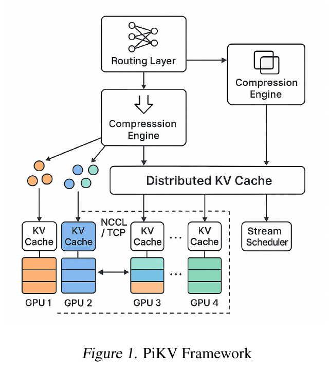
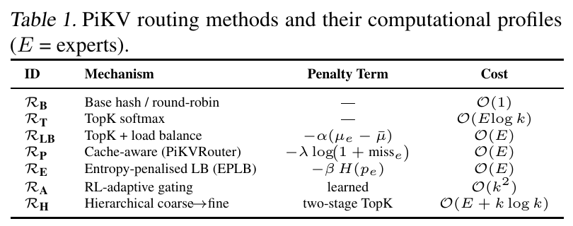
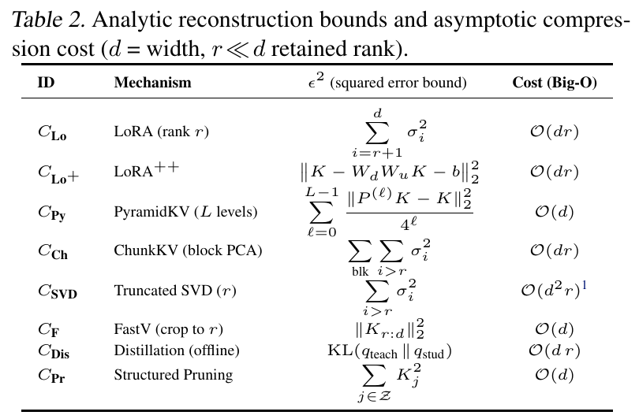
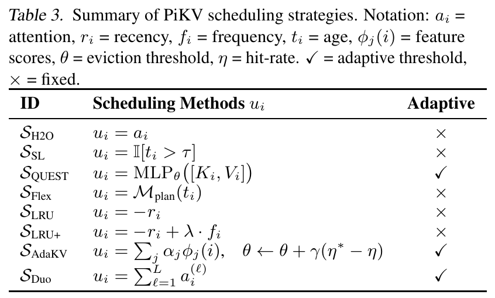

# PiKV：用路由、压缩和调度减少 KV 缓存开销

**PiKV 的核心思路是把三种操作组合起来：路由缩小 KV 的访问范围，压缩减少每条 KV 的存储量，调度在有限容量下决定哪些 KV 页保留或加载。** 三者共同减少推理时的内存占用与数据搬运。论文的主要价值在于这种系统整合；理解各模块的作用和配合，比逐项推导其成本公式更重要。

本文依据 [PiKV 论文 v3](https://arxiv.org/pdf/2508.06526v3)，围绕三个模块解释其优化原理。文中的小例子用于辅助理解，不是论文实测结果。

## 主要工作与优化目标

生成新 token 时，注意力需要读取历史 token 的键和值，这些数据保存在 **KV 缓存**中。缓存避免了历史 K/V 的重复计算，但每一步仍要读取参与注意力的那部分数据。因此，上下文变长会同时带来两个问题：**缓存占用更多内存，注意力需要搬运更多数据。**

混合专家模型（Mixture of Experts，MoE）让每个 token 只经过少量前馈专家，减少专家计算；历史 KV 的读取量却不会因此自动减少。PiKV 希望把这种“只处理一部分”的思路延伸到缓存访问上。[论文，§1、§3](https://arxiv.org/pdf/2508.06526v3#page=1)

| 模块 | 决定什么 | 怎样帮助推理 |
| --- | --- | --- |
| 路由 | 本次查询访问哪些专家对应的 KV 分片 | 缩小查找和读取范围，减少相关通信 |
| 压缩 | 每条 KV 用多大的表示保存 | 降低缓存占用和读取字节数 |
| 调度 | 哪些 KV 页保留、加载或移出缓存层 | 把有限容量用于更有用的数据，控制活跃工作集 |

*原文图 1，来自[论文第 1 页](https://arxiv.org/pdf/2508.06526v3#page=1)。Routing Layer 选择访问范围，Compression Engine 处理存储表示，Distributed KV Cache 分布在多张 GPU 上，Stream Scheduler 管理缓存页。*

图中的分布式缓存是三种操作共同作用的对象：选择要访问哪些部分，将数据以更小的形式保存，再动态管理需要保留和加载的内容。下面按这个顺序解释。

## 路由：缩小本次查询的 KV 访问范围

**路由的输出是一份选择清单。** PiKV 把 KV 按专家和 token 组织成分片，分布到不同 GPU；每次查询只选择一部分专家，随后访问这些专家对应的缓存。这里的“按专家组织 KV”是 PiKV 的设计，普通 MoE 的前馈专家并不天然各有一份独立的注意力 KV。[论文，§3.1–3.2](https://arxiv.org/pdf/2508.06526v3#page=3)

论文算法 1 的关键步骤是：

$$
g_t\leftarrow\mathcal R(q_t),\qquad
 y_t\leftarrow f_{\rm attn}(q_t,C[g_t]).
$$

$q_t$ 是当前查询，$\mathcal R$ 是路由函数，$g_t$ 是选中的专家集合；$C$ 表示整个缓存，**$C[g_t]$ 就是选中专家对应的缓存内容**。后一个式子表示：注意力使用这部分 KV 计算输出 $y_t$。

在评分式路由中，**门控（gating）负责根据当前查询给各个专家打分，再据此选择参与本步的专家**。按分数选出最高的 $k$ 个，称为 Top-k 选择，得到的就是前文的集合 $g_t$。

例如四个专家分数为 `[0.1, 0.7, 0.2, 0.6]`，取 $k=2$，就选择第 2、4 个专家，并访问对应的缓存组。门控分数决定排序，$k$ 决定选择数量；二者共同决定访问范围。

论文表 1 列出了路由的不同实现：

*原文表 1，来自[论文第 4 页](https://arxiv.org/pdf/2508.06526v3#page=4)。Mechanism 是选择方法，Penalty Term 是对评分的修正，Cost 是该路由方法自身的计算复杂度。*

表中的 RT 按分数取 Top-k；RLB 进一步考虑负载，减少继续选择繁忙专家的机会；RP 考虑缓存未命中次数，降低访问需要额外加载数据的分片的机会。**这些附加信息把选择与实际系统成本联系起来。** RB 则使用哈希或轮询规则，无需按查询学习评分。表中各行是可选方法，并非必须同时计算的多个指标。

为何可能加速？论文用 $E$ 表示全部专家数、$k$ 表示本步选择数。在每组访问规模相同的简化模型里，把扫描 $E$ 组改为扫描 $k$ 组，对应的工作量比值为

$$
\frac{\text{全组扫描的工作量}}{\text{选组扫描的工作量}}=\frac Ek.
$$

例如从 8 组选 2 组，这部分工作量变为四分之一。它只说明局部访问量的变化；实际收益还受路由开销、跨卡通信和其他模型计算影响。[论文，§3.2](https://arxiv.org/pdf/2508.06526v3#page=4)

选择范围缩小也可能遗漏有用历史信息。门控分数提供选择依据，但保持生成质量仍需验证；无需把专家分成“真专家”和“假专家”。

## 压缩：减少每条 KV 的存储与搬运量

**压缩改变的是 KV 的表示大小。** 论文 §3.3 将其描述为：把原本各有 $d$ 个数的键和值，变成各有 $d'$ 个数的压缩表示，且 $d'<d$：

$$
\mathcal C(K,V)=(\hat K,\hat V),\qquad
\rho=\frac d{d'}.
$$

$\mathcal C$ 是压缩器，帽子表示压缩后的向量，$\rho$ 是压缩比。比如 K、V 原本各有 128 个元素，压成各 32 个，压缩比就是 4。在同为每元素 2 字节、不计额外元数据的条件下，一对 KV 从 512 字节降为 128 字节。[论文，§3.3](https://arxiv.org/pdf/2508.06526v3#page=4)

这同时带来两种可能收益：同样容量能容纳更多 KV；读取相同条数时，需要搬运的字节数减少。理解耗时只需保留最基本的关系：

$$
\text{读取耗时}\approx\frac{\text{读取字节数}}{\text{有效带宽}}.
$$

因此，在带宽不变、没有额外瓶颈时，读取字节数减为四分之一，读取这一环节的耗时也可能接近四分之一。**整次推理的加速还要扣除压缩、解压和表示适配的成本。** 原来的查询与压缩后的键可能维度不同，需要重建或相应的注意力计算方式。

论文表 2 汇集了不同压缩方法：

*原文表 2，来自[论文第 4 页](https://arxiv.org/pdf/2508.06526v3#page=4)。Mechanism 是压缩机制，中间列列出误差表达式，Cost 是计算复杂度；这些表达式的度量口径不完全相同，不能直接按数值大小给方法排名。*

表中的低秩表示、截断等方法采用不同方式减少数据。低秩表示用更少的系数近似原数据，截断则丢弃部分信息；论文还把不同层的 KV 保留预算等方案纳入广义压缩。理解这些方法时，只需区分它们减少的是**每条的大小**，还是**保留的条数**，不必把所有方法都解释成同一种降维操作。

压缩程度越高，通常越需要关注信息损失。它的实际目标是在可接受的回答质量下减少存储和搬运，而不是单纯追求最大的压缩比。

## 调度：让有限容量优先保留有用的 KV 页

**调度决定缓存中的哪些内容继续保留、哪些内容本步加载。** 论文把管理单位称为 KV 页，即成组存放的多条 KV，并在 §3.4 明确提出：

> “dynamic retention of cached KV pages under bounded memory”

也就是在有限内存下动态保留缓存页。这里的“有界”表示有容量预算；这里的“调度”针对缓存页，不是给用户请求安排执行顺序。[论文，§3.4](https://arxiv.org/pdf/2508.06526v3#page=4)

做法是为每页计算一个**效用分数**，据此决定保留或加载哪些页。论文介绍的不同调度策略主要使用以下信息：

- **注意力强度**：过去或当前的注意力是否较依赖这一页。
- **最近访问时间**：这页是否刚被使用，还是很久没有访问。
- **访问频次**：这页是否经常被使用。

论文表 3 列出了使用这些信息的调度策略：

*原文表 3，来自[论文第 4 页](https://arxiv.org/pdf/2508.06526v3#page=4)。$u_i$ 表示页的效用分数；Adaptive 标记该策略是否使用自适应阈值，不代表效果排名。*

例如，SH2O 使用注意力分数，SLRU 根据最近访问情况评分，SLRU+ 再加入访问频次。它们是决定“哪些页更值得保留”的不同方法，可按需求选择。

例如，缓存预算只能容纳两页，而 A、B、C 三页的评分分别为 0.9、0.2、0.8。若采用保留最高分的规则，就保留 A、C，把 B 移出该缓存层。新的查询到来后，可以重新评分、调整保留集合。这是调度如何使用预算的示例，论文支持的策略不只这一种。

这里有些读者可能会疑惑：**KV 缓存不是按哈希找到相同前缀就能复用吗，为什么还要判断哪些页有用？** 前缀复用解决的是“这段前缀算过了，能否少算一次”；PiKV 调度解决的是“已有的历史 KV 太多，是否全部保留、全部读取”。知道地址并不能消除存储和搬运成本。即使前缀缓存能够精确匹配，容量不足时也仍需决定淘汰谁。

调度也没有为缺失的 KV 寻找另一条“相似 KV”来替代。它选择的是原有条目。只跳过读取可以节省本步流量；移出 GPU 缓存层可以释放 GPU 空间。被移出的页能否再次加载，取决于是否保有后备副本，论文没有完整展开这一机制。

**路由和调度的区别在于选择层次：路由先限定访问哪些专家组，调度再管理缓存页的保留与加载。** 压缩则决定这些页里的数据占多大空间。三者可以同时使用。

## FPGA：可选扩展

**FPGA 是可选扩展。** 论文还提出让 GPU 继续做编码和注意力，把部分寻址、评分、编解码及搬运管理交给 FPGA（可配置逻辑电路的芯片），并使用外部扩展内存保存 KV，但这种做法通常并不通用，也并非创新点，不需要太关注。[论文，§3.5](https://arxiv.org/pdf/2508.06526v3#page=5)
