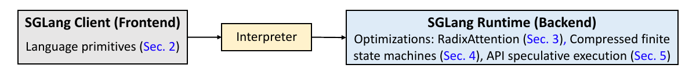
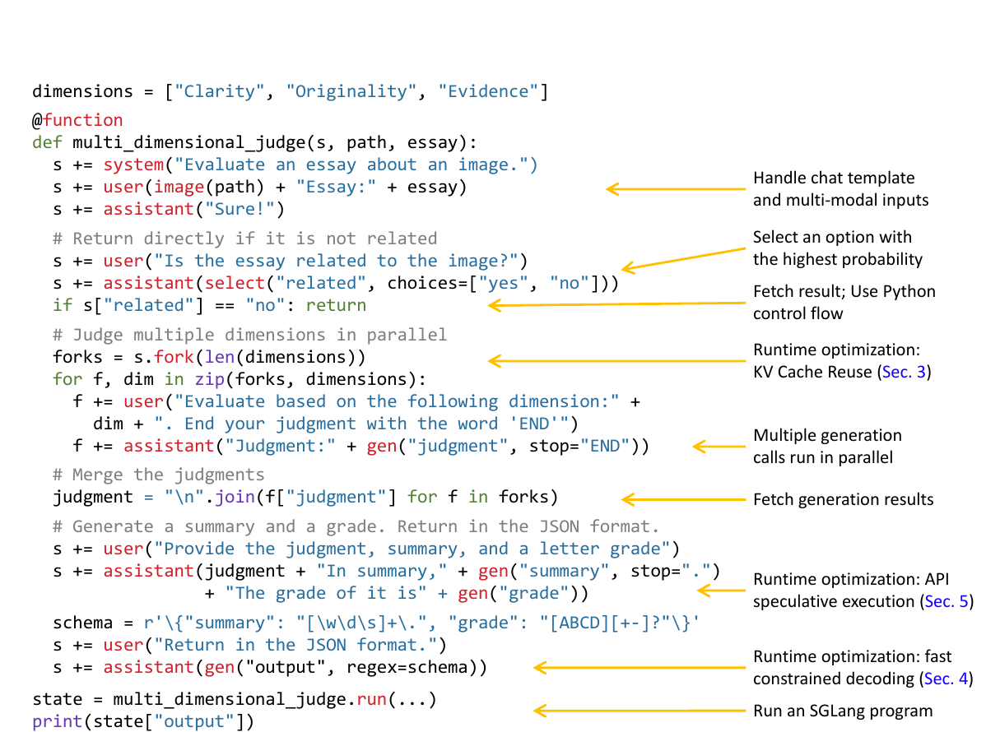
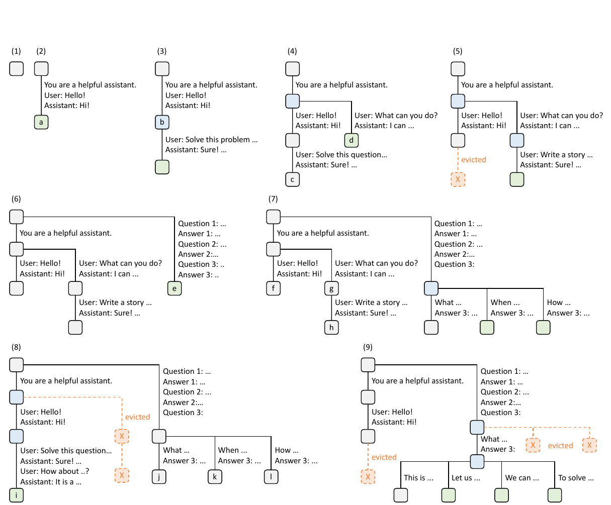
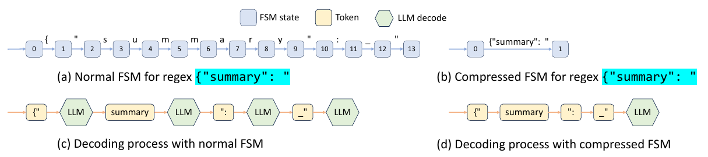
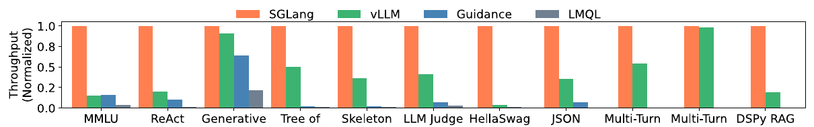
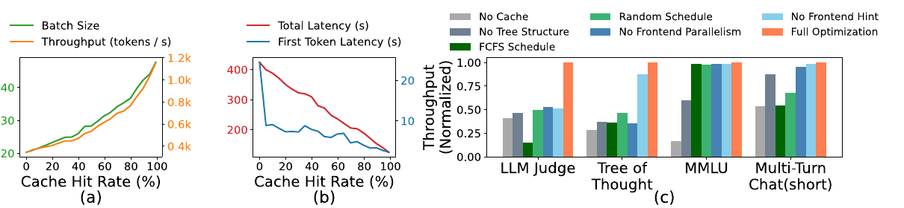

# SGLang: Efficient Execution of Structured Language Model Programs

本文精读 Zheng 等人在 NeurIPS 2024 发表的 SGLang 论文，解释前端程序与推理运行时如何配合，以及 RadixAttention、压缩有限状态机和 API 推测执行分别节省了什么。读者需要了解大语言模型按 token 自回归生成；KV 缓存、前缀匹配和约束解码所需的概念会在首次使用时说明。所有性能数字均为作者报告，本文没有重新运行基准测试。[论文原文](https://papers.nips.cc/paper_files/paper/2024/file/724be4472168f31ba1c9ac630f15dec8-Paper-Conference.pdf)

## 主要工作

**语言模型程序**（LM program）用控制流组织多次模型调用，并处理结构化输入或输出。SGLang 为这类程序提供两个协作部分：嵌入 Python 的前端语言负责表示提示、生成、选择和并行分支；运行时负责执行模型请求，并利用调用之间的共享结构减少重复工作。论文的主要贡献是让程序暴露的提示前缀、分支和输出约束成为运行时可利用的信息。[论文，§1–2、图 1](https://papers.nips.cc/paper_files/paper/2024/file/724be4472168f31ba1c9ac630f15dec8-Paper-Conference.pdf)



*图 1：论文的系统架构。前端通过解释器发出操作，后端利用请求结构实施 RadixAttention、压缩 FSM 和 API 推测执行。截取自 [Zheng 等，2024，原文图 1](https://papers.nips.cc/paper_files/paper/2024/file/724be4472168f31ba1c9ac630f15dec8-Paper-Conference.pdf#page=2)。*

图 1 的箭头表示职责边界：前端记录“当前提示是什么、下一步应生成或选择什么”，解释器按程序控制流提交操作；运行时接收可执行的请求。RadixAttention 的输入是多个请求的 token 前缀，压缩 FSM 的输入是输出正则约束，API 推测执行利用程序中连续的生成原语。理解这三种输入，才能判断各项优化在什么负载上会起作用。

对于本地运行的开放权重模型，RadixAttention 将共享前缀的键值缓存（KV cache）跨调用保留下来，压缩有限状态机（FSM）跳过结构化输出中已被语法确定的连续文本。对于只能通过黑盒 API 访问的模型，API 推测执行尝试把相邻生成合并进一次端点调用。论文在其测试配置与基线下报告，开放权重模型工作负载的**最大吞吐量最高提高 6.4 倍、单程序平均延迟最多降低 3.7 倍**；这些“最高”值来自不同工作负载，不能理解为每一种请求都有同样收益。[论文，摘要、§6.2](https://papers.nips.cc/paper_files/paper/2024/file/724be4472168f31ba1c9ac630f15dec8-Paper-Conference.pdf)

## 研究背景

单次聊天请求可以直接调用推理引擎。多步推理、智能体和结构化输出程序则常先生成中间结果，再依据结果决定后续提示或并行分支。例如先判断文章是否与图片相关，再并行生成不同维度的评价，最后汇总成 JSON。此时，程序员既要维护提示状态和变量，又要安排生成、等待和输出解析。论文以这一类多调用工作流为目标；SGLang 的前端原语减少手写字符串处理和并行控制。[论文，§1–2、图 2](https://papers.nips.cc/paper_files/paper/2024/file/724be4472168f31ba1c9ac630f15dec8-Paper-Conference.pdf)

运行时的问题来自自回归推理。模型先对输入提示执行 **prefill**，为提示中的各个 token 计算各层注意力所需的键和值；之后的 **decode** 阶段每生成一个 token，都利用这些历史键和值计算对前文的注意力。保存历史键和值的显存区域称为 **KV 缓存**。设提示为 token 序列 `P = [p₁, p₂, …, pₙ]`：在因果注意力下，位置 `i` 的 KV 由到 `i` 为止的前缀决定。两个请求若使用相同模型及相关执行配置，且前 `k` 个 token 完全相同，就有机会共享前 `k` 个位置的 KV；从第 `k+1` 个不同 token 开始仍需继续计算。[论文，§3、附录 A.1](https://papers.nips.cc/paper_files/paper/2024/file/724be4472168f31ba1c9ac630f15dec8-Paper-Conference.pdf)

这解释了“共享前缀”为何必须按 token 判断。两个提示含义相近但 token 不同，或相同词语出现在不同位置，前向计算的输入已经改变，不能直接复用同一段 KV。多轮会话、相同系统提示、少样本示例，以及一条提示分叉出的多个请求，都可能产生**逐 token 相同**的前缀。另一种浪费发生在有格式约束的输出中：若语法已确定接下来几个字符的唯一取值，仍让模型逐 token 决定这些字符，就增加了本可跳过的解码步骤。[论文，§3–4、附录 A.1](https://papers.nips.cc/paper_files/paper/2024/file/724be4472168f31ba1c9ac630f15dec8-Paper-Conference.pdf)

## 问题定义

给定一个语言模型程序，系统既要执行程序规定的生成、选择和控制流，也要在多个调用及程序实例之间复用计算。这里的**程序实例**是同一程序针对一份输入执行一次；一次实例内部也可能发出多个模型请求。对开放权重模型，运行时能控制 KV 缓存与模型前向传播；对仅提供 API 的模型，运行时只能控制调用方式、提示和返回结果的使用。因此论文采用三种机制处理三个不同的重复成本：共享前缀重复 prefill、被语法确定的文本重复解码，以及相邻 API 调用重复发送上下文。[论文，§2–5](https://papers.nips.cc/paper_files/paper/2024/file/724be4472168f31ba1c9ac630f15dec8-Paper-Conference.pdf)

这三项优化的输入条件不同。RadixAttention 要求运行时能够持有模型的 KV 缓存，并且有可复用的相同 token 前缀；压缩 FSM 要求生成过程由正则表达式约束，且某些状态之后只有唯一合法延续；API 推测执行针对只能通过端点调用的模型，并且连续的生成步骤能够被提前生成的文本匹配。一个程序可以同时包含多种机会，例如图 2 的并行评价分支共享提示前缀，最后的 JSON 生成具有格式约束。[论文，图 2、§3–5](https://papers.nips.cc/paper_files/paper/2024/file/724be4472168f31ba1c9ac630f15dec8-Paper-Conference.pdf)

## 方法原理

### 前端原语与异步执行

SGLang 把提示状态放在变量 `s` 中。`s += ...` 追加文本或消息；`gen("name")` 调用模型并把结果存为具名变量；`select` 从候选中选概率最高的一项；`fork` 复制当前提示形成并行分支。`gen` 的 `regex` 参数给生成结果施加正则表达式约束。它们嵌入 Python，因此程序仍可使用 `if`、循环和普通函数。[论文，§2、图 2](https://papers.nips.cc/paper_files/paper/2024/file/724be4472168f31ba1c9ac630f15dec8-Paper-Conference.pdf)



*图 2：论文用于贯穿全文的多维作文评价程序。代码右侧的箭头标出各原语与运行时优化的对应位置。截取自 [Zheng 等，2024，原文图 2](https://papers.nips.cc/paper_files/paper/2024/file/724be4472168f31ba1c9ac630f15dec8-Paper-Conference.pdf#page=3)。*

图 2 可沿执行顺序读成四段。第一段用 `system`、`user` 和 `assistant` 组成提示，并把图片和作文传给模型。第二段通过 `select("related", choices=["yes", "no"])` 在两个候选中选概率较高的一项；随后读取 `s["related"]`，Python 的 `if` 才能决定是否提前返回。第三段用 `s.fork(len(dimensions))` 从当前提示创建三个分支，每个分支追加不同的评价维度并执行 `gen("judgment")`，最后读取各分支的 `judgment` 并用 Python 的 `join` 合并文本。第四段先生成摘要和等级，再用 `gen("output", regex=schema)` 生成满足格式约束的 JSON。这里的 `fork` 是 SGLang 的提示分叉，`"\n".join(...)` 是 Python 字符串合并，两者操作的对象不同。[论文，§2、图 2](https://papers.nips.cc/paper_files/paper/2024/file/724be4472168f31ba1c9ac630f15dec8-Paper-Conference.pdf)

`select` 的结果会影响 Python 分支，程序必须在读取 `s["related"]` 时等待该结果；三个 `gen("judgment")` 则在读取结果以前没有相互依赖，可以并行提交。前端由此把**必要的同步点**和**可以重叠的生成调用**表达给运行时。三个评价分支还继承同一段原始提示，构成 RadixAttention 可复用的公共前缀；最后的 `regex` 则把 JSON 的合法输出路径交给压缩 FSM。这正是图 1 中前端信息进入后端优化的具体过程。[论文，§2–4、图 2](https://papers.nips.cc/paper_files/paper/2024/file/724be4472168f31ba1c9ac630f15dec8-Paper-Conference.pdf)

论文默认采用解释执行：前端把追加、生成和选择提交到提示对应的异步流；Python 代码可继续提交后续操作，读取尚未完成的生成变量时才等待。每个提示流由后台执行器管理，分支的多个流因此可以同时推进。论文也提到把程序编译为计算图的执行方式，但其主要实验默认使用解释模式。前端执行器在 `fork` 时还会先发送公共前缀作为提示，再发送分支剩余内容，以帮助运行时正确插入基数树并匹配缓存。[论文，§2–3、附录 D](https://papers.nips.cc/paper_files/paper/2024/file/724be4472168f31ba1c9ac630f15dec8-Paper-Conference.pdf)

### RadixAttention 的跨调用前缀复用

**基数树**（radix tree）是边可保存一段 token 序列的压缩前缀树。RadixAttention 在树中记录 token 前缀与对应 KV 张量的位置。新请求到来时，运行时查找最长可复用前缀：命中部分直接引用现有 KV，只对余下 token 计算 prefill；生成的新 token 也可以插入树中，供之后的请求使用。这样既覆盖同一程序的后续调用和 `fork` 分支，也覆盖不同程序实例。复用依据是实际 token 前缀，而非两段提示在自然语言上“意思相近”。[论文，§3、图 3](https://papers.nips.cc/paper_files/paper/2024/file/724be4472168f31ba1c9ac630f15dec8-Paper-Conference.pdf)



*图 3：RadixAttention 的九步运行示例。蓝色节点为当前时刻访问的已缓存节点，绿色为新节点，橙色虚线节点为被驱逐的节点；边上的文字表示一段 token 序列。截取自 [Zheng 等，2024，原文图 3](https://papers.nips.cc/paper_files/paper/2024/file/724be4472168f31ba1c9ac630f15dec8-Paper-Conference.pdf#page=5)。*

图 3 的前五步展示多轮聊天如何改变树，而不是为每一条请求建立独立缓存：(1) 树为空；(2) 第一个会话形成边 `system → Hello → Hi`；(3) 后续一轮沿已有边命中第一轮前缀，只附加新的提问和回答；(4) 第二个会话使用相同系统提示，但后续用户消息不同，原有边在分歧点**分裂**，两个会话共同指向系统提示那一段 KV；(5) 显存需要空间时，旧分支的叶节点 `c` 被驱逐，公共祖先仍保留。这一序列说明基数树的边可以变长或分裂，树的形状随真实请求变化。[论文，图 3、§3](https://papers.nips.cc/paper_files/paper/2024/file/724be4472168f31ba1c9ac630f15dec8-Paper-Conference.pdf)

图 3 的后四步展示更深层共享：(6) 少样本请求进入树，与聊天请求没有公共 token 前缀，因此从根处分开；(7) 又有多个请求共享同一批少样本示例，示例之后的不同问题使节点 `e` 再次分裂；(8) 第一个聊天会话回来时，最近未使用的另一会话叶节点 `g`、`h` 让出空间；(9) 多个采样请求从相同的问题前缀产生不同答案，运行时保留公共路径，并驱逐较旧的叶分支。树上的每一次分叉都对应某处 token 首次不同；读图时沿根到节点的整条路径，才是该节点代表的完整前缀。[论文，图 3](https://papers.nips.cc/paper_files/paper/2024/file/724be4472168f31ba1c9ac630f15dec8-Paper-Conference.pdf)

论文比较的常规处理方式会在**单条生成请求完成后**释放该请求的 KV；下一请求即使带有相同前缀，也要重算。RadixAttention 让完成请求留下的 KV 继续作为缓存候选。GPU 显存不足时，运行时按最近最少使用（LRU）策略从可驱逐的叶节点释放缓存；当前运行请求引用的节点有引用计数，引用数不为零时不能驱逐。先释放叶节点可以保住多个分支共享的祖先前缀。缓存和当前请求共用同一个内存池，所以当更多等待请求需要显存时，缓存空间会让位于运行中的批次。[论文，§3、图 3](https://papers.nips.cc/paper_files/paper/2024/file/724be4472168f31ba1c9ac630f15dec8-Paper-Conference.pdf)

基数树管理的是**token 路径到 KV 张量的映射**，并不要求整段 KV 在显存中连续排列。论文实现使用非连续的分页布局，每个页对应一个 token；树结构的元数据留在 CPU，KV 张量位于 GPU 的内存池。这样，树边能在共享前缀处分裂，而 KV 页仍可按原位置被多个请求引用。活跃请求使用的节点通过引用计数保护，引用数归零后才成为可驱逐候选。LRU 先驱逐叶子，因为若先丢弃共享祖先，多个子分支即使留在树中也失去了完整的可复用前缀。[论文，§3、图 3](https://papers.nips.cc/paper_files/paper/2024/file/724be4472168f31ba1c9ac630f15dec8-Paper-Conference.pdf)

缓存命中率在论文中定义为“已缓存的提示 token 数 / 提示 token 总数”。它度量实际免去多少提示计算，比“有多少请求命中至少一个 token”更适合解释 prefill 的节省。例如两个请求都命中同一系统提示，其中一个提示总长 100 token、另一个总长 1000 token，命中 80 token 对两者的计算占比不同。[论文，§3](https://papers.nips.cc/paper_files/paper/2024/file/724be4472168f31ba1c9ac630f15dec8-Paper-Conference.pdf)

请求处理顺序决定缓存会不会在复用前被挤出。假设等待队列中两条请求都以 `P` 开头，第三条以不相关的 `Q` 开头；显存只能保留其中一组旧前缀。先处理两条 `P` 请求，可以在处理第二条时继续使用 `P`；中途切到 `Q` 则可能先驱逐 `P`，再为第二条重算。论文因此在批量场景优先安排**匹配前缀较长**的请求，而不是简单按到达先后处理。其定理 3.1 证明：对已知的离线请求批次，若缓存容量至少覆盖最长请求，按请求基数树深度优先访问可达到最优命中率；论文把最长共享前缀优先顺序与这种深度优先顺序对应起来。在线请求不断到达、生成长度无法预知时，调度不再拥有定理的完整条件；长期优先高命中请求还可能造成其他请求饥饿。[论文，§3、定理 3.1、附录 A.3](https://papers.nips.cc/paper_files/paper/2024/file/724be4472168f31ba1c9ac630f15dec8-Paper-Conference.pdf)

因此，论文的贡献不宜概括为“首次跨请求复用 KV”。作者在相关工作中也列出了已有的部分复用方案。其系统设计是将**跨调用保留、树状多级前缀共享、LRU 驱逐与感知前缀的调度**结合，自动覆盖程序的动态共享模式。[论文，§3、§7](https://papers.nips.cc/paper_files/paper/2024/file/724be4472168f31ba1c9ac630f15dec8-Paper-Conference.pdf)

### 压缩有限状态机与确定文本

结构化输出的 `regex` 先被转换为有限状态机（FSM）：状态表示当前已经匹配到的语法位置，转移表示下一段允许的字符或字符串。普通约束解码在每次模型预测后按当前状态屏蔽非法 token，再从合法 token 中选取下一个 token。这里的**一次 decode**指推动自回归生成的一次模型前向传播。普通运行时逐 token 推进，原因还包括 FSM 与模型执行器没有协同处理连续的确定文本；仅凭“掩码非法 token”本身不足以推出所有实现都只能逐 token 前进。[论文，§4、图 4、附录 B](https://papers.nips.cc/paper_files/paper/2024/file/724be4472168f31ba1c9ac630f15dec8-Paper-Conference.pdf)



*图 4：原文图 4 的四个子图。(a) 是逐字符转移，(b) 是压缩后的转移，(c) 与 (d) 比较生成同一段固定 JSON 前缀时需要的模型解码步骤；图中下划线代表空格。截取自 [Zheng 等，2024，原文图 4](https://papers.nips.cc/paper_files/paper/2024/file/724be4472168f31ba1c9ac630f15dec8-Paper-Conference.pdf#page=6)。*

图 4(a) 从状态 0 到 13，每一步消耗固定字符串 `{"summary": "` 的一个字符；(b) 把这一段只有唯一合法延续的路径合成一条边。图中蓝色方块是 FSM 状态，浅黄色框是模型最终使用的 token，绿色六边形 `LLM` 是一次模型前向传播。于是 (c) 的示意流程经过四个 `LLM` 节点，(d) 只经过一个；四与一描述这张示意图的分词和流程，实际节省的次数取决于具体 tokenizer 与约束路径。FSM 在字符层表示语法，模型却在 token 层计算，因而不能直接把图 4(a) 的 13 条字符边等同于 13 次模型调用。[论文，§4、图 4、附录 B](https://papers.nips.cc/paper_files/paper/2024/file/724be4472168f31ba1c9ac630f15dec8-Paper-Conference.pdf)

**单一转移边**指其源状态只有一个后继，且该边只接受唯一字符或字符串。压缩 FSM 把相邻的此类边合并成较长的确定片段。模型走到该片段时，运行时已知道接下来必须出现什么，于是通过 **jump forward** 把整段文本推进到后续状态，省去其中逐 token 采样与重复解码。论文图 4 中 `{"summary": "` 是示例：普通流程里的多个 `LLM decode` 节点表示该常量片段经历多次模型前向传播；压缩流程将它作为一段处理。重新进入模型解码前，还要用模型原有 tokenizer 对已有文本及跳过的片段重新分词，因为字符边界和 token 边界并不一一对应。[论文，§4、图 4、附录 B.1–B.2](https://papers.nips.cc/paper_files/paper/2024/file/724be4472168f31ba1c9ac630f15dec8-Paper-Conference.pdf)

实现时，SGLang 先在**字符或字符串**层构造原始 FSM，再把连续单一转移并入压缩边。运行中，模型生成一个 token 后，运行时取得该 token 对应的字符串，匹配当前状态的出边；如果该出边后面已经压缩了一段唯一后续，就能跳到压缩边终点。压缩边的字符串仍须转回模型能接收的 token。论文附录 B.2 说明，直接把长字符串任意切分可能改变输入语义，因此实现用模型原有 tokenizer 对此前文本和压缩片段重新分词，再继续后续解码。压缩 FSM 节省的是**反复向模型询问已确定片段**的步骤，重新分词与继续计算仍有成本。[论文，附录 B.1–B.2](https://papers.nips.cc/paper_files/paper/2024/file/724be4472168f31ba1c9ac630f15dec8-Paper-Conference.pdf)

静态已知且由程序直接控制的字面量可以直接拼进提示；论文图 2 的 `"In summary,"` 就这样使用。压缩 FSM 更有价值的情形是**确定内容出现的位置要等运行时才知道**。例如生成形如 `{"summary": "<模型写的内容>", "grade": "<模型选的等级>"}` 的结果时，`summary` 写多长、何时结束由模型决定；一旦结束，JSON 的 `", "grade": "` 就成为语法规定的唯一后续。程序在生成前知道这段文本是什么，却不知道它应在第几个生成 token 后出现。FSM 在运行时跟踪当前语法状态，恰好能在分界出现后跳过固定片段。若语法允许可选字段，模型的选择还会决定之后哪一段固定键名或分隔符成为唯一后续；这类位置同样无法在生成前简单拼接。[论文，§2、§4、附录 B.1](https://papers.nips.cc/paper_files/paper/2024/file/724be4472168f31ba1c9ac630f15dec8-Paper-Conference.pdf)

### API 推测执行的调用合并

前两项优化要控制模型运行时，对黑盒 API 不适用。论文 §5 的例子先生成 `name`，再生成 `job`；按两个 `gen` 顺序调用 API，第二次必须把先前上下文再送入端点，因此同一上下文会计入两次输入 token 费用。若只是抽取两个简单字段，一次让模型输出两者也可能更直接；论文没有证明这个例子必须拆成两次。它讨论的是**已有多调用程序**如何降低重复调用成本。[论文，§5](https://papers.nips.cc/paper_files/paper/2024/file/724be4472168f31ba1c9ac630f15dec8-Paper-Conference.pdf)

论文中的程序形态可缩写为：

```python
s += context + "name:" + gen("name", stop="\n")
s += "job:" + gen("job", stop="\n")
```

第一次请求以 `context + "name:"` 为输入，返回 `name`；第二次请求为了接在正确上下文之后生成 `job`，输入中还要包含原来的 `context`、`name` 及 `"job:"`。API 按请求接收完整输入时，`context` 的输入 token 因而再次计费。把两个字段直接写在同一次模型生成中，对这个简单例子本身也可能合理；程序员若有独立变量、停止边界或后续控制流的需要，才会保留多调用形式。这些需要是从代码形态推得的可能动机，论文没有声称该例必须拆分。[论文，§5](https://papers.nips.cc/paper_files/paper/2024/file/724be4472168f31ba1c9ac630f15dec8-Paper-Conference.pdf)

SGLang 在第一次 API 调用中暂时忽略原定停止条件，让模型额外生成后续文本。解释器保存超出第一段的结果，再尝试与接下来的程序原语匹配；匹配成功时复用，省去一次 API 往返及重复上下文输入。它是**推测**，因为后续程序行为或模型输出可能与预期模板不符，节省效果依赖匹配成功率和提示设计。相对于重新发送长上下文，额外输出 token 也有成本。论文用 GPT-3.5 的三字段抽取测试报告输入 token 成本约降为三分之一；这是该实验的结果，不能直接推到所有 API 程序。[论文，§5、§6.2](https://papers.nips.cc/paper_files/paper/2024/file/724be4472168f31ba1c9ac630f15dec8-Paper-Conference.pdf)

执行顺序可拆成三步：先在 `name` 的调用中允许输出越过原定换行停止点；再由解释器把换行后的额外文本暂存，而不是立刻交给 `name` 变量；最后运行到 `"job:" + gen("job")` 时，检查暂存内容是否能够按程序模板对应到后续生成。只有匹配成立，才能把一次 API 返回拆成两个程序变量并省去后续端点调用。若程序在读到 `name` 后走向另一条 Python 分支，或模型额外输出不符合预期，提前生成的内容就没有该次复用价值；后续请求仍需要正常执行。这是对论文匹配机制的直接推论，不是论文提供的通用成功率保证。[论文，§5](https://papers.nips.cc/paper_files/paper/2024/file/724be4472168f31ba1c9ac630f15dec8-Paper-Conference.pdf)

## 实验与证据

### 实验配置与整体结果

论文主要在 NVIDIA A10G 24 GB 上评估开放权重模型：7B 模型使用单卡，更大模型使用多卡张量并行；另有 A100 80 GB 实验。吞吐量以大量程序实例运行时的**程序实例数/秒**计算；延迟是单个程序不批处理时，多次实例执行的平均时间。基线包括 vLLM 0.2.5、Guidance 0.1.8 和 LMQL 0.7.3，各自使用论文写明的后端。图 5–6 的主要结果使用单张 A10G 上的 Llama-7B。比较是系统及后端组合之间的比较，不能把全部差异归因于某一个优化。[论文，§6.1–6.2、附录 C](https://papers.nips.cc/paper_files/paper/2024/file/724be4472168f31ba1c9ac630f15dec8-Paper-Conference.pdf)

论文的工作负载覆盖 5-shot MMLU、20-shot HellaSwag、ReAct 与生成式智能体、思维树、思维骨架、LLM 评价、JSON 解码、四轮短/长对话及 DSPy RAG 管线。不同程序的提示长度、共享模式和输出长度不同，所以同一个优化不可能在所有组别带来相同收益。例如 MMLU 的少样本示例可以跨题复用，HellaSwag 的示例与多选题公共部分可形成两级共享；短对话的前缀计算占比较高，长对话则更易被新 token 的持续解码主导。[论文，§6.1–6.2](https://papers.nips.cc/paper_files/paper/2024/file/724be4472168f31ba1c9ac630f15dec8-Paper-Conference.pdf)



*图 5：单张 A10G 上 Llama-7B 的归一化吞吐量，纵轴越高越好。每组都以该组 SGLang 的吞吐量归一化，图中某些基线没有对应柱表示论文未在该组纳入其结果。截取自 [Zheng 等，2024，原文图 5](https://papers.nips.cc/paper_files/paper/2024/file/724be4472168f31ba1c9ac630f15dec8-Paper-Conference.pdf#page=7)。*

图 5 的橙色柱在每个工作负载中都取 1，表示**各组内部比较**。例如某组 vLLM 柱高约为 0.5，只能读作在那组设置下 vLLM 约为 SGLang 吞吐量的一半，不能据此得出该组的绝对程序数/秒，更不能拿另一组的橙色柱推断两个任务同速。论文的“最高 6.4 倍”来自部分工作负载相对基线的最大比值；它概括了论文的实验范围，不是图中每根柱子的共同倍数。论文脚注指出，所用 vLLM 0.2.5 是较早版本，因为较新的 vLLM 已部分集成可选的相关前缀复用功能；这也是比较结果的版本边界。[论文，§6.1–6.2、图 5](https://papers.nips.cc/paper_files/paper/2024/file/724be4472168f31ba1c9ac630f15dec8-Paper-Conference.pdf)

| 论文报告的观察 | 测量条件与含义 | 对应机制 |
| --- | --- | --- |
| 最大吞吐量最高为基线的 6.4 倍，平均延迟最多降低 3.7 倍 | 图 5–6，多种 Llama-7B 程序负载，各项为相应负载上的最好改善 | 前缀复用、程序内并行和约束解码共同作用 |
| JSON 解码吞吐量提高 1.6 倍 | §6.3 的压缩 FSM 消融；预处理 FSM 后复用于请求批次 | 跳过语法确定的连续文本 |
| 管理 RadixAttention 数据结构用时 0.2 秒 | ShareGPT 100 个请求总计 74.3 秒，且无 KV 复用机会；管理时间占比低于 0.3% | 测量树管理自身的开销 |
| 输入 token 成本约降为三分之一 | GPT-3.5、维基百科页面三字段抽取，使用少样本提示 | API 推测执行减少重复上下文输入 |

### 组件消融与机制证据



*图 8：(a) 缓存命中率与批大小、token 吞吐量；(b) 命中率与总延迟、首 token 延迟；(c) 不同组件移除后的归一化吞吐量。截取自 [Zheng 等，2024，原文图 8](https://papers.nips.cc/paper_files/paper/2024/file/724be4472168f31ba1c9ac630f15dec8-Paper-Conference.pdf#page=9)。*

图 8(a)(b) 使用思维树负载，并通过在运行时部分禁用已匹配 token 来改变命中率。随着更多提示 token 直接复用 KV，prefill 计算与显存占用降低，批次可以纳入更多请求；图中的批大小和 token 吞吐量随命中率上升，而首 token 延迟及总延迟下降。它展示的是该负载下命中率变化与性能变化的关系，不等于所有请求提高命中率都会得到同样的绝对延迟。[论文，§6.3、图 8](https://papers.nips.cc/paper_files/paper/2024/file/724be4472168f31ba1c9ac630f15dec8-Paper-Conference.pdf)

图 8(c) 的 `No Cache` 关闭 KV 复用，`No Tree Structure` 改用简单表缓存，`FCFS Schedule` 和 `Random Schedule` 分别改变请求顺序，`No Frontend Parallelism` 与 `No Frontend Hint` 移除前端并行或分支前缀提示。每一根柱是在相应负载上移除某项机制后，再对完整方案的吞吐量归一化；较低的柱说明该组件在那组负载有贡献。图中工作负载对组件的敏感程度不同，也支持把 SGLang 的收益视为多项机制按需生效，而非单一缓存技巧的固定加速比。[论文，§6.3、图 8](https://papers.nips.cc/paper_files/paper/2024/file/724be4472168f31ba1c9ac630f15dec8-Paper-Conference.pdf)

压缩 FSM 的消融还给出一个实现条件：在 JSON 解码负载上，预处理 FSM 并把结果复用于一批请求时，吞吐量比普通逐 token 约束解码高 1.6 倍；若每条请求都重新预处理 FSM，论文报告吞吐量反而下降 2.4 倍。由此可见，跳过确定文本产生的收益还需要覆盖语法构建成本，重复使用同一语法时更容易摊薄这部分开销。多轮短回复的缓存收益较明显，因为省去的主要是前缀 prefill；长回复中持续生成阶段占比增加，论文观察到几乎没有整体加速。[论文，§6.2–6.3](https://papers.nips.cc/paper_files/paper/2024/file/724be4472168f31ba1c9ac630f15dec8-Paper-Conference.pdf)

## 局限性

RadixAttention 需要真正相同且尚未被驱逐的 token 前缀。共享少、输出很长或显存主要被活动请求占用时，可复用 KV 减少，收益随之下降。缓存感知调度优先长前缀可能影响等待公平性；论文把与公平调度的结合留给后续工作。定理 3.1 约束的是离线批次、足够缓存容量等条件下的命中率，不保证在线服务的全局最优吞吐量。[论文，§3、§6.2](https://papers.nips.cc/paper_files/paper/2024/file/724be4472168f31ba1c9ac630f15dec8-Paper-Conference.pdf)

压缩 FSM 的跳转需要处理字符与 token 切分不一致。论文附录 B.3 还指出，跳过确定路径可能改变某些候选的概率比较，尤其当候选文本长度和分词不同、某候选走压缩边而另一候选不走时。因此，1.6 倍是所测试 JSON 负载的吞吐提升，不能推为任意语法下完全相同的采样分布或速度。API 推测执行同样依赖后续原语与提前生成文本能够匹配；论文没有给出所有多调用任务的匹配率保证。[论文，附录 B.2–B.3、§5–6](https://papers.nips.cc/paper_files/paper/2024/file/724be4472168f31ba1c9ac630f15dec8-Paper-Conference.pdf)

## 结论

SGLang 的主线是让程序结构进入推理运行时：前端表达调用之间的依赖、分支与输出约束，后端据此识别共享前缀和确定文本。RadixAttention 处理可复用的历史计算，压缩 FSM 处理可跳过的确定生成，API 推测执行处理黑盒端点重复发送上下文。三者分别减少不同成本，是否有效取决于前缀共享程度、语法中的确定片段以及后续调用的可预测性。
