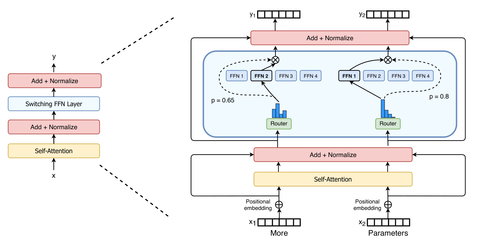
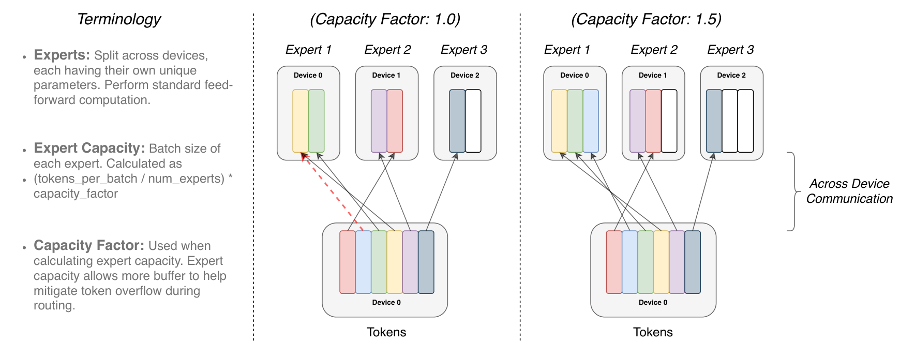
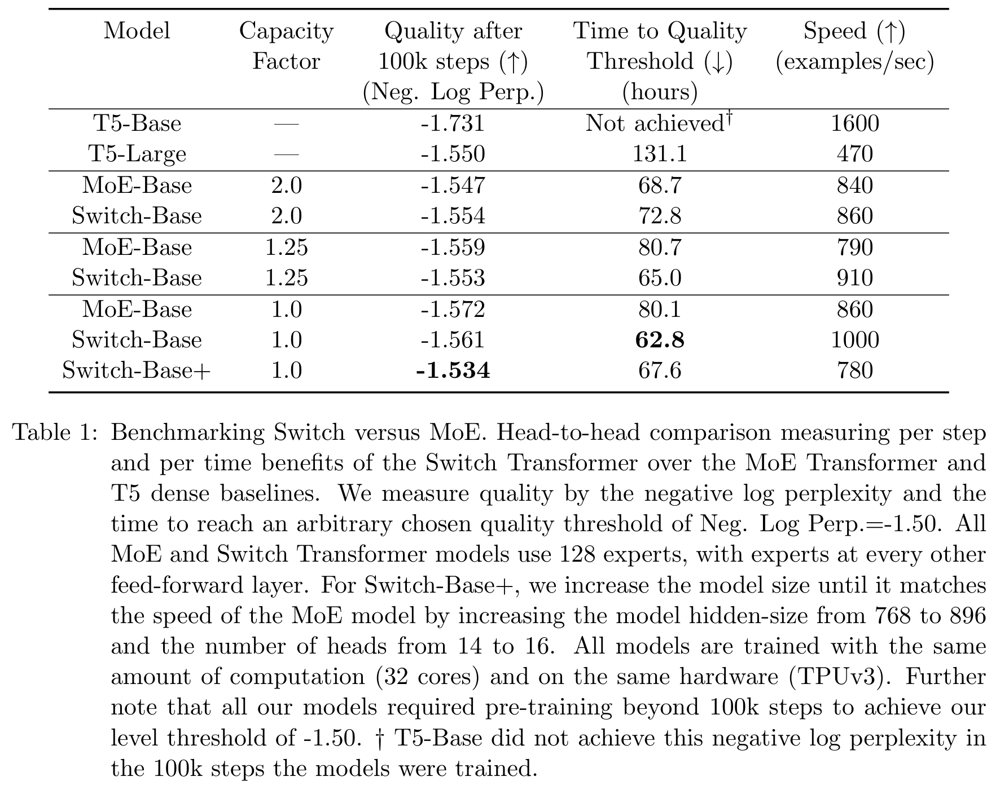
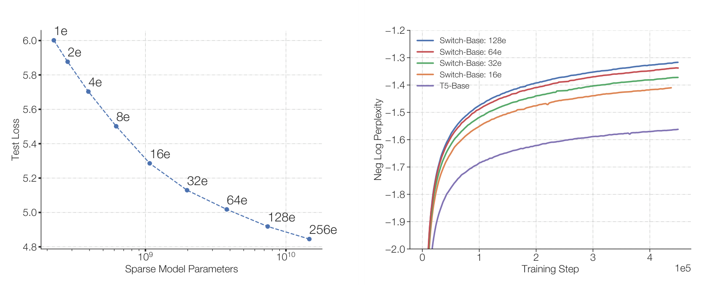
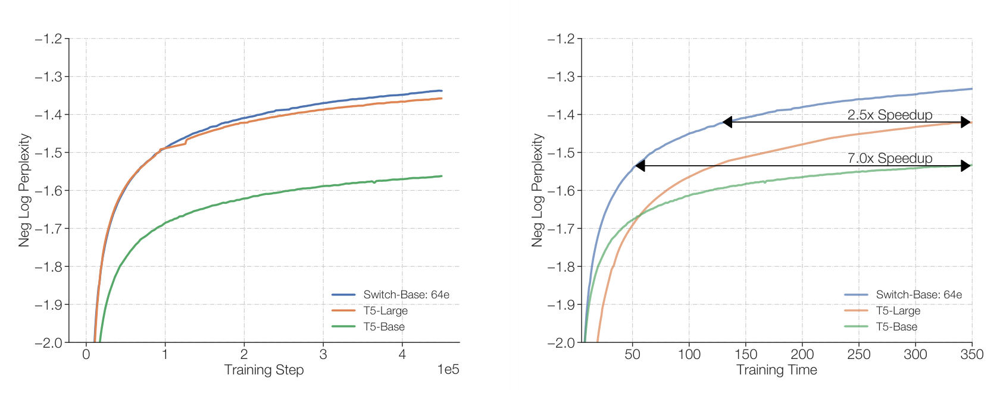
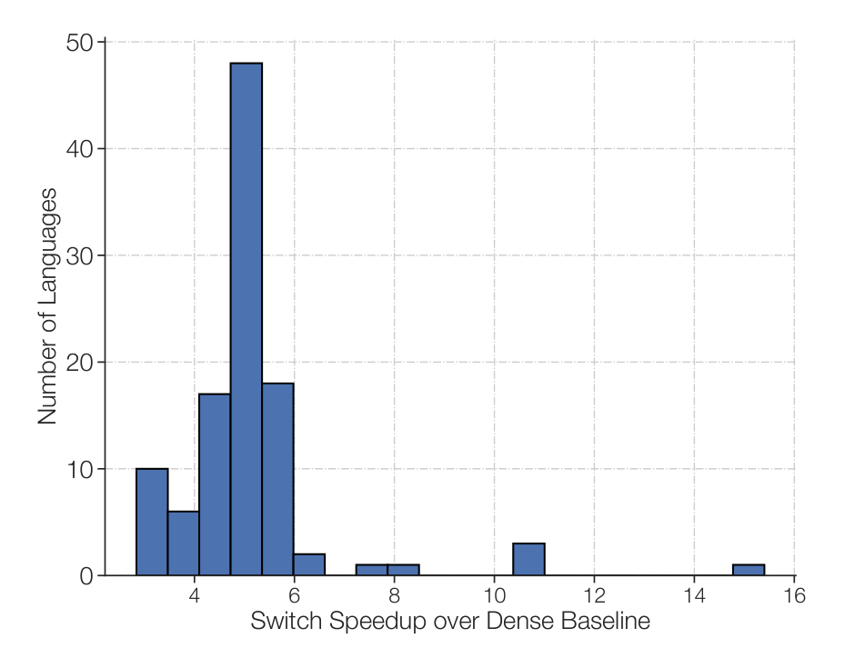
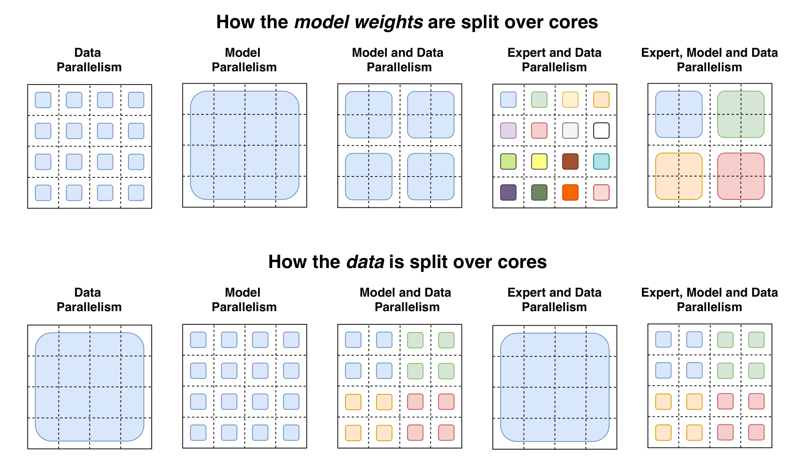
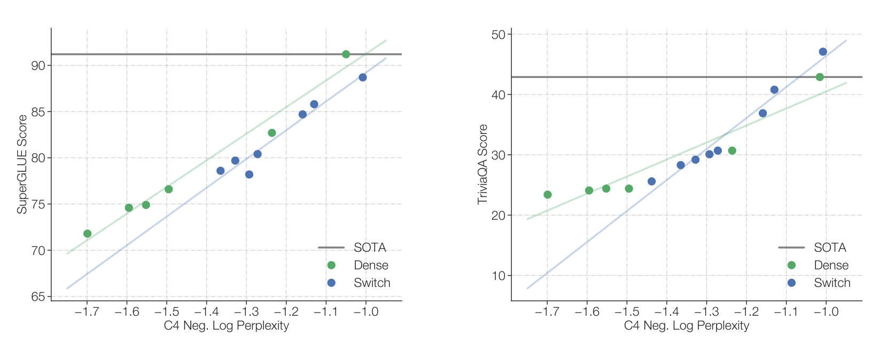

# Switch Transformers：单专家路由的原理、优化与扩展证据

本文阅读 William Fedus、Barret Zoph 与 Noam Shazeer 的 *Switch Transformers: Scaling to Trillion Parameter Models with Simple and Efficient Sparsity*，以 **JMLR 2022 年正式版**（23(120)，1–39 页）为准。本文围绕稀疏混合专家（Mixture of Experts，MoE）的路由与扩展机制，分析 Switch 如何通过单专家路由、容量控制和稳定训练，在增加总参数的同时控制每个 token 的计算量，并结合实验讨论其训练效率、下游迁移、蒸馏与万亿参数扩展。

## 主要工作

Switch Transformer 研究的是：**能否显著增加模型总参数，而让每个 token 实际使用的计算量大致不变？** 作者把 Transformer 中部分前馈网络（feed-forward network，FFN）替换为多组独立参数的专家 FFN，再让每个 token 只选择一个专家。参数容量由全部专家提供，单个 token 的专家计算量则由一个 FFN 决定。

它的核心贡献是将稀疏 MoE 中的多专家路由简化为 **Top-1 路由**，并配合容量控制、负载均衡和局部高精度计算，使这套结构获得实际训练收益。

| 原有问题 | Switch 的策略 | 关键证据 |
| --- | --- | --- |
| 每个 token 经过多个专家，路由与通信开销较大 | 每层每个 token 只选一个专家，保留门控权重 | 表 1：容量因子 1.0 时，Switch 的质量优于 Top-2 MoE，达到指定质量用时从 80.1 h 降到 62.8 h |
| 硬路由和低精度训练可能不稳定 | 路由局部用 float32，其他部分保留 bfloat16；缩小初始化尺度 | 表 2：选择性精度达到与 float32 接近的质量，吞吐由 1160 提高到 1390 examples/s |
| 稠密扩展同时增加参数与每 token 计算量 | 增加专家数，保持每 token 只激活一个专家 | 图 5–6：64 专家 Switch-Base 达到相近质量的实际训练时间约为 T5-Base 的 1/7 |
| 大参数模型微调容易过拟合，部署困难 | 专家内部采用更强 dropout；向小型稠密模型蒸馏 | 表 8：7.41B 教师蒸馏到 223M 学生，保留约 30% 的 SuperGLUE 分数增益 |
| 总参数继续扩大后难以放入单设备 | 组合数据、模型、专家并行 | 表 9：Switch-C 达到 1.571T 参数；作者报告其达到固定困惑度比 T5-XXL 快约 4 倍 |

## 研究背景：总参数与激活计算量的分离

**原有问题。** 稠密 Transformer 对每个 token 使用同一套 FFN 参数。扩大 FFN 的中间维度，通常同时扩大参数量和每个 token 的矩阵乘法计算量；模型越大，每步训练往往也越贵。已有稀疏 MoE 则存放多个专家，只激活其中少数专家，但还面临路由复杂、跨设备通信和训练不稳定的问题。

**优化策略。** Switch 沿用 T5 的编码器—解码器结构，在指定 FFN 层中放入多个结构相同、参数独立的专家。这里的“稀疏”发生在**某个 token 使用哪些专家参数**上；被选中专家内部仍执行普通稠密矩阵乘法。

## 单专家路由与容量控制

### Top-1 路由

**原有问题。** 论文对照的 MoE 使用 Top-2 路由，每个 token 需要送给两个专家、执行两次专家 FFN，再合并结果。早期工作还担心：只选一个专家，路由器缺少比较信号，可能学不好路由。

**优化策略。** 对一个 token 在当前层的表示 $x$，路由器先计算所有专家的分数，再经 softmax 得到概率。原文式（1）和式（2）在 Top-1 情形可写成：

$$
h(x)=W_r x,\qquad
p_i(x)=\frac{\exp(h_i(x))}{\sum_{j=1}^{N}\exp(h_j(x))},\qquad
i^*=\arg\max_i p_i(x),\qquad
y=p_{i^*}(x)E_{i^*}(x).
$$

$N$ 是专家数，$W_r$ 是路由器参数，$E_i(x)$ 是第 $i$ 个专家的 FFN 输出。先对全部专家打分，再只执行得分最高的专家。$y$ 表示专家分支输出，之后还会与残差路径结合。

*原文图 2：左侧标出 FFN 替换位置；右侧展开同一个 Switch 层对两个 token 的处理。来源：[论文图 2，p.4](https://jmlr.org/papers/volume23/21-0998/21-0998.pdf#page=4)，Fedus、Zoph、Shazeer，CC BY 4.0。*

图中 “More” 和 “Parameters” 先经过自注意力，再分别由路由器选择 FFN 2 和 FFN 1。实线表示实际执行的专家分支，虚线把门控概率送到乘法节点，分别乘以 0.65 和 0.8。外侧残差路径保留输入信息。

**实验结论。** 本节后面的表 1 直接比较 Top-1 与 Top-2：Top-1 在低容量因子下取得更好的速度—质量折中。它表明单专家路由在这些设置下足以学到有效模型；各配置的质量并非都超过 Top-2，因此应结合容量和时间口径判断。

### 固定容量、溢出与负载均衡

**原有问题。** 路由决定是动态的，有的专家可能收到很多 token，有的很少。论文采用的 TPU 编译实现要求张量形状静态确定，不能让每个专家的输入槽位无限增长。为所有专家预留很大空间又会产生 padding，即为凑齐固定形状而留下的空槽，以及相应的存储、计算和通信开销。

**优化策略。** 原文式（3）用平均负载乘容量因子，定义专家容量：

$$
C=\frac{T}{N}\times c.
$$

$T$ 是参与这次容量分配的 token 数，$N$ 是专家数，$c$ 是容量因子（capacity factor）。$c=1$ 按平均负载预留，$c>1$ 给负载不均衡留出额外空间。在附录的分布式实现中，容量按各发送设备上的 token 组计算，再把各组发送的 token 汇集到专家；使用该公式时要保持 $T$ 和容量槽位的统计范围一致。[论文，§2.2、附录 F](https://jmlr.org/papers/volume23/21-0998/21-0998.pdf#page=5)

如果某专家被分配的 token 超过容量，溢出 token **跳过当前层的专家计算，通过残差连接继续向后传递**。论文把它们称为 dropped tokens。它们没有从整段序列或整个模型中消失，也不会在本层自动改送第二名专家。

*原文图 3：红色虚线标出溢出路由，白色槽位表示预留而未被有效 token 填满的容量。来源：[论文图 3，p.5](https://jmlr.org/papers/volume23/21-0998/21-0998.pdf#page=5)，CC BY 4.0。*

图中间和右侧保留相同的“token 选专家”机制，只改变每个专家能容纳多少 token。容量因子从 1.0 提高到 1.5 后，原本超过容量的 token 更可能得到专家处理，但未被填满的槽位也增多。因此容量因子控制的是**溢出率与资源浪费之间的折中**。

用一个解释性算例具体化：共有 8 个 token、2 个专家，实际路由数量为 $[6,2]$。当 $c=1$ 时，每个专家容量为 4，第一位专家有 2 个 token 溢出，第二位专家有 2 个空槽。当 $c=1.5$ 时，容量为 6，两位专家都能接收全部分配，但第二位专家留下 4 个空槽。多留容量能缓解问题，改善路由分布则能从源头减少这种浪费。

为此，Switch 在主任务交叉熵之外加入辅助负载均衡损失。原文式（4）至式（6）为：

$$
L_{\mathrm{balance}}=\alpha N\sum_{i=1}^{N} f_iP_i,\qquad
f_i=\frac{1}{T}\sum_{x\in B}\mathbf{1}\{\arg\max_jp_j(x)=i\},\qquad
P_i=\frac{1}{T}\sum_{x\in B}p_i(x).
$$

$f_i$ 统计这个批次中**实际选择专家 $i$ 的 token 比例**；$P_i$ 统计路由器为专家 $i$ 分配的**平均概率**，两者不同。附录伪代码在容量截断之前计算该辅助损失，因此 $f_i$ 反映的是原始路由需求。当前路由分布下，负载较高的专家拥有更大的 $f_i$，损失会对继续向其分配概率施加更强压力，从而鼓励分流。[论文，§2.2，p.6、附录图 15](https://jmlr.org/papers/volume23/21-0998/21-0998.pdf#page=6)

例如 $N=2$，若 $f=[0.75,0.25]$、$P=[0.70,0.30]$，则 $N\sum_i f_iP_i=1.20$；均匀分配 $f=P=[0.5,0.5]$ 时为 $1.00$。乘 $N$ 使均匀状态的参考值不随专家数改变。论文取 $\alpha=10^{-2}$，使均衡信号足够强，同时避免压过主任务损失。这个目标鼓励负载均衡；它并不要求不同 token 拥有完全相同的专家偏好。

**实验结论。** 作者报告，在采用合适的辅助损失系数后，实验中的 dropped tokens 通常低于 1%。这是该实现和实验配置的观察值，不是任意容量因子下都能保证的比例。容量因子是否值得增大，还要看下面的质量和速度实测。

### 表 1 的速度—质量权衡

论文的质量指标是**负对数困惑度**（negative log perplexity）。若预测目标 token 的平均交叉熵为 $H$，则困惑度为 $\mathrm{PPL}=e^H$，所以：

$$
Q=-\ln(\mathrm{PPL})=-H.
$$

这里取自然对数，单位为 nat，$Q$ 越大越好。例如 $-1.50>-1.55$，所以前者更好。达到 $-1.50$ 阈值意味着 $Q\geq-1.50$。

下图为论文表 1 原图。所有模型使用 32 个 TPUv3 核心；MoE 和 Switch 均为 128 专家，在每隔一个 FFN 层的位置使用专家层。Top-2 MoE 每 token 的专家计算量高于 Switch，因此“相同硬件资源”与“相同每 token FLOPs”需要分别理解。

*原文表 1：保留各容量因子的实验数据及完整表注。来源：[论文表 1，p.7](https://jmlr.org/papers/volume23/21-0998/21-0998.pdf#page=7)，Fedus、Zoph、Shazeer，CC BY 4.0。*

从表中可以得到三条具体结论：

1. **低容量因子下，Top-1 的综合收益更清楚。** $c=1.0$ 时，Switch 的质量为 $-1.561$，优于 MoE 的 $-1.572$，吞吐量高约 16.3%，达标时间从 80.1 h 减为 62.8 h，约少 21.6%。$c=1.25$ 时同样同时改善质量和达标时间。
2. **容量增大有代价，也不保证 Switch 在每个指标上获胜。** $c=2.0$ 时，MoE 的 100k 步质量和达标时间都略优于 Switch；而 Switch 的容量从 2.0 减到 1.0，虽然固定步数质量稍降，达标时间反而缩短。资源消耗与学习效果需要一起看。
3. **节省的计算可以换成更大模型。** Switch-Base+ 加大隐藏维度等配置后，吞吐量降为 780 examples/s，接近表中 MoE 的速度量级，而固定 100k 步质量提高到全表最好的 $-1.534$。它的达标时间仍比普通 Switch-Base 的 62.8 h 长，因此“每步质量最好”和“最快达标”可以属于不同配置。

## 稳定训练与专家正则化

### 局部高精度路由

**原有问题。** 硬路由会在得分变化跨越选择边界时，让 token 转到另一个参数不同的专家；低精度误差还可能影响路由分数与 softmax 计算。论文将风险概括为：

> “Sparse expert models may introduce training difficulties over a vanilla Transformer. Instability can result because of the hard-switching (routing) decisions at each of these layers.”
>
> 稀疏专家模型相对普通 Transformer 可能更难训练，硬路由决策可能带来不稳定。[论文，§2.4，p.8](https://jmlr.org/papers/volume23/21-0998/21-0998.pdf#page=8)

**这是 Switch 独有的问题，还是所有专家模型都会发生？** 原文讨论的是采用离散选择的稀疏专家模型，Top-2 MoE 也存在这类风险。风险是否实际表现为发散，还取决于精度、初始化和模型配置。对所有专家都连续加权的软门控结构，不具有同一种 Top-k 选择跳变。因此这里应理解为**硬路由模型的一类共同风险**，不能推广成“所有 MoE 都必然不稳定”，也不能从“Top-1 更简单”推出“Top-1 一定更稳定”。

**优化策略。** Switch 使用选择性精度（selective precision）：把路由输入和路由函数内的局部计算转为 float32，得到用于分发 token 的 dispatch 张量和用于组合结果的 combine 张量，再转换回适合后续低精度计算的表示。其关键是把高精度限制在设备本地，避免跨设备 all-to-all 通信因此搬运 float32 大张量。bfloat16 是一种 16 位浮点格式；保留大部分低精度计算可以减少存储和数据搬运开销。[论文，§2.4、附录图 15](https://jmlr.org/papers/volume23/21-0998/21-0998.pdf#page=9)

**实验证据。** 原文表 2 使用 32 专家 Switch-Base，在训练早期相同固定步数比较质量与吞吐：

| 精度设置 | 负对数困惑度 ↑ | 吞吐量 ↑（examples/s） |
| --- | ---: | ---: |
| float32 | -1.718 | 1160 |
| bfloat16 | -3.780，已发散 | 1390 |
| 选择性精度 | **-1.716** | **1390** |

选择性精度获得与 float32 接近的质量，并达到纯 bfloat16 实验的吞吐量，相对 float32 快约 19.8%。表 2 与表 1 的专家数、训练阶段不同，不能直接把两表的质量数字混在一起排名。该实验支持局部高精度的有效性；它没有测量所有 MoE 架构的发散概率。[论文，表 2](https://jmlr.org/papers/volume23/21-0998/21-0998.pdf#page=8)

### 缩小初始化尺度

**原有问题。** 较大的初始权重可能使早期激活和路由行为更难控制；作者发现，沿用默认 Transformer 初始化尺度时，不同随机种子的早期质量波动很大。

**优化策略。** 论文使用零均值截断正态初始化，截断前分布的标准差参数为：

$$
\sigma=\sqrt{\frac{s}{n}},
$$

其中 $n$ 为输入单元数，$s$ 为初始化尺度。作者把 $s$ 从 $1.0$ 减为 $0.1$。因此标准差参数变为原来的 $\sqrt{0.1}\approx0.316$，**“尺度缩小十倍”并不等于标准差除以十**。这是一项经验上有效的稳定措施；论文没有给出它必然稳定所有配置的证明。

**实验证据。** 表 3 对 32 专家模型训练 3.5k 步，每个配置用 3 个随机种子：

| 初始化尺度 | 平均负对数困惑度 ↑ | 质量标准差 ↓ |
| --- | ---: | ---: |
| 原尺度，1.0x-init | -3.60 | 0.68 |
| 较小尺度，0.1x-init | **-2.72** | **0.01** |

较小尺度同时改善早期平均质量和跨运行稳定性。这里统计的是模型质量的标准差，和初始化公式中的权重标准差是两个不同对象。[论文，表 3、§2.4](https://jmlr.org/papers/volume23/21-0998/21-0998.pdf#page=9)

### 专家内部的更强 dropout

**原有问题。** 稀疏模型总参数远多于计算量匹配的稠密模型。在数据较少的下游微调中，这些参数更容易过拟合。单纯对所有层都加大 dropout，又可能损伤共享表示的学习。

**优化策略。** dropout 在训练中随机屏蔽部分中间激活，降低模型对特定激活的依赖。Switch 在非专家层维持 $d=0.1$，只把专家 FFN 内部的 dropout 提高到 $ed=0.4$。这里的 expert dropout 是**专家内部激活的 dropout**，与容量溢出导致的 token 跳过是不同机制。

**实验证据。** 表 4 对在 C4 上预训练过 34B token 的模型进行微调。GLUE、SuperGLUE 是任务集合的综合得分，CNNDM 是摘要的 ROUGE-2 分数，SQuAD 是问答精确匹配率；各列均越高越好。

| 配置 | GLUE | CNNDM | SQuAD | SuperGLUE |
| --- | ---: | ---: | ---: | ---: |
| T5-Base，$d=0.1$ | 82.9 | 19.6 | 83.5 | 72.4 |
| Switch-Base，$d=0.1$ | 84.7 | 19.1 | 83.7 | 73.0 |
| Switch-Base，$d=0.2$ | 84.4 | 19.2 | 83.9 | 73.2 |
| Switch-Base，$d=0.3$ | 83.9 | 19.6 | 83.4 | 70.7 |
| Switch-Base，$d=0.1,ed=0.4$ | **85.2** | 19.6 | 83.7 | 73.0 |

全局 dropout 提至 0.3 后，SuperGLUE 从 73.0 降为 70.7；只加强专家内部 dropout，则把 GLUE 提高到 85.2、CNNDM 提高到 19.6，另外两项相对 $d=0.1$ 保持不变。这支持**针对新增参数集中的专家部分加强正则化**。该配置也没有独占所有列的最高分：$d=0.2$ 的 SQuAD 和 SuperGLUE 略高。[论文，表 4](https://jmlr.org/papers/volume23/21-0998/21-0998.pdf#page=10)

## 专家扩展：样本效率与实际时间收益

**原有问题。** 提高固定步数下的模型质量，并不自动意味着节省实际训练时间。即使 FLOPs/token 接近，Switch 仍要计算路由、派发 token、等待各专家完成并收回结果。若每步慢很多，少训练一些步也可能抵消不了系统开销。

**优化策略。** 作者分别以训练步数和实际经过的时间（wall-clock time）为横轴比较，并增加一个更强的稠密基线 T5-Large，检验“把预算拿来扩大普通 Transformer”是否更好。

*原文图 4：左图的 1e、2e、4e 等表示专家数；右图中不同曲线表示 FLOPs 匹配的 Switch 配置和稠密基线。来源：[论文图 4，p.11](https://jmlr.org/papers/volume23/21-0998/21-0998.pdf#page=11)，CC BY 4.0。*

左图横轴是总参数量，纵轴沿用原图的 Test Loss 标记，越低越好；从约 223M 的基线扩展到 256 专家、14.7B 参数，曲线持续改善。右图使用负对数困惑度，越高越好：在相同步数下，更多专家的曲线总体更好。两个子图用不同的质量展示方式，应分别按坐标含义读图。

**实验证据。** §3.1 报告，64 专家 Switch-Base 在约 60k 步达到 T5-Base 约 450k 步的质量，步数之比为 $450/60=7.5$。这说明在相同批次设置下，前者使用更少训练样本即可达到相近质量，称为**样本效率更高**。它并不表示单步执行速度提高 7.5 倍。[论文，§3.1](https://jmlr.org/papers/volume23/21-0998/21-0998.pdf#page=11)

*原文图 6：右图标注的 7.0x 和 2.5x 是达到相近预训练质量所需实际时间的比较。来源：[论文图 6，p.13](https://jmlr.org/papers/volume23/21-0998/21-0998.pdf#page=13)，CC BY 4.0。*

图 6 左侧检验学习效率：Switch-Base 比 T5-Base 和 T5-Large 都更早达到相近质量。右侧把通信和路由时间也计入后，Switch-Base 仍领先。原文图 5 的设置为 32 个 TPUv3 核心，64 专家 Switch-Base 达到相近质量的时间约为 T5-Base 的 1/7；图 6 进一步显示，相对每 token 使用约 3.5 倍 FLOPs 的 T5-Large，Switch-Base 仍约有 2.5 倍的时间优势。[论文，§3.2–3.3、图 5–6](https://jmlr.org/papers/volume23/21-0998/21-0998.pdf#page=12)

| 观察口径 | 论文结果 | 对应含义 |
| --- | --- | --- |
| 达到相近质量所需步数 | 450k / 60k ≈ 7.5 | 学习同等质量需要的更新次数减少 |
| 达到相近质量所需实际时间，相对 T5-Base | 约 7 倍加速 | 计入系统开销后，学习效率收益仍然保留 |
| 达到相近质量所需实际时间，相对 T5-Large | 约 2.5 倍加速 | 将预算用于稀疏参数扩展，优于该实验中的更大稠密模型 |
| 每秒处理样本数 | 见表 1，不是 7 倍 | 单步吞吐与达到目标质量的总时间属于不同指标 |

这一组实验的关键结论是：**更多专家带来的学习收益，在这些硬件和模型配置下足以覆盖额外通信与路由开销。** 实验并未表明任意硬件、任意专家数都会得到相同倍数；图 4 及 §5 也指出，继续增加专家存在边际收益递减。

## 下游迁移：预训练收益的实际落点

**原有问题。** C4 去噪预测变好，只能说明模型更擅长该预训练目标；模型在问答、摘要和推理任务上的效果仍需验证。

**优化策略。** 作者把计算量匹配的 T5-Base / Switch-Base、T5-Large / Switch-Large 分别用于多项下游任务，并采用前述专家 dropout。表 5 的模型都在修订后的 C4 上预训练约 576B token，然后比较验证集结果。保留这个共同训练量，是为了明确同表对比条件；它与表 4 的较短预训练实验不同。[论文，§4.1](https://jmlr.org/papers/volume23/21-0998/21-0998.pdf#page=13)

**实验证据。** 下表转录表 5 的代表性任务，并保留没有改善的 ARC 项。SQuAD、闭卷 TriviaQA 使用精确匹配率；Winogrande 和 ARC 使用准确率；XSum 使用 ROUGE-2；所有列均越高越好。

| 模型 | GLUE | SuperGLUE | SQuAD | Winogrande | XSum | 闭卷 TriviaQA | ARC Easy | ARC Challenge |
| --- | ---: | ---: | ---: | ---: | ---: | ---: | ---: | ---: |
| T5-Base | 84.3 | 75.1 | 85.5 | 66.6 | 18.7 | 24.5 | 56.7 | 35.5 |
| Switch-Base | 86.7 | 79.5 | 87.2 | 73.3 | 20.3 | 30.7 | 61.3 | 32.8 |
| T5-Large | 87.8 | 82.7 | 88.1 | 79.1 | 20.9 | 29.5 | 68.8 | 35.5 |
| Switch-Large | 88.5 | 84.7 | 88.6 | 83.0 | 22.3 | 36.9 | 66.0 | 35.5 |

*来源：[原文表 5，p.14](https://jmlr.org/papers/volume23/21-0998/21-0998.pdf#page=14)。闭卷问答指只给问题，不提供供模型查阅的参考文章。*

在 Base 配对中，Switch 的 SuperGLUE 提高 4.4 分、Winogrande 提高 6.7 个百分点、闭卷 TriviaQA 提高 6.2 个百分点；Large 配对也有相应收益。与此同时，Switch-Base 的 ARC Challenge 下降 2.7 个百分点，Switch-Large 的 ARC Easy 下降 2.8 个百分点。因而表 5 支持**收益能迁移到多数被测任务，且涵盖知识型任务与部分推理任务**，而非每个任务都会改善。

## 稀疏到稠密蒸馏：部署规模与质量保留

**原有问题。** Top-1 减少的是每个 token 的激活计算量，庞大的专家参数仍需存储和部署。直接部署数十亿乃至万亿参数模型，可能受到设备内存和系统复杂度限制。

**优化策略。** 作者训练小型稠密学生去模仿大稀疏教师的输出分布，并采用两项改进：先用教师的非专家权重初始化学生中对应层；再混合真实标签和教师概率的训练损失。非专家层维度匹配，使这些权重可以直接迁移。论文使用真实标签损失占 0.75、教师软标签损失占 0.25 的组合，可概括为：

$$
L_{\mathrm{student}}=0.75L_{\mathrm{hard}}+0.25L_{\mathrm{soft}}.
$$

硬标签要求模型预测正确目标，软标签让学生学习教师对其他候选 token 的相对判断。学生最终仍是稠密模型，训练时也不需要复制教师的完整专家集合。[论文，§4.2](https://jmlr.org/papers/volume23/21-0998/21-0998.pdf#page=15)

**实验证据。** 表 6 使用 3.8B 参数教师与 223M 参数学生：

| 方法 | 负对数困惑度 ↑ | 相对稠密基线，保留教师增益 |
| --- | ---: | ---: |
| T5-Base 基线 | -1.636 | — |
| Switch-Base 教师 | -1.444 | 100% |
| 普通蒸馏 | -1.631 | 3% |
| 再加入教师非专家权重初始化 | -1.598 | 20% |
| 再混合真实标签与教师标签损失 | -1.580 | 29% |
| 仅复制非专家权重，正常训练而不蒸馏 | -1.639 | 无改善 |

表 6 中的“增益保留率”比较蒸馏学生与教师各自相对稠密基线提高了多少。式中的 $Q$ 均表示负对数困惑度，越大越好；三个下标对应三种模型：

- $Q_{\mathrm{baseline}}=-1.636$：未经过蒸馏的 T5-Base 稠密基线。
- $Q_{\mathrm{teacher}}=-1.444$：提供蒸馏监督的 Switch-Base 稀疏教师。
- $Q_{\mathrm{distilled}}=-1.580$：采用教师非专家权重初始化，并混合真实标签与教师标签损失训练后的 T5-Base 学生。

$$
\text{增益保留率}
=\frac{Q_{\mathrm{distilled}}-Q_{\mathrm{baseline}}}
{Q_{\mathrm{teacher}}-Q_{\mathrm{baseline}}}
=\frac{-1.580-(-1.636)}{-1.444-(-1.636)}
=\frac{0.056}{0.192}
\approx29.2\%.
$$

分子 $0.056$ 是蒸馏学生相对基线的质量提高，分母 $0.192$ 是教师相对同一基线的质量提高。因此，学生保留了教师相对基线约 29% 的增益。[论文，表 6](https://jmlr.org/papers/volume23/21-0998/21-0998.pdf#page=16)

| 教师规模与实验 | 稠密学生 | 蒸馏后结果 | 增益保留与压缩 |
| --- | --- | --- | --- |
| 3.8B，表 7 语言建模实验 | 223M | $Q=-1.579$ | 增益保留 30%，参数压缩约 95% |
| 14.7B，表 7 语言建模实验 | 223M | $Q=-1.578$ | 增益保留 28%，参数压缩约 99% |
| 7.41B，表 8 SuperGLUE 实验 | 223M | 基线 74.6 → 学生 76.6；教师 81.3 | 增益保留约 30%，参数压缩约 97% |

表 7 的百分比沿用论文取整。表 8 中 $(76.6-74.6)/(81.3-74.6)\approx29.9\%$，再次验证了相同的增益定义。该表与前节表 5 属于不同实验，基线分数不能交叉替换。**蒸馏能把部分稀疏模型收益转移到便于部署的模型中，但大部分教师增益仍会损失。**[论文，表 7–8](https://jmlr.org/papers/volume23/21-0998/21-0998.pdf#page=16)

## 多语言扩展：101 种语言的共同收益

**原有问题。** 单一英文语料上的收益不能直接代表多语言场景。多语言模型共享容量，需要同时处理不同语言的文本分布。

**优化策略。** 作者以多语言 T5（mT5）为基线，在 mC4 上对计算量匹配的 mT5-Base 和 mSwitch-Base 做相同步数训练。数据覆盖 101 种语言；由于部分语言还包含不同文字形式，训练混合中共有 107 个任务。实验考察的是联合多语言预训练，没有为每种语言手工指定一个专家。

**实验证据。** 训练 1M 步后，Switch 在全部 101 种语言上的负对数困惑度都优于基线。作者再按每种语言达到 mT5 最终质量所需的训练步数计算加速：

$$
\text{步数加速比}=\frac{\text{基线达到参照质量所需步数}}{\text{Switch 达到同等质量所需步数}}.
$$

*原文图 8：横轴为步数加速比，纵轴为语言数量。来源：[论文图 8，p.18](https://jmlr.org/papers/volume23/21-0998/21-0998.pdf#page=18)，CC BY 4.0。*

图中的柱子按加速区间统计语言数量，体现收益是否只集中在少数语言。论文报告平均步数加速约 **5 倍**，**91% 的语言至少达到 4 倍**。这支持稀疏扩展在多语言联合学习中也有效；该实验度量的是预训练质量和更新步数，没有测量 101 种语言的聊天质量，也没有直接证明 5 倍实际时间加速。[论文，§4.3、图 7–8](https://jmlr.org/papers/volume23/21-0998/21-0998.pdf#page=17)

## 并行设计与万亿参数模型

**原有问题。** 专家再多也需要设备来存放；单个专家变宽后，又可能放不进一个设备。只增加专家数还有边际收益递减，因此模型设计要同时考虑总参数、每 token 计算量和通信。

**优化策略。** 论文组合三种并行方式。理解它们的关键是区分“切输入样本”“切同一权重矩阵”和“把不同专家放在不同设备”。

| 并行方式 | 主要划分对象 | 主要通信及作用 |
| --- | --- | --- |
| 数据并行 | 不同设备处理不同批次片段，保存同一组权重副本 | 聚合梯度，使各副本更新一致 |
| 模型并行，本文以 FFN 张量切分为例 | 把同一 FFN 权重及中间维度切到多个设备 | all-reduce 汇总各设备的部分计算结果，使单个较宽模型能够分布存放 |
| 专家并行 | 不同设备保存不同专家 | all-to-all 按路由把 token 送到对应专家，再把结果送回原位置 |

all-reduce 是跨设备聚合后让参与设备取得聚合结果；all-to-all 是各设备向其他设备交换各自要发送的数据片段。两者处理的数据关系不同。Switch 的数据并行与专家并行还会复用设备划分：非专家层可保存副本、按 token 分工，专家层则按专家存放独立权重，不必理解成三个完全独立的设备集合。[论文，§5.1–5.5](https://jmlr.org/papers/volume23/21-0998/21-0998.pdf#page=19)

*原文图 9：每个虚线 4×4 网格代表 16 个核心；上排表示权重，下排表示 token 数据。来源：[论文图 9，p.20](https://jmlr.org/papers/volume23/21-0998/21-0998.pdf#page=20)，CC BY 4.0。*

从左到右看图：纯数据并行在上排复制相同权重、下排分开不同数据；纯模型并行切分上排权重，而下排设备共同参与处理同一批 token。中间一列结合两者。第四列加入不同专家的独立权重，需要将下排 token 动态派到专家所在设备；第五列进一步切分专家内部权重，因此同时承担专家路由的 all-to-all 与模型并行的 all-reduce。

这种组合说明，总参数和激活计算量可以分别调节。增加专家数主要提高总参数；增大单个专家的维度，会增加每 token 计算量。如果专家太大，就还需模型并行，并付出额外通信成本。原文用 $N_{\mathrm{cores}}=n\times m$ 表示数据划分数与模型划分数的组合：固定总核心数时，增加模型并行份数，也会减少留给数据划分的份数。

**实验证据。** 作者构造两种不同侧重的大模型：Switch-C 主要扩大专家数量，使用专家并行而不使用模型并行；Switch-XXL 的每序列计算量与 T5-XXL 匹配，结合模型并行与专家并行。表 9 的关键数值如下，B 表示十亿，T 表示万亿。

| 模型 | 总参数 | 每序列前向 FLOPs | 专家数 | 250k 步负对数困惑度 ↑ | 500k 步负对数困惑度 ↑ |
| --- | ---: | ---: | ---: | ---: | ---: |
| T5-XXL | 11B | 6.3T | — | -1.147 | -1.095 |
| Switch-XXL | 395B | 6.3T | 64 | **-1.086** | **-1.008** |
| Switch-C | 1571B，约 1.6T | 890B | 2048 | -1.096 | -1.043 |

*来源：[原文表 9、§5.6，p.21–22](https://jmlr.org/papers/volume23/21-0998/21-0998.pdf#page=21)。专家数按正文及模型配置含义核对。*

有三点值得保留。第一，Switch-XXL 在 250k 步就优于 T5-XXL 在 500k 步的预训练质量；到 500k 步，两者相差 $0.087$ nat。第二，Switch-C 参数最多，但单序列计算量更少，固定步数质量仍落后 Switch-XXL。第三，表 9 的表注报告，Switch-C 在相同计算资源预算下达到固定困惑度的实际速度比 T5-XXL 快约 4 倍；该倍数是作者另行报告的时间结果，不能只从表中两个训练步数的质量值反推出来。

按表中 FLOPs 直接相除，Switch-XXL / Switch-C 约为 $6.3\mathrm{T}/0.890\mathrm{T}\approx7.1$。正文使用了“nearly 10x”的近似说法；理解两种模型时，应记住 **Switch-XXL 单 token 计算更多、Switch-C 总参数更多**，精确比值则以表格为依据。

这些大模型结果还带来一个重要边界：作者观察到 Switch-C 没有训练不稳定，而 Switch-XXL 偶尔不稳定，因而后者没有完成原计划的 1M 步预训练。总参数更大并不自动意味着更容易发散；单 token 计算规模、结构与训练配置也共同影响稳定性。表 9 对 T5-XXL 的语料版本还存在原文注明的差异，因此对最大模型应保留这些比较条件。[论文，§5.6、脚注 10](https://jmlr.org/papers/volume23/21-0998/21-0998.pdf#page=22)

## 局限与结论

论文建立的完整因果链是：**Top-1 减少每个 token 的专家计算和路由工作；容量控制与负载均衡约束动态路由；局部高精度和较小初始化尺度改善可训练性；增加专家由此成为扩大模型容量的可行途径。** 固定步数、固定时间和下游实验分别检验这条链的不同环节。

最主要的局限来自收益的迁移。原文对最大模型明确写道：

> “its gains have not yet fully translated to SOTA downstream performance.”
>
> 预训练收益尚未完全转化为领先的下游表现。[论文，§5.6，p.23](https://jmlr.org/papers/volume23/21-0998/21-0998.pdf#page=23)

*原文图 13：横轴均为 C4 负对数困惑度，左图纵轴为 SuperGLUE 得分，右图为 TriviaQA 得分。来源：[论文附录 E，图 13，p.31](https://jmlr.org/papers/volume23/21-0998/21-0998.pdf#page=31)，CC BY 4.0。*

两幅图中，预训练质量改善总体伴随下游改善，但相同横坐标处的稠密与稀疏模型不一定达到相同任务分数。左图中，大规模稠密模型在给定困惑度下经常拥有更好的 SuperGLUE 表现；右图的知识型 TriviaQA 则显示 Switch 可能具有更有利的关系。作者明确表示仍需更多统计结果来确认，所以这张图支持“迁移关系依任务而变”，尚不足以证明一条普适规律。

§5.6 的具体结果也体现这种差异：部分预训练的 Switch-XXL 在 SuperGLUE 测试集得到 87.5，低于所比较 T5 的 89.3；而闭卷 Natural Questions、WebQuestions、TriviaQA 的精确匹配率分别为 34.4、41.0、47.5，高于对应 T5-XXL 基线的 32.8、37.2、42.9。这些比较存在预训练数据量与训练方式差异，应作为模型表现和研究边界阅读。[论文，§5.6](https://jmlr.org/papers/volume23/21-0998/21-0998.pdf#page=22)

因此，这篇论文最值得保留的认识有三点：

- **模型总参数和每 token 激活计算量可以分开扩展。** Switch 用单专家路由给出了简洁且有实验支持的实现。
- **算法计算量节省需要转化为系统和训练收益。** 容量、通信、数值稳定性、样本效率共同决定实际时间，FLOPs 匹配只是比较的一部分。
- **预训练更好、下游更好、部署更便宜需要分别验证。** 表 5 的 ARC 反例、最大模型的迁移差异和蒸馏的增益损失，划定了本文证据的适用范围。
