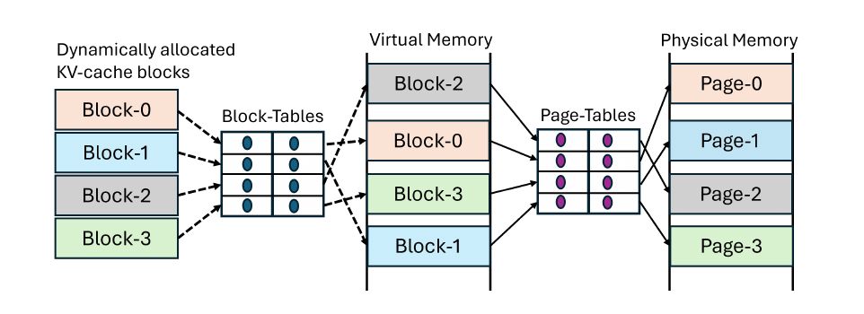
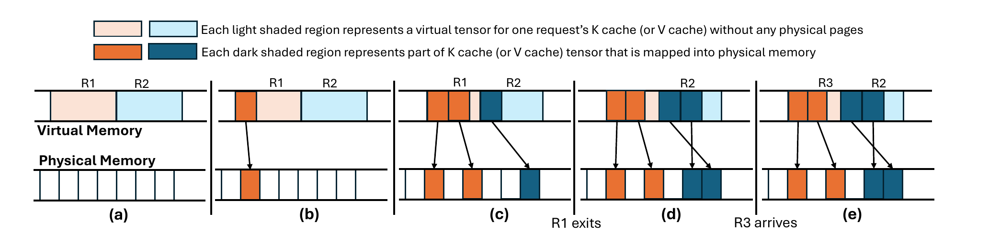
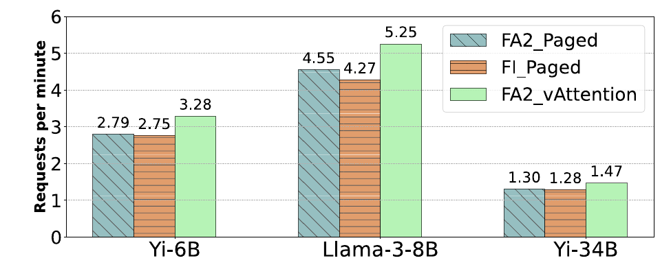
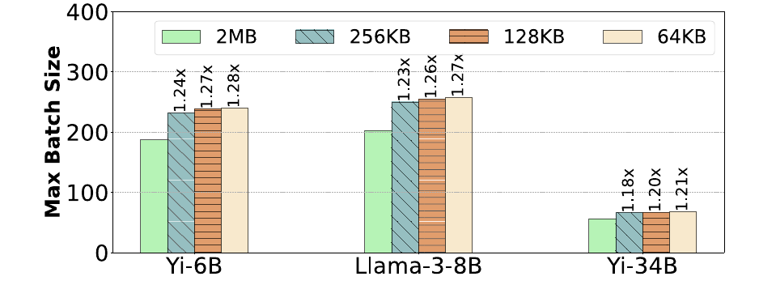

# vAttention：以连续虚拟地址实现 KV 缓存按需分配

本文精读 Prabhu 等人发表于 ASPLOS 2025 的论文 *vAttention: Dynamic Memory Management for Serving LLMs without PagedAttention*，重点解释虚拟地址与物理显存如何分离、请求槽位如何支持连续批处理，以及分配粒度和调用延迟怎样影响最终性能。读者只需了解大语言模型按 token 自回归生成；本文会在首次用到时解释其余概念。[论文原文（ASPLOS 2025 版）](https://apanwariisc.github.io/publications/asplos-2025-vattention/vattention-asplos25.pdf)；[作者公开的实现](https://github.com/microsoft/vattention)。

## 主要工作

大语言模型推理时，每个请求保存历史 token 的键和值，供后续注意力计算复用；这部分显存称为**键值缓存**（KV cache）。请求最终生成多少 token 事先未知，因此服务系统需要让缓存随请求增长。vAttention 的核心做法是：**预留连续的虚拟地址空间，物理显存则主要随实际上下文长度按页组映射**。少量页可为后续请求预先映射或在请求结束后暂留复用。注意力算子仍看到按常规张量布局排列的地址，服务框架负责维护这些物理页。[论文，摘要、§1、§5](https://apanwariisc.github.io/publications/asplos-2025-vattention/vattention-asplos25.pdf#page=1)

论文在其 vLLM v0.2.7、模型与设备配置下报告：长上下文离线请求的端到端吞吐量，相对 FlashAttention-2 与 FlashInfer 的分页实现最高分别提高 1.18 倍、1.23 倍。这个结果主要来自使用未改写的高效非分页注意力算子处理预填充，而不是“只换内存分配器”所产生的统一加速。解码阶段，vAttention 搭配 FlashAttention-2 的吞吐量与同库分页算子大致相当；相对 vLLM 当时自带解码算子的最高 1.99 倍差距，同时包含了算子实现差异。[论文，§7.1–7.3、图 8–9](https://apanwariisc.github.io/publications/asplos-2025-vattention/vattention-asplos25.pdf#page=11)

## 研究背景

推理请求先经历**预填充**（prefill）：并行处理输入提示，建立各位置的 KV；随后进入**解码**（decode）：每轮使用已有 KV 生成下一个 token，并将新 token 的 KV 追加到缓存。若一个请求需要容纳的最大上下文为 $L$ 个 token，在请求开始时直接为 $L$ 个位置分配物理显存，而实际只处理了 $L'$ 个位置，那么未用的 $L-L'$ 个位置会在请求存活期间占住显存。PDF 批注特别关注“每轮只增长一个 token”的影响：增长缓慢意味着预先分配的空间可能在请求的大部分生命周期中保持空置，从而压低同一时刻可容纳的请求数。[论文，§1–2](https://apanwariisc.github.io/publications/asplos-2025-vattention/vattention-asplos25.pdf#page=2)

PagedAttention 通过把 KV 缓存拆为固定 token 数的块、用到时才分配块，减小上述浪费。每个块本身有虚拟地址，但同一请求的相邻块通常不处在连续虚拟地址上；服务框架须保存**块表**，在运行注意力算子时指明逻辑块对应哪个实际块。注意力算子原本按连续地址访问一段 K、V 张量，现在需要读取块表、计算块内偏移，才能访问整段历史 KV。论文将这种框架与算子共同维护的映射称为用户态分页；底层硬件仍负责各虚拟地址到物理页的转换。[论文，§2.2–3、图 1](https://apanwariisc.github.io/publications/asplos-2025-vattention/vattention-asplos25.pdf#page=3)

*图 1：PagedAttention 的两层映射。截取自 [Prabhu 等，2025，原文图 1](https://apanwariisc.github.io/publications/asplos-2025-vattention/vattention-asplos25.pdf#page=4)。*

沿图 1 从左到右看，请求的 Block-0 至 Block-3 先通过服务框架维护的 Block-Tables 找到分散的虚拟内存块；这些虚拟地址再经页表找到物理页。第一层映射决定注意力算子到哪里读取请求的下一块 KV，第二层映射由内存系统完成。vAttention 保留第二层，但令同一请求的 KV 在虚拟地址中连续，使注意力算子按原有步长读取即可。PDF 批注把两者与操作系统按需分页作了比较；论文的具体实现由服务框架在每次模型执行前调用 `step` 显式保证映射；页的增加发生在这一步，而非由注意力算子访问未映射地址来触发。[论文，图 1、§5.3](https://apanwariisc.github.io/publications/asplos-2025-vattention/vattention-asplos25.pdf#page=7)

## 问题定义

系统需要同时满足两个条件：一个请求的 KV 对注意力算子表现为可直接寻址的张量；其**物理显存**又只随实际上下文长度增长。前一个条件决定新注意力算子能否直接接入，后一个条件决定是否会被最大上下文长度产生的预留浪费限制批量。虚拟地址是程序使用的稳定位置，物理页是实际承载数据的显存；二者可以通过映射分开管理。连续的是前者，按需增长的是后者。[论文，§3–5](https://apanwariisc.github.io/publications/asplos-2025-vattention/vattention-asplos25.pdf#page=5)

对一张由某个工作进程管理的、单层 K 缓存张量，论文记最大批量为 $B$、最大上下文长度为 $L$、该进程上的 KV 头数为 $H$、头维度为 $D$、每元素字节数为 $P$。单请求的虚拟槽位大小和整张量预留字节数分别为：

$$
S=L\times H\times D\times P,\qquad \text{预留字节数}=B\times S \tag{1}
$$

V 缓存同理。若该进程管理 $N$ 层，就有 $2N$ 张这样的虚拟张量。这里的 **worker** 是执行模型部分计算的工作进程，参数 $N$、$H$ 都按该进程实际负责的层和 KV 头计算；在论文的张量并行例子中，两个 GPU 分担 KV 头，因此每进程的 $H$ 减半。[论文，表 2、§5.1](https://apanwariisc.github.io/publications/asplos-2025-vattention/vattention-asplos25.pdf#page=6)

论文的 Yi-34B、两路张量并行、FP16 例子取 $N=60$、$H=4$、$D=128$、$P=2$ 字节、$L=200K$、$B=500$。每请求每层的 K 张量槽位约 200 MB，每张 K 或 V 张量约 100 GB；每个 worker 为 60 层的 K/V 共预留约 12 TB **虚拟地址空间**。这不是启动时占用 12 TB 物理显存，而是给各请求确定可增长的地址范围；页映射才决定实际显存占用。[论文，§5.1、图 5](https://apanwariisc.github.io/publications/asplos-2025-vattention/vattention-asplos25.pdf#page=6)

## 方法原理

### 虚拟张量与物理页映射

初始化时，vAttention 在工作进程中为各层 K、V 创建虚拟张量，给每个请求分配整数 $\mathrm{reqId}\in[0,B-1]$。请求 `reqId` 的单层 K 或 V 槽位起点是 $\mathrm{reqId}\times S$。vAttention 用 CUDA 虚拟内存管理（Virtual Memory Management，VMM）接口，或论文扩展的 NVIDIA 驱动接口，给槽位中已使用的前缀映射物理页；尚未使用的后缀只保留地址。普通激活等其他张量仍由原有分配器处理。[论文，§5.1–5.2、图 6](https://apanwariisc.github.io/publications/asplos-2025-vattention/vattention-asplos25.pdf#page=7)

*图 2：虚拟槽位与物理页按需映射、延迟回收和复用。截取自 [Prabhu 等，2025，原文图 5](https://apanwariisc.github.io/publications/asplos-2025-vattention/vattention-asplos25.pdf#page=6)。*

图 2 的浅色长框是 R1、R2 的虚拟槽位，深色部分表示已经映射物理页。(a) 只预留地址；(b) 给 R1 映射一页；(c) R1 增长到两页，R2 映射一页；(d) R1 结束后，其槽位暂时保留原映射；(e) 新请求 R3 接过 R1 的槽位和已映射页。图下方分散的物理页说明地址连续与物理相邻是两件事。R3 使用该槽位时，其新 KV 会写入相应位置；延迟回收节省的是重新申请和映射页的操作。[论文，图 5、§6.1.2](https://apanwariisc.github.io/publications/asplos-2025-vattention/vattention-asplos25.pdf#page=8)

用一个**解释性构造**核对地址计算：设 $B=3$、每个槽位容纳 8 个 token，示意性的页组容纳 2 个 token。$\mathrm{reqId}=0,1,2$ 分别固定占用虚拟 token 区间 $[0,8),[8,16),[16,24)$。若活跃请求 0、2 的实际长度分别为 3、5，系统需要为它们的前缀各映射 2、3 个页组；中间槽位 1 可以空着，而请求 2 在虚拟地址中的起点仍是 16。这里“每页组 2 个 token”仅用于说明映射关系，不代表论文中的 CUDA 页大小；真实每页组容纳多少 token 取决于模型形状与页组字节数。[论文，§5.1、表 8](https://apanwariisc.github.io/publications/asplos-2025-vattention/vattention-asplos25.pdf#page=13)

### 请求调度与连续批处理

服务框架通过 `init` 初始化张量；新请求调用 `alloc_reqid` 取得槽位；每次模型前向传播之前调用 `step`，传入按 `reqId` 排列的当前上下文长度。`step` 检查各槽位所需的物理页是否已映射；若显存不足则返回失败，框架可抢占请求。请求结束调用 `free_reqid`，对应物理页可以立即释放，也可以留待复用。解码阶段每轮每请求只增加一个 token，所以是否即将跨越页组边界可以提前判断；请求的**总生成长度仍未知**。PDF 中“总量不可知，可预测的是每次迭代增量”的批注对应的就是这一区别。[论文，表 4、算法 1、§5.3](https://apanwariisc.github.io/publications/asplos-2025-vattention/vattention-asplos25.pdf#page=7)

连续批处理会让活跃请求集合出现空槽。以上例为例，当前查询张量 Q 可以紧凑放置活跃请求 0、2，而 KV 槽位仍位于 0、2。若算子按 Q 的批量下标直接查同号 KV，Q 的第 1 项会误读槽位 1。论文使用 FlashAttention 的 `cache_batch_idx` 参数，令 `Q[0] → KV[0]`、`Q[1] → KV[2]`，把本轮紧凑排列的 Q 与请求生命周期内固定的 `reqId` 对齐。无需在请求离开时搬移其余请求的历史 KV，也能让空槽随后分配给新请求。这正对应 PDF 关于“Q 临时紧凑排列、KV 槽位固定”的长批注。[论文，§5.3，Supporting continuous batching](https://apanwariisc.github.io/publications/asplos-2025-vattention/vattention-asplos25.pdf#page=8)

### 分配延迟与页组粒度

`step` 若同步逐层映射新页，会把驱动调用放入模型执行的关键路径。论文举 Yi-34B 的例子：60 层 K/V 共 120 次 `cuMemMap` 加 `cuMemSetAccess`，每组约 40 微秒，单请求跨页时就可能增加约 5 毫秒。为此，vAttention 在上一轮计算尚在执行时由后台线程准备下一轮解码需要的映射。对新请求的预填充，则优先复用已结束请求留在原槽位的页，并给一个空闲槽位预映射少量页。只有缓存页低于阈值时才触发回收。这些手段降低调用延迟，但不能增加可用物理显存的总量。[论文，§6.1、表 3、图 12–13](https://apanwariisc.github.io/publications/asplos-2025-vattention/vattention-asplos25.pdf#page=8)

页组过大又会使每张 K/V 张量的尾部有未使用空间。论文所用标准 CUDA VMM 接口以 2 MB 为分配粒度；作者在开源 NVIDIA UVM 驱动中增加 64 KB、128 KB、256 KB 页组接口。以表 8 的 Llama-3-8B、两路张量并行为例，一张 K 或 V 张量中 2 MB 页组可覆盖 2048 个 token，64 KB 页组覆盖 64 个 token。小页组减少尾部浪费，使显存能容纳更多并发请求；代价是页数和映射操作增加，因此需要前述延迟隐藏。论文还提出用跨层张量切片共享 2 MB 页的替代方案，但此时每层切片具有非连续步长，只有支持这种步长的算子才能直接使用。[论文，§6.2、§8.2、表 8、表 10](https://apanwariisc.github.io/publications/asplos-2025-vattention/vattention-asplos25.pdf#page=13)

## 实验与证据

论文主要用 Yi-6B（单张 A100 80 GB）、Llama-3-8B 和 Yi-34B（各两张 A100 80 GB，张量并行度为 2），在共同的 vLLM v0.2.7 框架中比较 FlashAttention-2 v2.5.9、FlashInfer 和 vLLM 原生算子。预填充吞吐量按每秒处理的提示 token 数计算，解码吞吐量按每秒生成 token 数计算，端到端离线吞吐量按每分钟完成的请求数计算；三种指标不能混称。[论文，§7、表 5](https://apanwariisc.github.io/publications/asplos-2025-vattention/vattention-asplos25.pdf#page=9)

预填充阶段，长上下文使注意力计算占比升高。论文图 7 报告在 192K 上下文时，`FA2_vAttention` 相对 `FA2_Paged` 的预填充吞吐量，在三个模型上分别为 1.24、1.26、1.24 倍；表 6 同时列出完整预填充与其中注意力部分的耗时，支持收益主要来自非分页算子更快的注意力计算。短上下文下，FlashAttention-2 两种配置接近，因为其他线性算子的时间占比更高。[论文，§7.1、图 7、表 6](https://apanwariisc.github.io/publications/asplos-2025-vattention/vattention-asplos25.pdf#page=10)

解码阶段，在 16K 初始上下文、平均 400 轮解码的实验中，`FA2_vAttention` 与 `FA2_Paged` 的吞吐曲线几乎重合；两者都高于当时 vLLM 自带的分页解码算子。论文把预填充与解码的差异归因于后者更受显存读取限制，分页附加计算可能被内存等待遮蔽。PDF 有一条关于小块提高 L1 命中率的批注；对应的论文图 3 与 §3.3 只给出对该实验现象的分析判断，不能由此推广为“块越小越快”：不同算子、块表格式和访存方式会改变结果。[论文，§3.3、§7.2、图 3、图 8、表 7](https://apanwariisc.github.io/publications/asplos-2025-vattention/vattention-asplos25.pdf#page=11)

*图 3：427 条 arXiv-Summarization 长上下文请求的离线吞吐量，纵轴为每分钟完成请求数。截取自 [Prabhu 等，2025，原文图 9](https://apanwariisc.github.io/publications/asplos-2025-vattention/vattention-asplos25.pdf#page=11)。*

图 3 的每组柱对应一个模型，蓝、橙、绿分别是 FlashAttention-2 分页、FlashInfer 分页、FlashAttention-2 非分页加 vAttention。Yi-6B 为 2.79、2.75、3.28 请求/分钟；Llama-3-8B 为 4.55、4.27、5.25；Yi-34B 为 1.30、1.28、1.47。实验请求的总上下文长度为 64K–192K token，输出为 17–5153 token，平均预填充 token 数与解码 token 数之比为 356。因此这个柱状图支持**长上下文且预填充占比较高**时的收益；对以短提示和长输出为主的负载，不能直接套用这些倍数。[论文，§7.3、图 9](https://apanwariisc.github.io/publications/asplos-2025-vattention/vattention-asplos25.pdf#page=11)

*图 4：动态工作负载中页组大小与最大批量的关系。截取自 [Prabhu 等，2025，原文图 15](https://apanwariisc.github.io/publications/asplos-2025-vattention/vattention-asplos25.pdf#page=13)。*

图 4 横轴按模型分组，颜色表示 2 MB 至 64 KB 的页组，纵轴是显存限制下达到的最大批量。在论文给定的 OpenChat 动态负载、每秒 7 个查询条件下，2 MB 页组对应的最大批量为 187、203、56；64 KB 页组提高到 240、258、68。柱子上约 1.2 倍的比值描述的是**可容纳批量**，不是请求延迟或单次注意力算子的加速。论文图 14 在 Llama-3-8B 的测试范围内发现 64 KB 与 2 MB 页组的注意力算子时间接近，说明这些测试未观察到小页导致的明显地址转换开销。[论文，§7.6、图 14–15](https://apanwariisc.github.io/publications/asplos-2025-vattention/vattention-asplos25.pdf#page=13)

## 局限性

vAttention 的细粒度页组依赖作者扩展的 NVIDIA 驱动；只用标准 CUDA VMM 接口时，论文采用 2 MB 页组，内部碎片可能限制高并发场景。跨层切片可在不改驱动的情况下减少这种浪费，但会要求算子支持非连续步长。异步映射、延迟回收和预映射也占用后台工作与部分暂存显存；当 `step` 无法满足请求的物理显存需求时，框架仍须抢占请求。论文验证了所列设备与工作负载，尚不能推断所有 GPU、算子和请求分布都具有同样收益。[论文，§5.3、§6、§8.2](https://apanwariisc.github.io/publications/asplos-2025-vattention/vattention-asplos25.pdf#page=8)

论文的对照集成在 vLLM v0.2.7 中；当前[官方公开仓库的 README](https://github.com/microsoft/vattention#content)则说明代码包含 vAttention 分配器、修改过的 Sarathi-Serve 和 NVIDIA UVM 驱动。因此，阅读当前仓库时应按其实际入口和依赖判断运行路径，不能把论文中的 vLLM 实验配置直接当成此仓库的安装步骤。本文仅核对了论文、PDF 批注与仓库说明，未进行 GPU 性能复现。

## 结论

vAttention 将“为最大长度确定稳定地址”和“为已生成内容占用显存”拆成两个操作：先预留连续虚拟张量，再按需映射物理页。`reqId` 固定请求的 KV 槽位，`cache_batch_idx` 将紧凑 Q 批量映射到可能有空洞的槽位；后台映射与页复用处理分配延迟，细粒度页组处理显存尾部浪费。论文的主要证据表明，这种布局使非分页注意力算子能够直接用于动态 KV 缓存，并在其长上下文、预填充占比较高的负载中提高端到端吞吐量；收益幅度须连同所选算子、页大小和工作负载一起解读。
